# EditSimple — Benutzerhandbuch

[English](manual.en.md) · [Italiano](manual.it.md) · **Deutsch** · [Français](manual.fr.md) · [Español](manual.es.md) · [Nederlands](manual.nl.md) · [Polski](manual.pl.md) · [Ελληνικά](manual.el.md) · [Shqip](manual.sq.md)

EditSimple ist ein Videoschnittprogramm für alle, die in einem Video **einen
Sachverhalt erklären oder einen Beweis zeigen** müssen: eine Übergabe mitten
in der Menge, ein ankommendes Fahrzeug, eine Person, die verfolgt oder
unkenntlich gemacht werden soll. Sie importieren das Material, markieren das
Wichtige, und das Programm erledigt den Rest: Pfeile, Rahmen, Zooms und
Verpixelungen **folgen dem Motiv von selbst** in den nächsten Frames, und wo
die Verfolgung danebenliegt, ziehen Sie die Figur einfach an die richtige
Stelle, um sie zu korrigieren. In wenigen Minuten entsteht ein MP4, bereit
zum Vorführen oder Anhängen, mit Vorspann- und Abspannfolie, Texten, Logo
und Signatur des Bedieners.

*Andrea Cumini — www.osintinfo.net — andrea@osintinfo.net*
*EditSimple gehört zu den Werkzeugen von [Seity](https://www.seity.com).*

> **Hinweis zum Beispielvideo.** Die Bilder dieses Handbuchs verwenden ein
> auf Pexels veröffentlichtes Archivvideo: eine Fußgängerzone mit ganz
> normalen Passanten. **Die gezeigten Personen tun nichts Unrechtes**: Die
> Pfeile, Rahmen, Zooms und Verpixelungen auf ihnen dienen nur dazu, die
> Funktionsweise des Programms zu zeigen, und die Personen wurden zufällig
> ausgewählt.

## Inhalt

1. [Was Sie damit tun können](#1-was-sie-damit-tun-können)
2. [Installation und erster Start](#2-installation-und-erster-start)
3. [Das Fenster](#3-das-fenster)
4. [Seite Konfiguration](#4-seite-konfiguration)
5. [Ein vollständiges Beispiel, Schritt für Schritt](#5-ein-vollständiges-beispiel-schritt-für-schritt)
6. [Die Verfolgung mit Keyframes korrigieren](#6-die-verfolgung-mit-keyframes-korrigieren)
7. [Die Timeline](#7-die-timeline)
8. [Die Vorschau: vergrößern und lösen](#8-die-vorschau-vergrößern-und-lösen)
9. [Vorspann, Abspann und Folien dazwischen](#9-vorspann-abspann-und-folien-dazwischen)
10. [Texte, Bilder, verstrichene Zeit und Framenummer](#10-texte-bilder-verstrichene-zeit-und-framenummer)
11. [Beschleunigen und verlangsamen](#11-beschleunigen-und-verlangsamen)
12. [Schneiden, löschen, Standbild](#12-schneiden-löschen-standbild)
13. [Übergänge](#13-übergänge)
14. [Audio](#14-audio)
15. [Das Video exportieren](#15-das-video-exportieren)
16. [Tipps für ein gutes Ergebnis](#16-tipps-für-ein-gutes-ergebnis)
17. [Tastenkürzel und Maus](#17-tastenkürzel-und-maus)
18. [Die Projektdatei](#18-die-projektdatei)

## 1. Was Sie damit tun können

| Funktion | Kurz gesagt |
| --- | --- |
| **Verfolgung des Motivs** | Rahmen, Ovale, Pfeile, Zooms und Verpixelungen folgen einer Person, einem Gesicht, einem Objekt oder einem Fahrzeug; sie wachsen und schrumpfen mit, wenn es sich der Kamera nähert oder sich entfernt; sie enden von selbst, wenn es das Bild verlässt. |
| **Korrektur-Keyframes** | Wo die Verfolgung danebenliegt (ein Pfosten, eine Person, die vorbeigeht), ziehen Sie die Figur auf das Motiv: Das Programm korrigiert den Pfad vor und nach diesem Punkt. |
| **Zoom** | Ein kleines Detail (die Hände, ein Kennzeichen) 2- bis 16-fach vergrößert in einem Rahmen, mit Kontur und Linie zum Objekt. Rechteckig oder oval. |
| **Verpixelung** | Rechteckig oder oval, für Gesichter und Kennzeichen; folgt dem Motiv und wächst mit ihm. |
| **Texte und Bilder** | Mehrzeilige Texte mit Hintergrund und abgerundeten Ecken; eingeblendete Bilder (ein Frame, eine Karte, ein Dokument). |
| **Logo und Signatur** | Logo und Text des Bedieners fest in einer Ecke, einmal in der Konfiguration vorbereitet. |
| **Zeit und Frames** | Die verstrichene Zeit und die Framenummer im Video, an beliebiger Stelle. |
| **Folien** | Am Anfang, am Ende oder dazwischen; einfarbig oder mit Hintergrundbild; darauf kommen Texte und Bilder. |
| **Tempo** | Von 0,25x (Zeitlupe) bis 32x (Zeitraffer), mit einem Uhrsymbol, das das Tempo anzeigt. |
| **Schnitte** | Schnitt am Cursor, Löschen eines Bereichs, Standbild, Umordnen der Clips. |
| **Übergänge** | Einblenden aus Schwarz, Ausblenden nach Schwarz, Überblendung mit dem nächsten Clip. |
| **Audio** | Zusätzliche Spuren (Kommentar, Musik) mit Lautstärke und Blenden; Originalton mit Lautstärke, Blenden und Löschen einzelner Abschnitte. |
| **Vorschau** | Wiedergabe mit Ton, rückwärts, Frame für Frame; vergrößerbare Vorschau, die sich in ein eigenes Fenster **lösen** lässt. |
| **Export** | MP4 (H.264 + AAC), identisch mit der Vorschau. |
| **Sprachen** | Oberfläche in 9 Sprachen, ohne Neustart umschaltbar. |

## 2. Installation und erster Start

**Ausführbare Datei (Windows 10/11, 64 Bit).** Entpacken Sie das Zip an einen
beliebigen Ort und starten Sie `EditSimple.exe`. Python wird nicht benötigt.

**Aus dem Quellcode.** Mit Python 3.11:

```bash
python -m venv .venv
.venv\Scripts\python.exe -m pip install -r requirements.txt
.venv\Scripts\python.exe EditSimple.py
```

**FFmpeg.** EditSimple verwendet ffmpeg zum Lesen der Dateien und zum
Exportieren. Es ist nicht enthalten: Findet das Programm es beim ersten Start
nicht, öffnet sich die Seite **Konfiguration**, und die Schaltfläche
**Herunterladen / Aktualisieren** lädt es (offizieller Windows-Build) in den
Ordner `tools\ffmpeg\` neben dem Programm. Keine Installation.

**VitTrack (optional).** Auf derselben Seite holt **Herunterladen** VitTrack,
ein kleines Modell (0,7 MB), das der Verfolgung hilft, das Motiv nach einem
Hindernis wiederzufinden. Ohne VitTrack funktioniert die Verfolgung trotzdem.

## 3. Das Fenster

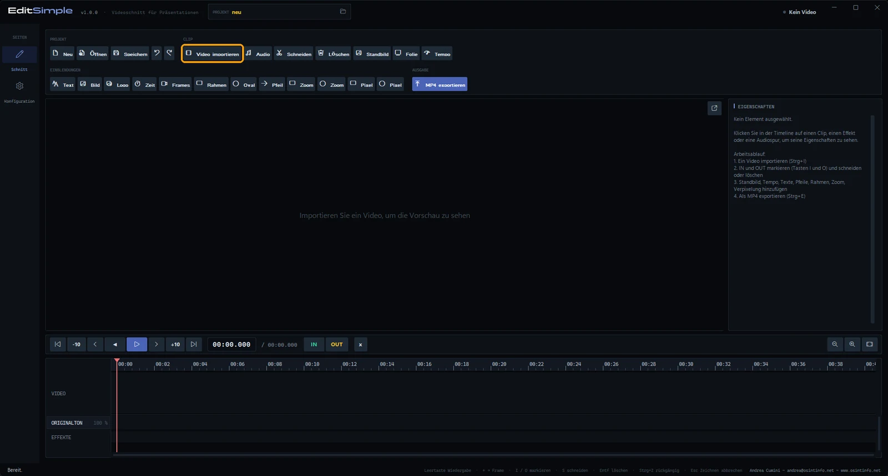

- **Werkzeugleiste**, in vier Gruppen: *Projekt* (neu, öffnen, speichern,
  rückgängig, wiederholen), *Clip* (Video importieren, Audio, schneiden,
  löschen, Standbild, Folie, Tempo), *Einblendungen* (Text, Bild, Logo, Zeit,
  Frames, Rahmen, Oval, Pfeil, rechteckiger und ovaler Zoom, rechteckige und
  ovale Pixel) und *Ausgabe* (MP4 exportieren). Jede Schaltfläche hat einen
  Tooltip mit ihrem Tastenkürzel.
- **Vorschau**, in der Mitte: zeigt den Frame am Cursor mit allen Effekten,
  genau wie im exportierten Video. Darauf werden die Effekte gezeichnet und
  verschoben.
- **Eigenschaften**, rechts: die Werte des gewählten Elements (ein Clip, ein
  Effekt, eine Audiospur).
- **Transportleiste**: Anfang, -10 Frames, vorheriger Frame, rückwärts
  abspielen, abspielen, nächster Frame, +10 Frames, Ende; die Zeit des Cursors
  (editierbar); IN, OUT und das Löschen der Markierungen; rechts der Zoom der
  Timeline.
- **Timeline**, unten: Lineal, Spur **Video** als Filmstreifen,
  **Originalton**, zusätzliche Audiospuren und **Effekte**.

## 4. Seite Konfiguration

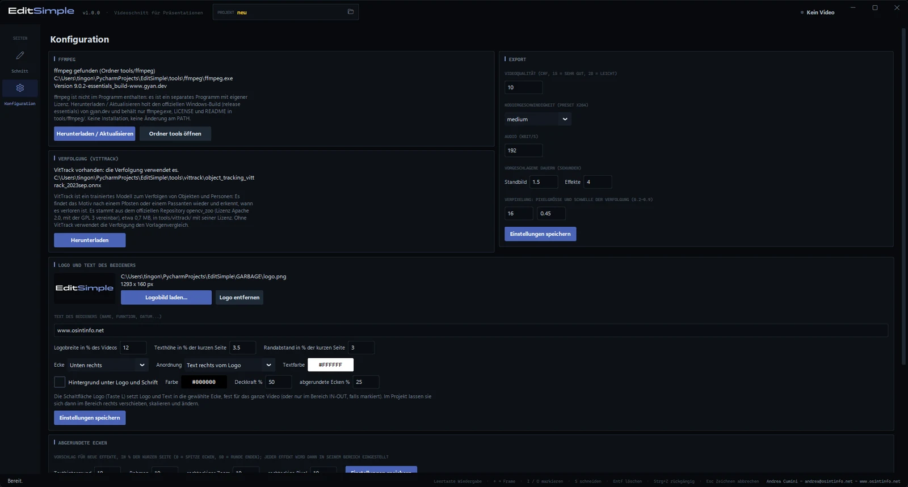

Sie öffnen sie über die Leiste links. Sie enthält:

- **FFmpeg** und **Verfolgung (VitTrack)**: Status, Download und Aktualisierung.
- **Export**: Videoqualität (CRF: 15 sehr gut, 28 leicht),
  Kodiergeschwindigkeit, Audioqualität, vorgeschlagene Dauern für Standbild
  und Effekte, Standard-Pixelgröße und Schwelle der Verfolgung (höher =
  strenger beim Erkennen des Motivs).
- **Logo und Text des Bedieners**: das Logobild (PNG mit Transparenz oder
  JPG), der Text (Name, Organisation, Website), die Logobreite, die Texthöhe,
  der Randabstand, die Ecke, die Anordnung, die Farben und ein Hintergrund mit
  Deckkraft und abgerundeten Ecken. Sie werden einmal vorbereitet; danach
  setzt die Schaltfläche **Logo** sie ins Video.

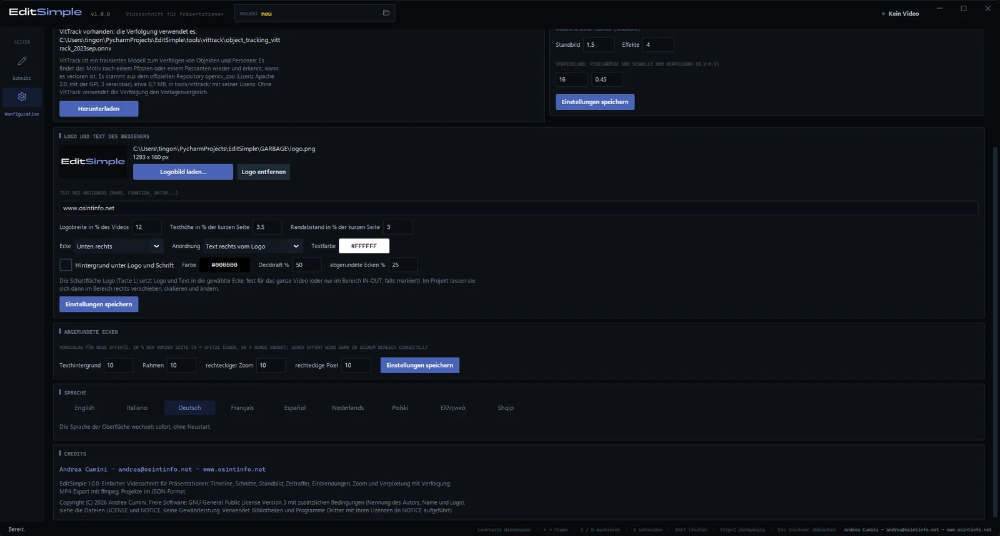

- **Abgerundete Ecken** für den Texthintergrund, die Rahmen, den rechteckigen
  Zoom und die rechteckige Verpixelung.
- **Sprache** der Oberfläche: English, Italiano, Deutsch, Français,
  Español, Nederlands, Polski, Ελληνικά, Shqip. Der Wechsel erfolgt sofort.

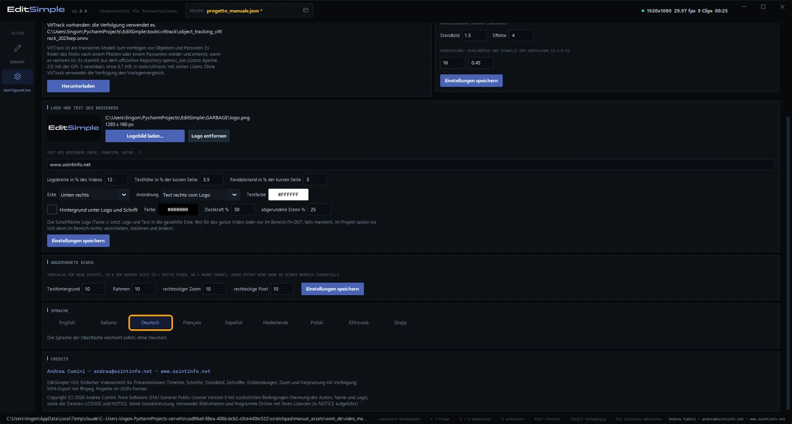

## 5. Ein vollständiges Beispiel, Schritt für Schritt

Das Beispiel dieses Kapitels ist ein 19 Sekunden langes Video aus einer
belebten Fußgängerzone (siehe den Hinweis oben: Die Passanten tun nichts
Unrechtes). In wenigen Schritten ergänzen wir es: Logo und Website des
Bedieners unten, ein Zoom auf die Hände eines Mannes, der seinen Bewegungen
folgt, ein Pfeil, der 12 Sekunden lang auf eine Person zeigt, zwei Rahmen um
andere Personen und die Verpixelung eines Gesichts am Ende.

### 5.1 Das Video importieren

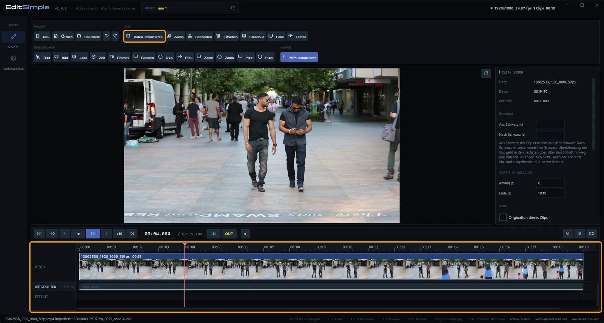

**Video importieren** (Strg+I) öffnet das Material. Das erste Video legt
Größe und Bildrate des Projekts fest (hier 1920×1080, 29,97 Frames pro
Sekunde). Der Clip erscheint in der Spur Video als Filmstreifen aus Frames,
sein Ton in der Spur Originalton (dieses Video hat keinen). Weitere Videos
werden am Ende oder am Cursor hinzugefügt.

Den Cursor bewegen Sie mit einem Klick auf das Lineal, mit den Pfeiltasten
← → (ein Frame), Strg+← → (zehn Frames), Umschalt+← → (eine Sekunde), Pos1
und Ende oder durch Eingabe der Zeit im Feld. **Leertaste** spielt mit Ton
ab, **Umschalt+Leertaste** spielt rückwärts ab.

### 5.2 Logo und Signatur des Bedieners

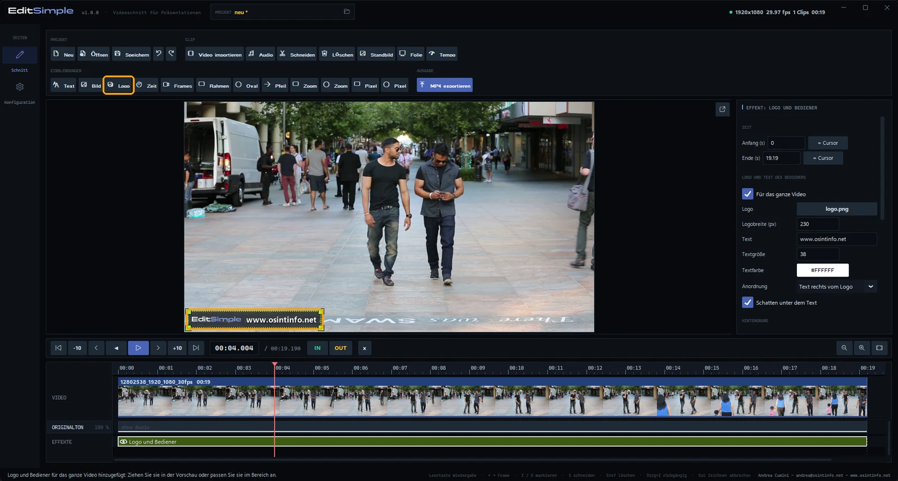

**Logo** (L) setzt das in der Konfiguration vorbereitete Logo und den Text für
das ganze Video ein (oder nur zwischen IN und OUT, falls markiert). In der
Vorschau verschieben Sie sie durch Ziehen und vergrößern sie an den Ecken; im
Bereich rechts ändern Sie Text, Farben, Hintergrund, Ecke und Deckkraft.

### 5.3 Ein Zoom, der den Händen folgt

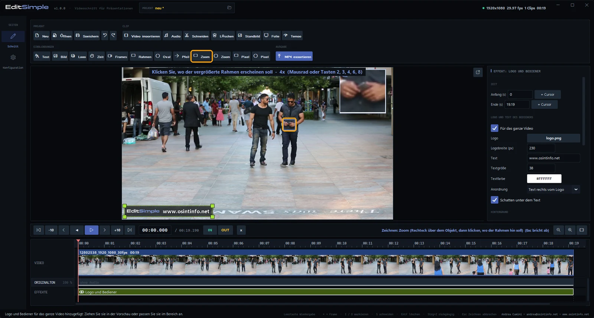

**Zoom** (Z) funktioniert in zwei Schritten:

1. Sie ziehen ein Rechteck um das Detail (hier die Hände des Mannes);
2. unter der Maus erscheint der vergrößerte Rahmen mit dem echten Inhalt: Ein
   Klick setzt ihn ab. Die Vergrößerung wählen Sie in diesem Moment mit dem
   Mausrad oder den Tasten 2, 3, 4, 6, 8 (bis 16x im Bereich rechts).

Der Zoom **beginnt sofort, dem Objekt zu folgen**: Ein Fenster zeigt den
Fortschritt der Verfolgung.

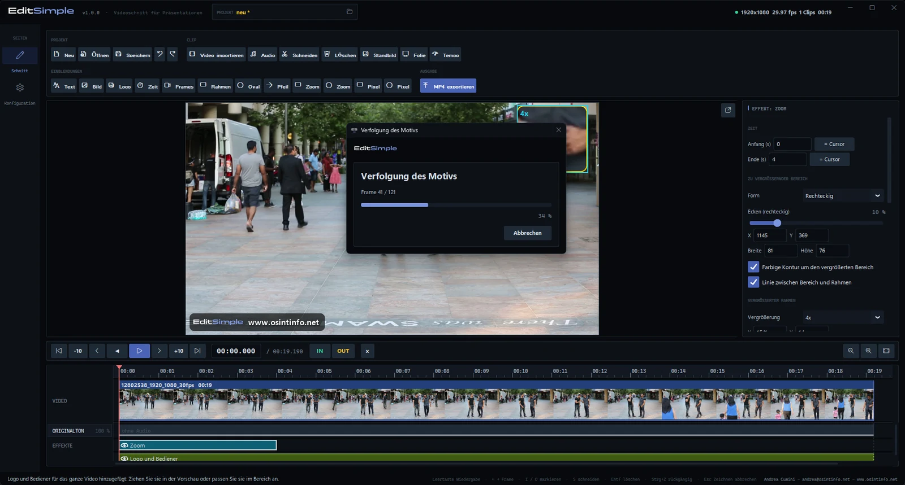

Der vergrößerte Bereich folgt den Händen und wächst oder schrumpft, wenn der
Mann näher kommt oder sich entfernt; der vergrößerte Rahmen bleibt, wo wir
ihn platziert haben. Eine farbige Kontur markiert das Objekt, und eine Linie
verbindet es mit dem Rahmen. Umschalt+Z erstellt einen ovalen Zoom.

### 5.4 Ein Pfeil, der einer Person folgt

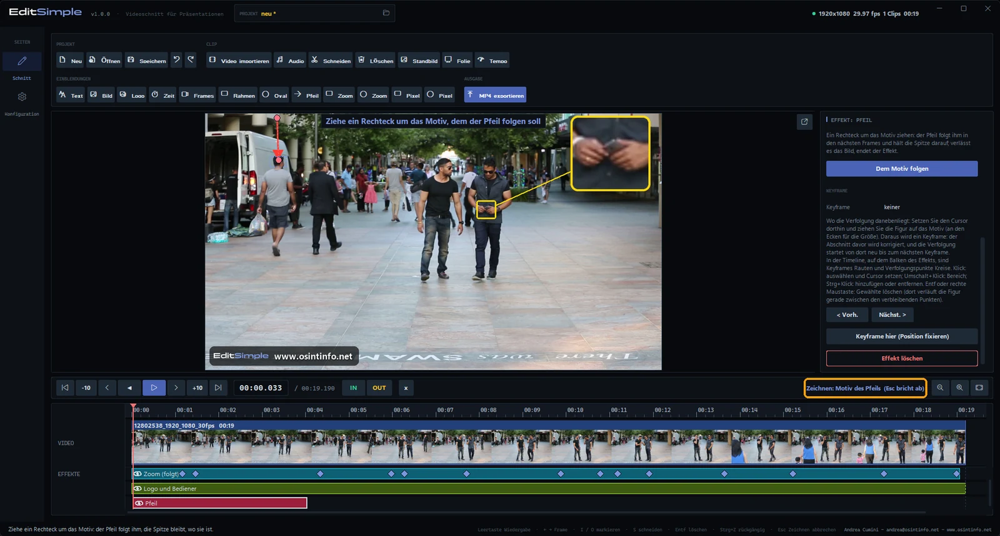

**Pfeil** (A): Sie ziehen vom Ende zur Spitze. Damit er einer Person folgt,
drücken Sie im Bereich rechts **Dem Motiv folgen** (oder *Verfolgung ab Cursor
wiederholen*) und zeichnen ein **Rechteck um das Motiv**: Der Pfeil folgt ihm
und hält die Spitze darauf.

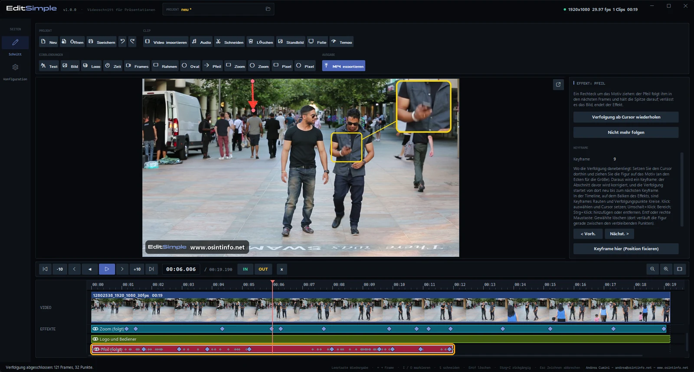

In der Timeline zeigt der Balken des Pfeils *(folgt)* und die Rauten der
Keyframes, mit denen wir den Pfad korrigiert haben (siehe Kapitel 6).

### 5.5 Rahmen um Personen

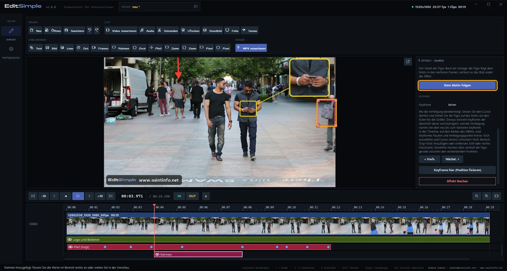

**Rahmen** (R) und **Oval** (E): Sie werden in der Vorschau aufgezogen. Im
Bereich rechts wählen Sie Farbe, Stärke, Füllung, abgerundete Ecken und
Deckkraft; **Dem Motiv folgen** lässt sie verfolgen, was sie enthalten. Wenn
die Person das Bild verlässt, begleitet die Figur sie hinaus, und der Effekt
endet.

### 5.6 Die Verpixelung eines Gesichts

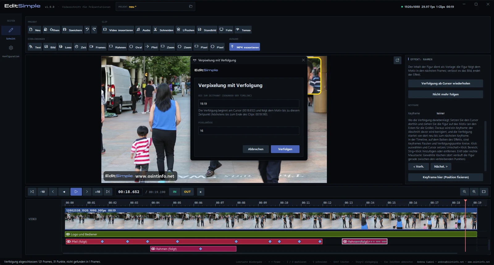

**Pixel** (P rechteckig, K oval): Sie ziehen einen Rahmen über das Gesicht;
ein Fenster fragt, bis wann es verfolgt werden soll und wie groß die Pixel
sind.

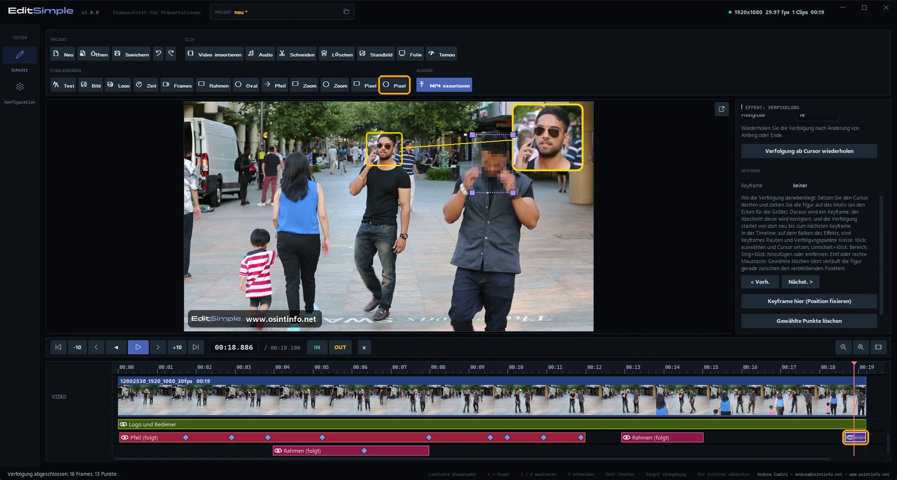

Die Verpixelung folgt dem Gesicht und **wächst, wenn es sich der Kamera
nähert**, sodass sie es immer verdeckt. Verlässt das Motiv das Bild,
begleitet die Verpixelung es, bis es ganz draußen ist: Kein Frame bleibt
unverdeckt.

## 6. Die Verfolgung mit Keyframes korrigieren

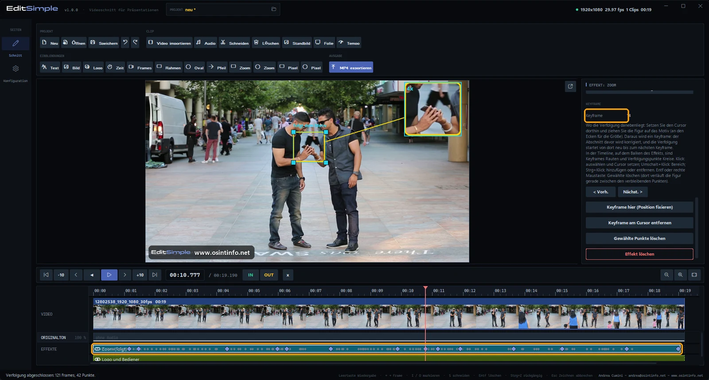

Die Verfolgung ist automatisch, aber ein echtes Video hat Hindernisse: einen
Pfosten, eine Person, die vorbeigeht, ein Motiv, das sich umdreht. Wo die
Figur danebenliegt:

1. Setzen Sie den Cursor auf diesen Frame;
2. **ziehen Sie die Figur auf das Motiv** in der Vorschau (oder ändern Sie
   ihre Größe an den Ecken).

Es entsteht ein **Keyframe** (eine Raute auf dem Balken des Effekts). Das
Programm korrigiert den Pfad vor dem Keyframe schrittweise und **startet die
Verfolgung von dort neu** bis zum nächsten Keyframe. Sie können so viele
Keyframes setzen wie nötig: Der Zoom im Beispiel hat 14, der Pfeil 9.

Auf dem Balken des gewählten Effekts sehen Sie auch die von der Verfolgung
gefundenen Punkte (Kreise). Ein Klick wählt einen Punkt und setzt den Cursor
dorthin, Umschalt+Klick wählt einen Bereich, Strg+Klick fügt hinzu oder
entfernt; **Entf** oder die rechte Maustaste löschen die gewählten Punkte. Im
Bereich rechts hat der Abschnitt **Keyframe** die Schaltflächen *< Vorh.* und
*Nächst. >*, *Keyframe hier* (fixiert die aktuelle Position) und *Keyframe am
Cursor entfernen*.

## 7. Die Timeline

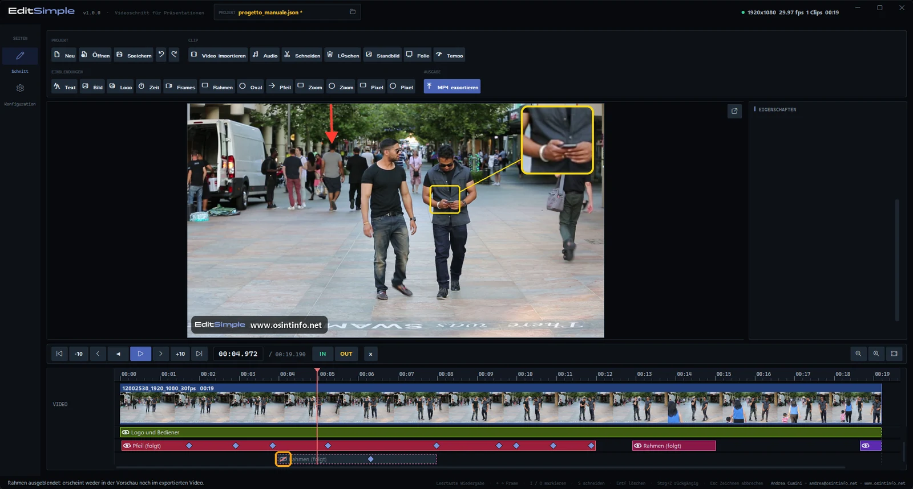

- **Effektbalken**: Sie werden durch Ziehen verschoben; der rechte Rand
  ändert die Dauer. Die Effekte verteilen sich auf mehrere Bahnen; bei vielen
  Effekten **scrollt** der Bereich mit Audio und Effekten **vertikal**
  (Bildlaufleiste rechts, Mausrad über den Zeilennamen oder
  Umschalt+Mausrad), während Lineal und Video oben stehen bleiben.
- **Auge**: Das Symbol links an jedem Balken **blendet** den Effekt **aus
  oder ein**, in der Vorschau und im exportierten Video. Nützlich, wenn sich
  während der Arbeit viele Effekte überlagern.
- **Rechtsklick auf einen Balken**: *Bis zum Cursor verlängern* (wenn der
  Cursor hinter dem Ende steht; folgt der Effekt einem Motiv, wird die
  Verfolgung fortgesetzt) und *Am Cursor beenden* (wenn der Cursor im Effekt
  steht).
- **Zoom der Timeline**: Strg+Mausrad oder die Schaltflächen − + und
  *Timeline einpassen*. Aus der Nähe zeigt der Filmstreifen jeden einzelnen
  Frame.
- **Scrollen**: Mausrad, Alt+Ziehen oder Ziehen mit der mittleren Taste.
- **Trenner**: Den schmalen Streifen über den Wiedergabe-Bedienelementen
  ziehen Sie nach oben oder unten, um der Timeline oder der Vorschau mehr
  Platz zu geben.

## 8. Die Vorschau: vergrößern und lösen

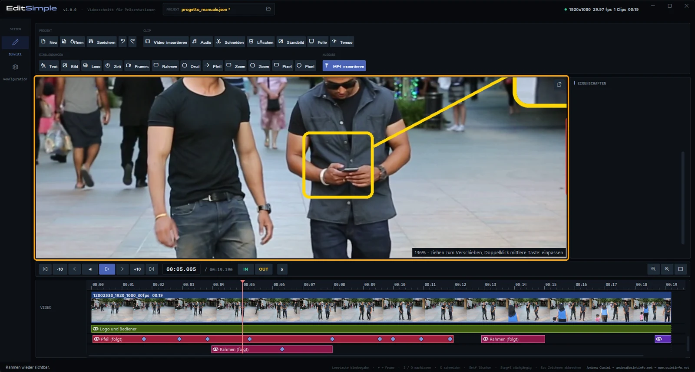

- **Strg+Mausrad** über der Vorschau vergrößert sie um die Mausposition, bis
  zum 16-Fachen: um einen Zoom präzise auf ein kleines Detail zu setzen oder
  eine Verpixelung zu prüfen. Sie verschieben die Ansicht durch Ziehen auf
  einer leeren Stelle (oder mit der mittleren Taste); ein Doppelklick mit der
  mittleren Taste kehrt zur Gesamtansicht zurück.
- **Vorschau lösen**: Die Schaltfläche oben rechts in der Vorschau öffnet sie
  in einem **eigenen Fenster**, das Sie auf einen zweiten Monitor oder an
  einen beliebigen Ort legen können; die Timeline nimmt den ganzen Platz ein.
  Dieselbe Schaltfläche (oder das Schließen des Fensters) **dockt** sie
  **wieder an**. Die Tastenkürzel funktionieren auch im gelösten Fenster.

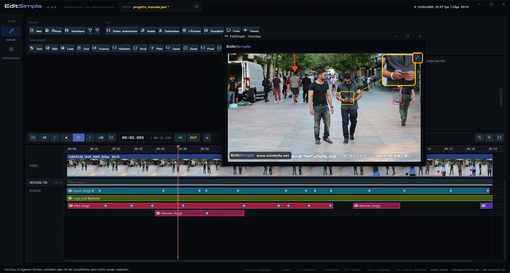

## 9. Vorspann, Abspann und Folien dazwischen

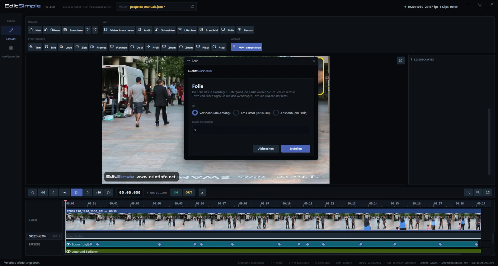

**Folie** fügt eine Folie **am Anfang** (Vorspann), **am Cursor** (mitten im
Video) oder **am Ende** (Abspann) ein, mit der gewählten Dauer. Die Folie ist
ein einfarbiger Hintergrund oder ein **Hintergrundbild**, an die Videogröße
angepasst (füllen, ganz oder strecken); Farbe und Bild wählen Sie im Bereich
rechts. Die nachfolgenden Effekte verschieben sich zusammen mit dem Video
nach hinten.

Auf die Folie setzen Sie Texte und Bilder mit den Werkzeugen **Text** und
**Bild**: Steht der Cursor auf der Folie, dauern sie so lang wie sie.

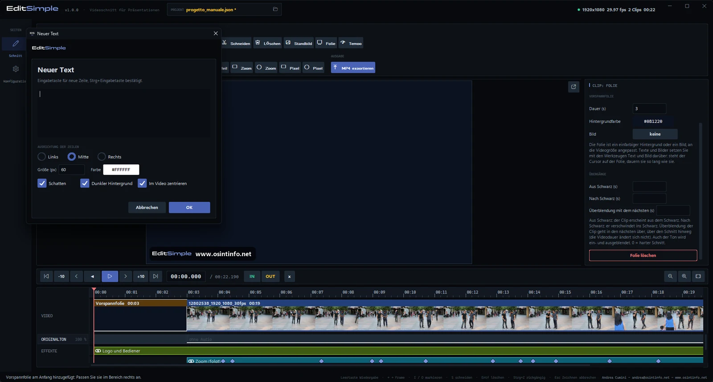

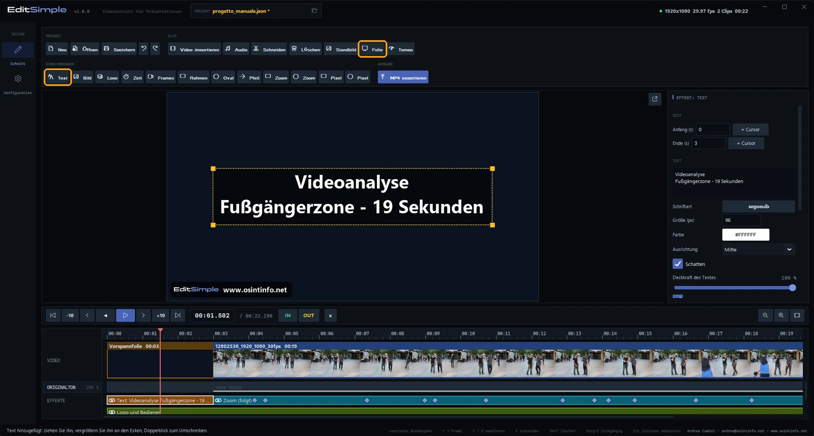

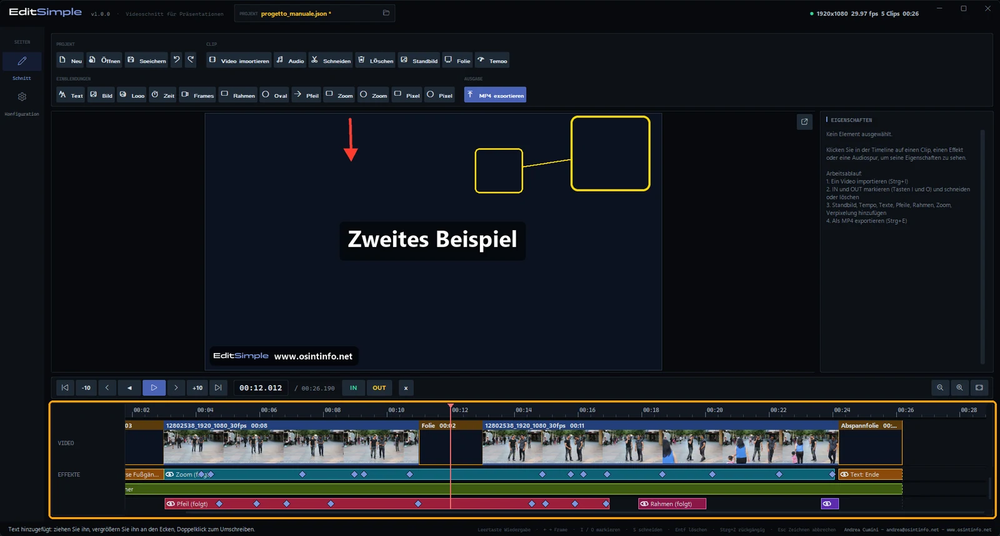

## 10. Texte, Bilder, verstrichene Zeit und Framenummer

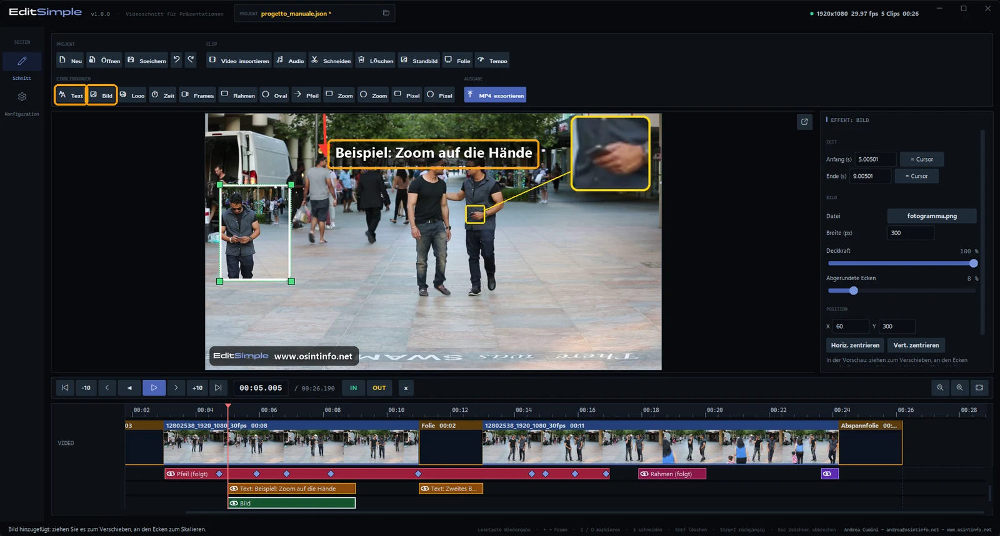

- **Text** (T): Ein Klick in die Vorschau öffnet das Textfenster: mehrere
  Zeilen, Ausrichtung, Größe, Farbe, Schatten, Hintergrund (mit Deckkraft und
  abgerundeten Ecken), Zentrierung. Doppelklick auf einen Text, um ihn
  umzuschreiben. Im Bereich rechts außerdem die Schriftart, gewählt aus einer
  Liste, die jede Schriftart in ihrem Aussehen zeigt.
- **Bild**: wählt eine Datei (PNG, JPG...) und setzt sie in die Mitte; sie
  wird in der Vorschau verschoben und skaliert; im Bereich rechts Deckkraft
  und abgerundete Ecken. Hier ist es ein vergrößerter Frame des Motivs, es
  kann aber auch eine Karte, ein Dokument oder ein Foto sein.

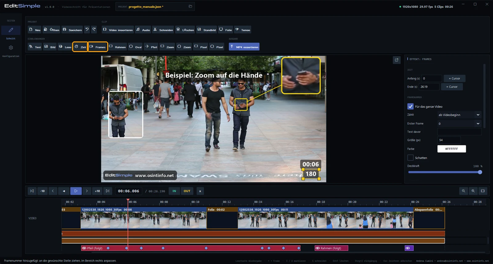

- **Zeit**: die verstrichene Zeit (01:23, 00:01:23 oder mit Zehnteln), ab
  Videobeginn oder ab Effektbeginn, mit einem frei wählbaren Text davor. Ab
  einer Stunde erscheinen die Stunden.
- **Frames**: die Framenummer, ab 0 oder ab 1, ab Videobeginn oder ab
  Effektbeginn. Nützlich, um einen Zeitpunkt genau zu benennen.

Beide haben Hintergrund, Deckkraft und abgerundete Ecken und werden mit
einem Klick an die gewünschte Stelle gesetzt.

## 11. Beschleunigen und verlangsamen

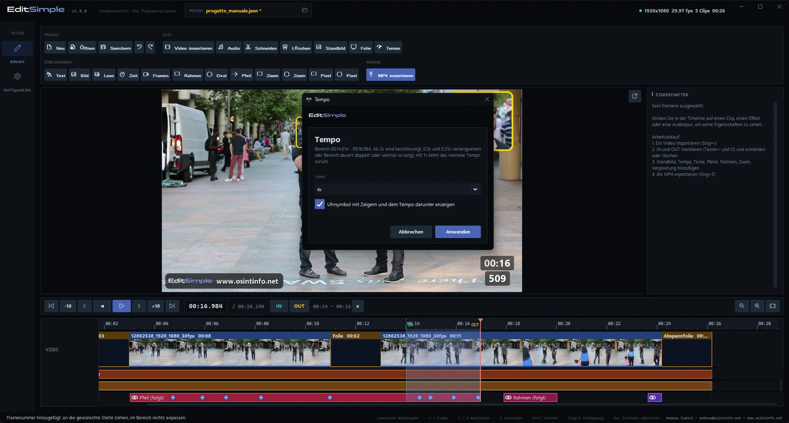

Markieren Sie einen Bereich mit **IN** und **OUT** (Tasten I und O) und
drücken Sie **Tempo** (V). Von **2x bis 32x** wird das Video beschleunigt;
**0,5x und 0,25x** verlangsamen. Die Option mit der **Uhr** zeigt ein Symbol
mit sich drehenden Zeigern und dem Tempo darunter, damit der Zuschauer weiß,
dass die Zeit schneller läuft. Die Timeline wird kürzer oder länger; mit 1x
kehrt das normale Tempo zurück. Position, Größe und Farbe der Uhr stellen Sie
im Bereich rechts des Clips ein.

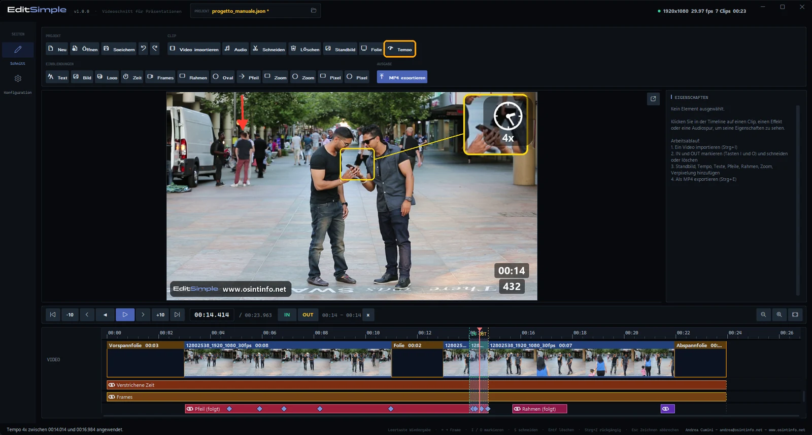

## 12. Schneiden, löschen, Standbild

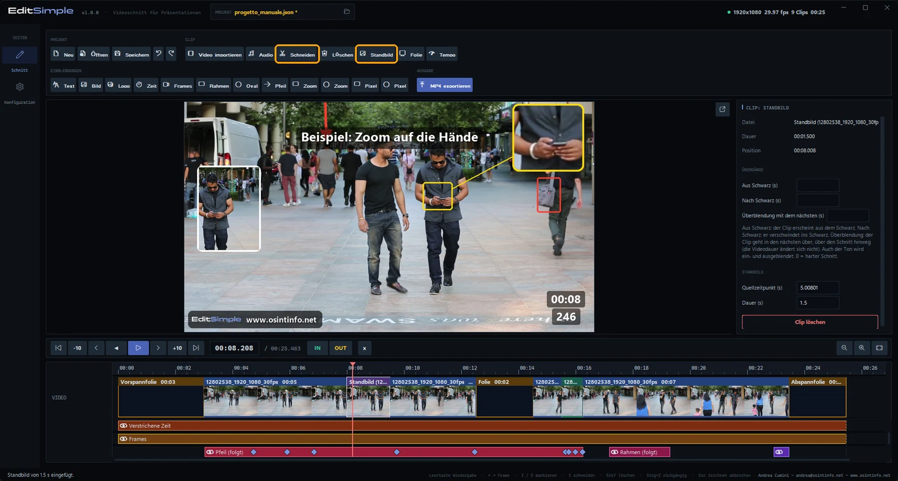

- **Schneiden** (S) teilt den Clip am Cursor. Die Clips werden in der
  Timeline **durch Ziehen umgeordnet**.
- **Löschen** (Entf) entfernt den Bereich zwischen IN und OUT oder das
  gewählte Element: Das Nachfolgende rückt zusammen mit den Effekten nach
  vorn.
- **Standbild** (F): Der Frame am Cursor bleibt für die gewählten Sekunden
  stehen; das Nachfolgende verschiebt sich nach hinten.

Alles lässt sich mit Strg+Z rückgängig machen und mit Strg+Y wiederholen.

## 13. Übergänge

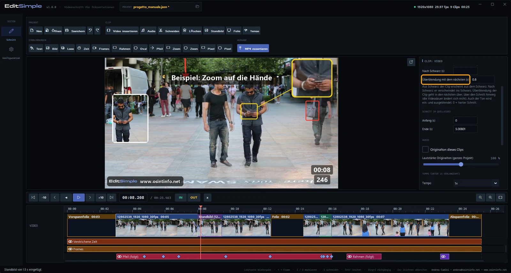

Wenn Sie einen Clip wählen, hat der Bereich rechts den Abschnitt
**Übergänge**:

- **Aus Schwarz**: Der Clip erscheint aus dem Schwarz;
- **Nach Schwarz**: Der Clip verschwindet ins Schwarz;
- **Überblendung mit dem nächsten**: Der Clip geht über den Schnitt hinweg in
  den nächsten über. Der ausgehende Clip bleibt während der Überblendung
  stehen; die Videodauer ändert sich nicht.

Auch der Ton wird mit den Übergängen ein- und ausgeblendet. 0 bedeutet
harter Schnitt.

## 14. Audio

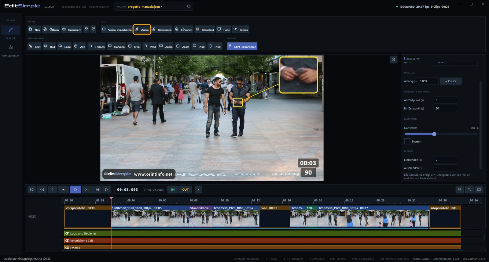

- **Audio** fügt am Cursor eine Spur hinzu (Kommentar, Musik). Im Bereich
  rechts: Name, Position, Ausschnitt der Datei, **Lautstärke**, stumm und
  **Blenden** beim Ein- und Ausblenden. Sie wird durch Ziehen verschoben; ein
  Klick auf ihren Namen wählt sie ganz aus, Entf löscht sie.
- Die **weiße Linie** über jeder Spur zeigt den Lautstärkeverlauf: Blenden
  und Übergänge sind auf einen Blick zu erkennen.
- **Originalton**: Ein Klick auf den Zeilennamen wählt den gesamten Ton des
  Videos (Lautstärke, Blenden am Anfang und am Ende, Löschen); ein Klick auf
  ein Stück wählt nur dieses Stück (Lautstärke, Blenden, stumm). Mit
  markiertem IN und OUT und gewähltem Originalton entfernt Entf **nur den
  Ton** dieses Abschnitts: Das Video bleibt.
- Die Wiedergabe in der Vorschau erfolgt **mit Ton** (gemischt wie beim
  Export).

## 15. Das Video exportieren

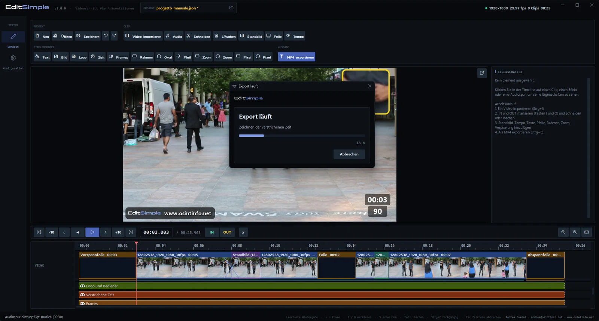

**MP4 exportieren** (Strg+E) wählt die Datei und erstellt das Video mit
ffmpeg: H.264 und AAC, Qualität und Kodiergeschwindigkeit in der
Konfiguration. Das Ergebnis ist identisch mit der Vorschau. Der Export lässt
sich abbrechen; am Ende bietet das Programm an, den Ordner zu öffnen.

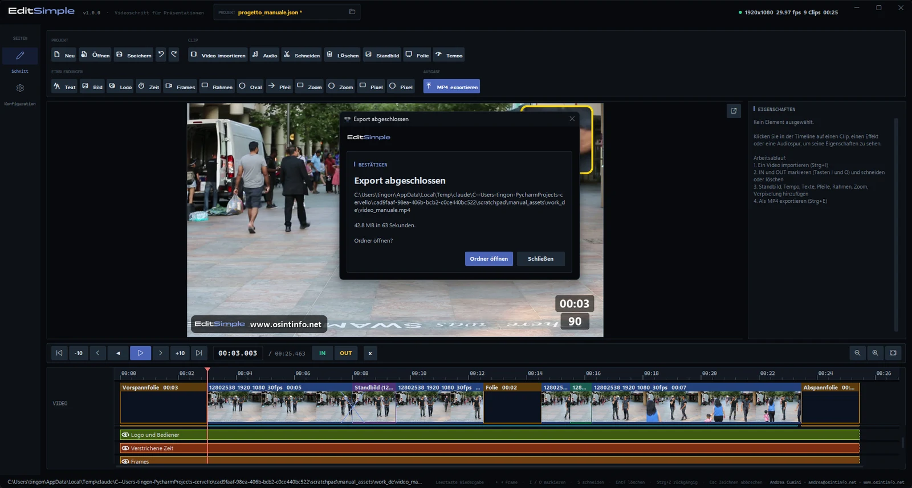

## 16. Tipps für ein gutes Ergebnis

- **Der Zoom-Rahmen gehört in einen neutralen Bereich**: Der vergrößerte
  Rahmen verdeckt den Teil des Videos, auf dem er liegt, solange er zu sehen
  ist. Setzen Sie ihn dorthin, wo nichts Interessantes passiert (Himmel,
  Wand, Boden).
- **Zeichnen Sie das Motiv eng ein** bei Rahmen, Ovalen und Verpixelungen:
  Der Inhalt der Figur ist die Vorlage, nach der in den nächsten Frames
  gesucht wird.
- **Beim Pfeil ein etwas größeres Rechteck** (Kopf und Schultern statt nur
  des Kopfes) hält besser, wenn andere Personen vorbeigehen.
- **Nach der Verfolgung das Video durchgehen**: Wo die Figur danebenliegt,
  ziehen Sie sie auf das Motiv. Wenige Keyframes genügen auch für lange
  Pfade.
- **Bei vielen Effekten** blenden Sie mit dem Auge aus, was Sie gerade nicht
  brauchen, und nutzen Sie die gelöste Vorschau für mehr Platz in der
  Timeline.
- **Speichern Sie oft** (Strg+S): Das Projekt ist eine kleine JSON-Datei, die
  Sie jederzeit wieder öffnen und bearbeiten können.

## 17. Tastenkürzel und Maus

| Taste | Aktion |
| --- | --- |
| Leertaste / Umschalt+Leertaste | Abspielen oder anhalten / rückwärts abspielen |
| ← → | Ein Frame zurück / vor |
| Strg+← → | Zehn Frames zurück / vor |
| Umschalt+← → | Eine Sekunde zurück / vor |
| Pos1 / Ende | Anfang / Ende des Videos |
| I / O | IN / OUT markieren |
| S | Am Cursor schneiden |
| F | Standbild |
| V | Tempo des Bereichs IN-OUT |
| T / R / E / A | Text / Rahmen / Oval / Pfeil |
| Z / Umschalt+Z | Rechteckiger / ovaler Zoom |
| P / K | Rechteckige / ovale Verpixelung |
| L | Logo und Bediener |
| Entf | Auswahl löschen (oder den Bereich IN-OUT) |
| Esc | Laufendes Zeichnen abbrechen |
| Strg+Z / Strg+Y | Rückgängig / wiederholen |
| Strg+N / Strg+O / Strg+S / Strg+Umschalt+S | Neu / öffnen / speichern / speichern unter |
| Strg+I | Video importieren |
| Strg+E | MP4 exportieren |

| Maus | Wo | Aktion |
| --- | --- | --- |
| Mausrad | Vorschau | Ein Frame vor oder zurück |
| Strg+Mausrad | Vorschau | Vergrößert die Ansicht |
| Ziehen auf leerer Stelle, mittlere Taste | Vergrößerte Vorschau | Verschiebt die Ansicht |
| Doppelklick | Text in der Vorschau | Schreibt den Text um |
| Strg+Mausrad | Timeline | Vergrößert die Timeline |
| Mausrad / Alt+Ziehen / mittlere Taste | Timeline | Scrollt horizontal |
| Umschalt+Mausrad, Mausrad über den Namen | Timeline | Scrollt Audio und Effekte vertikal |
| Rechte Maustaste | Balken eines Effekts | Bis zum Cursor verlängern / am Cursor beenden |
| Rechte Maustaste | Keyframe oder Punkt | Löschen |

## 18. Die Projektdatei

Das Projekt ist eine JSON-Datei mit den Clips, den Audiospuren, den Effekten
(mit den Pfaden der Verfolgung und den Keyframes) und den Pfaden der
verwendeten Dateien. Videos, Audiodateien und Bilder werden nicht in das
Projekt kopiert: Lassen Sie sie, wo sie sind, bis die Arbeit fertig ist. Das
exportierte Video dagegen ist ein eigenständiges MP4.

---

EditSimple ist freie Software, verbreitet unter der GNU GPL Version 3 mit
zusätzlichen Bedingungen zur Nennung des Autors (siehe `LICENSE` und
`NOTICE`). ffmpeg und VitTrack sind separate Programme mit eigenen Lizenzen.
