# EditSimple — Εγχειρίδιο χρήσης

[English](manual.en.md) · [Italiano](manual.it.md) · [Deutsch](manual.de.md) · [Français](manual.fr.md) · [Español](manual.es.md) · [Nederlands](manual.nl.md) · [Polski](manual.pl.md) · **Ελληνικά** · [Shqip](manual.sq.md)

Το EditSimple είναι ένα πρόγραμμα μοντάζ βίντεο για όσους πρέπει να
**εξηγήσουν ένα γεγονός ή να δείξουν ένα αποδεικτικό στοιχείο** σε ένα βίντεο:
ένα πέρασμα από χέρι σε χέρι μέσα στο πλήθος, ένα όχημα που φτάνει, ένα
πρόσωπο που πρέπει να ακολουθηθεί ή να γίνει αγνώριστο. Εισάγετε το υλικό,
δείχνετε ό,τι μετράει και το πρόγραμμα κάνει τα υπόλοιπα: τα βέλη, τα
πλαίσια, τα ζουμ και τα ψηφιδωτά **ακολουθούν μόνα τους το θέμα** στα επόμενα
καρέ, και όπου η παρακολούθηση κάνει λάθος αρκεί να σύρετε το σχήμα στη σωστή
θέση για να τη διορθώσετε. Σε λίγα λεπτά έχετε ένα MP4 έτοιμο για προβολή ή
για επισύναψη, με διαφάνειες έναρξης και κλεισίματος, κείμενα, λογότυπο και
υπογραφή του χειριστή.

*Andrea Cumini — www.osintinfo.net — andrea@osintinfo.net*
*Το EditSimple ανήκει στα εργαλεία του [Seity](https://www.seity.com).*

> **Σημείωση για το βίντεο του παραδείγματος.** Οι εικόνες αυτού του
> εγχειριδίου χρησιμοποιούν ένα βίντεο αρχείου δημοσιευμένο στο Pexels: έναν
> πεζόδρομο με συνηθισμένους περαστικούς. **Τα πρόσωπα που εμφανίζονται δεν
> κάνουν τίποτα κακό**: τα βέλη, τα πλαίσια, τα ζουμ και τα ψηφιδωτά που
> μπαίνουν πάνω τους χρησιμεύουν μόνο για να δείξουν πώς λειτουργεί το
> πρόγραμμα, και τα θέματα επιλέχθηκαν τυχαία.

## Περιεχόμενα

1. [Τι μπορείτε να κάνετε](#1-τι-μπορείτε-να-κάνετε)
2. [Εγκατάσταση και πρώτη εκκίνηση](#2-εγκατάσταση-και-πρώτη-εκκίνηση)
3. [Το παράθυρο](#3-το-παράθυρο)
4. [Σελίδα Διαμόρφωση](#4-σελίδα-διαμόρφωση)
5. [Ένα πλήρες παράδειγμα, βήμα προς βήμα](#5-ένα-πλήρες-παράδειγμα-βήμα-προς-βήμα)
6. [Διόρθωση της παρακολούθησης με καρέ-κλειδιά](#6-διόρθωση-της-παρακολούθησης-με-καρέ-κλειδιά)
7. [Η χρονογραμμή](#7-η-χρονογραμμή)
8. [Η προεπισκόπηση: μεγέθυνση και αποσύνδεση](#8-η-προεπισκόπηση-μεγέθυνση-και-αποσύνδεση)
9. [Διαφάνειες έναρξης, κλεισίματος και ενδιάμεσες](#9-διαφάνειες-έναρξης-κλεισίματος-και-ενδιάμεσες)
10. [Κείμενα, εικόνες, χρόνος που πέρασε και αριθμός καρέ](#10-κείμενα-εικόνες-χρόνος-που-πέρασε-και-αριθμός-καρέ)
11. [Επιτάχυνση και επιβράδυνση](#11-επιτάχυνση-και-επιβράδυνση)
12. [Κοπή, διαγραφή, πάγωμα καρέ](#12-κοπή-διαγραφή-πάγωμα-καρέ)
13. [Μεταβάσεις](#13-μεταβάσεις)
14. [Ήχος](#14-ήχος)
15. [Εξαγωγή του βίντεο](#15-εξαγωγή-του-βίντεο)
16. [Συμβουλές για καλό αποτέλεσμα](#16-συμβουλές-για-καλό-αποτέλεσμα)
17. [Συντομεύσεις πληκτρολογίου και ποντικιού](#17-συντομεύσεις-πληκτρολογίου-και-ποντικιού)
18. [Το αρχείο έργου](#18-το-αρχείο-έργου)

## 1. Τι μπορείτε να κάνετε

| Λειτουργία | Με λίγα λόγια |
| --- | --- |
| **Παρακολούθηση θέματος** | Πλαίσια, οβάλ, βέλη, ζουμ και ψηφιδωτά ακολουθούν ένα πρόσωπο, μια μορφή, ένα αντικείμενο ή ένα όχημα· μεγαλώνουν και μικραίνουν μαζί του όταν πλησιάζει ή απομακρύνεται από την κάμερα· τελειώνουν μόνα τους όταν βγαίνει από το κάδρο. |
| **Καρέ-κλειδιά διόρθωσης** | Όπου η παρακολούθηση κάνει λάθος (μια κολόνα, ένας περαστικός που περνά μπροστά) σύρετε το σχήμα πάνω στο θέμα: το πρόγραμμα διορθώνει τη διαδρομή πριν και μετά από εκείνο το σημείο. |
| **Ζουμ** | Μια μικρή λεπτομέρεια (τα χέρια, μια πινακίδα) μεγεθυμένη από 2x έως 16x σε ένα πλαίσιο, με περίγραμμα και γραμμή που τη συνδέουν με το αντικείμενο. Ορθογώνιο ή οβάλ. |
| **Ψηφιδωτό** | Ορθογώνιο ή οβάλ, για πρόσωπα και πινακίδες· ακολουθεί το θέμα και μεγαλώνει μαζί του. |
| **Κείμενα και εικόνες** | Κείμενα σε πολλές γραμμές με φόντο και στρογγυλεμένες γωνίες· εικόνες από πάνω (ένα καρέ, ένας χάρτης, ένα έγγραφο). |
| **Λογότυπο και υπογραφή** | Λογότυπο και κείμενο του χειριστή σταθερά σε μια γωνία, έτοιμα μία φορά στη Διαμόρφωση. |
| **Χρόνος και καρέ** | Ο χρόνος που πέρασε και ο αριθμός του καρέ γραμμένοι στο βίντεο, όπου θέλετε. |
| **Διαφάνειες** | Στην αρχή, στο τέλος ή ενδιάμεσα· μονόχρωμες ή με εικόνα φόντου· από πάνω γράφετε κείμενα και βάζετε εικόνες. |
| **Ταχύτητα** | Από 0,25x (αργή κίνηση) έως 32x (γρήγορη κίνηση), με το εικονίδιο ενός ρολογιού που δείχνει την ταχύτητα. |
| **Κοπές** | Κοπή στον δρομέα, διαγραφή ενός τμήματος, πάγωμα καρέ, αναδιάταξη των κλιπ. |
| **Μεταβάσεις** | Εμφάνιση από το μαύρο, εξαφάνιση στο μαύρο, διάλυση στο επόμενο κλιπ. |
| **Ήχος** | Πρόσθετα κομμάτια ήχου (σχόλιο, μουσική) με ένταση και σβησίματα· αρχικός ήχος με ένταση, σβησίματα και διαγραφή μεμονωμένων τμημάτων. |
| **Προεπισκόπηση** | Αναπαραγωγή με ήχο, προς τα πίσω, καρέ προς καρέ· προεπισκόπηση με μεγέθυνση που μπορεί να **αποσυνδεθεί** σε ξεχωριστό παράθυρο. |
| **Εξαγωγή** | MP4 (H.264 + AAC) πανομοιότυπο με την προεπισκόπηση. |
| **Γλώσσες** | Διεπαφή σε 9 γλώσσες, που αλλάζει χωρίς επανεκκίνηση. |

## 2. Εγκατάσταση και πρώτη εκκίνηση

**Εκτελέσιμο (Windows 10/11, 64 bit).** Αποσυμπιέστε το zip όπου θέλετε και
εκκινήστε το `EditSimple.exe`. Δεν χρειάζεται Python.

**Από τον πηγαίο κώδικα.** Με Python 3.11:

```bash
python -m venv .venv
.venv\Scripts\python.exe -m pip install -r requirements.txt
.venv\Scripts\python.exe EditSimple.py
```

**FFmpeg.** Το EditSimple χρησιμοποιεί το ffmpeg για να διαβάζει τα αρχεία και
για την εξαγωγή. Δεν περιλαμβάνεται: στην πρώτη εκκίνηση, αν δεν το βρει,
ανοίγει η σελίδα **Διαμόρφωση** και το κουμπί **Λήψη / Ενημέρωση** το κατεβάζει
(επίσημη έκδοση για Windows) στον φάκελο `tools\ffmpeg\` δίπλα στο πρόγραμμα.
Καμία εγκατάσταση.

**VitTrack (προαιρετικό).** Στην ίδια σελίδα, η **Λήψη** κατεβάζει το VitTrack,
ένα μικρό μοντέλο (0,7 MB) που βοηθά την παρακολούθηση να ξαναβρίσκει το θέμα
μετά από ένα εμπόδιο. Χωρίς αυτό, η παρακολούθηση λειτουργεί κανονικά.

## 3. Το παράθυρο

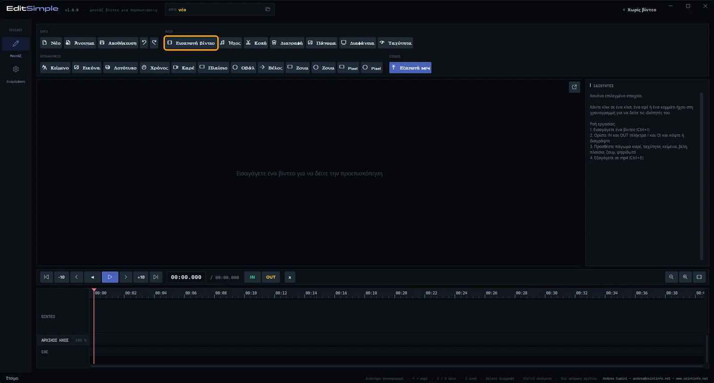

- **Γραμμή εργαλείων**, σε τέσσερις ομάδες: *Έργο* (νέο, άνοιγμα, αποθήκευση,
  αναίρεση, επανάληψη), *Κλιπ* (εισαγωγή βίντεο, ήχος, κοπή, διαγραφή, πάγωμα
  καρέ, διαφάνεια, ταχύτητα), *Επικαλύψεις* (κείμενο, εικόνα, λογότυπο, χρόνος,
  καρέ, πλαίσιο, οβάλ, βέλος, ορθογώνιο και οβάλ ζουμ, ορθογώνιο και οβάλ
  pixel) και *Έξοδος* (εξαγωγή MP4). Κάθε κουμπί έχει μια επεξήγηση με τη
  συντόμευσή του.
- **Προεπισκόπηση**, στο κέντρο: δείχνει το καρέ στον δρομέα με όλα τα εφέ,
  ακριβώς όπως στο βίντεο που εξάγεται. Πάνω της σχεδιάζετε και μετακινείτε
  τα εφέ.
- **Ιδιότητες**, δεξιά: οι τιμές του επιλεγμένου στοιχείου (ένα κλιπ, ένα εφέ,
  ένα κομμάτι ήχου).
- **Χειριστήρια αναπαραγωγής**: αρχή, -10 καρέ, προηγούμενο καρέ, αναπαραγωγή
  προς τα πίσω, αναπαραγωγή, επόμενο καρέ, +10 καρέ, τέλος· ο χρόνος του
  δρομέα (μπορείτε να τον πληκτρολογήσετε)· IN, OUT και η διαγραφή των
  σημαδιών· δεξιά το ζουμ της χρονογραμμής.
- **Χρονογραμμή**, κάτω: χάρακας, κομμάτι **Βίντεο** σε μορφή φιλμ,
  **Αρχικός ήχος**, πρόσθετα κομμάτια ήχου και **Εφέ**.

## 4. Σελίδα Διαμόρφωση

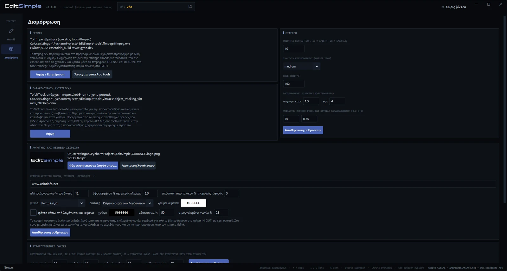

Ανοίγει από τη στήλη αριστερά. Περιέχει:

- **FFmpeg** και **Παρακολούθηση (VitTrack)**: κατάσταση, λήψη και ενημέρωση.
- **Εξαγωγή**: ποιότητα βίντεο (CRF: 15 άριστη, 28 ελαφριά), ταχύτητα
  κωδικοποίησης, ποιότητα ήχου, προτεινόμενες διάρκειες για πάγωμα καρέ και
  εφέ, προεπιλεγμένο μέγεθος pixel και κατώφλι παρακολούθησης (υψηλότερο =
  πιο αυστηρή αναγνώριση του θέματος).
- **Λογότυπο και κείμενο χειριστή**: η εικόνα του λογότυπου (PNG με διαφάνεια
  ή JPG), το κείμενο (όνομα, φορέας, ιστότοπος), το πλάτος του λογότυπου, το
  ύψος του κειμένου, η απόσταση από τα άκρα, η γωνία, η διάταξη, τα χρώματα
  και ένα φόντο με αδιαφάνεια και στρογγυλεμένες γωνίες. Τα ρυθμίζετε μία
  φορά· μετά το κουμπί **Λογότυπο** τα βάζει στο βίντεο.

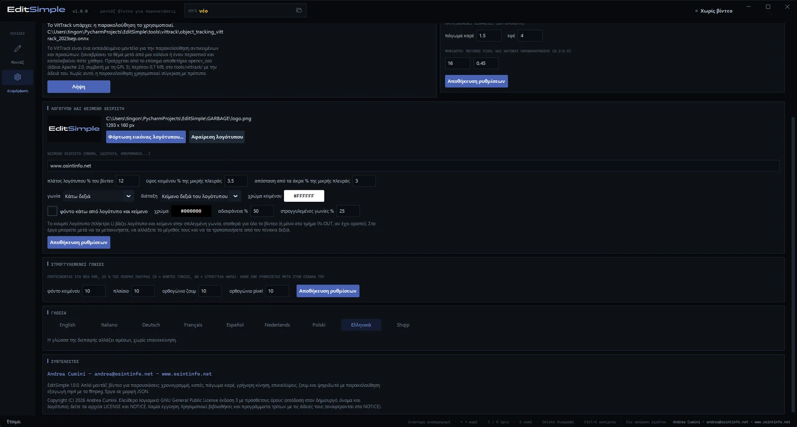

- **Στρογγυλεμένες γωνίες** του φόντου των κειμένων, των πλαισίων, του
  ορθογώνιου ζουμ και του ορθογώνιου ψηφιδωτού.
- **Γλώσσα** της διεπαφής: English, Italiano, Deutsch, Français,
  Español, Nederlands, Polski, Ελληνικά, Shqip. Η αλλαγή είναι άμεση.

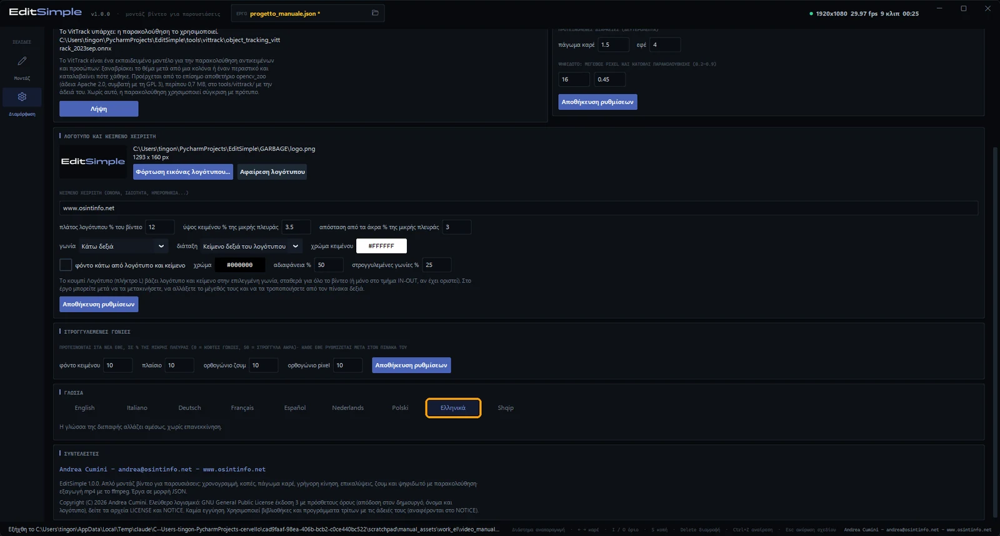

## 5. Ένα πλήρες παράδειγμα, βήμα προς βήμα

Το παράδειγμα αυτού του κεφαλαίου είναι ένα βίντεο 19 δευτερολέπτων
τραβηγμένο σε έναν πολυσύχναστο πεζόδρομο (δείτε τη σημείωση: οι περαστικοί
δεν κάνουν τίποτα κακό). Σε λίγα βήματα το εμπλουτίζουμε: το λογότυπο και ο
ιστότοπος του χειριστή κάτω, ένα ζουμ στα χέρια ενός άνδρα που ακολουθεί τις
κινήσεις του, ένα βέλος που δείχνει ένα πρόσωπο για 12 δευτερόλεπτα, δύο
πλαίσια σε άλλα πρόσωπα και το ψηφιδωτό ενός προσώπου στο τέλος.

### 5.1 Εισαγωγή του βίντεο

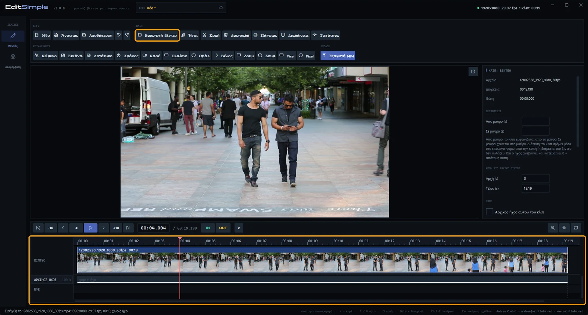

Η **Εισαγωγή βίντεο** (Ctrl+I) ανοίγει το υλικό. Το πρώτο βίντεο ορίζει τις
διαστάσεις και τη συχνότητα του έργου (εδώ 1920×1080, 29,97 καρέ ανά
δευτερόλεπτο). Το κλιπ εμφανίζεται στο κομμάτι Βίντεο σαν φιλμ από καρέ· ο
ήχος του στο κομμάτι Αρχικός ήχος (αυτό το βίντεο δεν έχει ήχο). Άλλα βίντεο
προστίθενται στο τέλος ή στον δρομέα.

Ο δρομέας μετακινείται με ένα κλικ στον χάρακα, με τα βέλη ← → (ένα καρέ),
Ctrl+← → (δέκα καρέ), Shift+← → (ένα δευτερόλεπτο), Home και End, ή
γράφοντας τον χρόνο στο πεδίο. Το **Διάστημα** αναπαράγει με ήχο, το
**Shift+Διάστημα** αναπαράγει προς τα πίσω.

### 5.2 Λογότυπο και υπογραφή του χειριστή

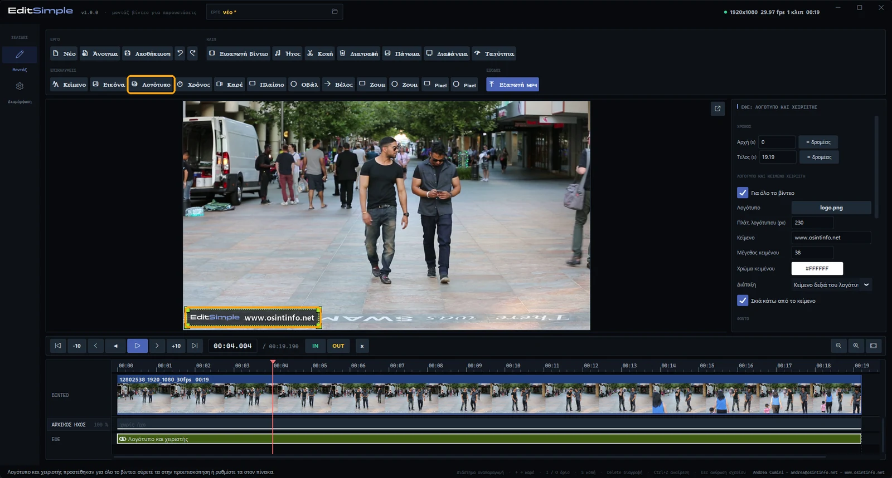

Το **Λογότυπο** (L) βάζει το λογότυπο και το κείμενο που ρυθμίσατε στη
Διαμόρφωση για όλο το βίντεο (ή μόνο μεταξύ IN και OUT, αν έχουν οριστεί).
Στην προεπισκόπηση τα μετακινείτε σύροντάς τα και τα μεγαλώνετε από τις
γωνίες· στον πίνακα αλλάζετε κείμενο, χρώματα, φόντο, γωνία και αδιαφάνεια.

### 5.3 Ένα ζουμ που ακολουθεί τα χέρια

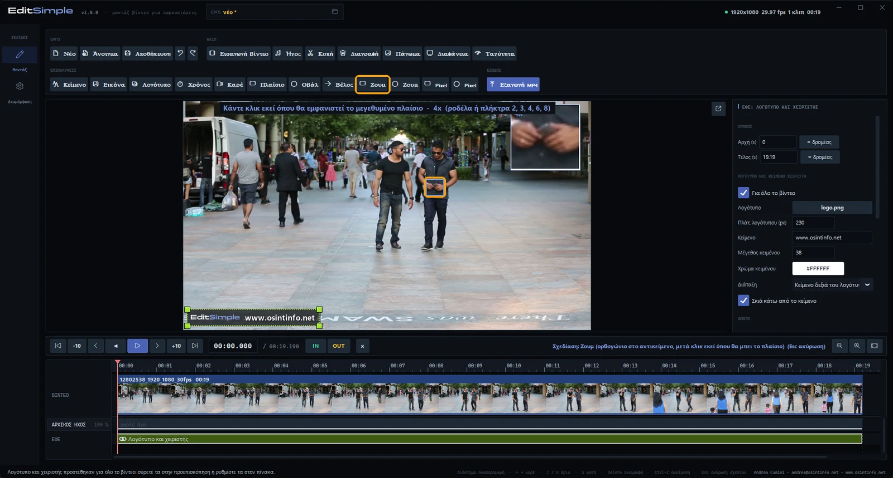

Το **Ζουμ** (Z) χρησιμοποιείται σε δύο βήματα:

1. σύρετε ένα ορθογώνιο γύρω από τη λεπτομέρεια (εδώ τα χέρια του άνδρα)·
2. κάτω από το ποντίκι εμφανίζεται το μεγεθυμένο πλαίσιο με το πραγματικό
   περιεχόμενο: ένα κλικ το τοποθετεί. Τη μεγέθυνση την επιλέγετε εκείνη τη
   στιγμή με τη ροδέλα ή με τα πλήκτρα 2, 3, 4, 6, 8 (έως 16x από τον πίνακα).

Το ζουμ **αρχίζει αμέσως να ακολουθεί το αντικείμενο**: ένα παράθυρο δείχνει
την πρόοδο της παρακολούθησης.

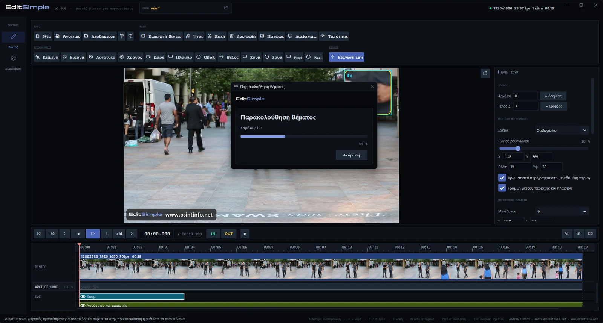

Η μεγεθυμένη περιοχή ακολουθεί τα χέρια και μεγαλώνει ή μικραίνει όταν ο
άνδρας πλησιάζει ή απομακρύνεται· το μεγεθυμένο πλαίσιο μένει εκεί που το
βάλαμε. Ένα χρωματιστό περίγραμμα σημαδεύει το αντικείμενο και μια γραμμή το
συνδέει με το πλαίσιο. Το Shift+Z δημιουργεί οβάλ ζουμ.

### 5.4 Ένα βέλος που ακολουθεί ένα πρόσωπο

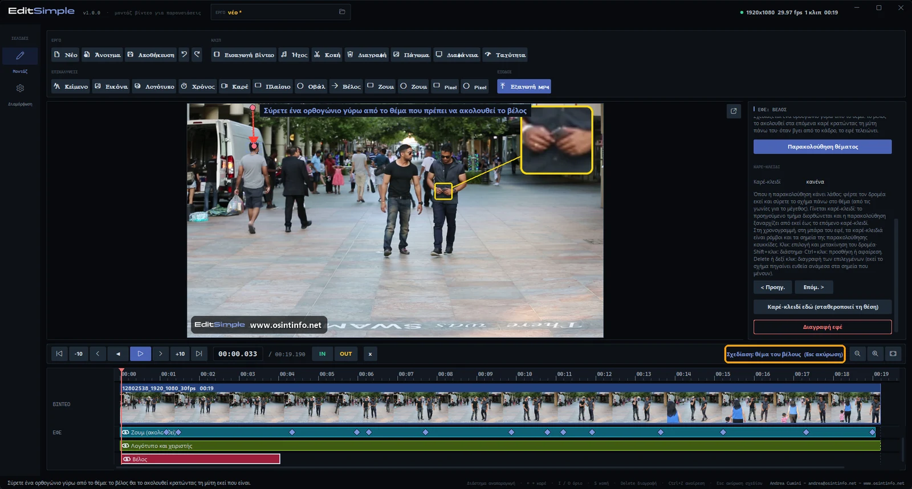

**Βέλος** (A): σύρετε από την ουρά προς την αιχμή. Για να ακολουθεί ένα
πρόσωπο, πατήστε **Παρακολούθηση θέματος** στον πίνακα (ή *Επανάληψη
παρακολούθησης από τον δρομέα*) και σχεδιάστε ένα **ορθογώνιο γύρω από το
θέμα**: το βέλος το ακολουθεί κρατώντας την αιχμή πάνω του.

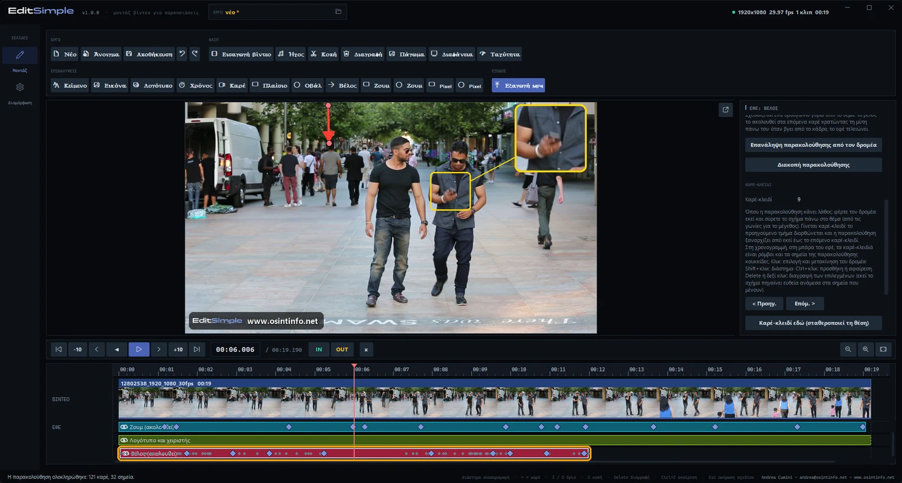

Στη χρονογραμμή η μπάρα του βέλους δείχνει *(ακολουθεί)* και τους ρόμβους των
καρέ-κλειδιών με τα οποία διορθώσαμε τη διαδρομή (δείτε το κεφάλαιο 6).

### 5.5 Πλαίσια στα πρόσωπα

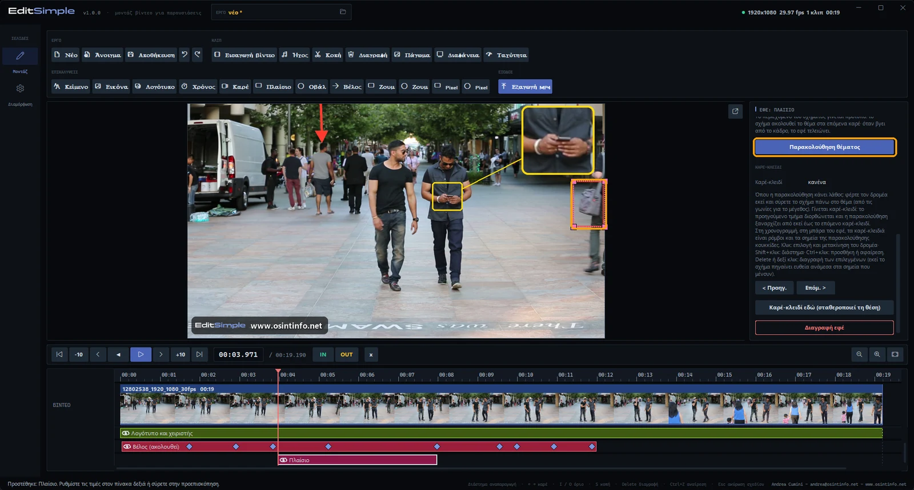

**Πλαίσιο** (R) και **Οβάλ** (E): τα σύρετε στην προεπισκόπηση. Στον πίνακα
επιλέγετε χρώμα, πάχος, γέμισμα, στρογγυλεμένες γωνίες και αδιαφάνεια· η
**Παρακολούθηση θέματος** τα κάνει να ακολουθούν ό,τι περιέχουν. Όταν το
πρόσωπο βγαίνει από το κάδρο, το σχήμα το συνοδεύει έξω και το εφέ τελειώνει.

### 5.6 Το ψηφιδωτό ενός προσώπου

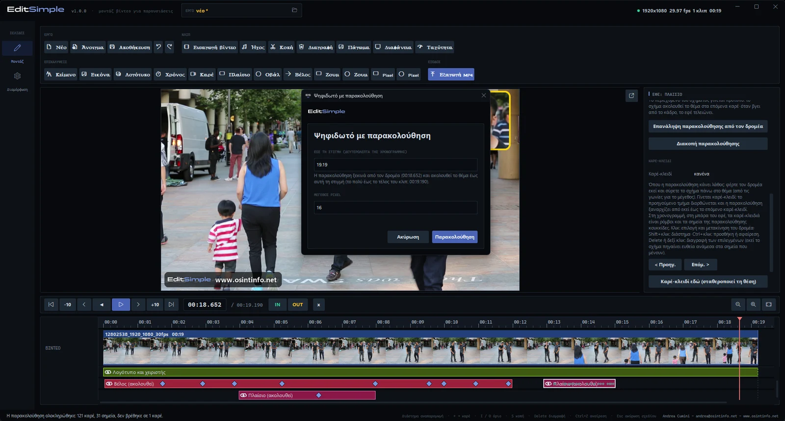

**Pixel** (P ορθογώνιο, K οβάλ): σύρετε ένα πλαίσιο πάνω στο πρόσωπο· ένα
παράθυρο ρωτά έως πότε να το ακολουθεί και το μέγεθος των pixel.

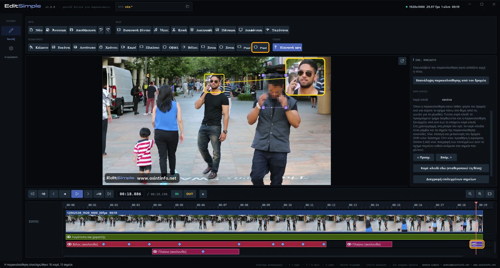

Το ψηφιδωτό ακολουθεί το πρόσωπο και **μεγαλώνει όταν πλησιάζει** την κάμερα,
έτσι ώστε να το καλύπτει πάντα. Αν το θέμα βγει από το κάδρο, το ψηφιδωτό το
συνοδεύει μέχρι να βγει εντελώς: κανένα καρέ δεν μένει ακάλυπτο.

## 6. Διόρθωση της παρακολούθησης με καρέ-κλειδιά

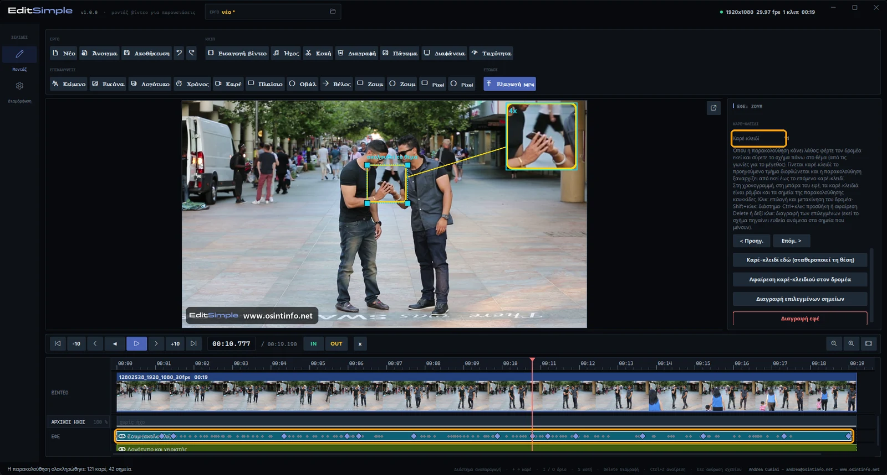

Η παρακολούθηση είναι αυτόματη, αλλά ένα πραγματικό βίντεο έχει εμπόδια: μια
κολόνα, έναν περαστικό που περνά μπροστά, ένα θέμα που γυρίζει. Όπου το σχήμα
κάνει λάθος:

1. φέρτε τον δρομέα σε εκείνο το καρέ·
2. **σύρετε το σχήμα πάνω στο θέμα** στην προεπισκόπηση (ή αλλάξτε το μέγεθός
   του από τις γωνίες).

Δημιουργείται ένα **καρέ-κλειδί** (ένας ρόμβος στη μπάρα του εφέ). Το
πρόγραμμα διορθώνει τη διαδρομή πριν από το καρέ-κλειδί, σταδιακά, και
**ξαναρχίζει την παρακολούθηση από εκεί** έως το επόμενο καρέ-κλειδί. Μπορείτε
να βάλετε όσα καρέ-κλειδιά χρειάζονται: το ζουμ του παραδείγματος έχει 14, το
βέλος 9.

Στη μπάρα του επιλεγμένου εφέ φαίνονται επίσης τα σημεία που βρήκε η
παρακολούθηση (κουκκίδες). Ένα κλικ επιλέγει ένα σημείο και φέρνει εκεί τον
δρομέα, Shift+κλικ επιλέγει ένα διάστημα, Ctrl+κλικ προσθέτει ή αφαιρεί· το
**Delete** ή το δεξί κλικ διαγράφουν τα επιλεγμένα σημεία. Στον πίνακα, η
ενότητα **Καρέ-κλειδί** έχει τα κουμπιά *< Προηγ.* και *Επόμ. >*, *Καρέ-κλειδί
εδώ* (σταθεροποιεί την τρέχουσα θέση) και *Αφαίρεση καρέ-κλειδιού στον δρομέα*.

## 7. Η χρονογραμμή

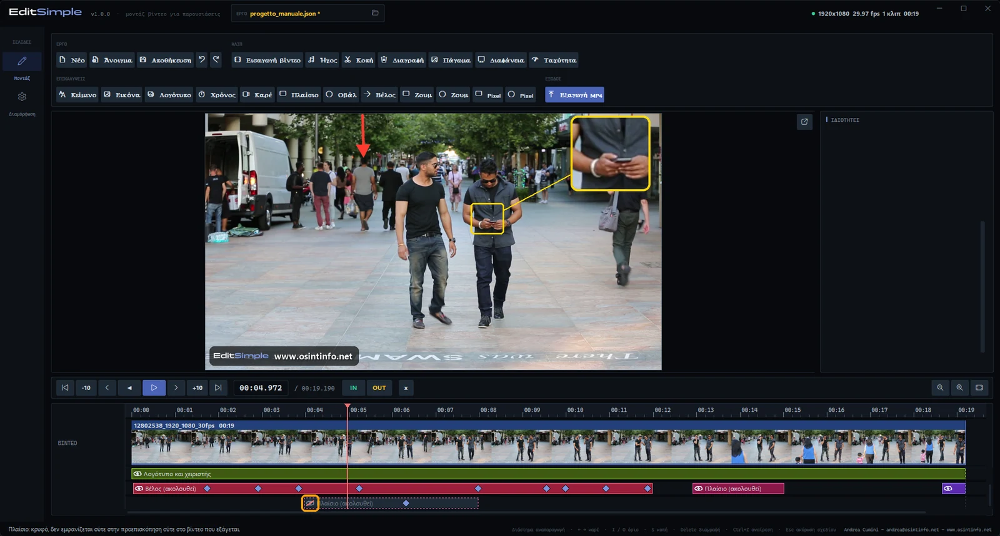

- **Μπάρες των εφέ**: μετακινούνται με σύρσιμο· το δεξί άκρο αλλάζει τη
  διάρκεια. Τα εφέ μπαίνουν σε περισσότερες λωρίδες· με πολλά εφέ το τμήμα
  ήχου και εφέ **κυλά κατακόρυφα** (μπάρα δεξιά, ροδέλα πάνω στα ονόματα των
  γραμμών ή Shift+ροδέλα), ενώ ο χάρακας και το βίντεο μένουν σταθερά πάνω.
- **Μάτι**: το εικονίδιο αριστερά από κάθε μπάρα **κρύβει ή εμφανίζει** το
  εφέ, στην προεπισκόπηση και στο βίντεο που εξάγεται. Χρήσιμο όταν πολλά εφέ
  επικαλύπτονται κατά τη διάρκεια της εργασίας.
- **Δεξί κλικ σε μια μπάρα**: *Επέκταση έως τον δρομέα* (αν ο δρομέας είναι
  μετά το τέλος· αν το εφέ ακολουθεί ένα θέμα, η παρακολούθηση συνεχίζεται)
  και *Διακοπή στον δρομέα* (αν ο δρομέας είναι μέσα στο εφέ).
- **Ζουμ της χρονογραμμής**: Ctrl+ροδέλα, ή τα κουμπιά − + και *Προσαρμογή*.
  Από κοντά το φιλμ δείχνει κάθε μεμονωμένο καρέ.
- **Κύλιση**: ροδέλα, Alt+σύρσιμο ή σύρσιμο με το μεσαίο πλήκτρο.
- **Διαχωριστικό**: τη λεπτή λωρίδα πάνω από τα χειριστήρια αναπαραγωγής τη
  σύρετε πάνω ή κάτω για να δώσετε περισσότερο χώρο στη χρονογραμμή ή στην
  προεπισκόπηση.

## 8. Η προεπισκόπηση: μεγέθυνση και αποσύνδεση

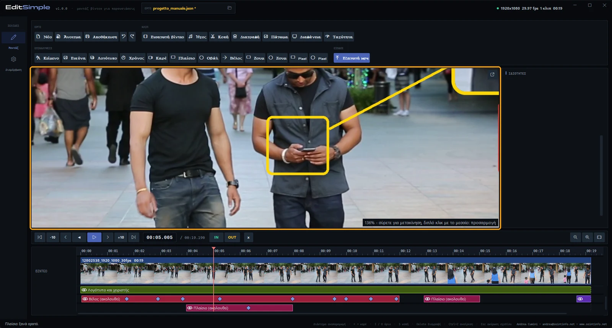

- Το **Ctrl+ροδέλα** στην προεπισκόπηση τη μεγεθύνει γύρω από το ποντίκι, έως
  16 φορές: για να τοποθετήσετε με ακρίβεια ένα ζουμ σε μια μικρή λεπτομέρεια
  ή για να ελέγξετε ένα ψηφιδωτό. Μετακινείστε σύροντας σε ένα κενό σημείο (ή
  με το μεσαίο πλήκτρο)· διπλό κλικ με το μεσαίο πλήκτρο επιστρέφει στην
  πλήρη προβολή.
- **Αποσύνδεση της προεπισκόπησης**: το κουμπί πάνω δεξιά στην προεπισκόπηση
  την ανοίγει σε **ξεχωριστό παράθυρο**, για να το βάλετε σε δεύτερη οθόνη ή
  όπου θέλετε· η χρονογραμμή παίρνει όλο τον χώρο. Το ίδιο κουμπί (ή το
  κλείσιμο του παραθύρου) την **επανασυνδέει**. Οι συντομεύσεις λειτουργούν
  και στο αποσυνδεδεμένο παράθυρο.

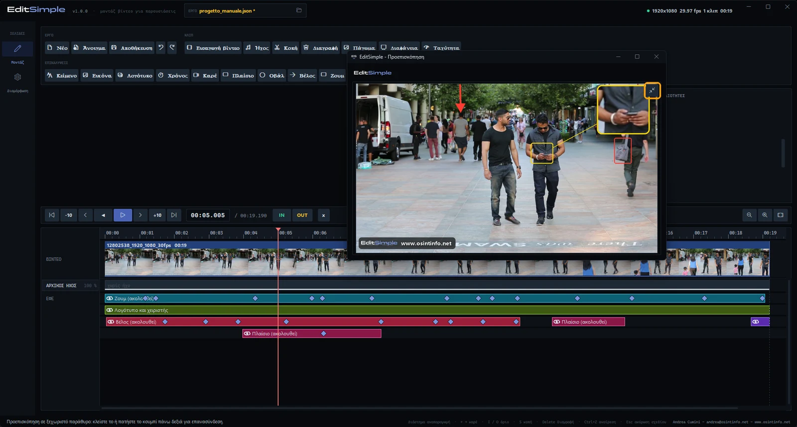

## 9. Διαφάνειες έναρξης, κλεισίματος και ενδιάμεσες

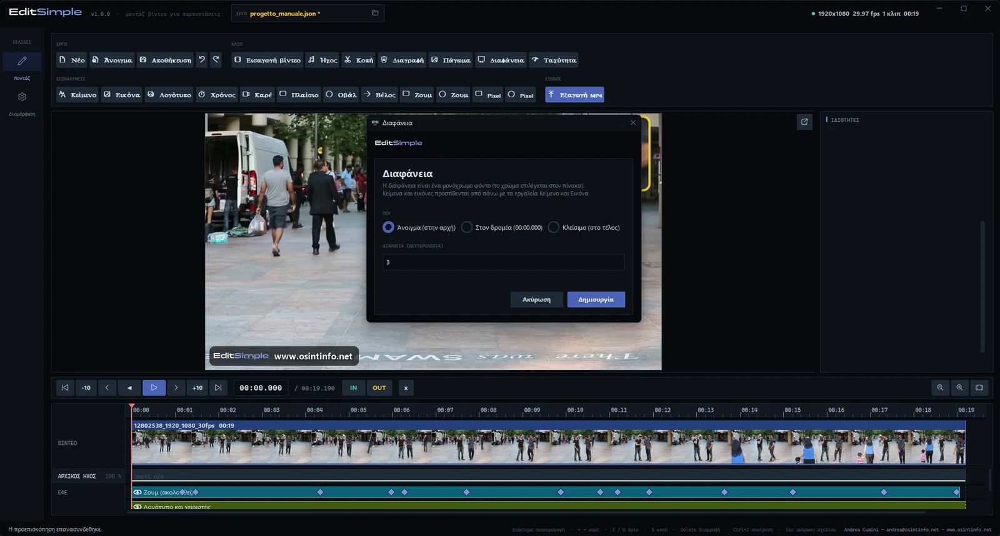

Η **Διαφάνεια** εισάγει μια διαφάνεια **στην αρχή** (έναρξη), **στον δρομέα**
(στη μέση του βίντεο) ή **στο τέλος** (κλείσιμο), με τη διάρκεια που
επιλέγετε. Η διαφάνεια είναι ένα μονόχρωμο φόντο ή μια **εικόνα φόντου**
προσαρμοσμένη στις διαστάσεις του βίντεο (γέμισμα, ολόκληρη ή τέντωμα)· χρώμα
και εικόνα επιλέγονται στον πίνακα. Τα εφέ που ακολουθούν μετατίθενται μπροστά
μαζί με το βίντεο.

Πάνω στη διαφάνεια γράφετε κείμενα και βάζετε εικόνες με τα εργαλεία
**Κείμενο** και **Εικόνα**: με τον δρομέα στη διαφάνεια διαρκούν όσο αυτή.

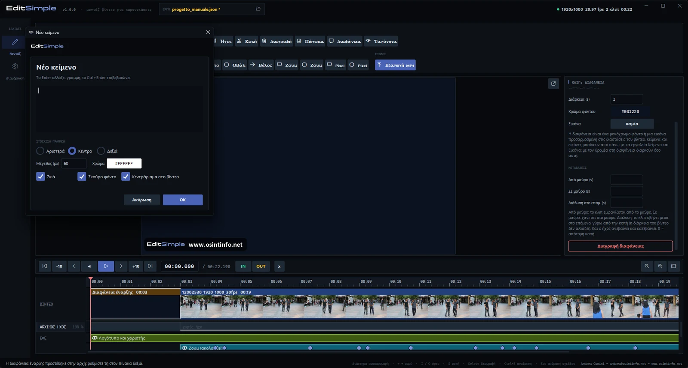

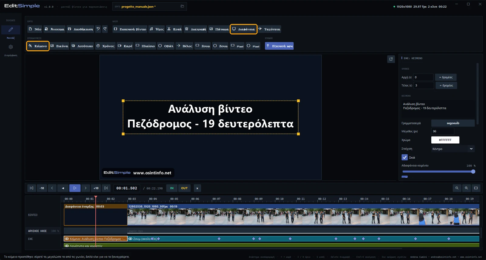

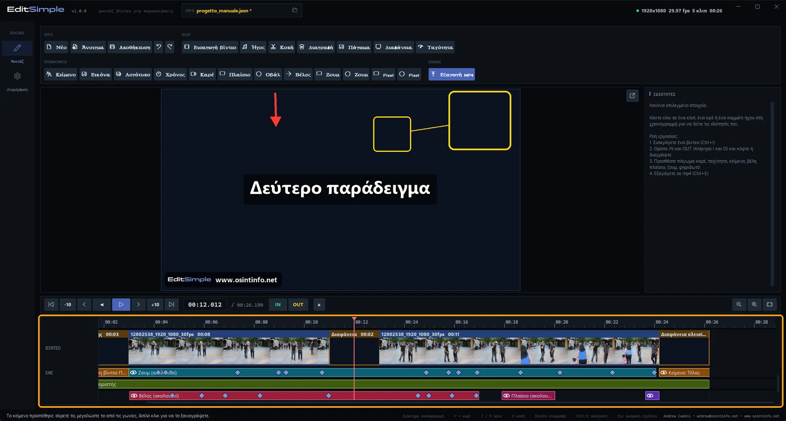

## 10. Κείμενα, εικόνες, χρόνος που πέρασε και αριθμός καρέ

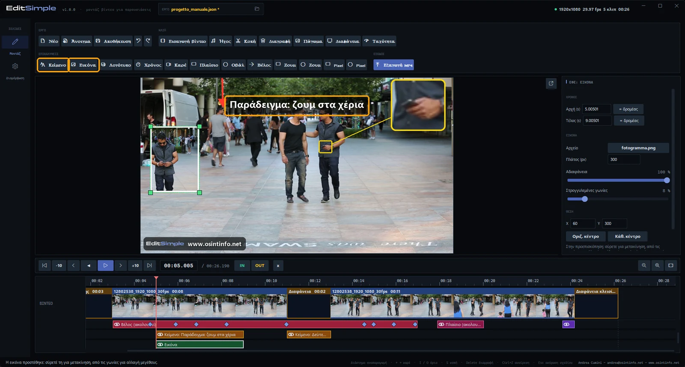

- **Κείμενο** (T): ένα κλικ στην προεπισκόπηση ανοίγει το παράθυρο του
  κειμένου: πολλές γραμμές, στοίχιση, μέγεθος, χρώμα, σκιά, φόντο (με
  αδιαφάνεια και στρογγυλεμένες γωνίες), κεντράρισμα. Διπλό κλικ σε ένα
  κείμενο για να το ξαναγράψετε. Στον πίνακα και η γραμματοσειρά, που
  επιλέγεται από μια λίστα όπου φαίνεται κάθε γραμματοσειρά.
- **Εικόνα**: επιλέγει ένα αρχείο (PNG, JPG...) και το βάζει στο κέντρο·
  μετακινείται και αλλάζει μέγεθος στην προεπισκόπηση· στον πίνακα αδιαφάνεια
  και στρογγυλεμένες γωνίες. Εδώ είναι ένα μεγεθυμένο καρέ του θέματος, αλλά
  μπορεί να είναι ένας χάρτης, ένα έγγραφο, μια φωτογραφία.

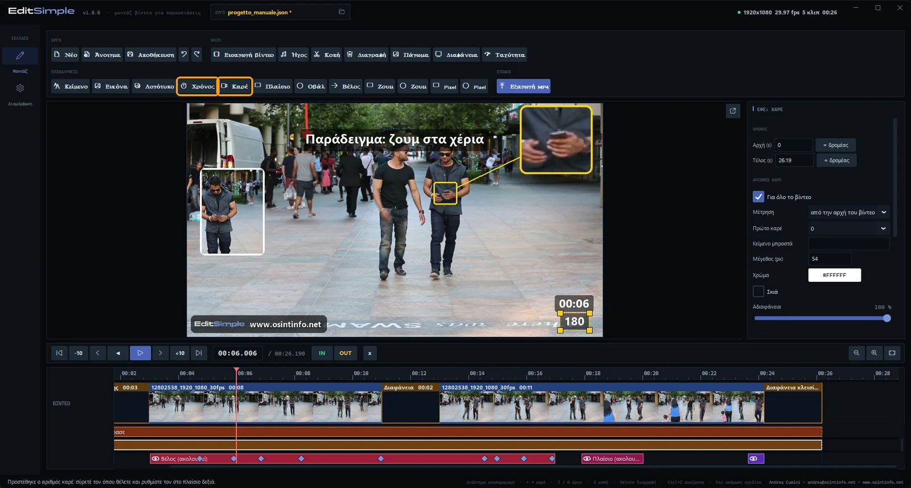

- **Χρόνος**: ο χρόνος που πέρασε (01:23, 00:01:23 ή με δέκατα), από την αρχή
  του βίντεο ή από την αρχή του εφέ, με ένα κείμενο μπροστά της επιλογής σας.
  Πέρα από τη μία ώρα εμφανίζονται και οι ώρες.
- **Καρέ**: ο αριθμός του καρέ, από 0 ή από 1, από την αρχή του βίντεο ή του
  εφέ. Χρήσιμο για να αναφέρετε με ακρίβεια μια στιγμή.

Και τα δύο έχουν φόντο, αδιαφάνεια και στρογγυλεμένες γωνίες, και τα βάζετε
όπου θέλετε με ένα κλικ.

## 11. Επιτάχυνση και επιβράδυνση

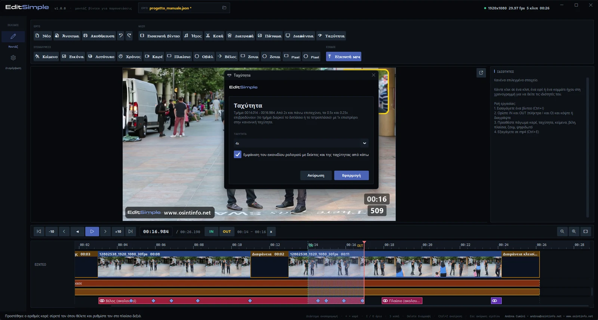

Ορίστε ένα τμήμα με **IN** και **OUT** (πλήκτρα I και O) και πατήστε
**Ταχύτητα** (V). Από **2x έως 32x** το βίντεο επιταχύνει· τα **0,5x και
0,25x** επιβραδύνουν. Η επιλογή του **ρολογιού** δείχνει ένα εικονίδιο με
δείκτες που γυρίζουν και την ταχύτητα γραμμένη από κάτω, ώστε ο θεατής να
ξέρει ότι ο χρόνος κυλά γρηγορότερα. Η χρονογραμμή μικραίνει ή μεγαλώνει· με
1x επιστρέφετε στην κανονική ταχύτητα. Θέση, μέγεθος και χρώμα του ρολογιού
ρυθμίζονται στον πίνακα του κλιπ.

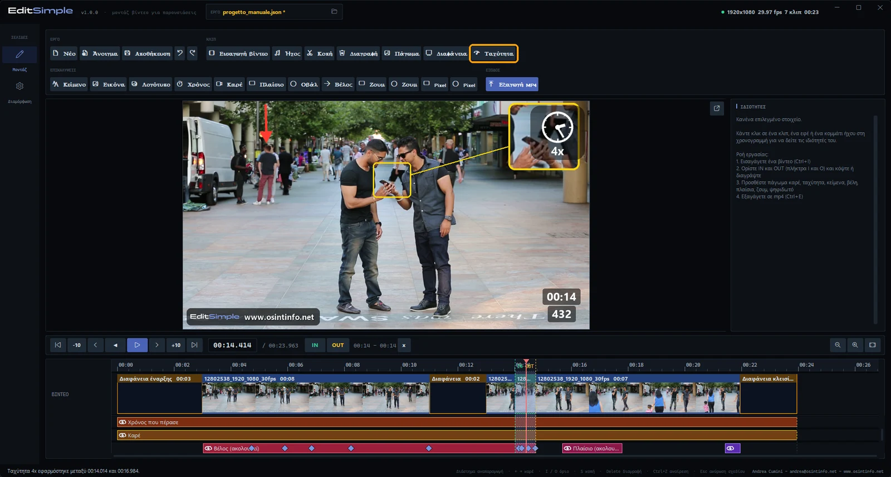

## 12. Κοπή, διαγραφή, πάγωμα καρέ

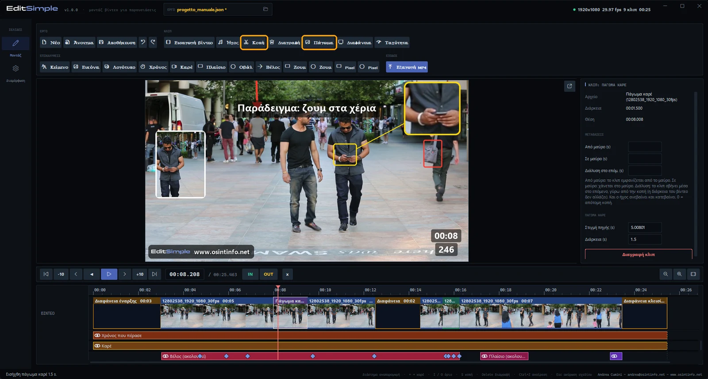

- Η **Κοπή** (S) χωρίζει το κλιπ στον δρομέα. Τα κλιπ **αναδιατάσσονται
  σύροντάς τα** στη χρονογραμμή.
- Η **Διαγραφή** (Delete) αφαιρεί το τμήμα μεταξύ IN και OUT, ή το επιλεγμένο
  στοιχείο: ό,τι ακολουθεί μετατίθεται πίσω, μαζί με τα εφέ.
- **Πάγωμα** (F): το καρέ στον δρομέα μένει σταθερό για τα δευτερόλεπτα που
  επιλέγετε· ό,τι ακολουθεί μετατίθεται μπροστά.

Όλα αναιρούνται με Ctrl+Z και επαναλαμβάνονται με Ctrl+Y.

## 13. Μεταβάσεις

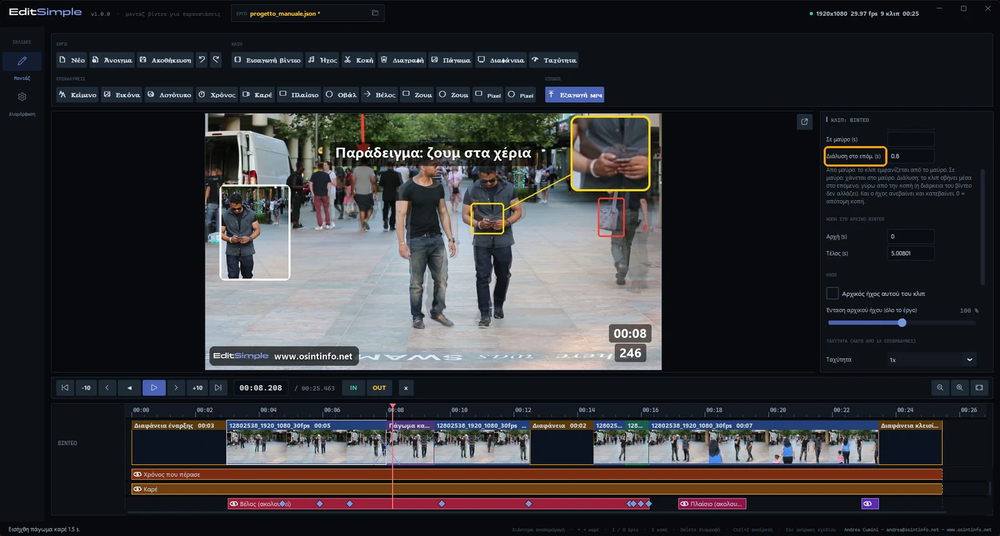

Όταν επιλέγετε ένα κλιπ, ο πίνακας έχει την ενότητα **Μεταβάσεις**:

- **Από μαύρο**: το κλιπ εμφανίζεται από το μαύρο·
- **Σε μαύρο**: το κλιπ χάνεται στο μαύρο·
- **Διάλυση στο επόμενο**: το κλιπ σβήνει μέσα στο επόμενο, γύρω από την
  κοπή. Το κλιπ που φεύγει μένει σταθερό κατά τη διάλυση· η διάρκεια του
  βίντεο δεν αλλάζει.

Και ο ήχος ανεβαίνει και κατεβαίνει με τις μεταβάσεις. Το 0 σημαίνει απότομη
κοπή.

## 14. Ήχος

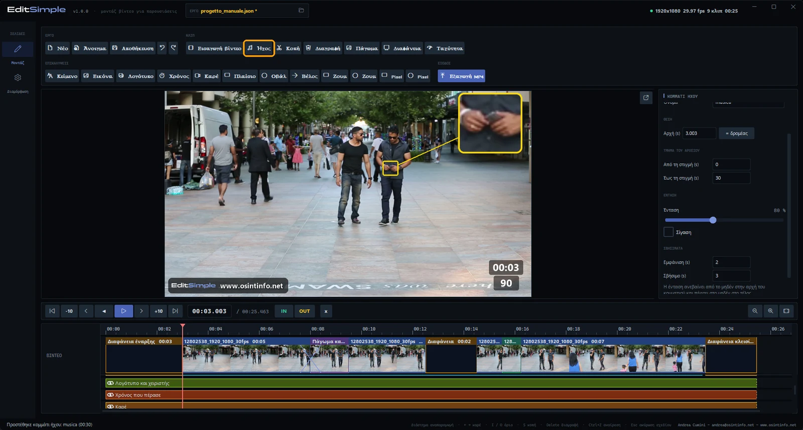

- Ο **Ήχος** προσθέτει ένα κομμάτι (σχόλιο, μουσική) στον δρομέα. Στον πίνακα:
  όνομα, θέση, τμήμα του αρχείου, **ένταση**, σίγαση και **σβησίματα** στην
  είσοδο και στην έξοδο. Μετακινείται με σύρσιμο· ένα κλικ στο όνομά του το
  επιλέγει ολόκληρο, το Delete το διαγράφει.
- Η **λευκή γραμμή** πάνω από κάθε κομμάτι δείχνει την πορεία της έντασης:
  σβησίματα και μεταβάσεις φαίνονται με μια ματιά.
- **Αρχικός ήχος**: ένα κλικ στο όνομα της γραμμής επιλέγει όλο τον ήχο του
  βίντεο (ένταση, σβησίματα στην αρχή και στο τέλος, διαγραφή)· ένα κλικ σε
  ένα κομμάτι επιλέγει μόνο εκείνο το κομμάτι (ένταση, σβησίματα, σίγαση). Με
  IN και OUT ορισμένα και τον αρχικό ήχο επιλεγμένο, το Delete αφαιρεί **μόνο
  τον ήχο** εκείνου του τμήματος: το βίντεο μένει.
- Η αναπαραγωγή στην προεπισκόπηση γίνεται **με ήχο** (μιξαρισμένο όπως στην
  εξαγωγή).

## 15. Εξαγωγή του βίντεο

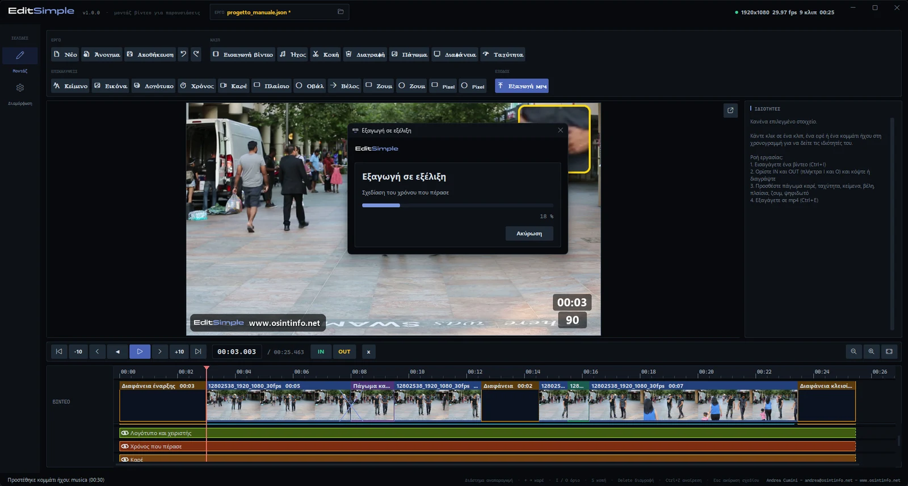

Η **Εξαγωγή MP4** (Ctrl+E) επιλέγει το αρχείο και δημιουργεί το βίντεο με το
ffmpeg: H.264 και AAC, ποιότητα και ταχύτητα κωδικοποίησης από τη Διαμόρφωση.
Το αποτέλεσμα είναι πανομοιότυπο με την προεπισκόπηση. Η εξαγωγή μπορεί να
ακυρωθεί· στο τέλος το πρόγραμμα προτείνει να ανοίξει τον φάκελο.

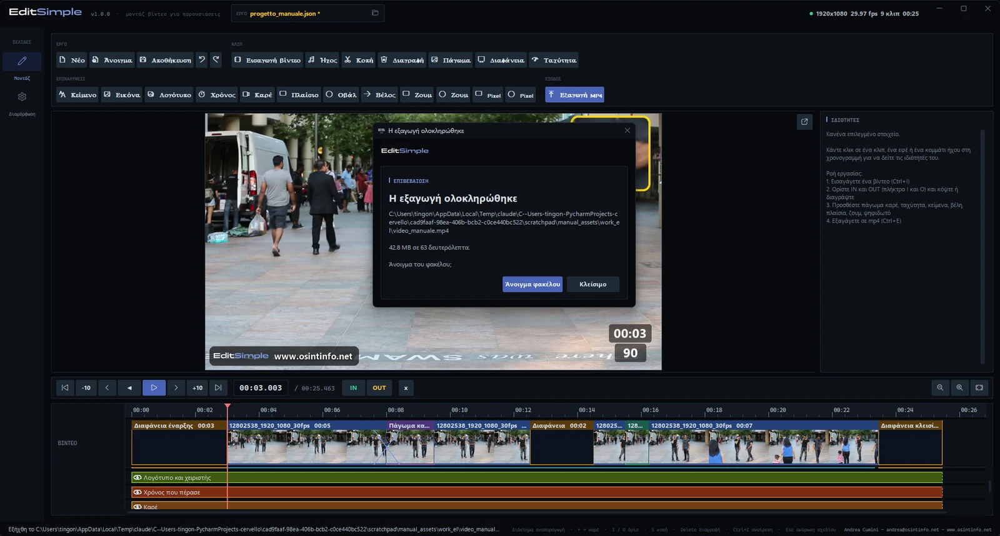

## 16. Συμβουλές για καλό αποτέλεσμα

- **Το πλαίσιο του ζουμ μπαίνει σε ουδέτερη περιοχή**: το μεγεθυμένο πλαίσιο
  καλύπτει το μέρος του βίντεο όπου τοποθετείται, για όσο χρόνο εμφανίζεται.
  Βάλτε το εκεί όπου δεν συμβαίνει τίποτα ενδιαφέρον (ουρανός, τοίχος,
  δάπεδο).
- **Σχεδιάστε στενά γύρω από το θέμα** για πλαίσια, οβάλ και ψηφιδωτά: το
  περιεχόμενο του σχήματος είναι το πρότυπο που αναζητείται στα επόμενα καρέ.
- **Για το βέλος, ένα λίγο μεγαλύτερο ορθογώνιο** (κεφάλι και ώμοι αντί για
  μόνο το κεφάλι) αντέχει καλύτερα όταν άλλοι περαστικοί περνούν μπροστά.
- **Μετά την παρακολούθηση, διατρέξτε το βίντεο**: όπου το σχήμα κάνει λάθος,
  σύρετέ το πάνω στο θέμα. Λίγα καρέ-κλειδιά αρκούν ακόμη και για μεγάλες
  διαδρομές.
- **Με πολλά εφέ**, χρησιμοποιήστε το μάτι για να κρύψετε όσα δεν χρειάζεστε
  εκείνη τη στιγμή, και την αποσυνδεδεμένη προεπισκόπηση για να έχετε
  περισσότερο χώρο στη χρονογραμμή.
- **Αποθηκεύετε συχνά** (Ctrl+S): το έργο είναι ένα μικρό αρχείο JSON που
  ξανανοίγετε και τροποποιείτε όποτε θέλετε.

## 17. Συντομεύσεις πληκτρολογίου και ποντικιού

| Πλήκτρο | Ενέργεια |
| --- | --- |
| Διάστημα / Shift+Διάστημα | Αναπαραγωγή ή παύση / αναπαραγωγή προς τα πίσω |
| ← → | Ένα καρέ πίσω / μπροστά |
| Ctrl+← → | Δέκα καρέ πίσω / μπροστά |
| Shift+← → | Ένα δευτερόλεπτο πίσω / μπροστά |
| Home / End | Αρχή / τέλος του βίντεο |
| I / O | Ορισμός IN / OUT |
| S | Κοπή στον δρομέα |
| F | Πάγωμα καρέ |
| V | Ταχύτητα του τμήματος IN-OUT |
| T / R / E / A | Κείμενο / πλαίσιο / οβάλ / βέλος |
| Z / Shift+Z | Ορθογώνιο / οβάλ ζουμ |
| P / K | Ορθογώνιο / οβάλ ψηφιδωτό |
| L | Λογότυπο και χειριστής |
| Delete | Διαγραφή της επιλογής (ή του τμήματος IN-OUT) |
| Esc | Ακύρωση της σχεδίασης σε εξέλιξη |
| Ctrl+Z / Ctrl+Y | Αναίρεση / επανάληψη |
| Ctrl+N / Ctrl+O / Ctrl+S / Ctrl+Shift+S | Νέο / άνοιγμα / αποθήκευση / αποθήκευση ως |
| Ctrl+I | Εισαγωγή βίντεο |
| Ctrl+E | Εξαγωγή MP4 |

| Ποντίκι | Πού | Ενέργεια |
| --- | --- | --- |
| Ροδέλα | Προεπισκόπηση | Ένα καρέ μπροστά ή πίσω |
| Ctrl+ροδέλα | Προεπισκόπηση | Μεγέθυνση της προβολής |
| Σύρσιμο σε κενό σημείο, μεσαίο πλήκτρο | Μεγεθυμένη προεπισκόπηση | Μετακίνηση της προβολής |
| Διπλό κλικ | Κείμενο στην προεπισκόπηση | Επανεγγραφή του κειμένου |
| Ctrl+ροδέλα | Χρονογραμμή | Μεγέθυνση της χρονογραμμής |
| Ροδέλα / Alt+σύρσιμο / μεσαίο πλήκτρο | Χρονογραμμή | Οριζόντια κύλιση |
| Shift+ροδέλα, ροδέλα στα ονόματα | Χρονογραμμή | Κατακόρυφη κύλιση ήχου και εφέ |
| Δεξί κλικ | Μπάρα ενός εφέ | Επέκταση έως τον δρομέα / διακοπή στον δρομέα |
| Δεξί κλικ | Καρέ-κλειδί ή σημείο | Διαγραφή |

## 18. Το αρχείο έργου

Το έργο είναι ένα αρχείο JSON με τα κλιπ, τα κομμάτια ήχου, τα εφέ (με τις
διαδρομές της παρακολούθησης και τα καρέ-κλειδιά) και τις διαδρομές των
αρχείων που χρησιμοποιούνται. Τα βίντεο, οι ήχοι και οι εικόνες δεν
αντιγράφονται μέσα στο έργο: αφήστε τα εκεί που βρίσκονται μέχρι να
ολοκληρωθεί η εργασία. Το βίντεο που εξάγεται, αντίθετα, είναι ένα αυτόνομο
MP4.

---

Το EditSimple είναι ελεύθερο λογισμικό, που διανέμεται με την άδεια GNU GPL
έκδοση 3 με πρόσθετους όρους απόδοσης στον δημιουργό (δείτε τα `LICENSE` και
`NOTICE`). Το ffmpeg και το VitTrack είναι ξεχωριστά προγράμματα με τις δικές
τους άδειες.
