# EditSimple — User Manual

**English** · [Italiano](manual.it.md) · [Deutsch](manual.de.md) · [Français](manual.fr.md) · [Español](manual.es.md) · [Nederlands](manual.nl.md) · [Polski](manual.pl.md) · [Ελληνικά](manual.el.md) · [Shqip](manual.sq.md)

EditSimple is a video editing program for anyone who needs to **explain an
event or show evidence** in a video: a hand-off in the middle of a crowd, a
vehicle arriving, a person to follow or to make unrecognizable. You import
the footage, point out what matters and the program does the rest: arrows,
boxes, zooms and pixelations **follow the subject on their own** in the
following frames, and where tracking goes wrong you just drag the shape to
the right place to correct it. In a few minutes you get an MP4 ready to show
or to attach, with opening and closing slides, texts, logo and the
operator's signature.

*Andrea Cumini — www.osintinfo.net — andrea@osintinfo.net*
*EditSimple is one of the [Seity](https://www.seity.com) tools.*

> **A note on the sample video.** The images in this manual use a stock
> video published on Pexels: a pedestrian street with ordinary passers-by.
> **The people who appear are not doing anything wrong**: the arrows, boxes,
> zooms and pixelations placed on them only serve to show how the program
> works, and the subjects were chosen at random.

## Contents

1. [What you can do](#1-what-you-can-do)
2. [Installation and first start](#2-installation-and-first-start)
3. [The window](#3-the-window)
4. [Configure page](#4-configure-page)
5. [A complete example, step by step](#5-a-complete-example-step-by-step)
6. [Correcting tracking with keyframes](#6-correcting-tracking-with-keyframes)
7. [The timeline](#7-the-timeline)
8. [The preview: zoom in and detach](#8-the-preview-zoom-in-and-detach)
9. [Opening, closing and in-between slides](#9-opening-closing-and-in-between-slides)
10. [Texts, images, elapsed time and frame number](#10-texts-images-elapsed-time-and-frame-number)
11. [Speeding up and slowing down](#11-speeding-up-and-slowing-down)
12. [Cut, delete, freeze frame](#12-cut-delete-freeze-frame)
13. [Transitions](#13-transitions)
14. [Audio](#14-audio)
15. [Exporting the video](#15-exporting-the-video)
16. [Tips for a good result](#16-tips-for-a-good-result)
17. [Keyboard and mouse shortcuts](#17-keyboard-and-mouse-shortcuts)
18. [The project file](#18-the-project-file)

## 1. What you can do

| Feature | In short |
| --- | --- |
| **Subject tracking** | Boxes, ovals, arrows, zooms and pixelations follow a person, a face, an object or a vehicle; they grow and shrink with it as it moves toward or away from the camera; they end on their own when it leaves the frame. |
| **Correction keyframes** | Where tracking goes wrong (a pole, a person passing in front) you drag the shape onto the subject: the program corrects the path before and after that point. |
| **Zoom** | A small detail (hands, a license plate) magnified from 2x to 16x in a box, with an outline and a line connecting it to the object. Rectangular or oval. |
| **Pixelation** | Rectangular or oval, for faces and license plates; it follows the subject and grows with it. |
| **Texts and images** | Multi-line texts with background and rounded corners; images on top (a frame, a map, a document). |
| **Logo and signature** | Logo and operator text fixed in a corner, prepared once in Configure. |
| **Time and frames** | The elapsed time and the frame number written in the video, wherever you want. |
| **Slides** | At the start, at the end or in between; solid color or background image; you write texts and place images on top. |
| **Speed** | From 0.25x (slow motion) to 32x (fast forward), with a clock icon showing the speed. |
| **Cuts** | Cut at the cursor, deletion of a range, freeze frame, reordering of clips. |
| **Transitions** | Fade in from black, fade out to black, blend with the next clip. |
| **Audio** | Added tracks (commentary, music) with volume and fades; original audio with volume, fades and deletion of single stretches. |
| **Preview** | Playback with audio, backwards, frame by frame; zoomable preview that can be **detached** into a separate window. |
| **Export** | MP4 (H.264 + AAC) identical to the preview. |
| **Languages** | Interface in 9 languages, switchable without restarting. |

## 2. Installation and first start

**Executable (Windows 10/11, 64-bit).** Extract the zip wherever you like and
start `EditSimple.exe`. Python is not needed.

**From source.** With Python 3.11:

```bash
python -m venv .venv
.venv\Scripts\python.exe -m pip install -r requirements.txt
.venv\Scripts\python.exe EditSimple.py
```

**FFmpeg.** EditSimple uses ffmpeg to read files and to export. It is not
included: at the first start, if it cannot find it, the **Configure** page
opens and the **Download / Update** button downloads it (official Windows
build) into the `tools\ffmpeg\` folder next to the program. No installation.

**VitTrack (optional).** On the same page, **Download** gets VitTrack, a small
model (0.7 MB) that helps tracking find the subject again after an obstacle.
Without it, tracking works anyway.

## 3. The window

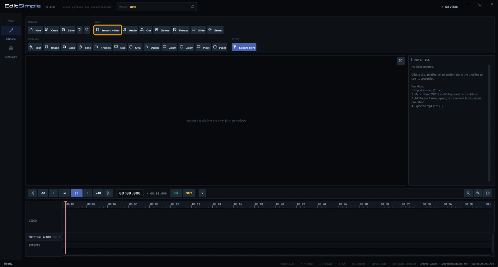

- **Toolbar**, in four groups: *Project* (new, open, save, undo, redo),
  *Clip* (import video, audio, cut, delete, freeze frame, slide, speed),
  *Overlays* (text, image, logo, time, frames, box, oval, arrow, rectangular
  and oval zoom, rectangular and oval pixel) and *Output* (export MP4). Each
  button has a tooltip with its shortcut.
- **Preview**, in the center: shows the frame at the cursor with all the
  effects, exactly as in the exported video. You draw and move the effects on
  it.
- **Properties**, on the right: the values of the selected item (a clip, an
  effect, an audio track).
- **Transport**: start, -10 frames, previous frame, play backwards, play,
  next frame, +10 frames, end; the cursor time (you can type it); IN, OUT and
  clearing the marks; on the right, the timeline zoom.
- **Timeline**, at the bottom: ruler, filmstrip **Video** track, **Original
  audio**, added audio tracks and **Effects**.

## 4. Configure page

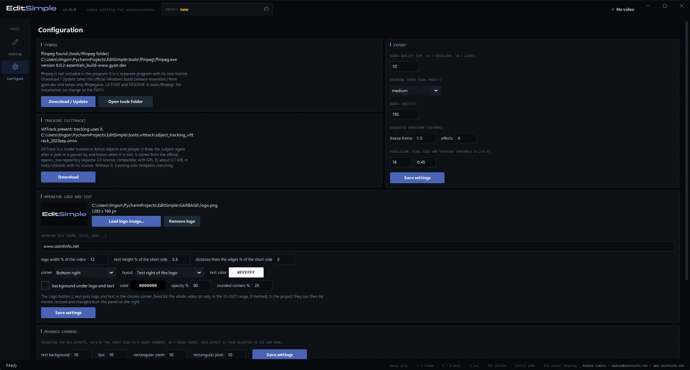

It opens from the bar on the left. It contains:

- **FFmpeg** and **Tracking (VitTrack)**: status, download and update.
- **Export**: video quality (CRF: 15 excellent, 28 light), encoding speed,
  audio quality, suggested durations for freeze frames and effects, default
  pixel size and tracking threshold (higher = stricter in recognizing the
  subject).
- **Operator logo and text**: the logo image (PNG with transparency or JPG),
  the text (name, organization, website), the logo width, the text height,
  the distance from the edges, the corner, the layout, the colors and a
  background with opacity and rounded corners. You prepare them once; then
  the **Logo** button puts them in the video.

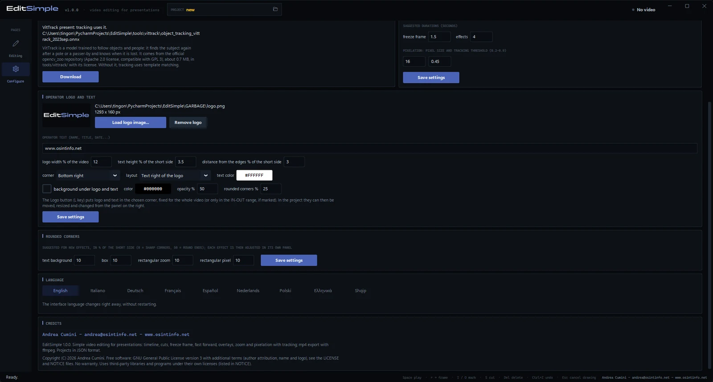

- **Rounded corners** of the background of texts, boxes, rectangular zoom and
  rectangular pixelation.
- Interface **Language**: English, Italiano, Deutsch, Français, Español,
  Nederlands, Polski, Ελληνικά, Shqip. The change is immediate.

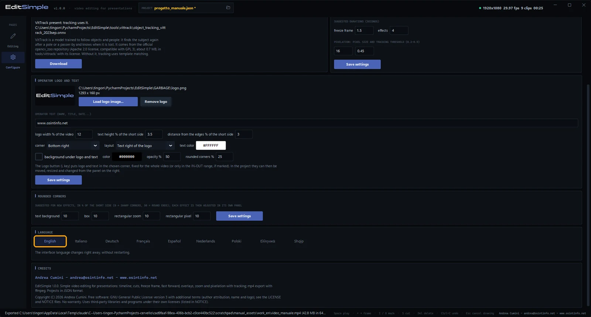

## 5. A complete example, step by step

The example in this chapter is a 19-second video shot in a crowded pedestrian
street (see the note at the top: the passers-by are not doing anything
wrong). In a few steps we enrich it: the operator's logo and website at the
bottom, a zoom on a man's hands that follows their movements, an arrow
pointing at a person for 12 seconds, two boxes on other people and the
pixelation of a face at the end.

### 5.1 Importing the video

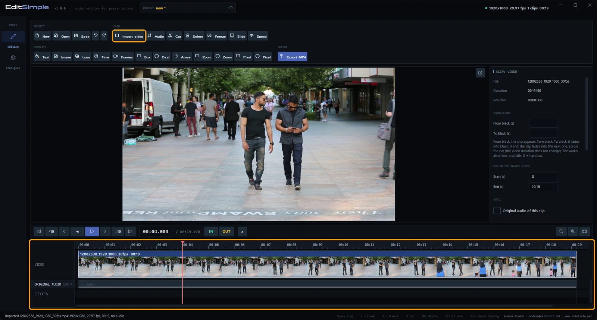

**Import video** (Ctrl+I) opens the footage. The first video sets the size
and frame rate of the project (here 1920×1080, 29.97 frames per second). The
clip appears in the Video track as a filmstrip of frames; its audio in the
Original audio track (this video has none). Other videos are added at the end
or at the cursor.

You move the cursor with a click on the ruler, with the ← → arrows (one
frame), Ctrl+← → (ten frames), Shift+← → (one second), Home and End, or by
typing the time in the box. **Space** plays with audio, **Shift+Space** plays
backwards.

### 5.2 Operator logo and signature

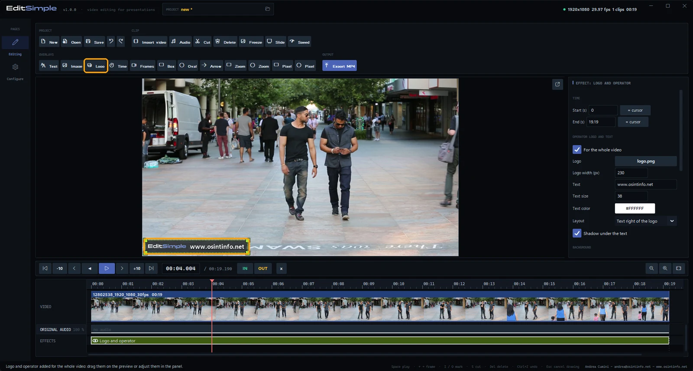

**Logo** (L) puts the logo and text prepared in Configure over the whole video
(or only between IN and OUT, if they are marked). On the preview you move
them by dragging and resize them from the corners; in the panel you change
text, colors, background, corner and opacity.

### 5.3 A zoom that follows the hands

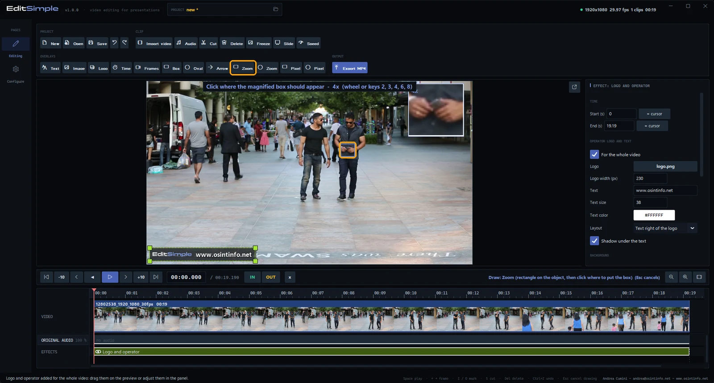

**Zoom** (Z) works in two steps:

1. drag a rectangle around the detail (here the man's hands);
2. the magnified box with the real content appears under the mouse: a click
   places it. You choose the magnification at that moment with the mouse
   wheel or with the 2, 3, 4, 6, 8 keys (up to 16x from the panel).

The zoom **starts following the object right away**: a window shows the
tracking progress.

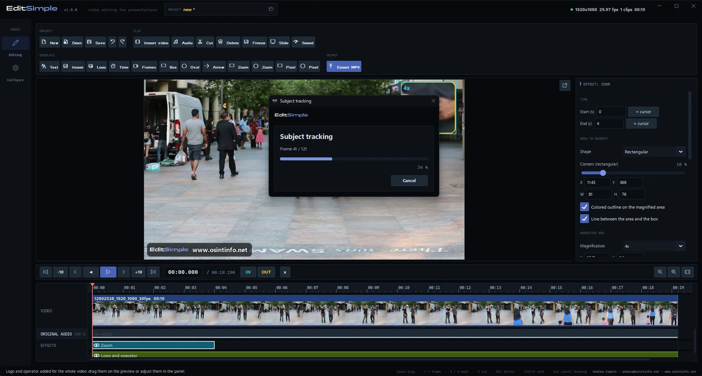

The magnified area follows the hands and grows or shrinks as the man moves
closer or farther away; the magnified box stays where we put it. A colored
outline marks the object and a line connects it to the box. Shift+Z creates
an oval zoom.

### 5.4 An arrow that follows a person

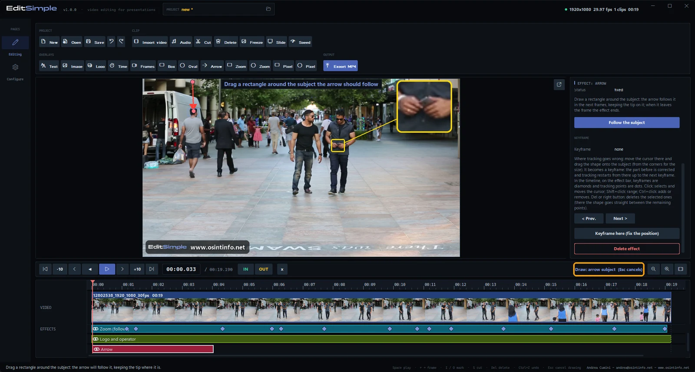

**Arrow** (A): drag from the tail to the tip. To make it follow a person,
press **Follow the subject** in the panel (or *Repeat tracking from the
cursor*) and draw a **rectangle around the subject**: the arrow follows it,
keeping the tip on it.

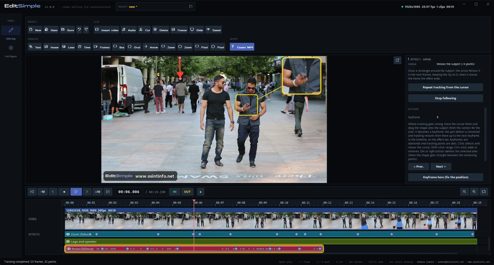

In the timeline the arrow's bar shows *(follows)* and the diamonds of the
keyframes we used to correct the path (see chapter 6).

### 5.5 Boxes on people

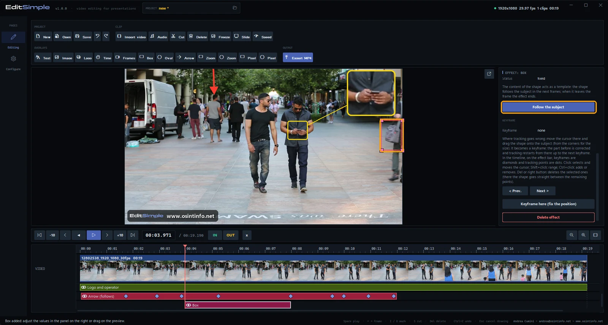

**Box** (R) and **Oval** (E): drag them on the preview. In the panel you
choose color, thickness, fill, rounded corners and opacity; **Follow the
subject** makes them track what they contain. When the person leaves the
frame, the shape goes out with them and the effect ends.

### 5.6 Pixelating a face

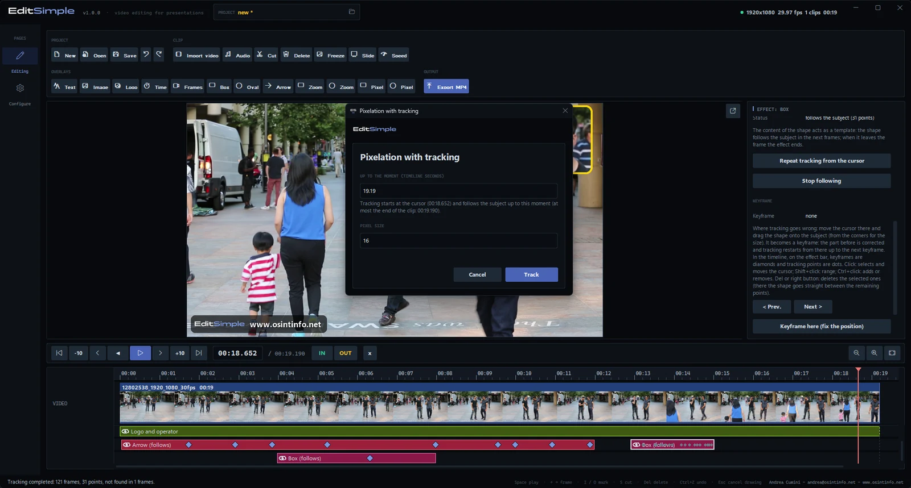

**Pixel** (P rectangular, K oval): drag a box over the face; a window asks how
long to track it and the pixel size.

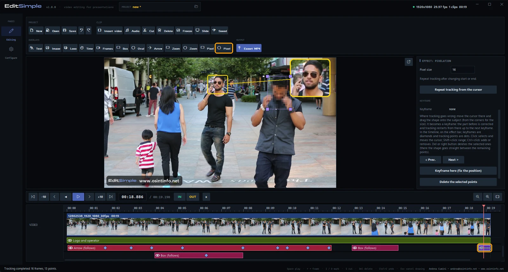

The pixelation follows the face and **grows as it gets closer** to the
camera, so it always covers it. If the subject leaves the frame, the
pixelation goes with it until it is completely out: no frame is left
uncovered.

## 6. Correcting tracking with keyframes

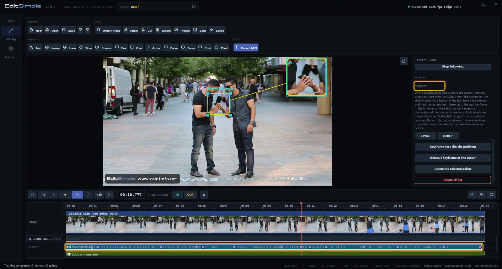

Tracking is automatic, but a real video has obstacles: a pole, a person
passing in front, a subject turning around. Where the shape goes wrong:

1. move the cursor to that frame;
2. **drag the shape onto the subject** in the preview (or resize it from the
   corners).

A **keyframe** is created (a diamond on the effect bar). The program corrects
the path before the keyframe, gradually, and **restarts tracking from
there** up to the next keyframe. You can add as many keyframes as you need:
the zoom in the example has 14, the arrow 9.

On the bar of the selected effect you also see the points found by tracking
(dots). A click selects a point and moves the cursor there, Shift+click
selects a range, Ctrl+click adds or removes; **Delete** or the right mouse
button deletes the selected points. In the panel, the **Keyframe** section
has the *< Prev.* and *Next >* buttons, *Keyframe here (fix the position)*
(fixes the current position) and *Remove keyframe at the cursor*.

## 7. The timeline

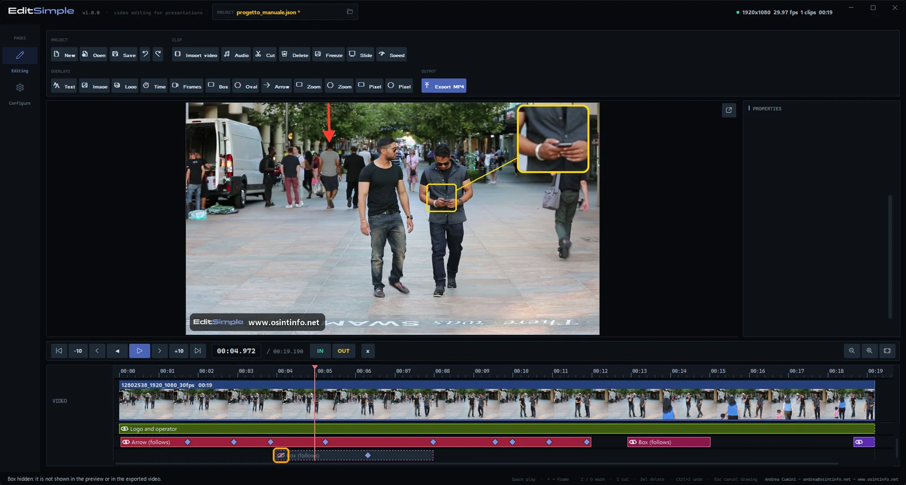

- **Effect bars**: you move them by dragging; the right edge changes the
  duration. Effects are arranged on several lanes; with many effects the
  audio and effects area **scrolls vertically** (scroll bar on the right,
  mouse wheel over the row names or Shift+wheel), while ruler and video stay
  fixed at the top.
- **Eye**: the icon to the left of each bar **hides or shows** the effect, in
  the preview and in the exported video. Useful when many effects overlap
  while you work.
- **Right-click on a bar**: *Extend to cursor* (if the cursor is past the
  end; if the effect follows a subject, tracking continues) and *Stop at
  cursor* (if the cursor is inside the effect).
- **Timeline zoom**: Ctrl+wheel, or the − + buttons and *Fit the timeline*.
  Close up, the filmstrip shows every single frame.
- **Scrolling**: mouse wheel, Alt+drag or drag with the middle button.
- **Divider**: drag the thin strip above the playback controls up or down to
  give more room to the timeline or to the preview.

## 8. The preview: zoom in and detach

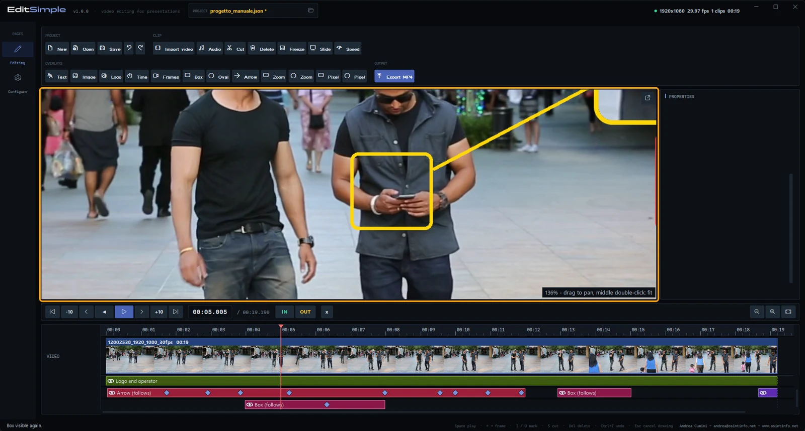

- **Ctrl+wheel** on the preview zooms in around the mouse, up to 16 times: to
  place a zoom precisely on a small detail or to check a pixelation. You pan
  by dragging on an empty spot (or with the middle button); a double-click
  with the middle button returns to the full view.
- **Detaching the preview**: the button at the top right of the preview opens
  it in a **separate window**, to put on a second monitor or wherever you
  like; the timeline takes all the space. The same button (or closing the
  window) **docks it again**. Shortcuts also work in the detached window.

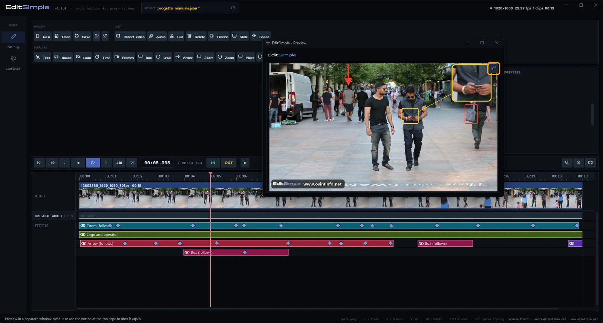

## 9. Opening, closing and in-between slides

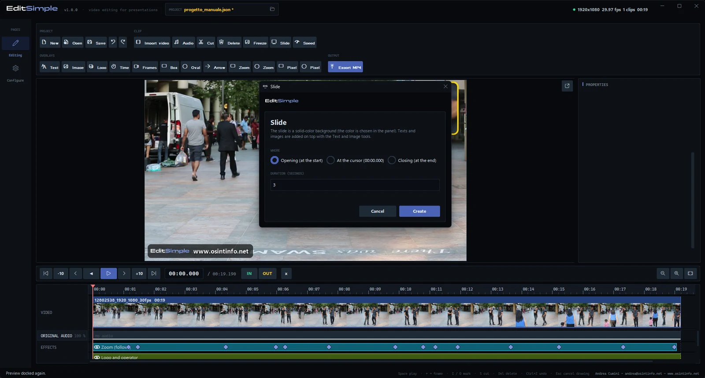

**Slide** inserts a slide **at the start** (opening), **at the cursor** (in
the middle of the video) or **at the end** (closing), with the chosen
duration. The slide is a solid-color background or a **background image**
fitted to the video size (fill, fit or stretch); color and image are chosen
in the panel. The effects that follow move forward together with the video.

On top of the slide you write texts and place images with the **Text** and
**Image** tools: with the cursor on the slide they last as long as the slide.

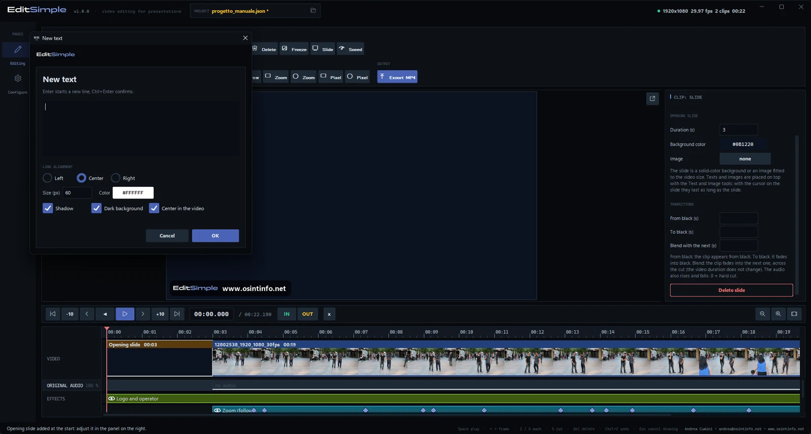

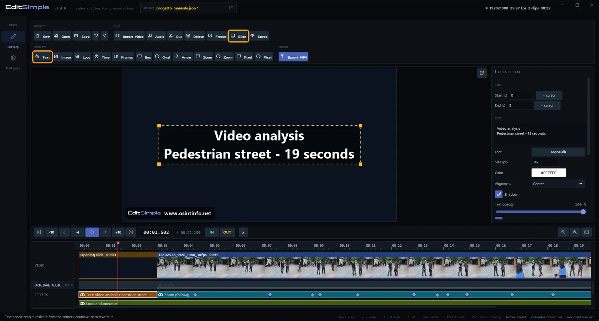

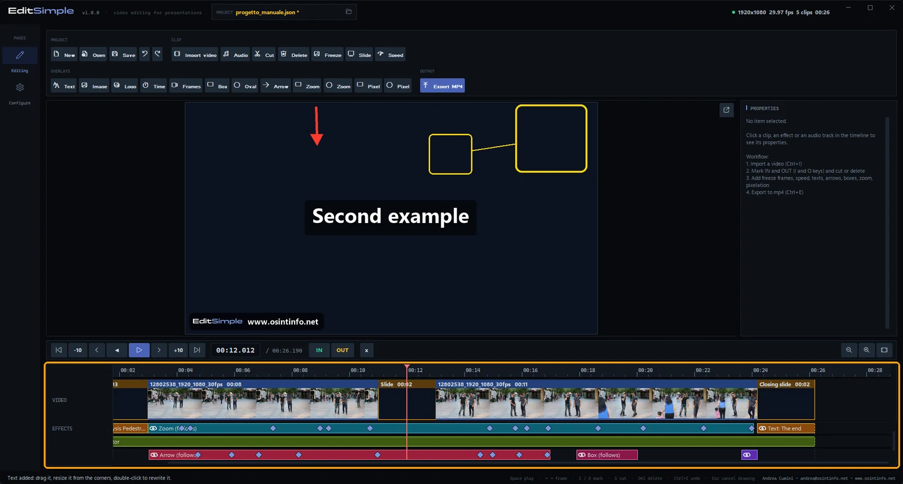

## 10. Texts, images, elapsed time and frame number

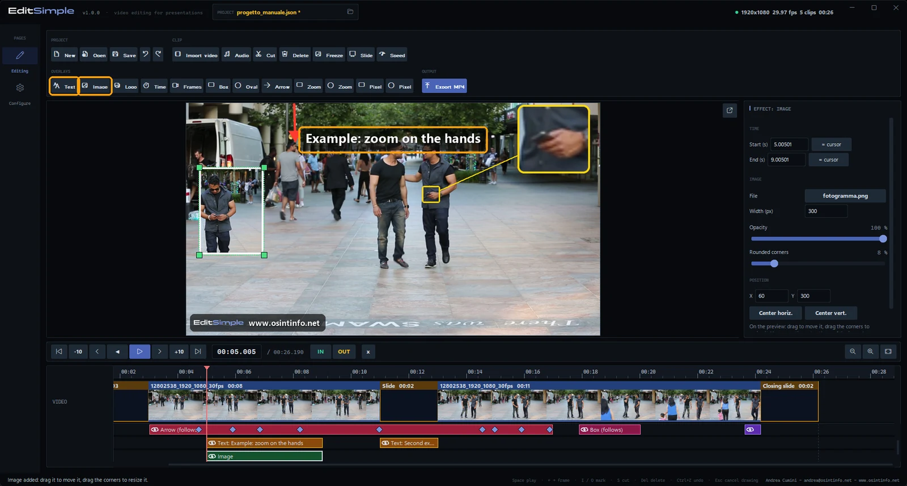

- **Text** (T): a click on the preview opens the text window: multiple lines,
  alignment, size, color, shadow, background (with opacity and rounded
  corners), centering. Double-click a text to rewrite it. In the panel there
  is also the font, chosen from a list that shows each font.
- **Image**: choose a file (PNG, JPG...) and it is placed in the center; you
  move and resize it on the preview; in the panel, opacity and rounded
  corners. Here it is a magnified frame of the subject, but it can be a map,
  a document, a photo.

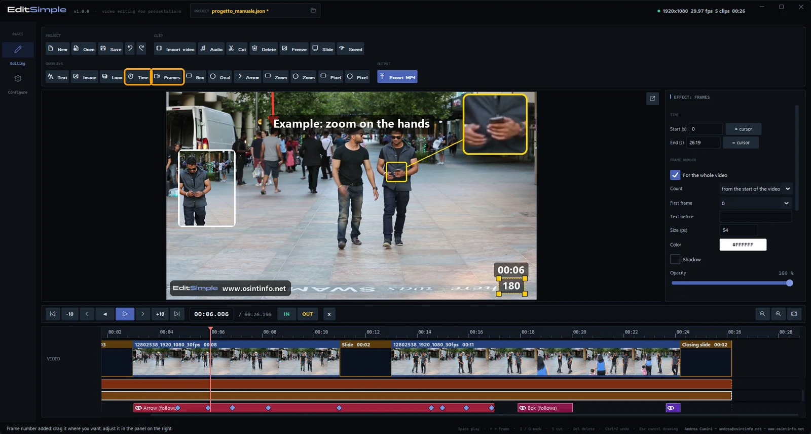

- **Time**: the elapsed time (01:23, 00:01:23 or with tenths), from the start
  of the video or from the start of the effect, with an optional text in
  front. Past one hour, the hours appear.
- **Frames**: the frame number, from 0 or from 1, from the start of the video
  or of the effect. Useful for citing an exact moment.

Both have background, opacity and rounded corners, and you place them
wherever you want with a click.

## 11. Speeding up and slowing down

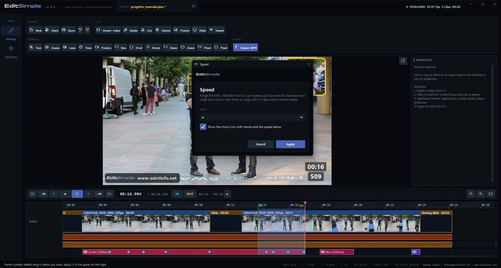

Mark a range with **IN** and **OUT** (I and O keys) and press **Speed** (V).
From **2x to 32x** the video speeds up; **0.5x and 0.25x** slow it down. The
**clock** option shows an icon with turning hands and the speed written
below, so viewers know that time is running faster. The timeline gets
shorter or longer; with 1x you go back to normal speed. Position, size and
color of the clock are adjusted in the clip panel.

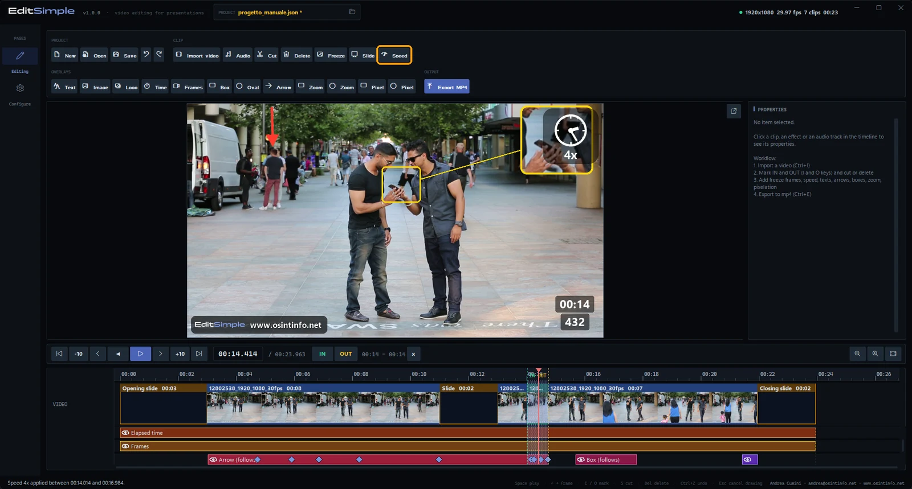

## 12. Cut, delete, freeze frame

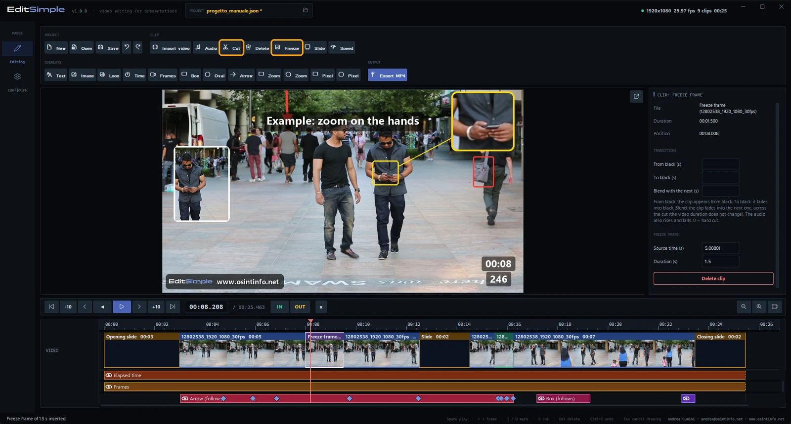

- **Cut** (S) splits the clip at the cursor. You **reorder clips by
  dragging them** in the timeline.
- **Delete** (Delete) removes the range between IN and OUT, or the selected
  item: what follows moves back, together with the effects.
- **Freeze** (F): the frame at the cursor stays still for the chosen number
  of seconds; what follows moves forward.

Everything can be undone with Ctrl+Z and redone with Ctrl+Y.

## 13. Transitions

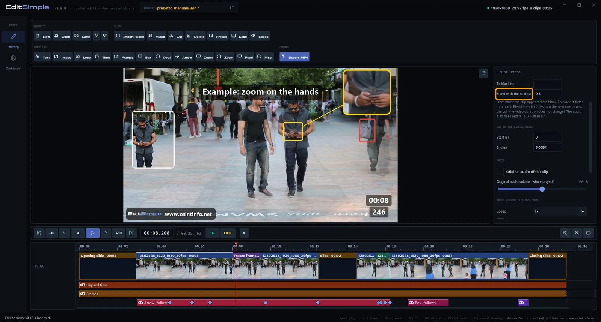

When you select a clip, the panel has the **Transitions** section:

- **From black**: the clip appears from black;
- **To black**: the clip fades into black;
- **Blend with the next**: the clip fades into the next one across the cut.
  The outgoing clip stays still during the blend; the video duration does
  not change.

The audio also rises and falls with the transitions. 0 means a hard cut.

## 14. Audio

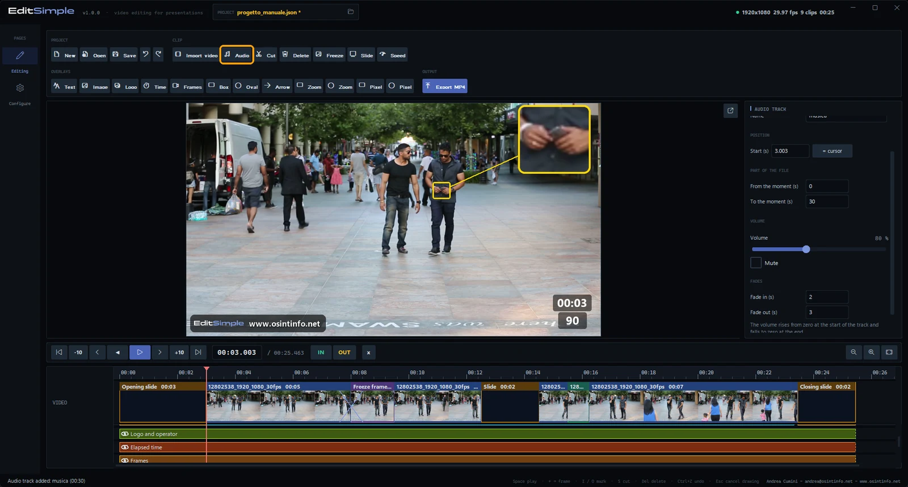

- **Audio** adds a track (commentary, music) at the cursor. In the panel:
  name, position, part of the file, **volume**, mute and **fades** in and
  out. You move it by dragging; a click on its name selects all of it,
  Delete removes it.
- The **white line** above each track shows the volume curve: fades and
  transitions are visible at a glance.
- **Original audio**: a click on the row name selects all the audio of the
  video (volume, fades at the start and at the end, deletion); a click on a
  piece selects only that piece (volume, fades, mute). With IN and OUT marked
  and the original audio selected, Delete removes **only the audio** of that
  stretch: the video stays.
- Playback in the preview is **with audio** (mixed as in the export).

## 15. Exporting the video

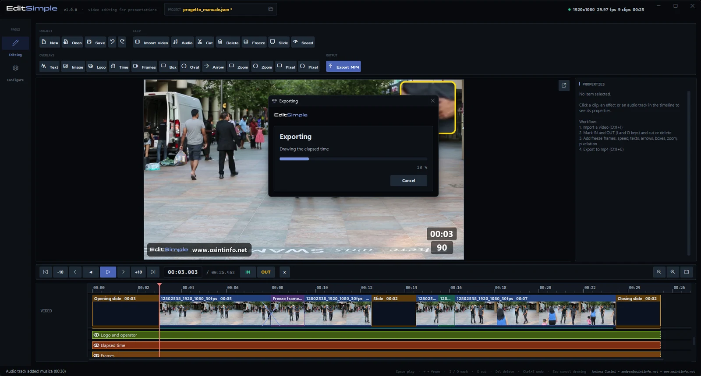

**Export MP4** (Ctrl+E) chooses the file and creates the video with ffmpeg:
H.264 and AAC, quality and encoding speed set in Configure. The result is
identical to the preview. The export can be cancelled; at the end the program
offers to open the folder.

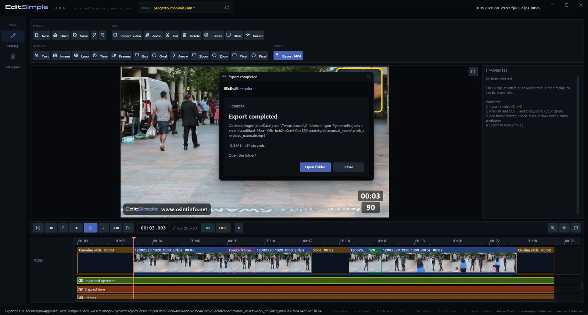

## 16. Tips for a good result

- **Put the zoom box in a neutral area**: the magnified box covers the part
  of the video it sits on, for the whole time it appears. Put it where
  nothing interesting happens (sky, wall, floor).
- **Draw tightly around the subject** for boxes, ovals and pixelations: the
  content of the shape is the template searched for in the following frames.
- **For the arrow, a slightly larger rectangle** (head and shoulders instead
  of just the head) holds up better when other people pass in front.
- **After tracking, scroll through the video**: where the shape goes wrong,
  drag it onto the subject. A few keyframes are enough even for long paths.
- **With many effects**, use the eye to hide the ones you don't need at the
  moment, and the detached preview to have more room in the timeline.
- **Save often** (Ctrl+S): the project is a small JSON file that you can
  reopen and edit whenever you want.

## 17. Keyboard and mouse shortcuts

| Key | Action |
| --- | --- |
| Space / Shift+Space | Play or pause / play backwards |
| ← → | One frame back / forward |
| Ctrl+← → | Ten frames back / forward |
| Shift+← → | One second back / forward |
| Home / End | Start / end of the video |
| I / O | Mark IN / OUT |
| S | Cut at the cursor |
| F | Freeze frame |
| V | Speed of the IN-OUT range |
| T / R / E / A | Text / box / oval / arrow |
| Z / Shift+Z | Rectangular / oval zoom |
| P / K | Rectangular / oval pixelation |
| L | Logo and operator |
| Delete | Delete the selection (or the IN-OUT range) |
| Esc | Cancel the drawing in progress |
| Ctrl+Z / Ctrl+Y | Undo / redo |
| Ctrl+N / Ctrl+O / Ctrl+S / Ctrl+Shift+S | New / open / save / save as |
| Ctrl+I | Import video |
| Ctrl+E | Export MP4 |

| Mouse | Where | Action |
| --- | --- | --- |
| Wheel | Preview | One frame forward or back |
| Ctrl+wheel | Preview | Zooms in the view |
| Drag on an empty spot, middle button | Zoomed-in preview | Pans the view |
| Double-click | Text in the preview | Rewrites the text |
| Ctrl+wheel | Timeline | Zooms in the timeline |
| Wheel / Alt+drag / middle button | Timeline | Scrolls horizontally |
| Shift+wheel, wheel over the names | Timeline | Scrolls audio and effects vertically |
| Right button | Effect bar | Extend to cursor / stop at cursor |
| Right button | Keyframe or point | Deletes |

## 18. The project file

The project is a JSON file with the clips, the audio tracks, the effects
(with the tracking paths and the keyframes) and the paths of the files used.
Videos, audio files and images are not copied into the project: leave them
where they are until the work is finished. The exported video, on the other
hand, is a self-contained MP4.

---

EditSimple is free software, distributed under the GNU GPL version 3 license
with additional author attribution terms (see `LICENSE` and `NOTICE`).
ffmpeg and VitTrack are separate programs with their own licenses.
