# EditSimple — Manual de usuario

[English](manual.en.md) · [Italiano](manual.it.md) · [Deutsch](manual.de.md) · [Français](manual.fr.md) · **Español** · [Nederlands](manual.nl.md) · [Polski](manual.pl.md) · [Ελληνικά](manual.el.md) · [Shqip](manual.sq.md)

EditSimple es un programa de edición de vídeo pensado para quien necesita
**explicar un hecho o mostrar una evidencia** en un vídeo: una entrega de mano
en medio de la multitud, un vehículo que llega, una persona a la que seguir o
que hacer irreconocible. Se importa la grabación, se indica lo que importa y
el programa hace el resto: las flechas, los recuadros, los zooms y los
pixelados **siguen solos al sujeto** en los fotogramas siguientes, y donde el
seguimiento se equivoca basta con arrastrar la figura al lugar correcto para
corregirlo. En pocos minutos se obtiene un MP4 listo para proyectar o adjuntar,
con diapositivas de apertura y de cierre, textos, logo y firma del operador.

*Andrea Cumini — www.osintinfo.net — andrea@osintinfo.net*
*EditSimple forma parte de las herramientas de [Seity](https://www.seity.com).*

> **Nota sobre el vídeo de ejemplo.** Las imágenes de este manual usan un
> vídeo de archivo publicado en Pexels: una calle peatonal con transeúntes
> corrientes. **Las personas que aparecen no están haciendo nada malo**: las
> flechas, los recuadros, los zooms y los pixelados colocados sobre ellas solo
> sirven para mostrar cómo funciona el programa, y los sujetos se han elegido
> al azar.

## Índice

1. [Qué se puede hacer](#1-qué-se-puede-hacer)
2. [Instalación y primer inicio](#2-instalación-y-primer-inicio)
3. [La ventana](#3-la-ventana)
4. [Página Configurar](#4-página-configurar)
5. [Un ejemplo completo, paso a paso](#5-un-ejemplo-completo-paso-a-paso)
6. [Corregir el seguimiento con los keyframes](#6-corregir-el-seguimiento-con-los-keyframes)
7. [La línea de tiempo](#7-la-línea-de-tiempo)
8. [La vista previa: ampliar y separar](#8-la-vista-previa-ampliar-y-separar)
9. [Diapositivas de apertura, de cierre e intermedias](#9-diapositivas-de-apertura-de-cierre-e-intermedias)
10. [Textos, imágenes, tiempo transcurrido y número de fotograma](#10-textos-imágenes-tiempo-transcurrido-y-número-de-fotograma)
11. [Acelerar y ralentizar](#11-acelerar-y-ralentizar)
12. [Cortar, eliminar, imagen congelada](#12-cortar-eliminar-imagen-congelada)
13. [Transiciones](#13-transiciones)
14. [Audio](#14-audio)
15. [Exportar el vídeo](#15-exportar-el-vídeo)
16. [Consejos para un buen resultado](#16-consejos-para-un-buen-resultado)
17. [Atajos de teclado y ratón](#17-atajos-de-teclado-y-ratón)
18. [El archivo de proyecto](#18-el-archivo-de-proyecto)

## 1. Qué se puede hacer

| Función | En resumen |
| --- | --- |
| **Seguimiento del sujeto** | Recuadros, óvalos, flechas, zooms y pixelados siguen a una persona, un rostro, un objeto o un vehículo; crecen y se reducen con él si se acerca o se aleja de la cámara; terminan solos cuando sale del encuadre. |
| **Keyframes de corrección** | Donde el seguimiento se equivoca (un poste, una persona que pasa por delante) se arrastra la figura sobre el sujeto: el programa corrige el recorrido antes y después de ese punto. |
| **Zoom** | Un detalle pequeño (las manos, una matrícula) ampliado de 2x a 16x en un recuadro, con un contorno y una línea que lo unen al objeto. Rectangular u ovalado. |
| **Pixelado** | Rectangular u ovalado, para rostros y matrículas; sigue al sujeto y crece con él. |
| **Textos e imágenes** | Textos de varias líneas con fondo y esquinas redondeadas; imágenes superpuestas (un fotograma, un mapa, un documento). |
| **Logo y firma** | Logo y texto del operador fijos en una esquina, preparados una sola vez en Configurar. |
| **Tiempo y fotogramas** | El tiempo transcurrido y el número de fotograma escritos en el vídeo, donde se quiera. |
| **Diapositivas** | Al principio, al final o en medio; color liso o imagen de fondo; encima se escriben textos y se ponen imágenes. |
| **Velocidad** | De 0,25x (cámara lenta) a 32x (avance rápido), con el icono de un reloj que indica la velocidad. |
| **Cortes** | Corte en el cursor, eliminación de una porción, imagen congelada, reordenación de los clips. |
| **Transiciones** | Aparición desde negro, desaparición en negro, fundido con el clip siguiente. |
| **Audio** | Pistas añadidas (comentario, música) con volumen y fundidos; audio original con volumen, fundidos y eliminación de tramos sueltos. |
| **Vista previa** | Reproducción con audio, hacia atrás, fotograma a fotograma; vista previa ampliable y **separable** en una ventana aparte. |
| **Exportación** | MP4 (H.264 + AAC) idéntico a la vista previa. |
| **Idiomas** | Interfaz en 9 idiomas, que se cambia sin reiniciar. |

## 2. Instalación y primer inicio

**Ejecutable (Windows 10/11, 64 bits).** Extraiga el zip donde quiera e inicie
`EditSimple.exe`. No hace falta Python.

**Desde el código fuente.** Con Python 3.11:

```bash
python -m venv .venv
.venv\Scripts\python.exe -m pip install -r requirements.txt
.venv\Scripts\python.exe EditSimple.py
```

**FFmpeg.** EditSimple usa ffmpeg para leer los archivos y para exportar. No
está incluido: en el primer inicio, si no lo encuentra, se abre la página
**Configurar** y el botón **Descargar / Actualizar** lo descarga (compilación
oficial para Windows) en la carpeta `tools\ffmpeg\` junto al programa. Sin
instalación.

**VitTrack (opcional).** En la misma página, **Descargar** obtiene VitTrack,
un modelo pequeño (0,7 MB) que ayuda al seguimiento a recuperar al sujeto
tras un obstáculo. Sin él, el seguimiento funciona igualmente.

## 3. La ventana

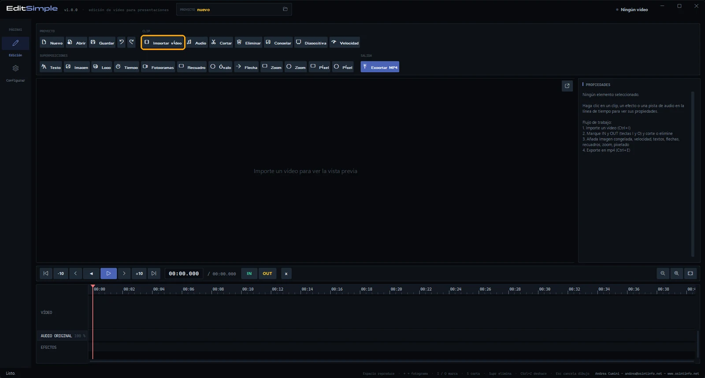

- **Barra de herramientas**, en cuatro grupos: *Proyecto* (nuevo, abrir,
  guardar, deshacer, rehacer), *Clip* (importar vídeo, audio, cortar,
  eliminar, imagen congelada, diapositiva, velocidad), *Superposiciones*
  (texto, imagen, logo, tiempo, fotogramas, recuadro, óvalo, flecha, zoom
  rectangular y ovalado, píxel rectangular y ovalado) y *Salida* (exportar
  MP4). Cada botón tiene una sugerencia con su atajo.
- **Vista previa**, en el centro: muestra el fotograma del cursor con todos los
  efectos, exactamente como en el vídeo exportado. Sobre ella se dibujan y se
  mueven los efectos.
- **Propiedades**, a la derecha: los valores del elemento seleccionado (un
  clip, un efecto, una pista de audio).
- **Transporte**: inicio, -10 fotogramas, fotograma anterior, reproducción
  hacia atrás, reproducción, fotograma siguiente, +10 fotogramas, fin; el
  tiempo del cursor (se puede escribir); IN, OUT y el borrado de las marcas; a
  la derecha, el zoom de la línea de tiempo.
- **Línea de tiempo**, abajo: regla, pista **Vídeo** en forma de película,
  **Audio original**, pistas de audio añadidas y **Efectos**.

## 4. Página Configurar

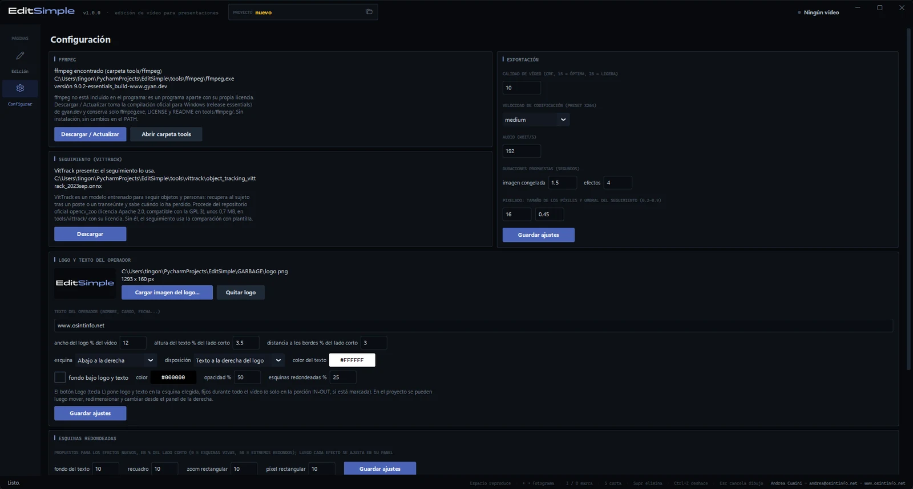

Se abre desde la barra de la izquierda. Contiene:

- **FFmpeg** y **Seguimiento (VitTrack)**: estado, descarga y actualización.
- **Exportación**: calidad del vídeo (CRF: 15 óptima, 28 ligera), velocidad
  de codificación, calidad del audio, duraciones propuestas para la imagen
  congelada y los efectos, tamaño predeterminado de los píxeles y umbral del
  seguimiento (más alto = más estricto al reconocer al sujeto).
- **Logo y texto del operador**: la imagen del logo (PNG con transparencia o
  JPG), el texto (nombre, organismo, sitio web), el ancho del logo, la altura
  del texto, la distancia a los bordes, la esquina, la disposición, los
  colores y un fondo con opacidad y esquinas redondeadas. Se preparan una sola
  vez; luego el botón **Logo** los pone en el vídeo.

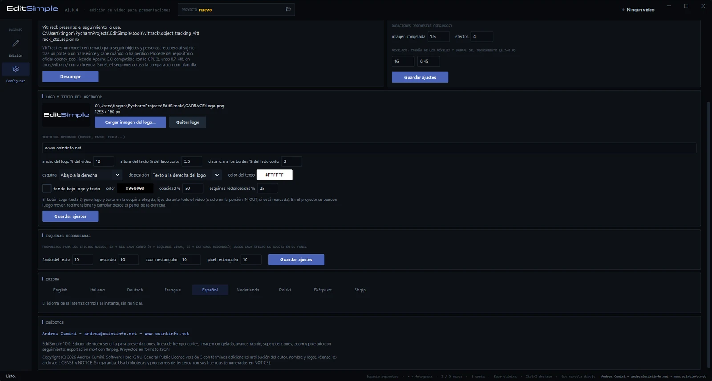

- **Esquinas redondeadas** del fondo de los textos, de los recuadros, del zoom
  rectangular y del pixelado rectangular.
- **Idioma** de la interfaz: English, Italiano, Deutsch, Français,
  Español, Nederlands, Polski, Ελληνικά, Shqip. El cambio es inmediato.

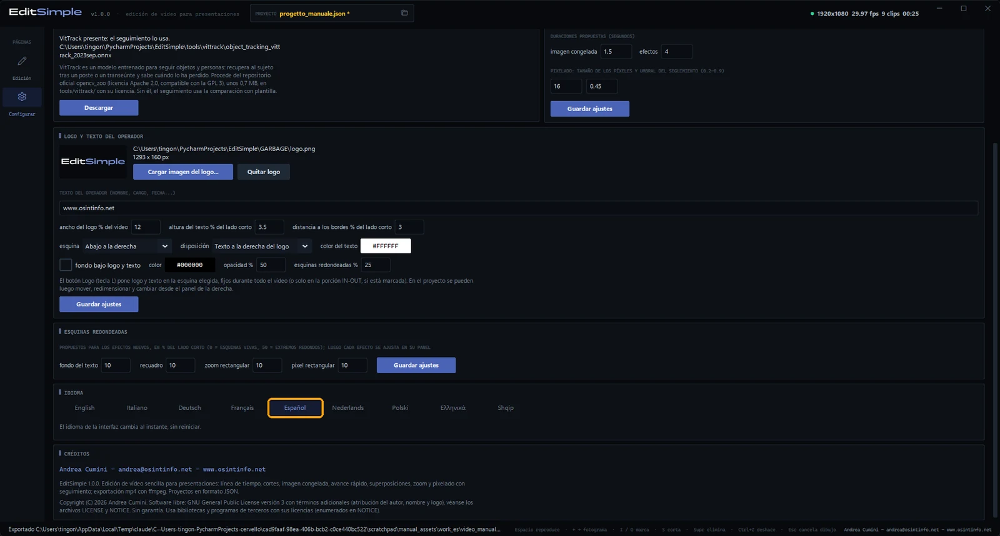

## 5. Un ejemplo completo, paso a paso

El ejemplo de este capítulo es un vídeo de 19 segundos grabado en una calle
peatonal concurrida (véase la nota inicial: los transeúntes no hacen nada
malo). En pocos pasos lo enriquecemos: el logo y el sitio web del operador
abajo, un zoom sobre las manos de un hombre que sigue sus movimientos, una
flecha que señala a una persona durante 12 segundos, dos recuadros sobre otras
personas y el pixelado de un rostro al final.

### 5.1 Importar el vídeo

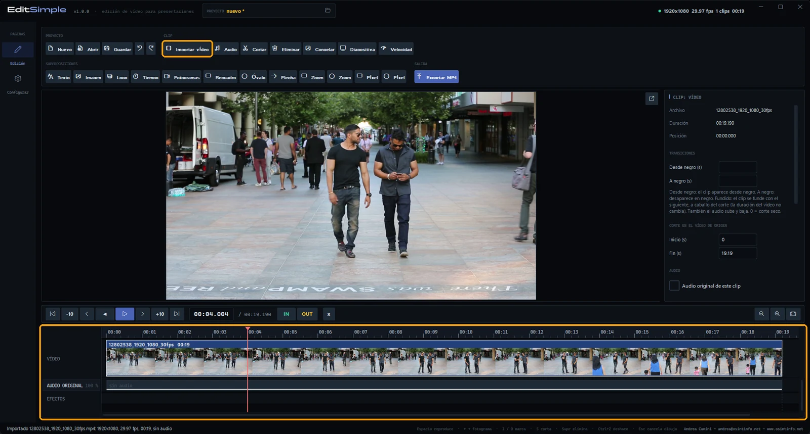

**Importar vídeo** (Ctrl+I) abre la grabación. El primer vídeo fija el tamaño
y la frecuencia del proyecto (aquí 1920×1080, 29,97 fotogramas por segundo).
El clip aparece en la pista Vídeo como una película de fotogramas; su audio,
en la pista Audio original (este vídeo no tiene). Otros vídeos se añaden al
final o en el cursor.

El cursor se mueve con un clic en la regla, con las flechas ← → (un
fotograma), Ctrl+← → (diez fotogramas), Mayús+← → (un segundo), Inicio y Fin,
o escribiendo el tiempo en la casilla. **Espacio** reproduce con audio,
**Mayús+Espacio** reproduce hacia atrás.

### 5.2 Logo y firma del operador

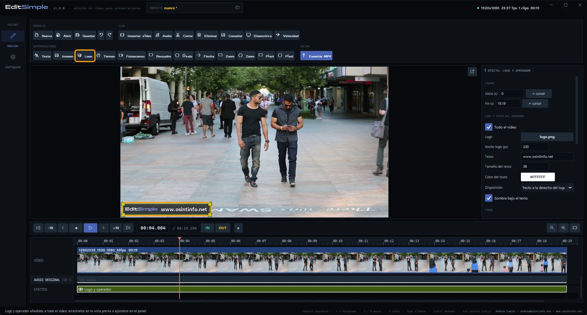

**Logo** (L) pone el logo y el texto preparados en Configurar durante todo el
vídeo (o solo entre IN y OUT, si están marcados). En la vista previa se
mueven arrastrándolos y se amplían desde las esquinas; en el panel se cambian
el texto, los colores, el fondo, la esquina y la opacidad.

### 5.3 Un zoom que sigue las manos

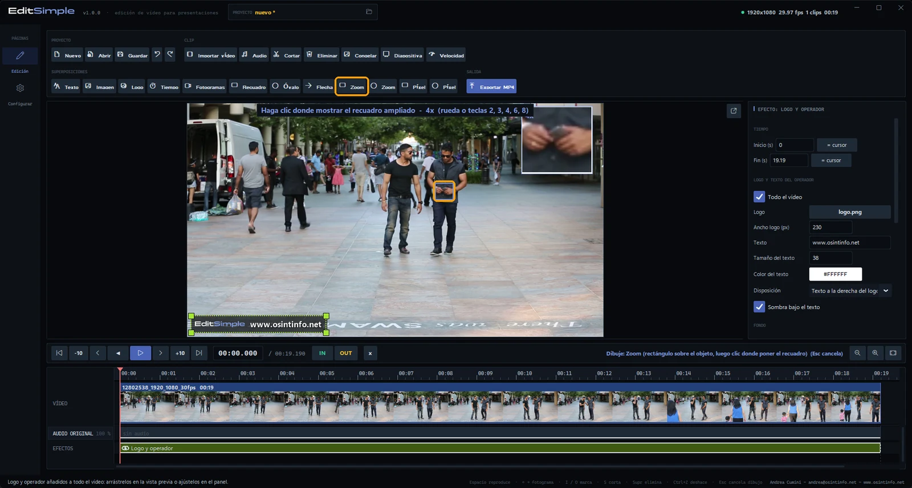

**Zoom** (Z) se usa en dos pasos:

1. se arrastra un rectángulo alrededor del detalle (aquí las manos del
   hombre);
2. bajo el ratón aparece el recuadro ampliado con el contenido real: un clic
   lo coloca. La ampliación se elige en ese momento con la rueda o con las
   teclas 2, 3, 4, 6, 8 (hasta 16x desde el panel).

El zoom **empieza enseguida a seguir el objeto**: una ventana muestra el
avance del seguimiento.

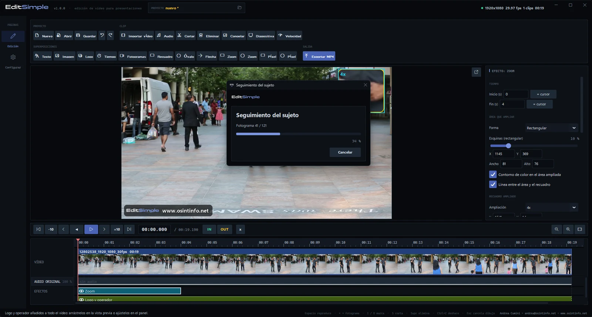

El área ampliada sigue las manos y crece o se reduce si el hombre se acerca o
se aleja; el recuadro ampliado se queda donde lo pusimos. Un contorno de color
marca el objeto y una línea lo une al recuadro. Mayús+Z crea un zoom ovalado.

### 5.4 Una flecha que sigue a una persona

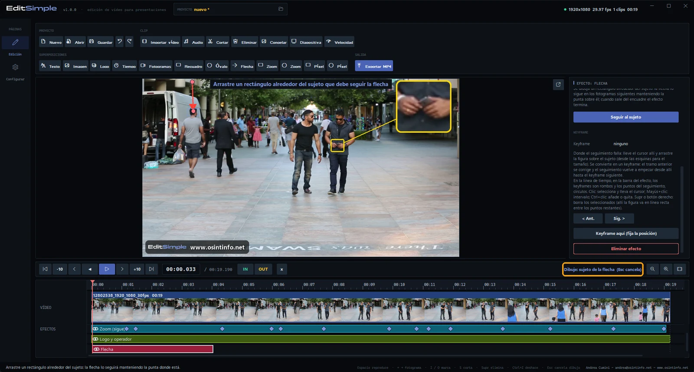

**Flecha** (A): se arrastra desde la cola hasta la punta. Para que siga a una
persona, se pulsa **Seguir al sujeto** en el panel (o *Repetir seguimiento
desde el cursor*) y se dibuja un **rectángulo alrededor del sujeto**: la
flecha lo sigue manteniendo la punta sobre él.

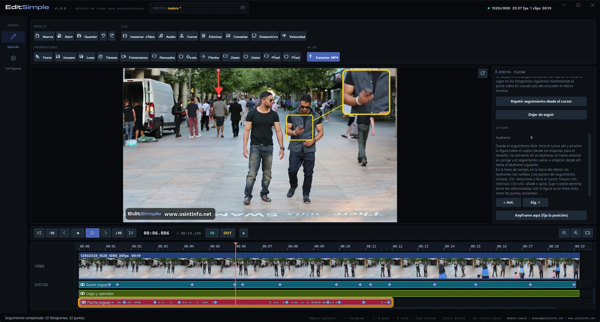

En la línea de tiempo, la barra de la flecha muestra *(sigue)* y los rombos de
los keyframes con los que hemos corregido el recorrido (véase el capítulo 6).

### 5.5 Recuadros sobre las personas

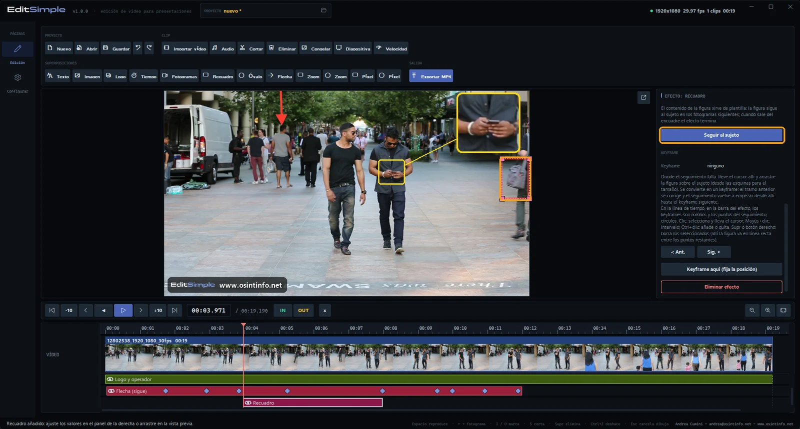

**Recuadro** (R) y **Óvalo** (E): se arrastran en la vista previa. En el
panel se eligen color, grosor, relleno, esquinas redondeadas y opacidad;
**Seguir al sujeto** hace que sigan lo que contienen. Cuando la persona sale
del encuadre, la figura la acompaña fuera y el efecto termina.

### 5.6 El pixelado de un rostro

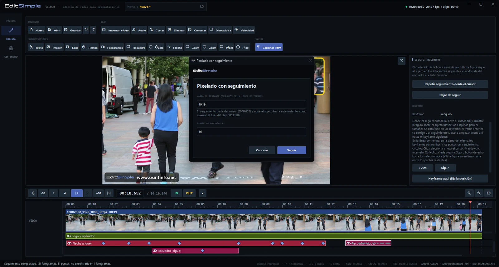

**Píxel** (P rectangular, K ovalado): se arrastra un recuadro sobre el rostro;
una ventana pregunta hasta cuándo seguirlo y el tamaño de los píxeles.

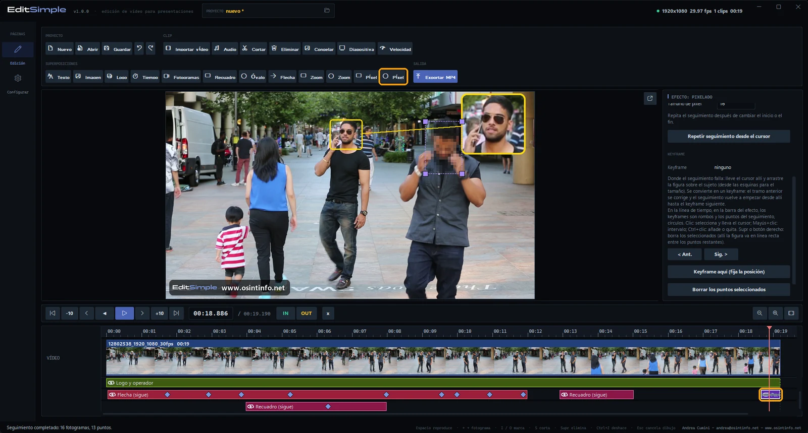

El pixelado sigue el rostro y **crece cuando se acerca** a la cámara, así que
siempre lo cubre. Si el sujeto sale del encuadre, el pixelado lo acompaña
hasta que ha salido del todo: ningún fotograma queda al descubierto.

## 6. Corregir el seguimiento con los keyframes

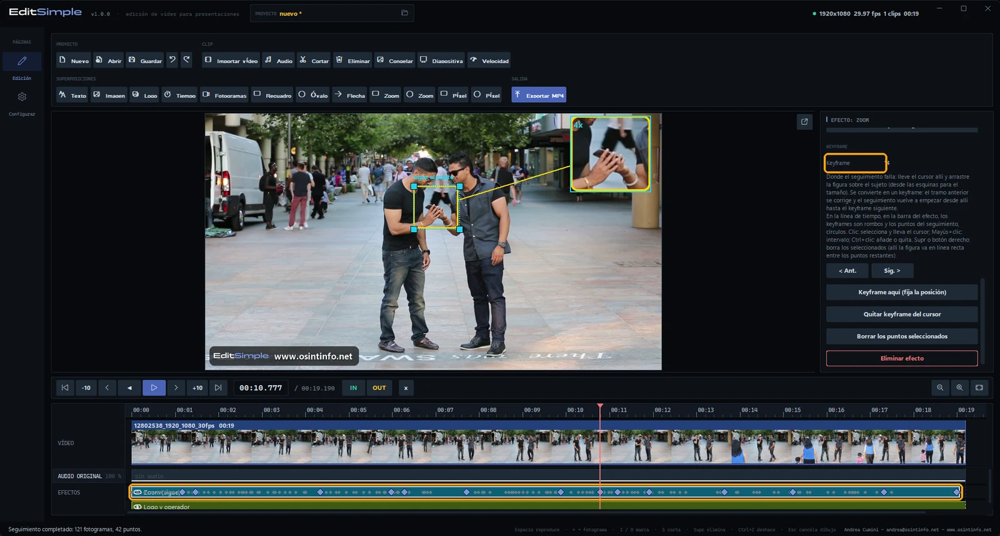

El seguimiento es automático, pero un vídeo real tiene obstáculos: un poste,
una persona que pasa por delante, un sujeto que se gira. Donde la figura se
equivoca:

1. lleve el cursor a ese fotograma;
2. **arrastre la figura sobre el sujeto** en la vista previa (o
   redimensiónela desde las esquinas).

Se crea un **keyframe** (un rombo en la barra del efecto). El programa corrige
el recorrido antes del keyframe, de forma gradual, y **reanuda el seguimiento
desde ahí** hasta el keyframe siguiente. Se pueden poner todos los keyframes
que hagan falta: el zoom del ejemplo tiene 14 y la flecha, 9.

En la barra del efecto seleccionado se ven también los puntos encontrados por
el seguimiento (círculos). Un clic selecciona un punto y lleva allí el cursor,
Mayús+clic selecciona un intervalo, Ctrl+clic añade o quita; **Supr** o el
botón derecho borran los puntos seleccionados. En el panel, la sección
**Keyframe** tiene los botones *< Ant.* y *Sig. >*, *Keyframe aquí (fija la
posición)* y *Quitar keyframe del cursor*.

## 7. La línea de tiempo

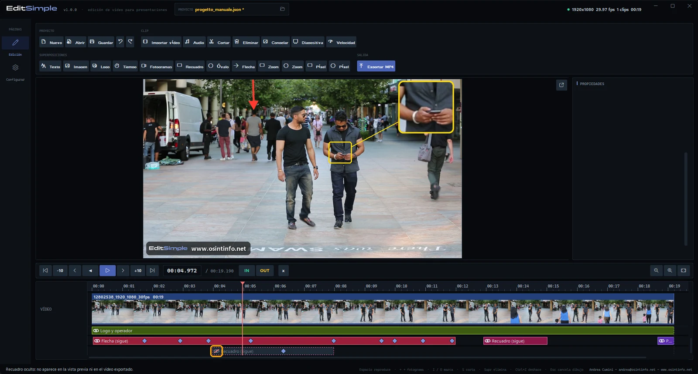

- **Barras de los efectos**: se mueven arrastrándolas; el borde derecho cambia
  la duración. Los efectos se reparten en varias filas; con muchos efectos, la
  parte de audio y efectos **se desplaza en vertical** (barra de la derecha,
  rueda sobre los nombres de las filas o Mayús+rueda), mientras la regla y el
  vídeo se quedan fijos arriba.
- **Ojo**: el icono a la izquierda de cada barra **oculta o muestra** el
  efecto, en la vista previa y en el vídeo exportado. Útil cuando muchos
  efectos se superponen mientras se trabaja.
- **Botón derecho sobre una barra**: *Alargar hasta el cursor* (si el cursor
  está más allá del final; si el efecto sigue a un sujeto, el seguimiento
  continúa) y *Cortar en el cursor* (si el cursor está dentro del efecto).
- **Zoom de la línea de tiempo**: Ctrl+rueda, o los botones − + y *Ajustar*.
  De cerca, la película muestra cada fotograma.
- **Desplazamiento**: rueda, Alt+arrastrar o arrastre con el botón central.
- **Divisor**: la franja fina sobre los controles de reproducción se arrastra
  hacia arriba o hacia abajo para dar más espacio a la línea de tiempo o a la
  vista previa.

## 8. La vista previa: ampliar y separar

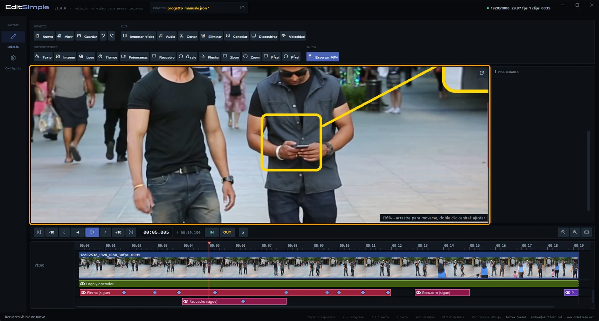

- **Ctrl+rueda** sobre la vista previa la amplía alrededor del ratón, hasta 16
  veces: para colocar con precisión un zoom sobre un detalle pequeño o para
  comprobar un pixelado. Para desplazarse, se arrastra sobre un punto vacío (o
  con el botón central); doble clic con el botón central vuelve a la vista
  completa.
- **Separar la vista previa**: el botón de arriba a la derecha de la vista
  previa la abre en una **ventana aparte**, para ponerla en un segundo
  monitor o donde se quiera; la línea de tiempo ocupa todo el espacio. El
  mismo botón (o cerrar la ventana) la **vuelve a acoplar**. Los atajos
  funcionan también en la ventana separada.

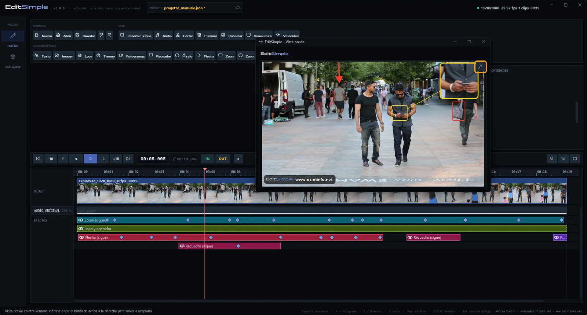

## 9. Diapositivas de apertura, de cierre e intermedias

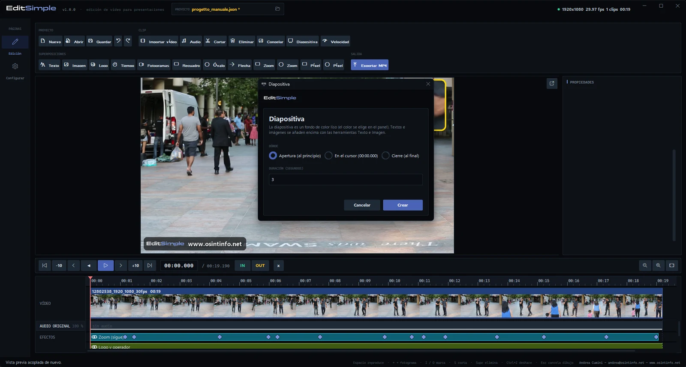

**Diapositiva** inserta una diapositiva **al principio** (apertura), **en el
cursor** (en medio del vídeo) o **al final** (cierre), con la duración
elegida. La diapositiva es un fondo de color liso o una **imagen de fondo**
ajustada al tamaño del vídeo (rellenar, entera o estirar); el color y la
imagen se eligen en el panel. Los efectos que siguen se desplazan hacia
delante junto con el vídeo.

Sobre la diapositiva se escriben textos y se ponen imágenes con las
herramientas **Texto** e **Imagen**: con el cursor en la diapositiva duran lo
mismo que ella.

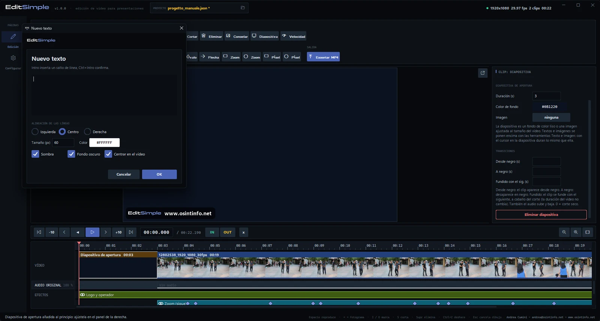

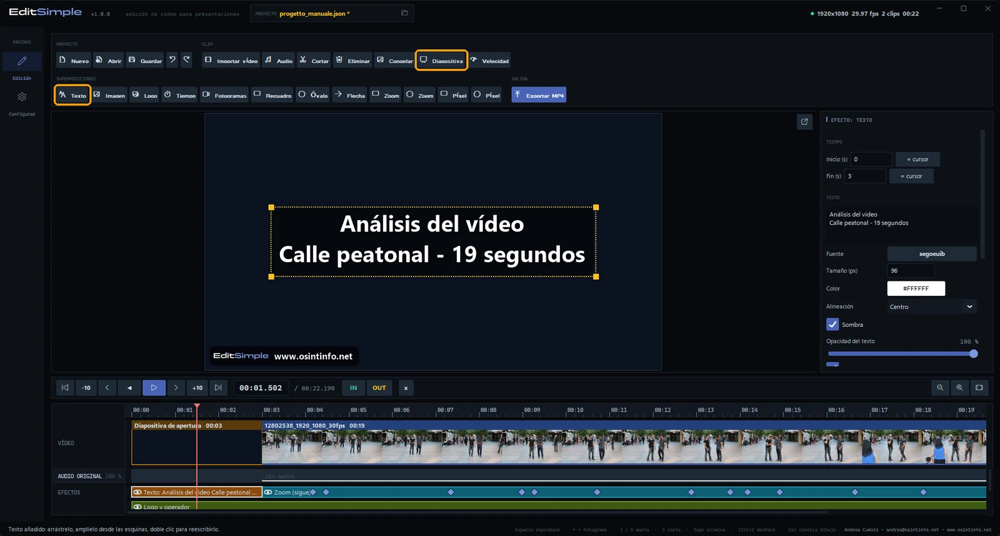

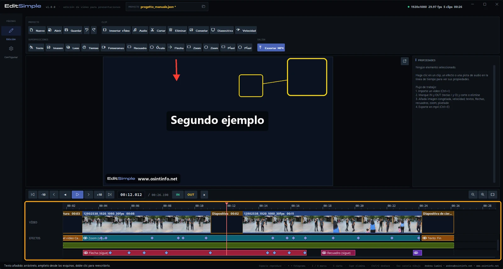

## 10. Textos, imágenes, tiempo transcurrido y número de fotograma

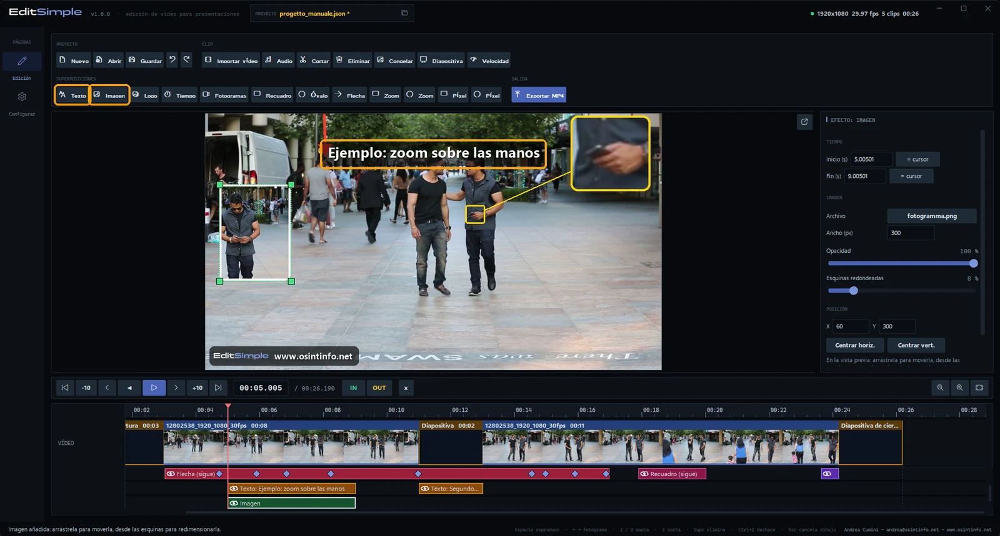

- **Texto** (T): un clic en la vista previa abre la ventana del texto: varias
  líneas, alineación, tamaño, color, sombra, fondo (con opacidad y esquinas
  redondeadas), centrado. Doble clic sobre un texto para reescribirlo. En el
  panel también la fuente, elegida en una lista que muestra cada fuente.
- **Imagen**: elige un archivo (PNG, JPG...) y lo pone en el centro; se mueve
  y se redimensiona en la vista previa; en el panel, opacidad y esquinas
  redondeadas. Aquí es un fotograma ampliado del sujeto, pero puede ser un
  mapa, un documento, una foto.

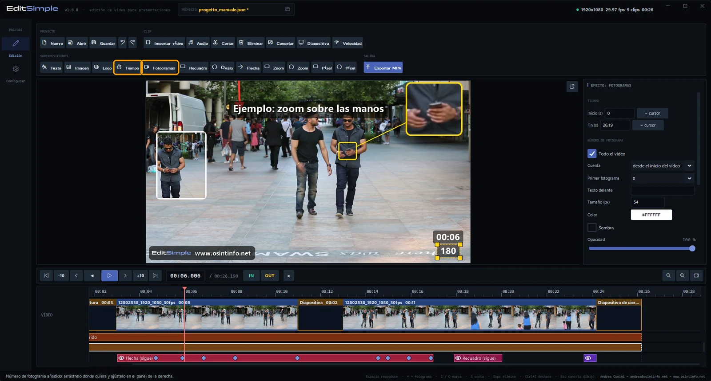

- **Tiempo**: el tiempo transcurrido (01:23, 00:01:23 o con décimas), desde el
  inicio del vídeo o desde el inicio del efecto, con un texto delante a
  elección. Pasada la hora, aparecen las horas.
- **Fotogramas**: el número de fotograma, desde 0 o desde 1, desde el inicio
  del vídeo o del efecto. Útil para citar con precisión un instante.

Los dos tienen fondo, opacidad y esquinas redondeadas, y se colocan donde se
quiera con un clic.

## 11. Acelerar y ralentizar

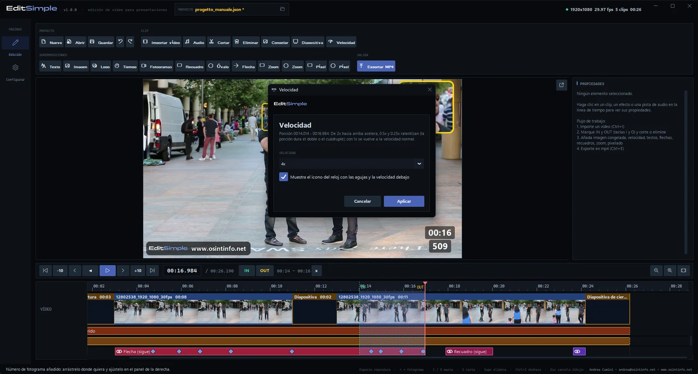

Se marca una porción con **IN** y **OUT** (teclas I y O) y se pulsa
**Velocidad** (V). De **2x a 32x** el vídeo se acelera; **0,5x y 0,25x**
ralentizan. La opción del **reloj** muestra un icono con agujas que giran y la
velocidad escrita debajo, para que quien mira sepa que el tiempo pasa más
rápido. La línea de tiempo se acorta o se alarga; con 1x se vuelve a la
velocidad normal. La posición, el tamaño y el color del reloj se ajustan en el
panel del clip.

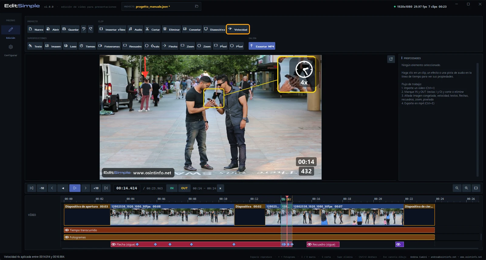

## 12. Cortar, eliminar, imagen congelada

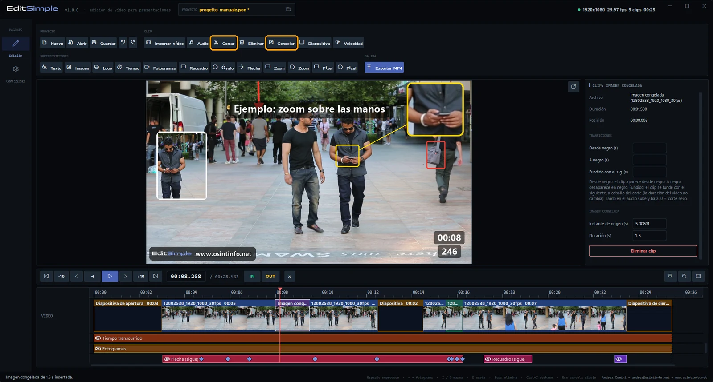

- **Cortar** (S) divide el clip en el cursor. Los clips se **reordenan
  arrastrándolos** en la línea de tiempo.
- **Eliminar** (Supr) quita la porción entre IN y OUT, o el elemento
  seleccionado: lo que sigue se desplaza hacia atrás, junto con los efectos.
- **Congelar** (F): el fotograma del cursor queda congelado durante los
  segundos elegidos; lo que sigue se desplaza hacia delante.

Todo se deshace con Ctrl+Z y se rehace con Ctrl+Y.

## 13. Transiciones

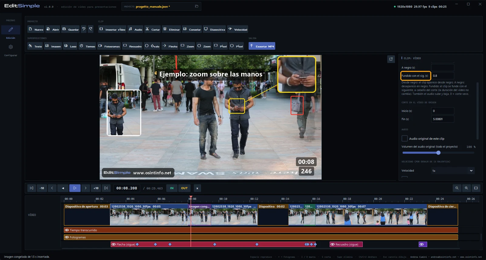

Al seleccionar un clip, el panel tiene la sección **Transiciones**:

- **Desde negro**: el clip aparece desde negro;
- **A negro**: el clip desaparece en negro;
- **Fundido con el siguiente**: el clip se funde con el siguiente a caballo
  del corte. El clip que sale queda congelado durante el fundido; la duración
  del vídeo no cambia.

También el audio sube y baja con las transiciones. 0 significa corte seco.

## 14. Audio

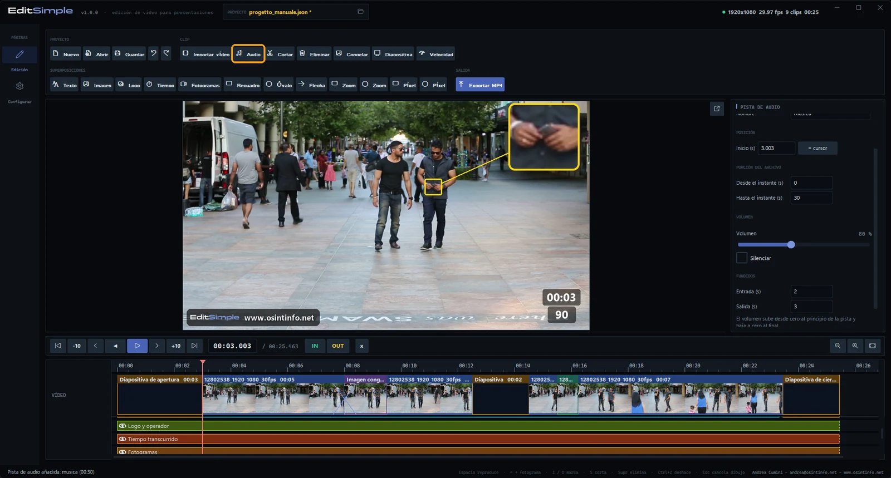

- **Audio** añade una pista (comentario, música) en el cursor. En el panel:
  nombre, posición, porción del archivo, **volumen**, silencio y **fundidos**
  de entrada y de salida. Se mueve arrastrándola; un clic en su nombre la
  selecciona entera, Supr la elimina.
- La **línea blanca** sobre cada pista muestra la evolución del volumen:
  fundidos y transiciones se ven de un vistazo.
- **Audio original**: un clic en el nombre de la fila selecciona todo el audio
  del vídeo (volumen, fundidos al principio y al final, eliminación); un clic
  en un fragmento selecciona solo ese fragmento (volumen, fundidos, silencio).
  Con IN y OUT marcados y el audio original seleccionado, Supr quita **solo el
  audio** de ese tramo: el vídeo se queda.
- La reproducción en la vista previa es **con audio** (mezclado como en la
  exportación).

## 15. Exportar el vídeo

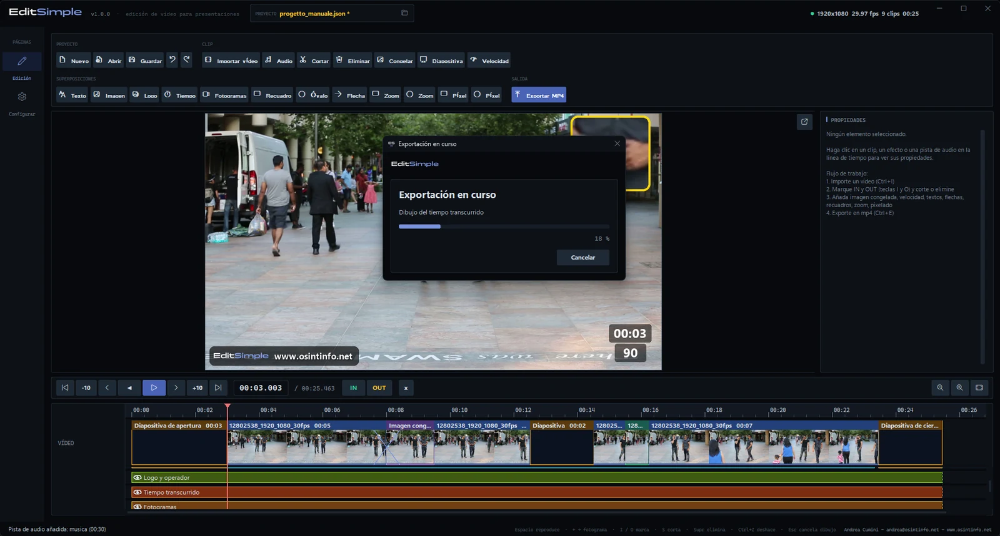

**Exportar MP4** (Ctrl+E) elige el archivo y crea el vídeo con ffmpeg: H.264
y AAC, con la calidad y la velocidad de codificación de Configurar. El
resultado es idéntico a la vista previa. La exportación se puede cancelar; al
final el programa propone abrir la carpeta.

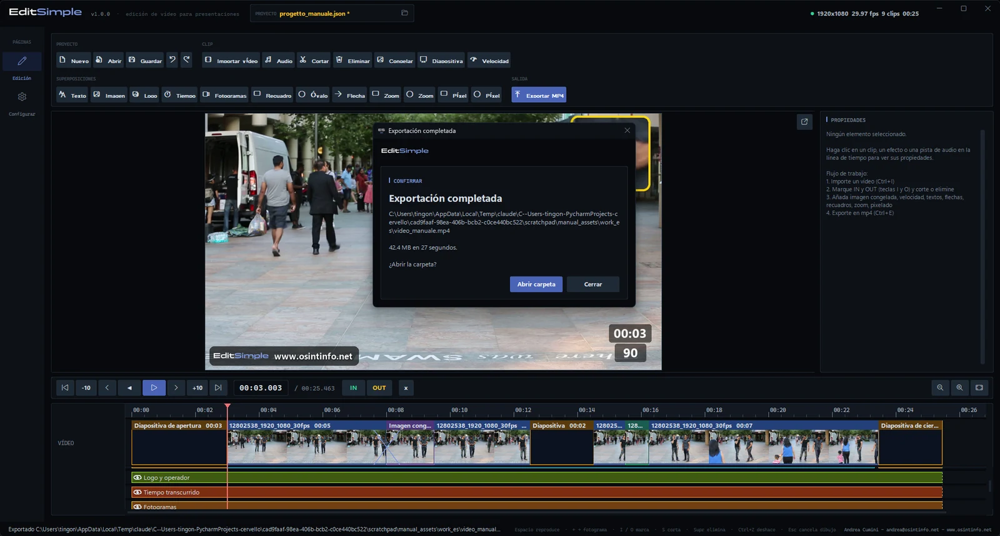

## 16. Consejos para un buen resultado

- **El recuadro del zoom va en una zona neutra**: el recuadro ampliado tapa la
  parte del vídeo sobre la que está colocado, durante todo el tiempo en que
  aparece. Póngalo donde no pase nada interesante (cielo, pared, suelo).
- **Dibuje ajustado al sujeto** en recuadros, óvalos y pixelados: el contenido
  de la figura es la plantilla que se busca en los fotogramas siguientes.
- **Para la flecha, un rectángulo algo más grande** (cabeza y hombros en lugar
  de solo la cabeza) aguanta mejor cuando otras personas pasan por delante.
- **Después del seguimiento, recorra el vídeo**: donde la figura se equivoque,
  arrástrela sobre el sujeto. Pocos keyframes bastan incluso para recorridos
  largos.
- **Con muchos efectos**, use el ojo para ocultar los que no necesite en ese
  momento, y la vista previa separada para tener más espacio en la línea de
  tiempo.
- **Guarde a menudo** (Ctrl+S): el proyecto es un pequeño archivo JSON que se
  vuelve a abrir y se modifica cuando se quiera.

## 17. Atajos de teclado y ratón

| Tecla | Acción |
| --- | --- |
| Espacio / Mayús+Espacio | Reproducir o pausar / reproducir hacia atrás |
| ← → | Un fotograma atrás / adelante |
| Ctrl+← → | Diez fotogramas atrás / adelante |
| Mayús+← → | Un segundo atrás / adelante |
| Inicio / Fin | Inicio / fin del vídeo |
| I / O | Marcar IN / OUT |
| S | Cortar en el cursor |
| F | Imagen congelada |
| V | Velocidad de la porción IN-OUT |
| T / R / E / A | Texto / recuadro / óvalo / flecha |
| Z / Mayús+Z | Zoom rectangular / ovalado |
| P / K | Pixelado rectangular / ovalado |
| L | Logo y operador |
| Supr | Eliminar la selección (o la porción IN-OUT) |
| Esc | Cancelar el dibujo en curso |
| Ctrl+Z / Ctrl+Y | Deshacer / rehacer |
| Ctrl+N / Ctrl+O / Ctrl+S / Ctrl+Mayús+S | Nuevo / abrir / guardar / guardar como |
| Ctrl+I | Importar vídeo |
| Ctrl+E | Exportar MP4 |

| Ratón | Dónde | Acción |
| --- | --- | --- |
| Rueda | Vista previa | Un fotograma adelante o atrás |
| Ctrl+rueda | Vista previa | Amplía la vista |
| Arrastrar sobre un punto vacío, botón central | Vista previa ampliada | Desplaza la vista |
| Doble clic | Texto en la vista previa | Reescribe el texto |
| Ctrl+rueda | Línea de tiempo | Amplía la línea de tiempo |
| Rueda / Alt+arrastrar / botón central | Línea de tiempo | Desplaza en horizontal |
| Mayús+rueda, rueda sobre los nombres | Línea de tiempo | Desplaza audio y efectos en vertical |
| Botón derecho | Barra de un efecto | Alargar hasta el cursor / cortar en el cursor |
| Botón derecho | Keyframe o punto | Borrar |

## 18. El archivo de proyecto

El proyecto es un archivo JSON con los clips, las pistas de audio, los efectos
(con los recorridos del seguimiento y los keyframes) y las rutas de los
archivos usados. Los vídeos, los audios y las imágenes no se copian en el
proyecto: déjelos donde están hasta terminar el trabajo. El vídeo exportado,
en cambio, es un MP4 independiente.

---

EditSimple es software libre, distribuido con la licencia GNU GPL versión 3
con términos adicionales de atribución del autor (véanse `LICENSE` y
`NOTICE`). ffmpeg y VitTrack son programas aparte con sus propias licencias.
