# EditSimple — Manuel d'utilisation

[English](manual.en.md) · [Italiano](manual.it.md) · [Deutsch](manual.de.md) · **Français** · [Español](manual.es.md) · [Nederlands](manual.nl.md) · [Polski](manual.pl.md) · [Ελληνικά](manual.el.md) · [Shqip](manual.sq.md)

EditSimple est un programme de montage vidéo conçu pour ceux qui doivent
**expliquer un fait ou montrer une preuve** dans une vidéo : une remise de
main à main au milieu de la foule, un véhicule qui arrive, une personne à
suivre ou à rendre méconnaissable. Vous importez la séquence, vous indiquez ce
qui compte et le programme fait le reste : les flèches, les cadres, les zooms
et les pixellisations **suivent tout seuls le sujet** dans les images
suivantes, et là où le suivi se trompe, il suffit de faire glisser la figure au
bon endroit pour le corriger. En quelques minutes, vous obtenez un MP4 prêt à
être projeté ou joint, avec diapos d'ouverture et de fermeture, textes, logo
et signature de l'opérateur.

*Andrea Cumini — www.osintinfo.net — andrea@osintinfo.net*
*EditSimple fait partie des outils de [Seity](https://www.seity.com).*

> **Avertissement sur la vidéo d'exemple.** Les images de ce manuel utilisent
> une vidéo d'archive publiée sur Pexels : une rue piétonne avec des passants
> ordinaires. **Les personnes qui apparaissent ne font rien de mal** : les
> flèches, les cadres, les zooms et les pixellisations placés sur elles
> servent uniquement à montrer le fonctionnement du programme, et les sujets
> ont été choisis au hasard.

## Sommaire

1. [Ce que l'on peut faire](#1-ce-que-lon-peut-faire)
2. [Installation et premier démarrage](#2-installation-et-premier-démarrage)
3. [La fenêtre](#3-la-fenêtre)
4. [Page Configurer](#4-page-configurer)
5. [Un exemple complet, pas à pas](#5-un-exemple-complet-pas-à-pas)
6. [Corriger le suivi avec les images clés](#6-corriger-le-suivi-avec-les-images-clés)
7. [La chronologie](#7-la-chronologie)
8. [L'aperçu : agrandir et détacher](#8-laperçu--agrandir-et-détacher)
9. [Diapos d'ouverture, de fermeture et intermédiaires](#9-diapos-douverture-de-fermeture-et-intermédiaires)
10. [Textes, images, temps écoulé et numéro d'image](#10-textes-images-temps-écoulé-et-numéro-dimage)
11. [Accélérer et ralentir](#11-accélérer-et-ralentir)
12. [Couper, supprimer, arrêt sur image](#12-couper-supprimer-arrêt-sur-image)
13. [Transitions](#13-transitions)
14. [Audio](#14-audio)
15. [Exporter la vidéo](#15-exporter-la-vidéo)
16. [Conseils pour un bon résultat](#16-conseils-pour-un-bon-résultat)
17. [Raccourcis clavier et souris](#17-raccourcis-clavier-et-souris)
18. [Le fichier de projet](#18-le-fichier-de-projet)

## 1. Ce que l'on peut faire

| Fonction | En bref |
| --- | --- |
| **Suivi du sujet** | Cadres, ovales, flèches, zooms et pixellisations suivent une personne, un visage, un objet ou un véhicule ; ils grandissent et rapetissent avec lui s'il s'approche ou s'éloigne de la caméra ; ils se terminent tout seuls quand il sort du cadre. |
| **Images clés de correction** | Là où le suivi se trompe (un poteau, une personne qui passe devant), vous faites glisser la figure sur le sujet : le programme corrige le trajet avant et après ce point. |
| **Zoom** | Un petit détail (les mains, une plaque d'immatriculation) agrandi de 2x à 16x dans un encart, avec un contour et une ligne qui le relient à l'objet. Rectangulaire ou ovale. |
| **Pixellisation** | Rectangulaire ou ovale, pour les visages et les plaques ; elle suit le sujet et grandit avec lui. |
| **Textes et images** | Textes sur plusieurs lignes avec fond et coins arrondis ; images superposées (une image extraite, une carte, un document). |
| **Logo et signature** | Logo et texte de l'opérateur fixes dans un coin, préparés une seule fois dans Configurer. |
| **Temps et images** | Le temps écoulé et le numéro d'image inscrits dans la vidéo, où vous voulez. |
| **Diapos** | Au début, à la fin ou au milieu ; couleur unie ou image de fond ; vous y écrivez des textes et y placez des images. |
| **Vitesse** | De 0,25x (ralenti) à 32x (avance rapide), avec l'icône d'une horloge qui indique la vitesse. |
| **Coupes** | Coupe au curseur, suppression d'une portion, arrêt sur image, réorganisation des clips. |
| **Transitions** | Apparition depuis le noir, disparition vers le noir, fondu avec le clip suivant. |
| **Audio** | Pistes ajoutées (commentaire, musique) avec volume et fondus ; audio original avec volume, fondus et suppression de passages précis. |
| **Aperçu** | Lecture avec le son, en arrière, image par image ; aperçu agrandissable et **détachable** dans une fenêtre séparée. |
| **Exportation** | MP4 (H.264 + AAC) identique à l'aperçu. |
| **Langues** | Interface en 9 langues, modifiable sans redémarrer. |

## 2. Installation et premier démarrage

**Exécutable (Windows 10/11, 64 bits).** Extrayez le zip où vous voulez et
lancez `EditSimple.exe`. Python n'est pas nécessaire.

**Depuis les sources.** Avec Python 3.11 :

```bash
python -m venv .venv
.venv\Scripts\python.exe -m pip install -r requirements.txt
.venv\Scripts\python.exe EditSimple.py
```

**FFmpeg.** EditSimple utilise ffmpeg pour lire les fichiers et pour exporter.
Il n'est pas inclus : au premier démarrage, s'il ne le trouve pas, la page
**Configurer** s'ouvre et le bouton **Télécharger / Mettre à jour** le
télécharge (version officielle pour Windows) dans le dossier `tools\ffmpeg\` à
côté du programme. Aucune installation.

**VitTrack (facultatif).** Sur la même page, **Télécharger** récupère
VitTrack, un petit modèle (0,7 Mo) qui aide le suivi à retrouver le sujet
après un obstacle. Sans lui, le suivi fonctionne quand même.

## 3. La fenêtre

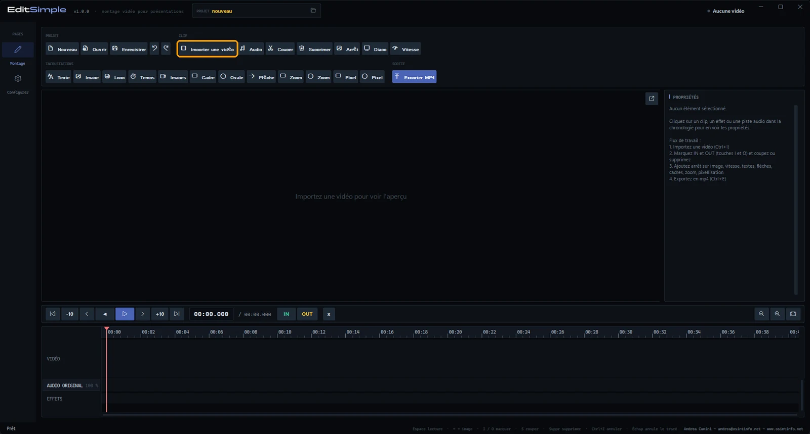

- **Barre d'outils**, en quatre groupes : *Projet* (nouveau, ouvrir,
  enregistrer, annuler, rétablir), *Clip* (importer une vidéo, audio, couper,
  supprimer, arrêt sur image, diapo, vitesse), *Incrustations* (texte, image,
  logo, temps, images, cadre, ovale, flèche, zoom rectangulaire et ovale,
  pixel rectangulaire et ovale) et *Sortie* (exporter MP4). Chaque bouton a
  une info-bulle avec son raccourci.
- **Aperçu**, au centre : il montre l'image au curseur avec tous les effets,
  exactement comme dans la vidéo exportée. C'est là que vous dessinez et
  déplacez les effets.
- **Propriétés**, à droite : les valeurs de l'élément sélectionné (un clip, un
  effet, une piste audio).
- **Transport** : début, -10 images, image précédente, lecture arrière,
  lecture, image suivante, +10 images, fin ; le temps du curseur (modifiable
  au clavier) ; IN, OUT et l'effacement des marques ; à droite, le zoom de la
  chronologie.
- **Chronologie**, en bas : règle, piste **Vidéo** en pellicule, **Audio
  original**, pistes audio ajoutées et **Effets**.

## 4. Page Configurer

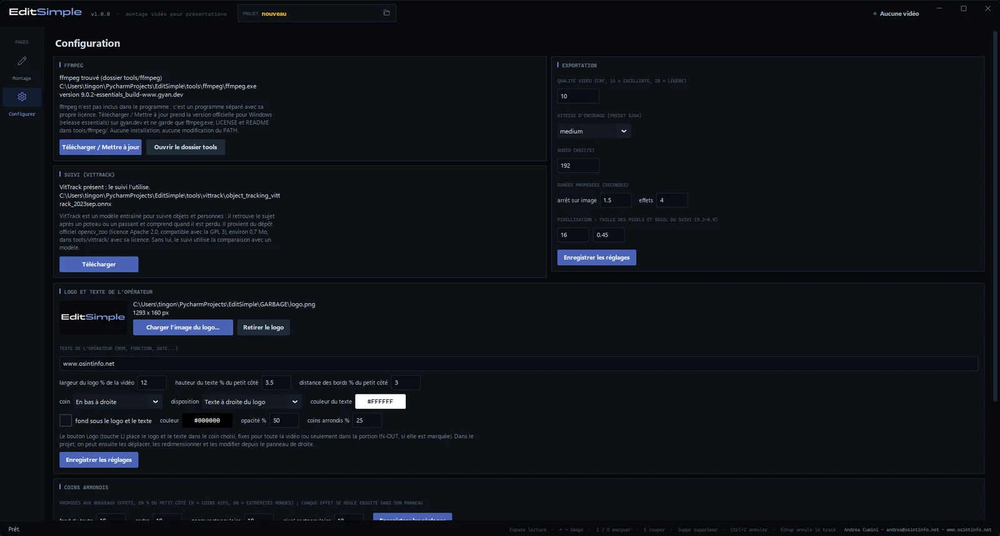

Elle s'ouvre depuis la barre de gauche. Elle contient :

- **FFmpeg** et **Suivi (VitTrack)** : état, téléchargement et mise à jour.
- **Exportation** : qualité de la vidéo (CRF : 15 excellente, 28 légère),
  vitesse d'encodage, qualité de l'audio, durées proposées pour l'arrêt sur
  image et les effets, taille par défaut des pixels et seuil du suivi (plus
  élevé = plus strict pour reconnaître le sujet).
- **Logo et texte de l'opérateur** : l'image du logo (PNG avec transparence
  ou JPG), le texte (nom, organisme, site), la largeur du logo, la hauteur du
  texte, la distance des bords, le coin, la disposition, les couleurs et un
  fond avec opacité et coins arrondis. Vous les préparez une seule fois ;
  ensuite, le bouton **Logo** les place dans la vidéo.

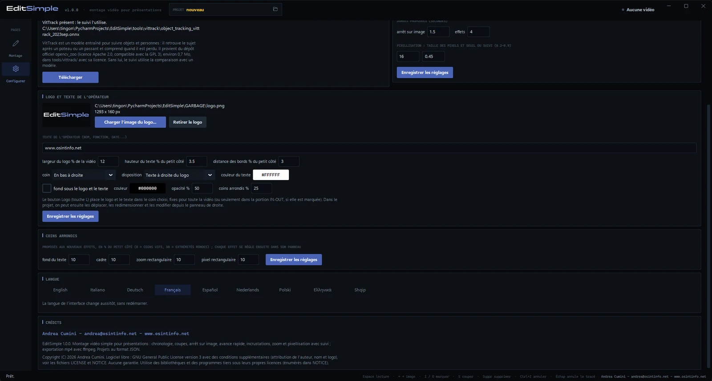

- **Coins arrondis** du fond des textes, des cadres, du zoom rectangulaire et
  de la pixellisation rectangulaire.
- **Langue** de l'interface : English, Italiano, Deutsch, Français,
  Español, Nederlands, Polski, Ελληνικά, Shqip. Le changement est immédiat.

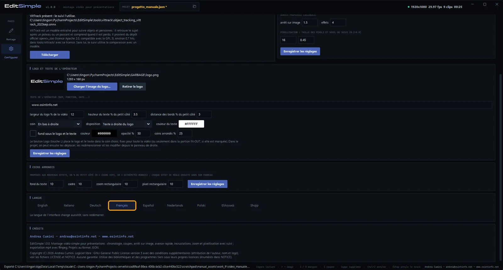

## 5. Un exemple complet, pas à pas

L'exemple de ce chapitre est une vidéo de 19 secondes tournée dans une rue
piétonne animée (voir l'avertissement : les passants ne font rien de mal).
En quelques étapes, nous l'enrichissons : le logo et le site de l'opérateur en
bas, un zoom sur les mains d'un homme qui suit ses mouvements, une flèche qui
désigne une personne pendant 12 secondes, deux cadres sur d'autres personnes
et la pixellisation d'un visage à la fin.

### 5.1 Importer la vidéo

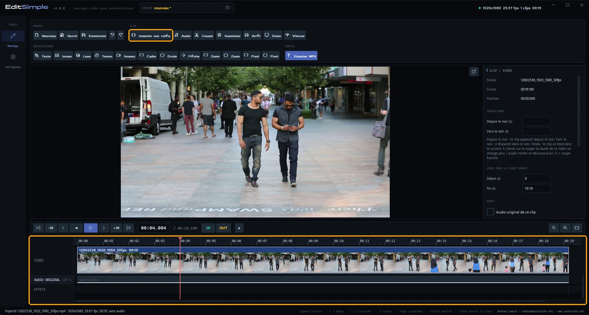

**Importer une vidéo** (Ctrl+I) ouvre la séquence. La première vidéo fixe les
dimensions et la fréquence du projet (ici 1920×1080, 29,97 images par
seconde). Le clip apparaît dans la piste Vidéo sous forme de pellicule
d'images ; son audio dans la piste Audio original (cette vidéo n'en a pas).
Les autres vidéos s'ajoutent à la fin ou au curseur.

Le curseur se déplace d'un clic sur la règle, avec les flèches ← → (une
image), Ctrl+← → (dix images), Maj+← → (une seconde), Début et Fin, ou en
tapant le temps dans la case. **Espace** lance la lecture avec le son,
**Maj+Espace** lit en arrière.

### 5.2 Logo et signature de l'opérateur

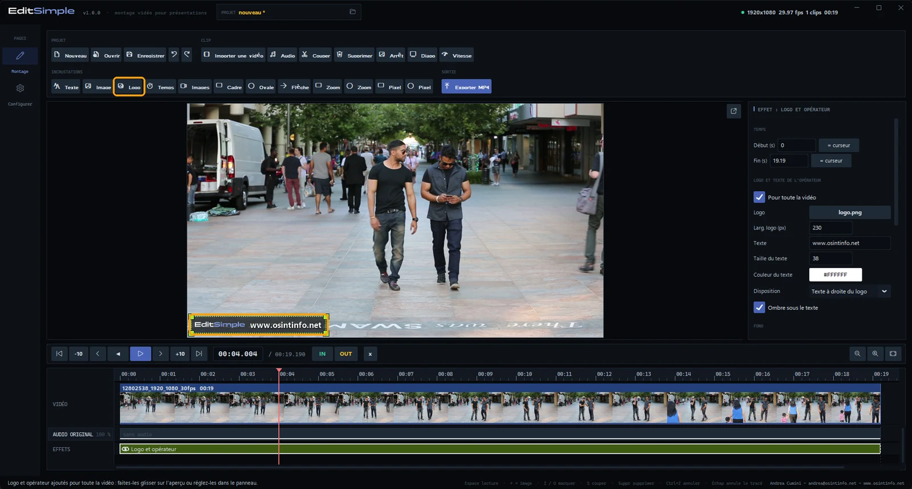

**Logo** (L) place le logo et le texte préparés dans Configurer pour toute la
vidéo (ou seulement entre IN et OUT, s'ils sont marqués). Sur l'aperçu, vous
les déplacez en les faisant glisser et les agrandissez par les coins ; dans le
panneau, vous changez le texte, les couleurs, le fond, le coin et l'opacité.

### 5.3 Un zoom qui suit les mains

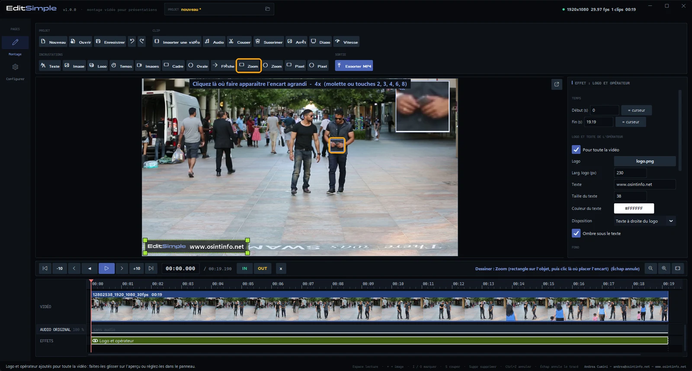

**Zoom** (Z) s'utilise en deux étapes :

1. faites glisser un rectangle autour du détail (ici les mains de l'homme) ;
2. sous la souris apparaît l'encart agrandi avec le contenu réel : un clic le
   pose. L'agrandissement se choisit à ce moment-là avec la molette ou avec
   les touches 2, 3, 4, 6, 8 (jusqu'à 16x depuis le panneau).

Le zoom **commence aussitôt à suivre l'objet** : une fenêtre montre la
progression du suivi.

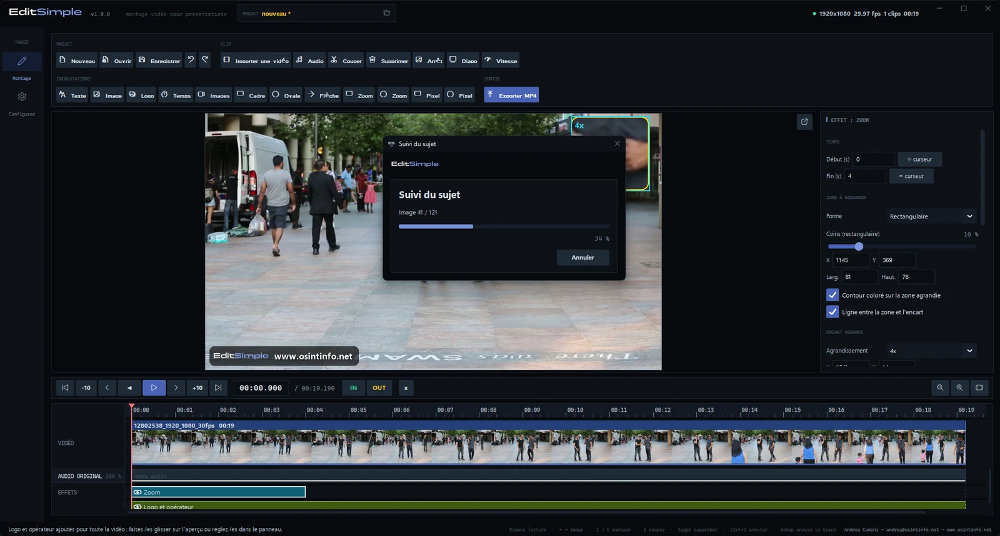

La zone agrandie suit les mains et grandit ou rapetisse si l'homme s'approche
ou s'éloigne ; l'encart agrandi reste là où vous l'avez placé. Un contour
coloré marque l'objet et une ligne le relie à l'encart. Maj+Z crée un zoom
ovale.

### 5.4 Une flèche qui suit une personne

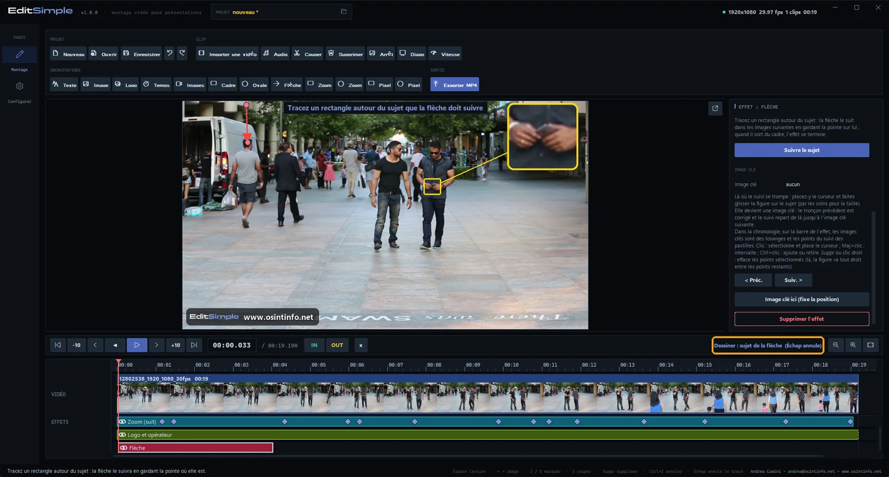

**Flèche** (A) : faites glisser de la queue à la pointe. Pour qu'elle suive
une personne, appuyez sur **Suivre le sujet** dans le panneau (ou *Relancer le
suivi depuis le curseur*) et tracez un **rectangle autour du sujet** : la
flèche le suit en gardant la pointe sur lui.

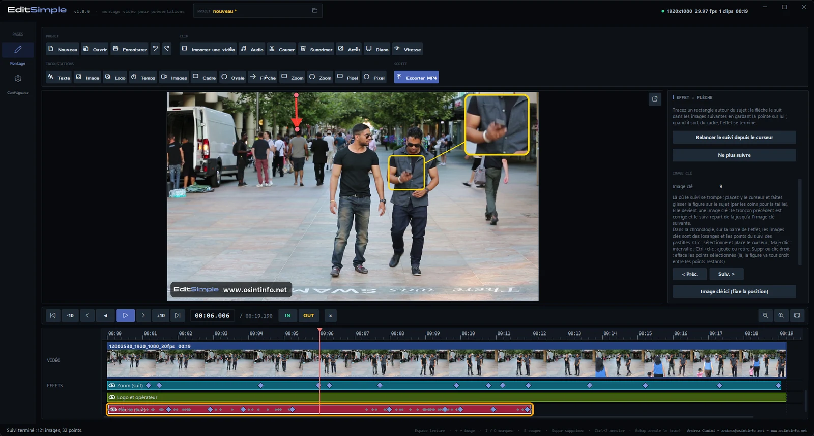

Dans la chronologie, la barre de la flèche affiche *(suit)* et les losanges
des images clés avec lesquelles nous avons corrigé le trajet (voir le
chapitre 6).

### 5.5 Des cadres sur les personnes

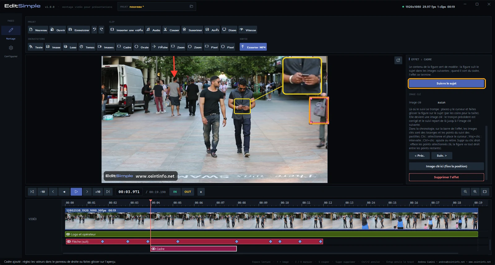

**Cadre** (R) et **Ovale** (E) : faites-les glisser sur l'aperçu. Dans le
panneau, vous choisissez la couleur, l'épaisseur, le remplissage, les coins
arrondis et l'opacité ; **Suivre le sujet** leur fait suivre ce qu'ils
contiennent. Quand la personne sort du cadre, la figure l'accompagne
jusqu'au bord et l'effet se termine.

### 5.6 La pixellisation d'un visage

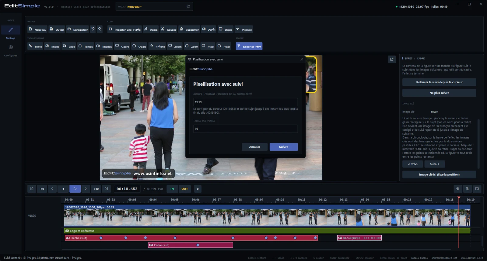

**Pixel** (P rectangulaire, K ovale) : faites glisser un cadre sur le visage ;
une fenêtre demande jusqu'à quand le suivre et la taille des pixels.

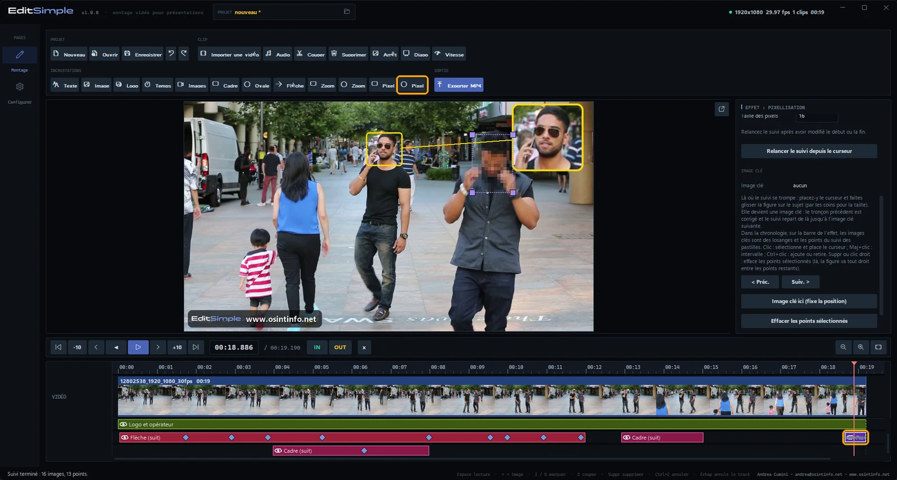

La pixellisation suit le visage et **grandit quand il s'approche** de la
caméra, de sorte qu'elle le couvre toujours. Si le sujet sort du cadre, la
pixellisation l'accompagne jusqu'à ce qu'il soit entièrement sorti : aucune
image ne reste découverte.

## 6. Corriger le suivi avec les images clés

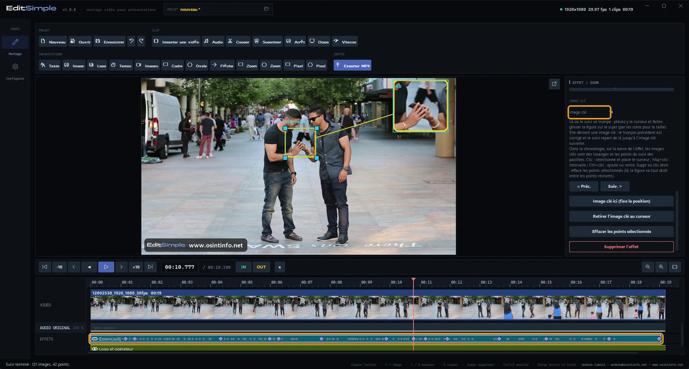

Le suivi est automatique, mais une vraie vidéo a des obstacles : un poteau,
une personne qui passe devant, un sujet qui se retourne. Là où la figure se
trompe :

1. placez le curseur sur cette image ;
2. **faites glisser la figure sur le sujet** dans l'aperçu (ou
   redimensionnez-la par les coins).

Une **image clé** apparaît (un losange sur la barre de l'effet). Le programme
corrige le trajet avant l'image clé, de façon progressive, et **reprend le
suivi à partir de là** jusqu'à l'image clé suivante. Vous pouvez ajouter
autant d'images clés que nécessaire : le zoom de l'exemple en a 14, la
flèche 9.

Sur la barre de l'effet sélectionné, vous voyez aussi les points trouvés par
le suivi (pastilles). Un clic sélectionne un point et y place le curseur,
Maj+clic sélectionne un intervalle, Ctrl+clic ajoute ou retire ; **Suppr** ou
le clic droit effacent les points sélectionnés. Dans le panneau, la section
**Image clé** a les boutons *< Préc.* et *Suiv. >*, *Image clé ici* (fixe la
position actuelle) et *Retirer l'image clé au curseur*.

## 7. La chronologie

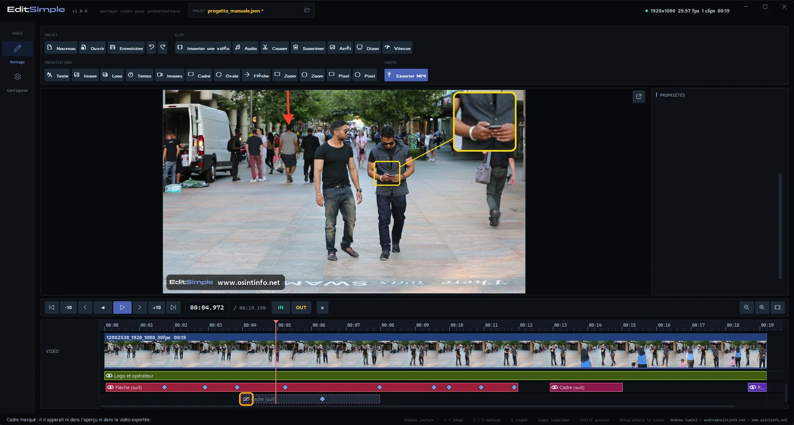

- **Barres des effets** : elles se déplacent en les faisant glisser ; le bord
  droit modifie la durée. Les effets se répartissent sur plusieurs couloirs ;
  avec beaucoup d'effets, la partie audio et effets **défile verticalement**
  (barre à droite, molette sur les noms des lignes ou Maj+molette), tandis que
  la règle et la vidéo restent fixes en haut.
- **Œil** : l'icône à gauche de chaque barre **masque ou affiche** l'effet,
  dans l'aperçu et dans la vidéo exportée. Utile quand de nombreux effets se
  superposent pendant le travail.
- **Clic droit sur une barre** : *Prolonger jusqu'au curseur* (si le curseur
  est après la fin ; si l'effet suit un sujet, le suivi continue) et
  *Arrêter au curseur* (si le curseur est à l'intérieur de l'effet).
- **Zoom de la chronologie** : Ctrl+molette, ou les boutons − + et *Ajuster
  la chronologie*. De près, la pellicule montre chaque image.
- **Défilement** : molette, Alt+glisser ou glisser avec le bouton central.
- **Séparateur** : la fine bande au-dessus des commandes de lecture se fait
  glisser vers le haut ou vers le bas pour donner plus de place à la
  chronologie ou à l'aperçu.

## 8. L'aperçu : agrandir et détacher

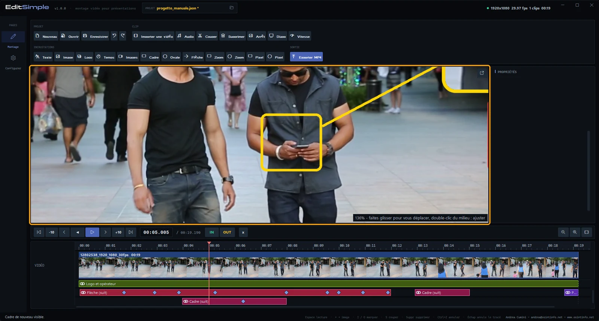

- **Ctrl+molette** sur l'aperçu l'agrandit autour de la souris, jusqu'à
  16 fois : pour poser avec précision un zoom sur un petit détail ou pour
  contrôler une pixellisation. Vous vous déplacez en faisant glisser sur un
  point vide (ou avec le bouton central) ; un double-clic avec le bouton
  central revient à la vue entière.
- **Détacher l'aperçu** : le bouton en haut à droite de l'aperçu l'ouvre dans
  une **fenêtre séparée**, à placer sur un second écran ou où vous voulez ; la
  chronologie prend toute la place. Le même bouton (ou la fermeture de la
  fenêtre) le **rattache**. Les raccourcis fonctionnent aussi dans la fenêtre
  détachée.

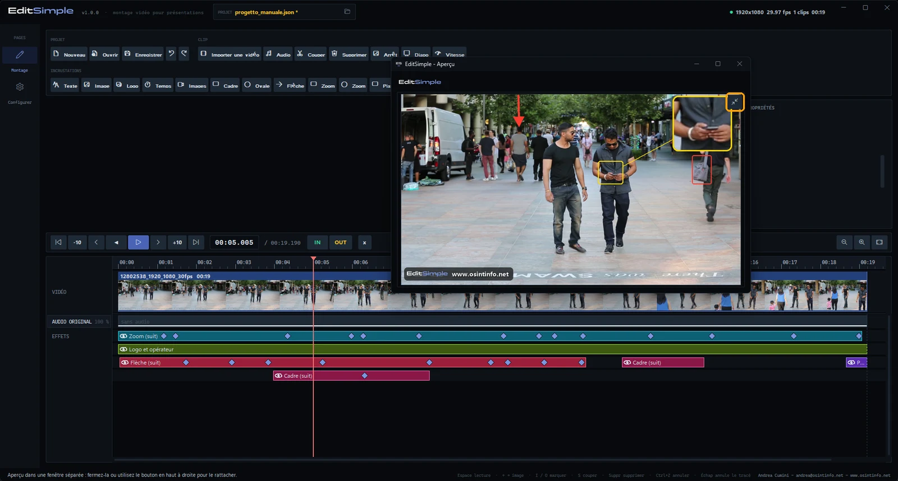

## 9. Diapos d'ouverture, de fermeture et intermédiaires

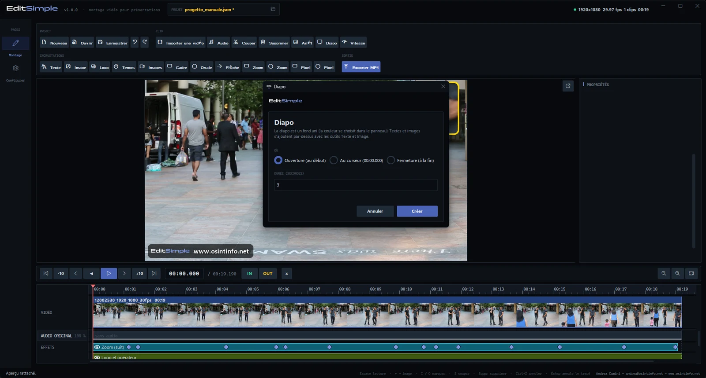

**Diapo** insère une diapo **au début** (ouverture), **au curseur** (au
milieu de la vidéo) ou **à la fin** (fermeture), de la durée choisie. La diapo
est un fond uni ou une **image de fond** adaptée aux dimensions de la vidéo
(remplir, entière ou étirer) ; la couleur et l'image se choisissent dans le
panneau. Les effets qui suivent sont décalés vers l'avant avec la vidéo.

Sur la diapo, vous écrivez des textes et placez des images avec les outils
**Texte** et **Image** : avec le curseur sur la diapo, ils durent autant
qu'elle.

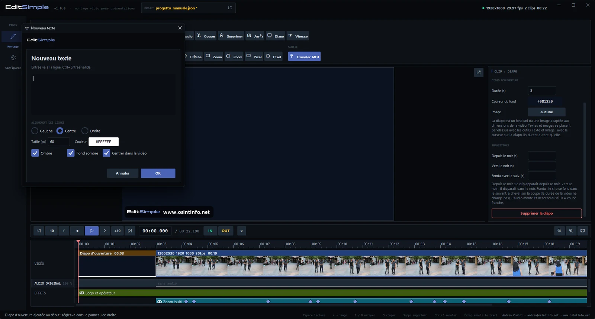

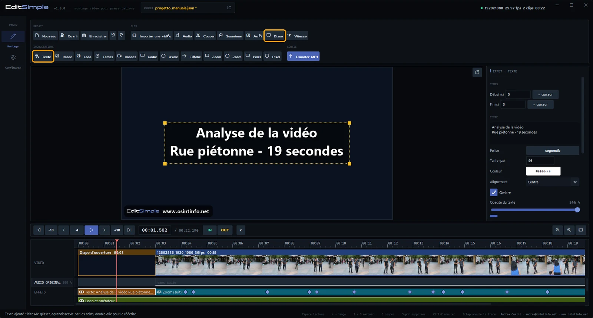

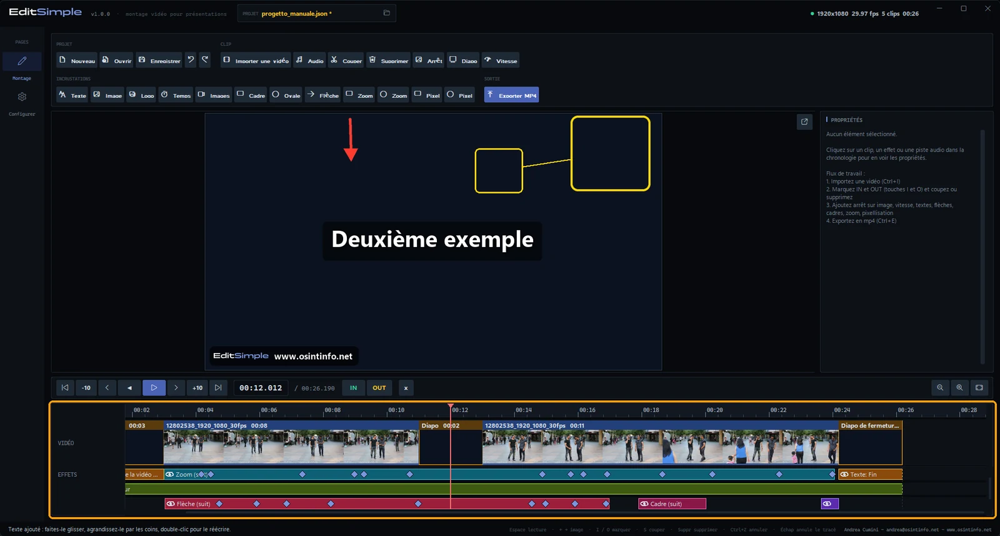

## 10. Textes, images, temps écoulé et numéro d'image

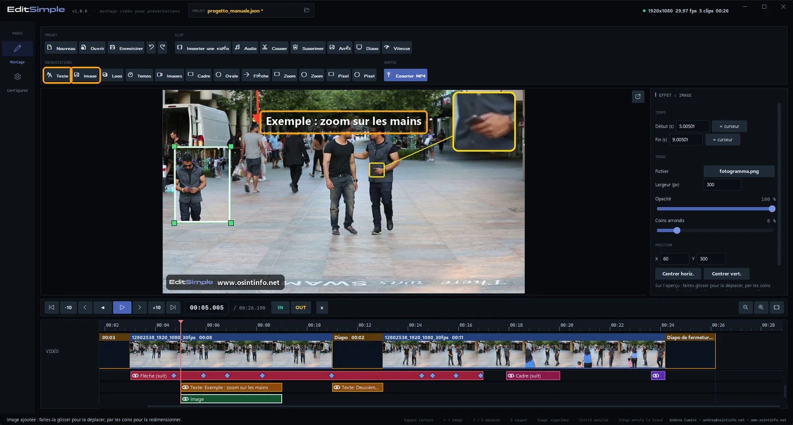

- **Texte** (T) : un clic sur l'aperçu ouvre la fenêtre du texte : plusieurs
  lignes, alignement, taille, couleur, ombre, fond (avec opacité et coins
  arrondis), centrage. Double-cliquez sur un texte pour le réécrire. Dans le
  panneau, également la police, choisie dans une liste qui affiche chaque
  police.
- **Image** : choisit un fichier (PNG, JPG...) et le place au centre ; il se
  déplace et se redimensionne sur l'aperçu ; dans le panneau, opacité et coins
  arrondis. Ici, c'est une image agrandie du sujet, mais ce peut être une
  carte, un document, une photo.

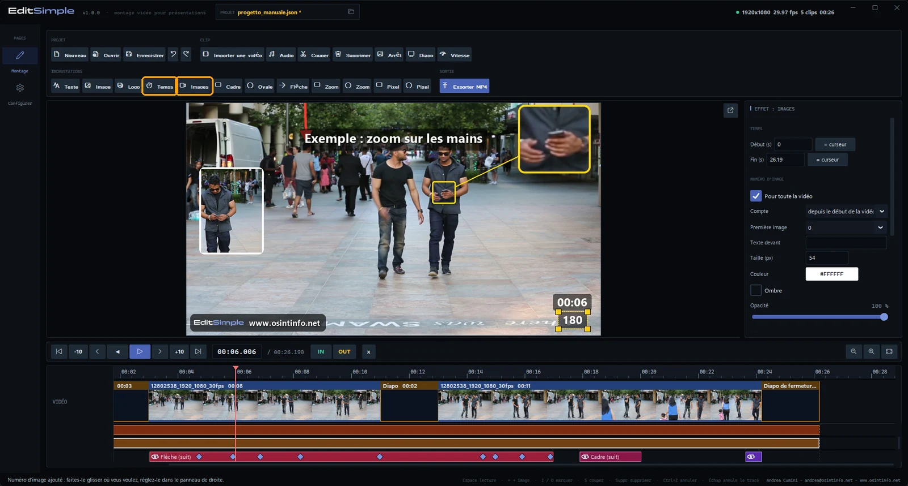

- **Temps** : le temps écoulé (01:23, 00:01:23 ou avec les dixièmes), depuis
  le début de la vidéo ou depuis le début de l'effet, précédé d'un texte au
  choix. Au-delà d'une heure, les heures apparaissent.
- **Images** : le numéro d'image, à partir de 0 ou de 1, depuis le début de la
  vidéo ou de l'effet. Utile pour citer un instant avec précision.

Les deux ont un fond, une opacité et des coins arrondis, et se placent où
vous voulez d'un clic.

## 11. Accélérer et ralentir

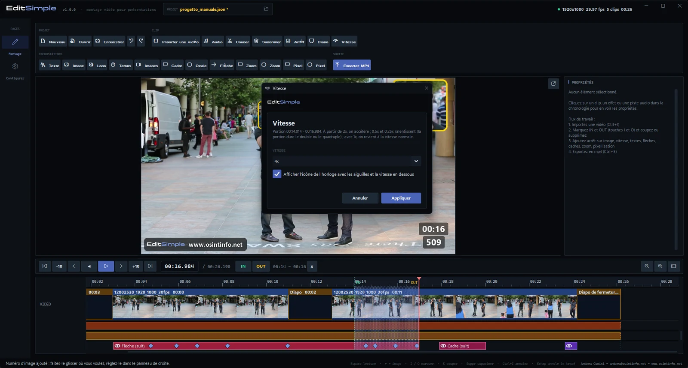

Marquez une portion avec **IN** et **OUT** (touches I et O) et appuyez sur
**Vitesse** (V). De **2x à 32x**, la vidéo accélère ; **0,5x et 0,25x**
ralentissent. L'option de l'**horloge** affiche une icône avec des aiguilles
qui tournent et la vitesse inscrite en dessous, pour que le spectateur sache
que le temps passe plus vite. La chronologie se raccourcit ou s'allonge ; avec
1x, on revient à la vitesse normale. La position, la taille et la couleur de
l'horloge se règlent dans le panneau du clip.

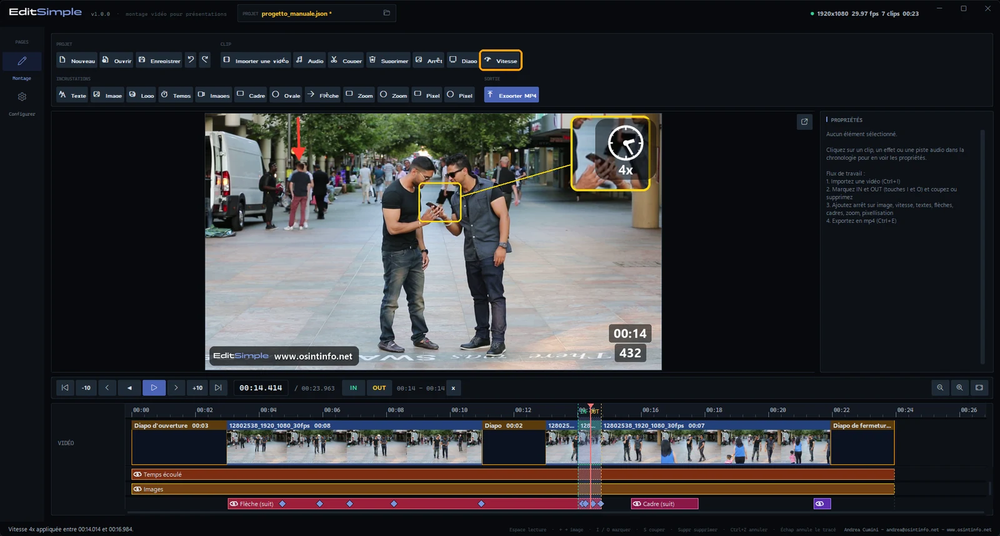

## 12. Couper, supprimer, arrêt sur image

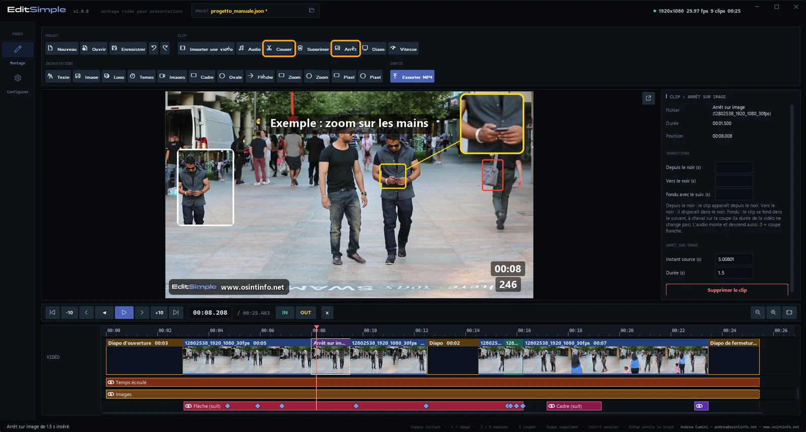

- **Couper** (S) divise le clip au curseur. Les clips se **réorganisent en
  les faisant glisser** dans la chronologie.
- **Supprimer** (Suppr) retire la portion entre IN et OUT, ou l'élément
  sélectionné : la suite recule, avec les effets.
- **Arrêt** (F) : l'image au curseur reste figée pendant le nombre de
  secondes choisi ; la suite est décalée vers l'avant.

Tout s'annule avec Ctrl+Z et se rétablit avec Ctrl+Y.

## 13. Transitions

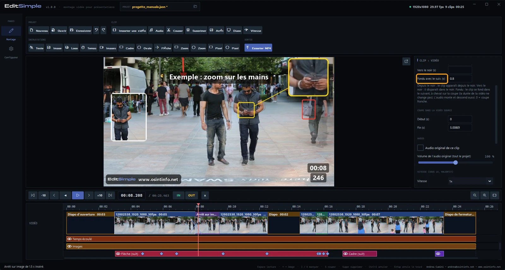

Quand vous sélectionnez un clip, le panneau contient la section
**Transitions** :

- **Depuis le noir** : le clip apparaît depuis le noir ;
- **Vers le noir** : le clip disparaît dans le noir ;
- **Fondu avec le suiv.** : le clip se fond dans le suivant, à cheval sur la
  coupe. Le clip sortant reste figé pendant le fondu ; la durée de la vidéo ne
  change pas.

L'audio monte et descend aussi avec les transitions. 0 signifie coupe franche.

## 14. Audio

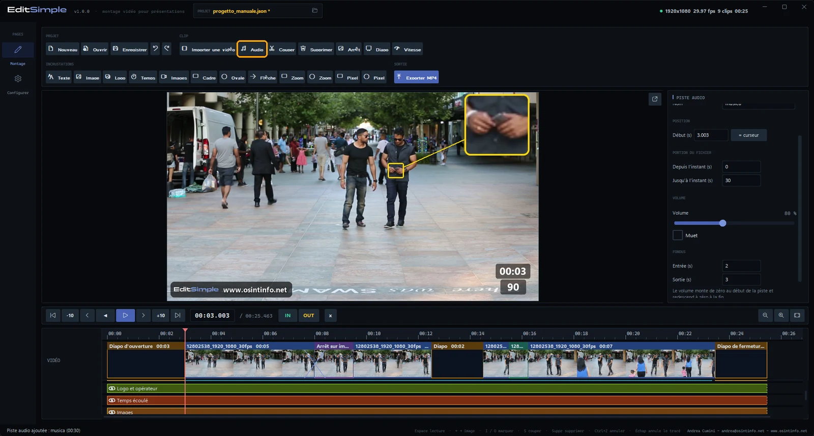

- **Audio** ajoute une piste (commentaire, musique) au curseur. Dans le
  panneau : nom, position, portion du fichier, **volume**, muet et **fondus**
  d'entrée et de sortie. Elle se déplace en la faisant glisser ; un clic sur
  son nom la sélectionne entièrement, Suppr la supprime.
- La **ligne blanche** au-dessus de chaque piste montre l'évolution du volume :
  fondus et transitions se voient d'un coup d'œil.
- **Audio original** : un clic sur le nom de la ligne sélectionne tout l'audio
  de la vidéo (volume, fondus au début et à la fin, suppression) ; un clic sur
  un morceau sélectionne seulement ce morceau (volume, fondus, muet). Avec IN
  et OUT marqués et l'audio original sélectionné, Suppr retire **seulement
  l'audio** de ce passage : la vidéo reste.
- La lecture dans l'aperçu se fait **avec le son** (mixé comme à
  l'exportation).

## 15. Exporter la vidéo

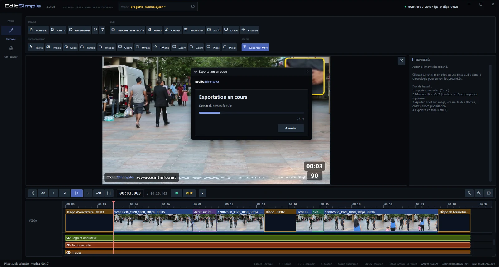

**Exporter MP4** (Ctrl+E) choisit le fichier et crée la vidéo avec ffmpeg :
H.264 et AAC, qualité et vitesse d'encodage dans Configurer. Le résultat est
identique à l'aperçu. L'exportation peut être annulée ; à la fin, le programme
propose d'ouvrir le dossier.

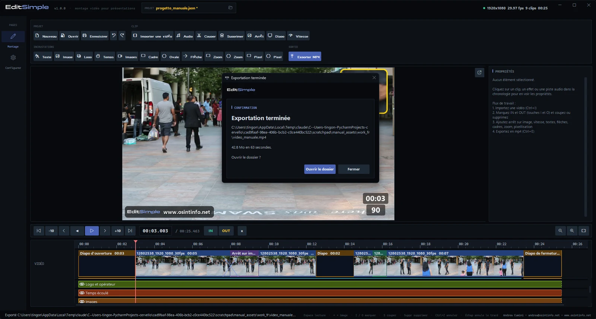

## 16. Conseils pour un bon résultat

- **L'encart du zoom se place dans une zone neutre** : l'encart agrandi
  couvre la partie de la vidéo sur laquelle il est posé, pendant toute sa
  durée. Placez-le là où il ne se passe rien d'intéressant (ciel, mur, sol).
- **Dessinez au plus près du sujet** pour les cadres, ovales et
  pixellisations : le contenu de la figure est le modèle recherché dans les
  images suivantes.
- **Pour la flèche, un rectangle un peu plus grand** (tête et épaules au lieu
  de la tête seule) tient mieux quand d'autres personnes passent devant.
- **Après le suivi, parcourez la vidéo** : là où la figure se trompe,
  faites-la glisser sur le sujet. Quelques images clés suffisent, même pour de
  longs trajets.
- **Avec beaucoup d'effets**, utilisez l'œil pour masquer ceux dont vous
  n'avez pas besoin à ce moment-là, et l'aperçu détaché pour avoir plus de
  place dans la chronologie.
- **Enregistrez souvent** (Ctrl+S) : le projet est un petit fichier JSON que
  vous pouvez rouvrir et modifier quand vous voulez.

## 17. Raccourcis clavier et souris

| Touche | Action |
| --- | --- |
| Espace / Maj+Espace | Lire ou arrêter / lire en arrière |
| ← → | Une image en arrière / en avant |
| Ctrl+← → | Dix images en arrière / en avant |
| Maj+← → | Une seconde en arrière / en avant |
| Début / Fin | Début / fin de la vidéo |
| I / O | Marquer IN / OUT |
| S | Couper au curseur |
| F | Arrêt sur image |
| V | Vitesse de la portion IN-OUT |
| T / R / E / A | Texte / cadre / ovale / flèche |
| Z / Maj+Z | Zoom rectangulaire / ovale |
| P / K | Pixellisation rectangulaire / ovale |
| L | Logo et opérateur |
| Suppr | Supprimer la sélection (ou la portion IN-OUT) |
| Échap | Annuler le tracé en cours |
| Ctrl+Z / Ctrl+Y | Annuler / rétablir |
| Ctrl+N / Ctrl+O / Ctrl+S / Ctrl+Maj+S | Nouveau / ouvrir / enregistrer / enregistrer sous |
| Ctrl+I | Importer une vidéo |
| Ctrl+E | Exporter MP4 |

| Souris | Où | Action |
| --- | --- | --- |
| Molette | Aperçu | Une image en avant ou en arrière |
| Ctrl+molette | Aperçu | Agrandit la vue |
| Glisser sur un point vide, bouton central | Aperçu agrandi | Déplace la vue |
| Double-clic | Texte dans l'aperçu | Réécrit le texte |
| Ctrl+molette | Chronologie | Agrandit la chronologie |
| Molette / Alt+glisser / bouton central | Chronologie | Défile horizontalement |
| Maj+molette, molette sur les noms | Chronologie | Fait défiler l'audio et les effets verticalement |
| Clic droit | Barre d'un effet | Prolonger jusqu'au curseur / arrêter au curseur |
| Clic droit | Image clé ou point | Efface |

## 18. Le fichier de projet

Le projet est un fichier JSON contenant les clips, les pistes audio, les
effets (avec les trajets du suivi et les images clés) et les chemins des
fichiers utilisés. Les vidéos, les fichiers audio et les images ne sont pas
copiés dans le projet : laissez-les où ils sont tant que le travail n'est pas
terminé. La vidéo exportée, en revanche, est un MP4 autonome.

---

EditSimple est un logiciel libre, distribué sous la licence GNU GPL version 3
avec des conditions supplémentaires d'attribution de l'auteur (voir `LICENSE`
et `NOTICE`). ffmpeg et VitTrack sont des programmes séparés avec leurs
propres licences.
