# EditSimple — Manuale d'uso

[English](manual.en.md) · **Italiano** · [Deutsch](manual.de.md) · [Français](manual.fr.md) · [Español](manual.es.md) · [Nederlands](manual.nl.md) · [Polski](manual.pl.md) · [Ελληνικά](manual.el.md) · [Shqip](manual.sq.md)

EditSimple è un programma di montaggio video pensato per chi deve **spiegare
un fatto o mostrare un'evidenza** in un video: un passaggio di mano in mezzo
alla folla, un veicolo che arriva, una persona da seguire o da rendere
irriconoscibile. Si importa il filmato, si indica ciò che conta e il
programma fa il resto: le frecce, i riquadri, gli zoom e le pixelature
**seguono da soli il soggetto** nei fotogrammi successivi, e dove
l'inseguimento sbaglia basta trascinare la figura al posto giusto per
correggerlo. In pochi minuti si ottiene un MP4 pronto da proiettare o da
allegare, con slide di apertura e di chiusura, testi, logo e firma
dell'operatore.

*Andrea Cumini — www.osintinfo.net — andrea@osintinfo.net*
*EditSimple fa parte degli strumenti di [Seity](https://www.seity.com).*

> **Premessa sul video di esempio.** Le immagini di questo manuale usano un
> video di archivio pubblicato su Pexels: una via pedonale con normali
> passanti. **Le persone che compaiono non stanno facendo nulla di male**:
> le frecce, i riquadri, gli zoom e le pixelature messi su di loro servono
> solo a mostrare come funziona il programma, e i soggetti sono stati scelti a
> caso.

## Indice

1. [Che cosa si può fare](#1-che-cosa-si-può-fare)
2. [Installazione e primo avvio](#2-installazione-e-primo-avvio)
3. [La finestra](#3-la-finestra)
4. [Pagina Configura](#4-pagina-configura)
5. [Un esempio completo, passo per passo](#5-un-esempio-completo-passo-per-passo)
6. [Correggere l'inseguimento con i keyframe](#6-correggere-linseguimento-con-i-keyframe)
7. [La timeline](#7-la-timeline)
8. [L'anteprima: ingrandire e staccare](#8-lanteprima-ingrandire-e-staccare)
9. [Slide di apertura, di chiusura e in mezzo](#9-slide-di-apertura-di-chiusura-e-in-mezzo)
10. [Testi, immagini, tempo trascorso e numero del fotogramma](#10-testi-immagini-tempo-trascorso-e-numero-del-fotogramma)
11. [Accelerare e rallentare](#11-accelerare-e-rallentare)
12. [Tagliare, eliminare, fermo immagine](#12-tagliare-eliminare-fermo-immagine)
13. [Transizioni](#13-transizioni)
14. [Audio](#14-audio)
15. [Esportare il video](#15-esportare-il-video)
16. [Consigli per un buon risultato](#16-consigli-per-un-buon-risultato)
17. [Scorciatoie da tastiera e mouse](#17-scorciatoie-da-tastiera-e-mouse)
18. [Il file di progetto](#18-il-file-di-progetto)

## 1. Che cosa si può fare

| Funzione | In breve |
| --- | --- |
| **Inseguimento del soggetto** | Riquadri, ovali, frecce, zoom e pixelature seguono una persona, un volto, un oggetto o un veicolo; crescono e calano con lui se si avvicina o si allontana dalla camera; finiscono da soli quando esce dall'inquadratura. |
| **Keyframe di correzione** | Dove l'inseguimento sbaglia (un palo, una persona che passa davanti) si trascina la figura sul soggetto: il programma corregge il percorso prima e dopo quel punto. |
| **Zoom** | Un dettaglio piccolo (le mani, una targa) ingrandito da 2x a 16x in un riquadro, con contorno e linea che lo collegano all'oggetto. Rettangolare od ovale. |
| **Pixelatura** | Rettangolare od ovale, per volti e targhe; segue il soggetto e cresce con lui. |
| **Testi e immagini** | Testi su più righe con sfondo e angoli arrotondati; immagini sovrapposte (un fotogramma, una mappa, un documento). |
| **Logo e firma** | Logo e testo dell'operatore fissi in un angolo, preparati una volta in Configura. |
| **Tempo e fotogrammi** | Il tempo trascorso e il numero del fotogramma scritti nel video, dove si vuole. |
| **Slide** | All'inizio, alla fine o in mezzo; tinta unita o immagine di sfondo; sopra si scrivono testi e si mettono immagini. |
| **Velocità** | Da 0,25x (rallentatore) a 32x (avanzamento veloce), con l'icona di un orologio che indica la velocità. |
| **Tagli** | Taglio al cursore, eliminazione di una porzione, fermo immagine, riordino delle clip. |
| **Transizioni** | Comparsa dal nero, scomparsa nel nero, fusione con la clip successiva. |
| **Audio** | Tracce aggiunte (commento, musica) con volume e dissolvenze; audio originale con volume, dissolvenze ed eliminazione di singoli tratti. |
| **Anteprima** | Riproduzione con audio, all'indietro, fotogramma per fotogramma; anteprima ingrandibile e **staccabile** in una finestra a parte. |
| **Esportazione** | MP4 (H.264 + AAC) identico all'anteprima. |
| **Lingue** | Interfaccia in 9 lingue, cambiabile senza riavviare. |

## 2. Installazione e primo avvio

**Eseguibile (Windows 10/11, 64 bit).** Estrai lo zip dove vuoi e avvia
`EditSimple.exe`. Python non serve.

**Dai sorgenti.** Con Python 3.11:

```bash
python -m venv .venv
.venv\Scripts\python.exe -m pip install -r requirements.txt
.venv\Scripts\python.exe EditSimple.py
```

**FFmpeg.** EditSimple usa ffmpeg per leggere i file e per esportare. Non è
incluso: al primo avvio, se non lo trova, si apre la pagina **Configura** e il
pulsante **Scarica / Aggiorna** lo scarica (build ufficiale per Windows) nella
cartella `tools\ffmpeg\` accanto al programma. Nessuna installazione.

**VitTrack (facoltativo).** Nella stessa pagina, **Scarica** prende VitTrack,
un piccolo modello (0,7 MB) che aiuta l'inseguimento a ritrovare il soggetto
dopo un ostacolo. Senza, l'inseguimento funziona lo stesso.

## 3. La finestra

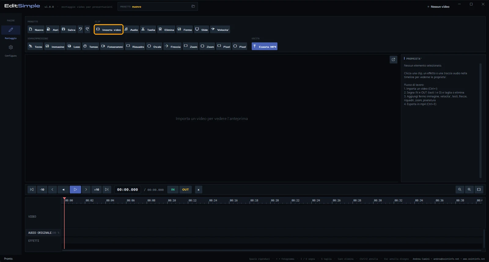

- **Barra degli strumenti**, in quattro gruppi: *Progetto* (nuovo, apri, salva,
  annulla, ripeti), *Clip* (importa video, audio, taglia, elimina, fermo
  immagine, slide, velocità), *Sovraimpressioni* (testo, immagine, logo, tempo,
  fotogrammi, riquadro, ovale, freccia, zoom rettangolare e ovale, pixel
  rettangolare e ovale) e *Uscita* (esporta MP4). Ogni pulsante ha un
  suggerimento con la sua scorciatoia.
- **Anteprima**, al centro: mostra il fotogramma al cursore con tutti gli
  effetti, esattamente come nel video esportato. Sopra si disegnano e si
  spostano gli effetti.
- **Proprietà**, a destra: i valori dell'elemento selezionato (una clip, un
  effetto, una traccia audio).
- **Trasporto**: inizio, -10 fotogrammi, fotogramma precedente, riproduzione
  all'indietro, riproduzione, fotogramma successivo, +10 fotogrammi, fine; il
  tempo del cursore (si può scrivere); IN, OUT e la cancellazione dei segni;
  a destra lo zoom della timeline.
- **Timeline**, in basso: righello, traccia **Video** a pellicola, **Audio
  originale**, tracce audio aggiunte ed **Effetti**.

## 4. Pagina Configura

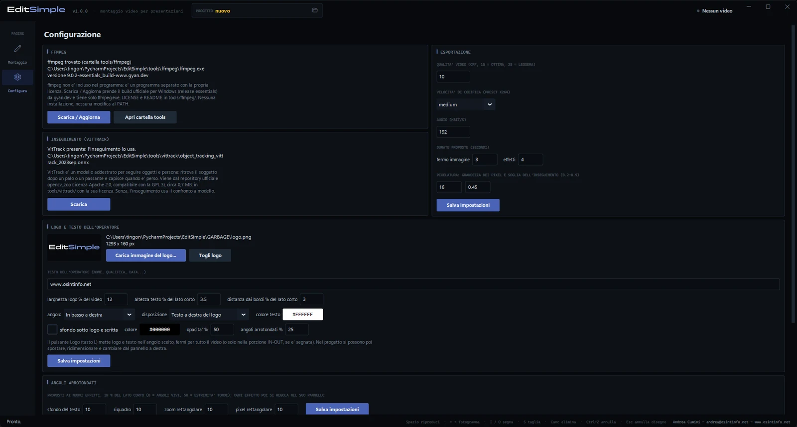

Si apre dalla barra a sinistra. Contiene:

- **FFmpeg** e **Inseguimento (VitTrack)**: stato, download e aggiornamento.
- **Esportazione**: qualità del video (CRF: 15 ottima, 28 leggera), velocità
  di codifica, qualità dell'audio, durate proposte per fermo immagine ed
  effetti, grandezza predefinita dei pixel e soglia dell'inseguimento (più
  alta = più severa nel riconoscere il soggetto).
- **Logo e testo dell'operatore**: l'immagine del logo (PNG con trasparenza o
  JPG), il testo (nome, ente, sito), la larghezza del logo, l'altezza del
  testo, la distanza dai bordi, l'angolo, la disposizione, i colori e uno
  sfondo con opacità e angoli arrotondati. Si preparano una volta; poi il
  pulsante **Logo** li mette nel video.

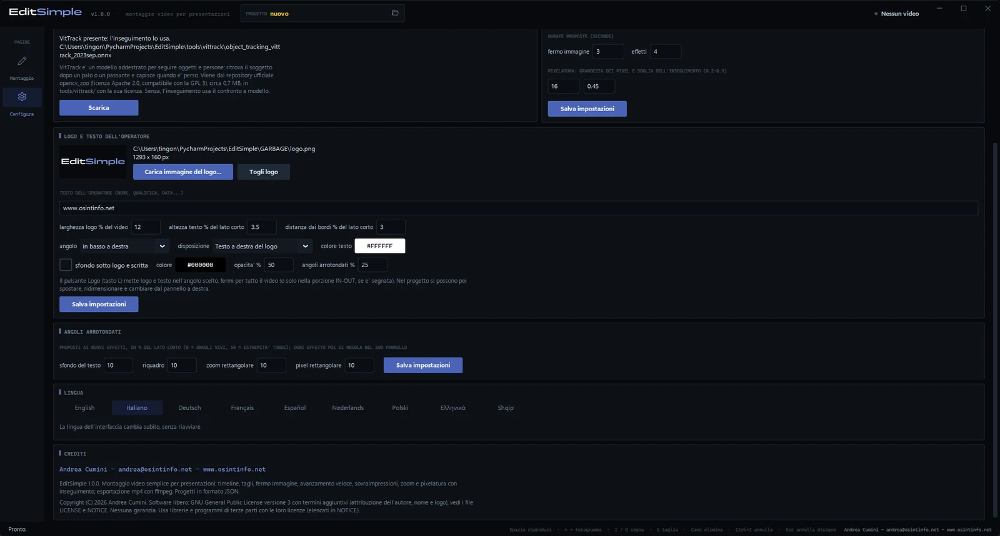

- **Angoli arrotondati** dello sfondo dei testi, dei riquadri, dello zoom
  rettangolare e della pixelatura rettangolare.
- **Lingua** dell'interfaccia: English, Italiano, Deutsch, Français,
  Español, Nederlands, Polski, Ελληνικά, Shqip. Il cambio è immediato.

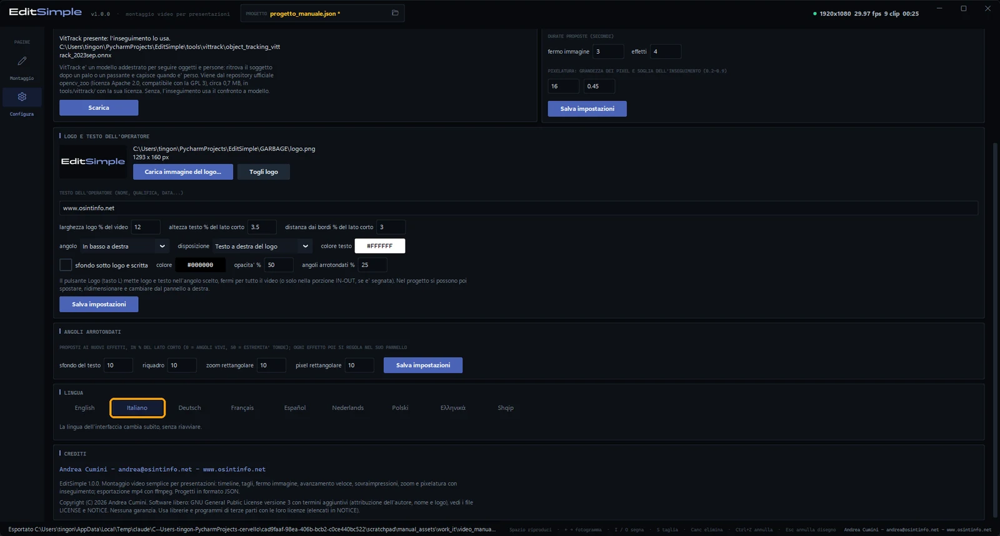

## 5. Un esempio completo, passo per passo

L'esempio di questo capitolo è un video di 19 secondi girato in una via
pedonale affollata (vedi la premessa: i passanti non fanno nulla di male).
In pochi passi lo arricchiamo: il logo e il sito dell'operatore in basso, uno
zoom sulle mani di un uomo che segue i suoi movimenti, una freccia che indica
una persona per 12 secondi, due riquadri su altre persone e la pixelatura di
un volto alla fine.

### 5.1 Importare il video

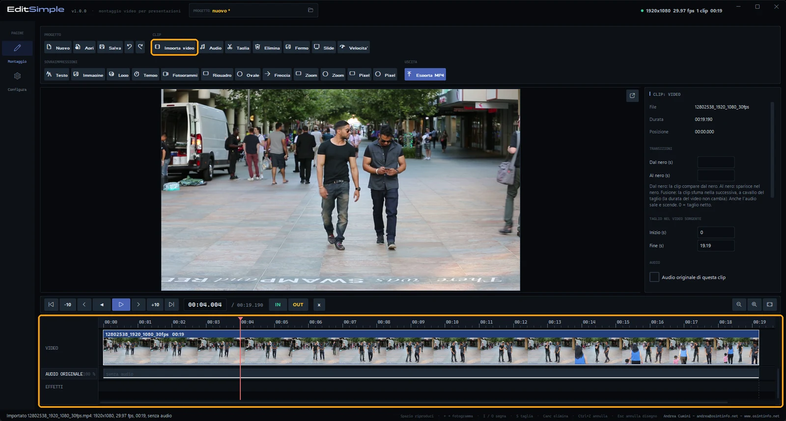

**Importa video** (Ctrl+I) apre il filmato. Il primo video fissa misura e
frequenza del progetto (qui 1920×1080, 29,97 fotogrammi al secondo). La clip
compare nella traccia Video come una pellicola di fotogrammi; il suo audio
nella traccia Audio originale (questo video non ne ha). Altri video si
aggiungono in coda o al cursore.

Il cursore si sposta con un clic sul righello, con le frecce ← → (un
fotogramma), Ctrl+← → (dieci fotogrammi), Maiusc+← → (un secondo), Home e
Fine, o scrivendo il tempo nella casella. **Spazio** riproduce con l'audio,
**Maiusc+Spazio** riproduce all'indietro.

### 5.2 Logo e firma dell'operatore

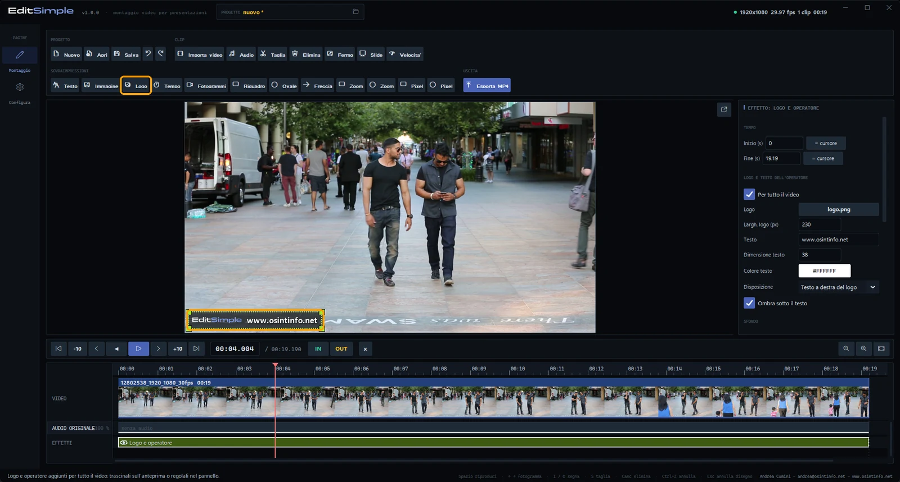

**Logo** (L) mette il logo e il testo preparati in Configura per tutto il
video (o solo fra IN e OUT, se sono segnati). Sull'anteprima si spostano
trascinandoli e si ingrandiscono dagli angoli; nel pannello si cambiano testo,
colori, sfondo, angolo e opacità.

### 5.3 Uno zoom che segue le mani

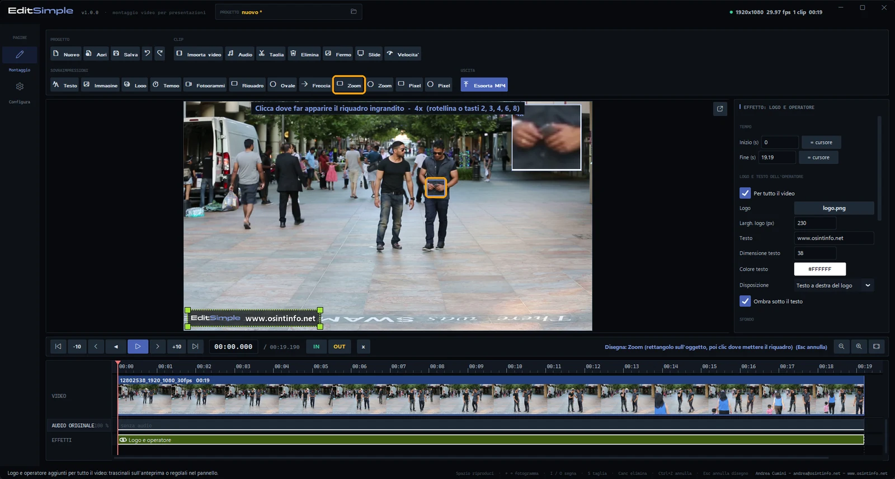

**Zoom** (Z) si usa in due passi:

1. si trascina un rettangolo attorno al dettaglio (qui le mani dell'uomo);
2. sotto il mouse compare il riquadro ingrandito con il contenuto vero: un
   clic lo posa. L'ingrandimento si sceglie in quel momento con la rotellina o
   con i tasti 2, 3, 4, 6, 8 (fino a 16x dal pannello).

Lo zoom **comincia subito a seguire l'oggetto**: una finestra mostra
l'avanzamento dell'inseguimento.

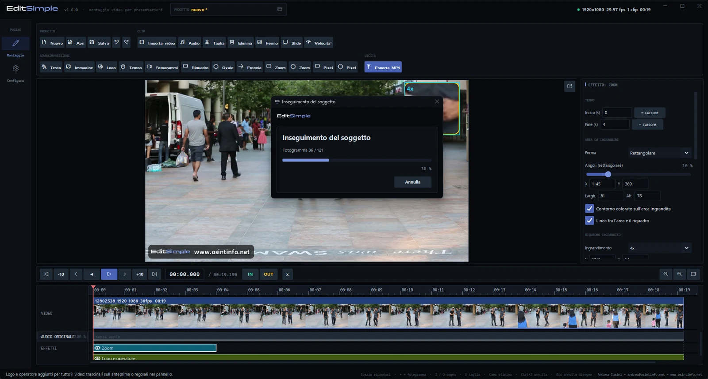

L'area ingrandita segue le mani e cresce o cala se l'uomo si avvicina o si
allontana; il riquadro ingrandito resta dove l'abbiamo messo. Un contorno
colorato segna l'oggetto e una linea lo collega al riquadro. Maiusc+Z crea uno
zoom ovale.

### 5.4 Una freccia che segue una persona

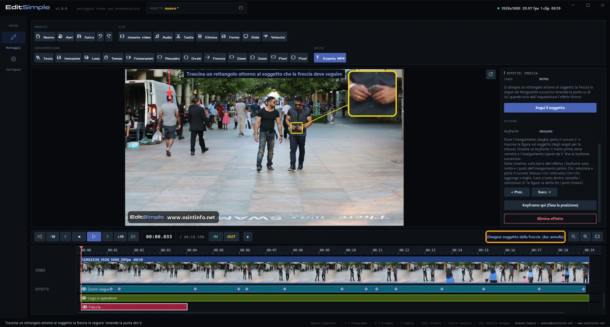

**Freccia** (A): si trascina dalla coda alla punta. Per farle seguire una
persona si preme **Segui il soggetto** nel pannello (o *Ripeti inseguimento*)
e si disegna un **rettangolo attorno al soggetto**: la freccia lo segue
tenendo la punta su di lui.

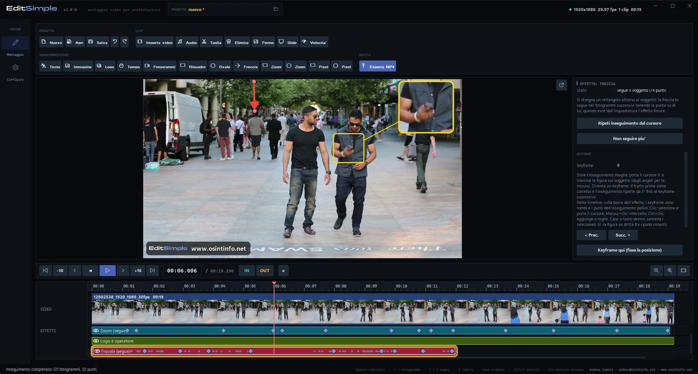

Nella timeline la barra della freccia mostra *(segue)* e i rombi dei keyframe
con cui abbiamo corretto il percorso (vedi il capitolo 6).

### 5.5 Riquadri sulle persone

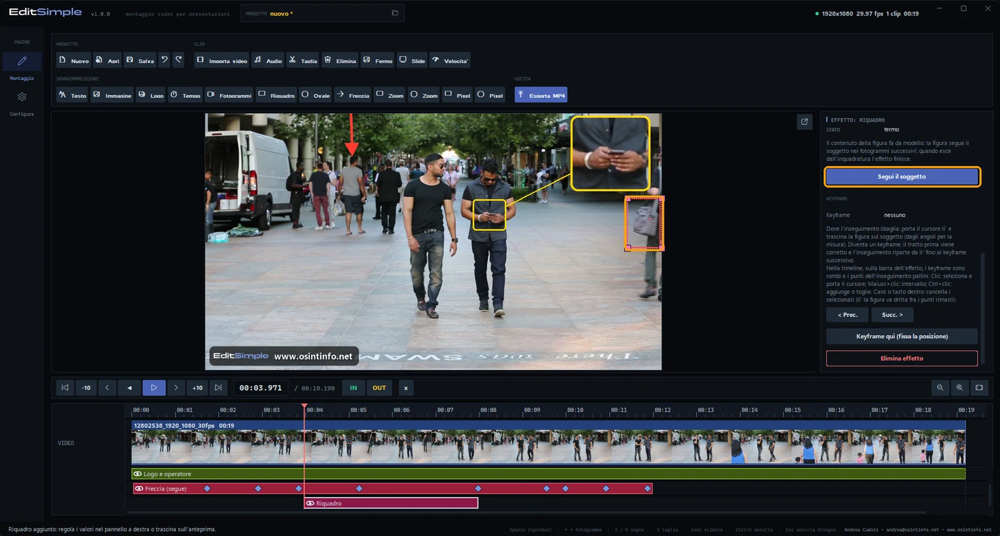

**Riquadro** (R) e **Ovale** (E): si trascinano sull'anteprima. Nel pannello
si scelgono colore, spessore, riempimento, angoli arrotondati e opacità;
**Segui il soggetto** li fa inseguire ciò che contengono. Quando la persona
esce dall'inquadratura, la figura la accompagna fuori e l'effetto finisce.

### 5.6 La pixelatura di un volto

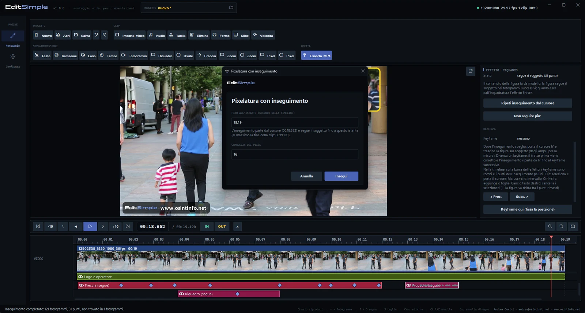

**Pixel** (P rettangolare, K ovale): si trascina un riquadro sul volto; una
finestra chiede fino a quando inseguirlo e la grandezza dei pixel.

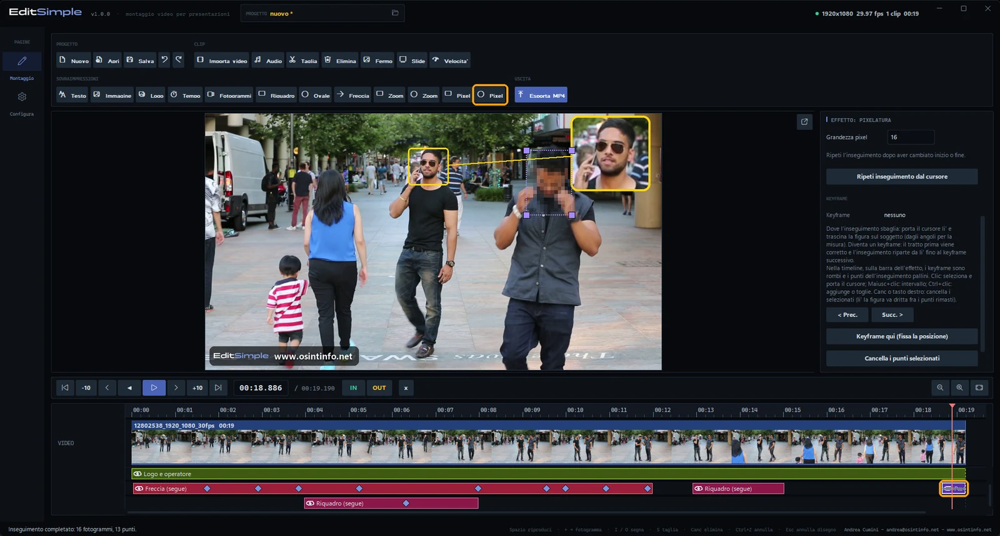

La pixelatura segue il volto e **cresce quando si avvicina** alla camera, così
lo copre sempre. Se il soggetto esce dall'inquadratura la pixelatura lo
accompagna finché è uscito del tutto: nessun fotogramma resta scoperto.

## 6. Correggere l'inseguimento con i keyframe

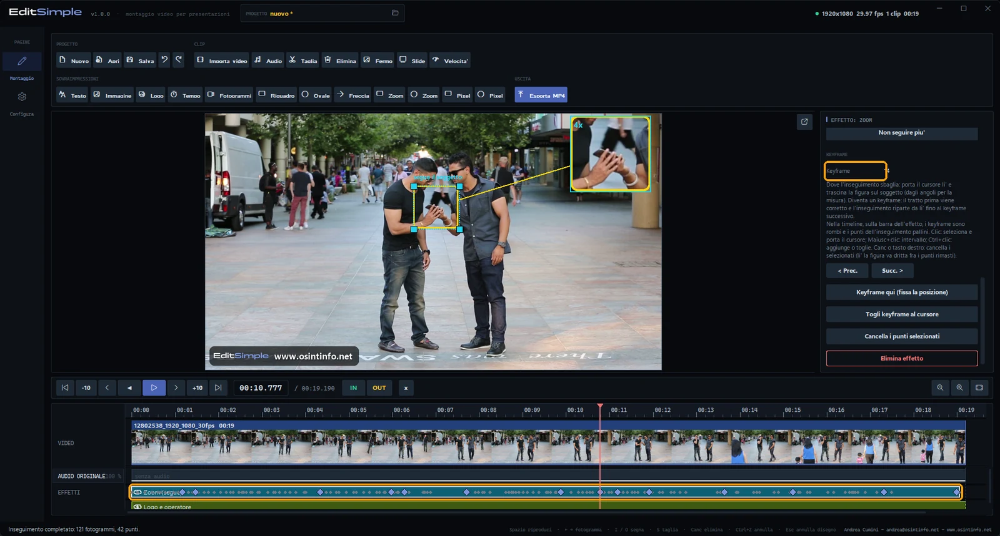

L'inseguimento è automatico, ma un video reale ha ostacoli: un palo, una
persona che passa davanti, un soggetto che si gira. Dove la figura sbaglia:

1. porta il cursore su quel fotogramma;
2. **trascina la figura sul soggetto** nell'anteprima (o ridimensionala dagli
   angoli).

Nasce un **keyframe** (un rombo sulla barra dell'effetto). Il programma
corregge il percorso prima del keyframe, in modo graduale, e **riprende
l'inseguimento da lì** fino al keyframe successivo. Si possono mettere tutti i
keyframe che servono: lo zoom dell'esempio ne ha 14, la freccia 9.

Sulla barra dell'effetto selezionato si vedono anche i punti trovati
dall'inseguimento (pallini). Un clic seleziona un punto e porta lì il cursore,
Maiusc+clic seleziona un intervallo, Ctrl+clic aggiunge o toglie; **Canc** o
il tasto destro cancellano i punti selezionati. Nel pannello, la sezione
**Keyframe** ha i pulsanti *< Prec.* e *Succ. >*, *Keyframe qui* (fissa la
posizione attuale) e *Togli keyframe al cursore*.

## 7. La timeline

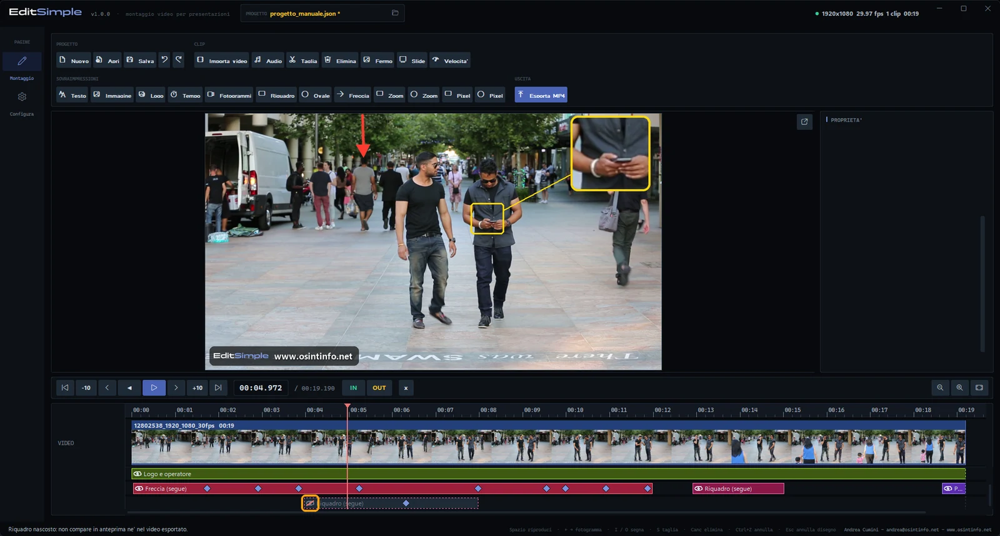

- **Barre degli effetti**: si spostano trascinandole; il bordo destro cambia
  la durata. Gli effetti si dispongono su più corsie; con tanti effetti la
  parte di audio ed effetti **scorre in verticale** (barra a destra, rotellina
  sui nomi delle righe o Maiusc+rotellina), mentre righello e video restano
  fermi in alto.
- **Occhio**: l'icona a sinistra di ogni barra **nasconde o mostra** l'effetto,
  in anteprima e nel video esportato. Utile quando molti effetti si
  sovrappongono mentre si lavora.
- **Tasto destro su una barra**: *Allunga fino al cursore* (se il cursore è
  oltre la fine; se l'effetto segue un soggetto, l'inseguimento continua) e
  *Interrompi al cursore* (se il cursore è dentro l'effetto).
- **Zoom della timeline**: Ctrl+rotellina, o i pulsanti − + e *Adatta*. Da
  vicino la pellicola mostra ogni singolo fotogramma.
- **Scorrimento**: rotellina, Alt+trascina o trascinamento con il tasto
  centrale.
- **Divisore**: la sottile fascia sopra i comandi di riproduzione si trascina
  in alto o in basso per dare più spazio alla timeline o all'anteprima.

## 8. L'anteprima: ingrandire e staccare

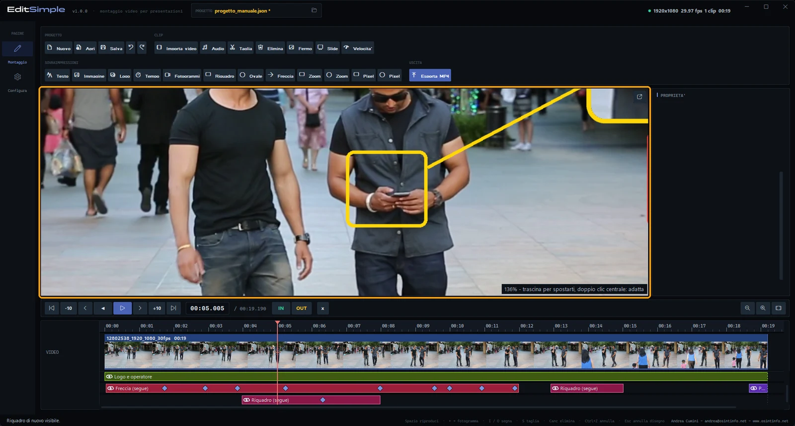

- **Ctrl+rotellina** sull'anteprima la ingrandisce attorno al mouse, fino a
  16 volte: per posare con precisione uno zoom su un dettaglio piccolo o per
  controllare una pixelatura. Ci si sposta trascinando su un punto vuoto (o
  con il tasto centrale); doppio clic con il tasto centrale torna alla vista
  intera.
- **Staccare l'anteprima**: il pulsante in alto a destra dell'anteprima la
  apre in una **finestra a parte**, da mettere su un secondo monitor o dove si
  vuole; la timeline prende tutto lo spazio. Lo stesso pulsante (o la
  chiusura della finestra) la **riattacca**. Le scorciatoie funzionano anche
  nella finestra staccata.

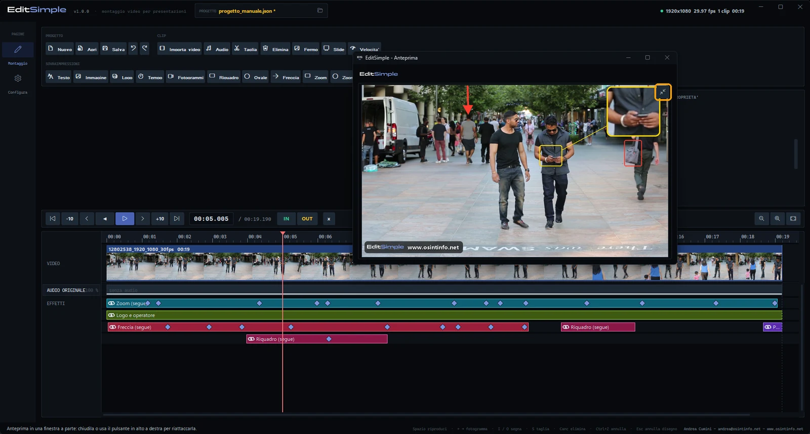

## 9. Slide di apertura, di chiusura e in mezzo

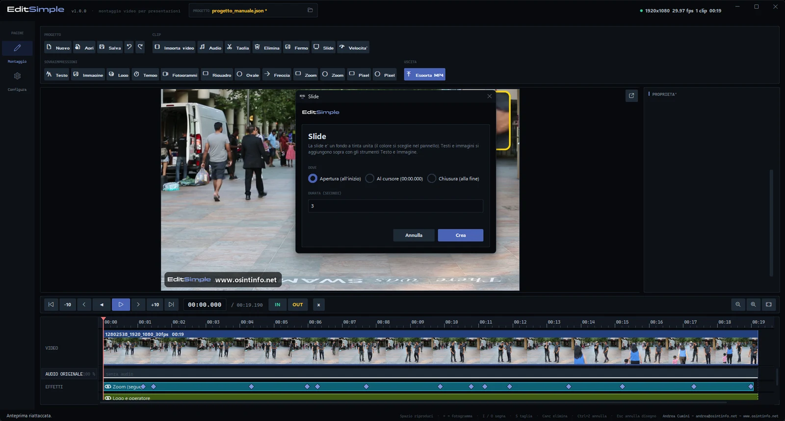

**Slide** inserisce una slide **all'inizio** (apertura), **al cursore** (in
mezzo al video) o **alla fine** (chiusura), della durata scelta. La slide è un
fondo a tinta unita o un'**immagine di sfondo** adattata alla misura del video
(riempi, contieni o deforma); colore e immagine si scelgono nel pannello. Gli
effetti che seguono si spostano in avanti insieme al video.

Sopra la slide si scrivono testi e si mettono immagini con gli strumenti
**Testo** e **Immagine**: con il cursore sulla slide durano quanto lei.

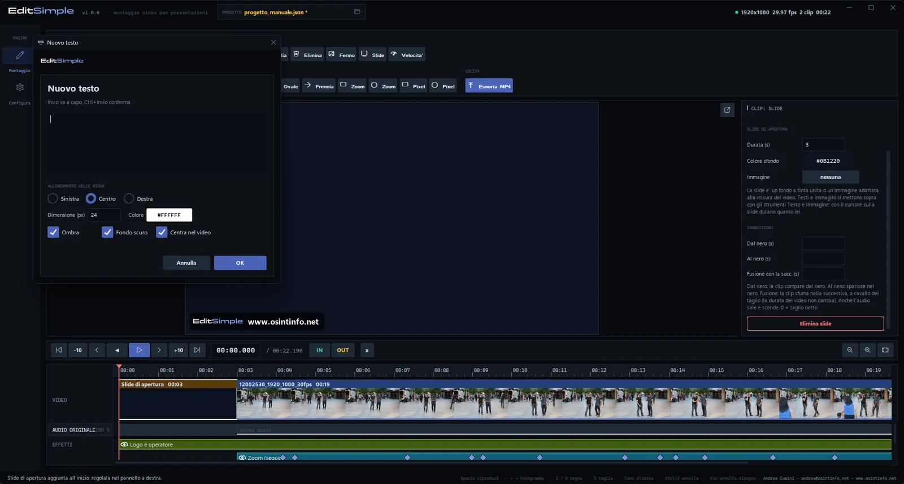

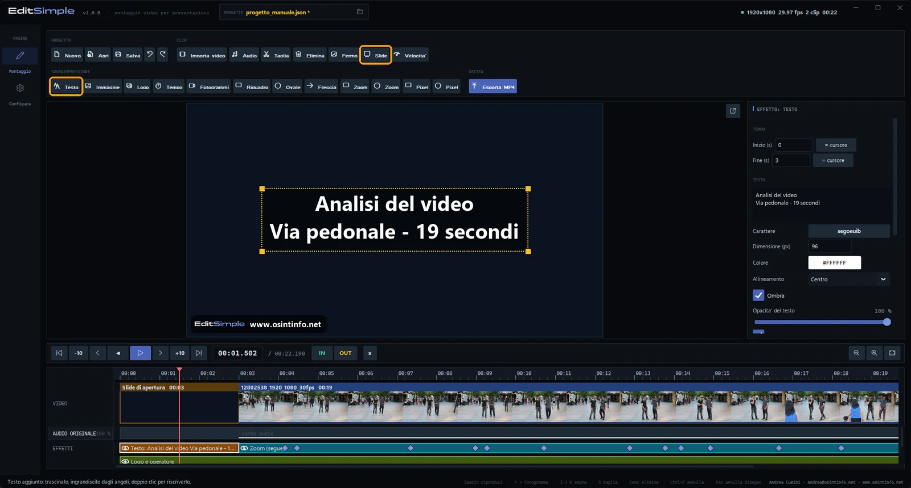

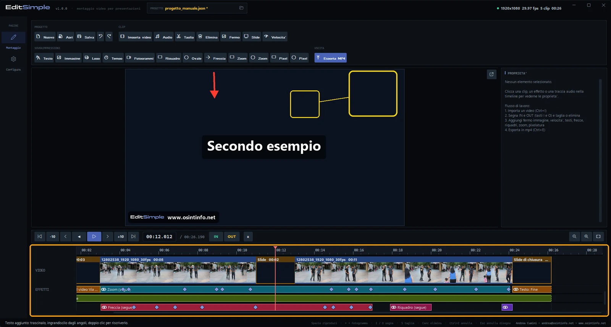

## 10. Testi, immagini, tempo trascorso e numero del fotogramma

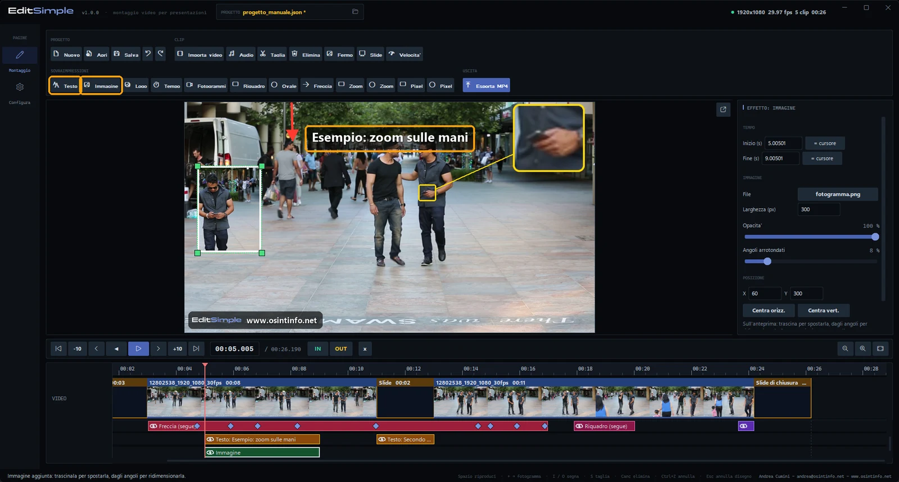

- **Testo** (T): un clic sull'anteprima apre la finestra del testo: più
  righe, allineamento, dimensione, colore, ombra, sfondo (con opacità e
  angoli arrotondati), centratura. Doppio clic su un testo per riscriverlo.
  Nel pannello anche il carattere, scelto da un elenco che mostra ogni
  carattere.
- **Immagine**: sceglie un file (PNG, JPG...) e lo mette al centro; si sposta
  e si ridimensiona sull'anteprima; nel pannello opacità e angoli
  arrotondati. Qui è un fotogramma ingrandito del soggetto, ma può essere una
  mappa, un documento, una foto.

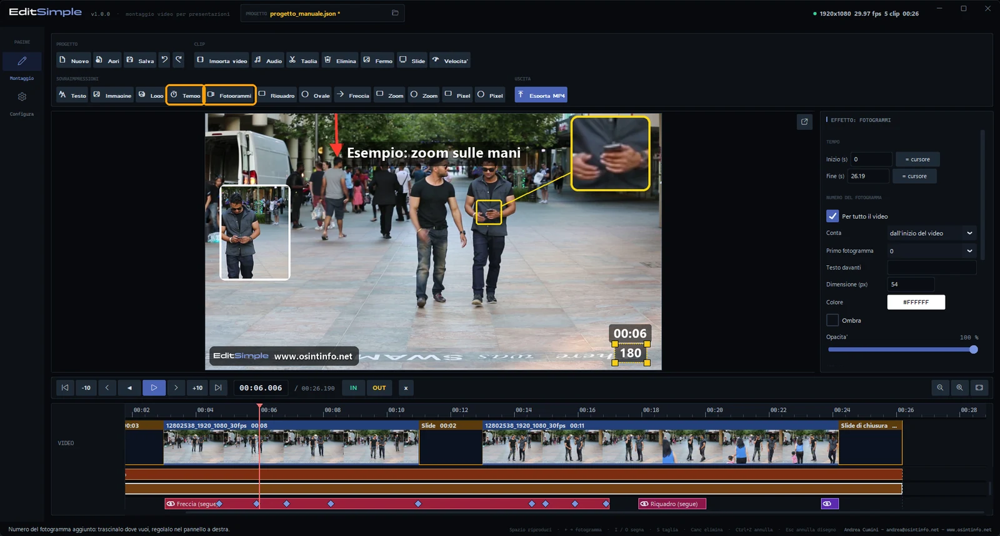

- **Tempo**: il tempo trascorso (01:23, 00:01:23 o con i decimi), dall'inizio
  del video o dall'inizio dell'effetto, con un testo davanti a scelta. Oltre
  l'ora compaiono le ore.
- **Fotogrammi**: il numero del fotogramma, da 0 o da 1, dall'inizio del
  video o dell'effetto. Utile per citare con precisione un istante.

Tutti e due hanno sfondo, opacità e angoli arrotondati, e si mettono dove si
vuole con un clic.

## 11. Accelerare e rallentare

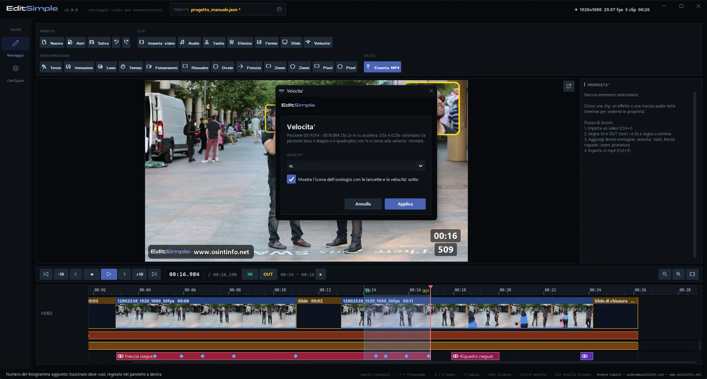

Si segna una porzione con **IN** e **OUT** (tasti I e O) e si preme
**Velocità** (V). Da **2x a 32x** il video accelera; **0,5x e 0,25x**
rallentano. L'opzione dell'**orologio** mostra un'icona con le lancette che
girano e la velocità scritta sotto, così chi guarda sa che il tempo scorre più
veloce. La timeline si accorcia o si allunga; con 1x si torna alla velocità
normale. Posizione, misura e colore dell'orologio si regolano nel pannello
della clip.

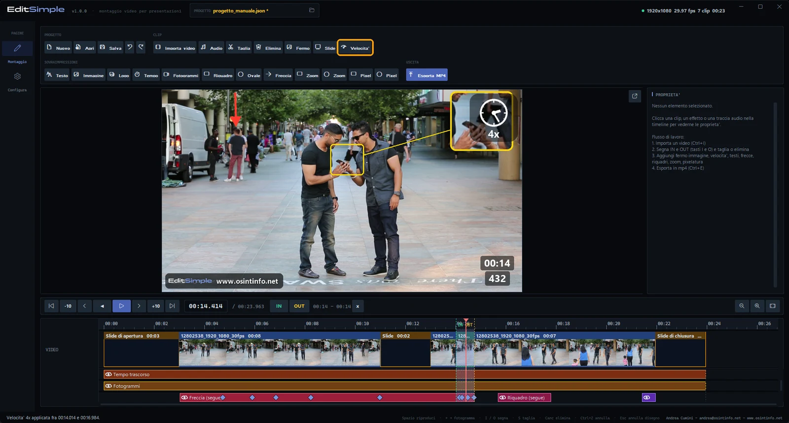

## 12. Tagliare, eliminare, fermo immagine

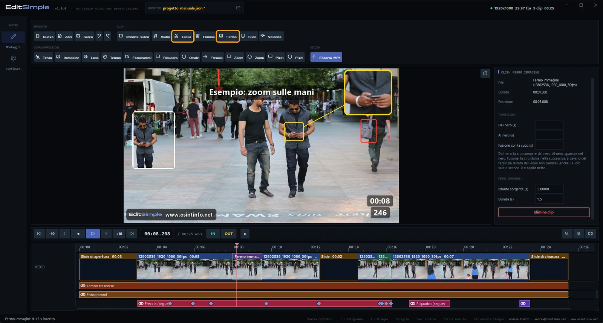

- **Taglia** (S) divide la clip al cursore. Le clip si **riordinano
  trascinandole** nella timeline.
- **Elimina** (Canc) toglie la porzione fra IN e OUT, o l'elemento
  selezionato: ciò che segue scorre indietro, insieme agli effetti.
- **Fermo** (F): il fotogramma al cursore resta fermo per i secondi scelti;
  ciò che segue scorre in avanti.

Tutto si annulla con Ctrl+Z e si ripete con Ctrl+Y.

## 13. Transizioni

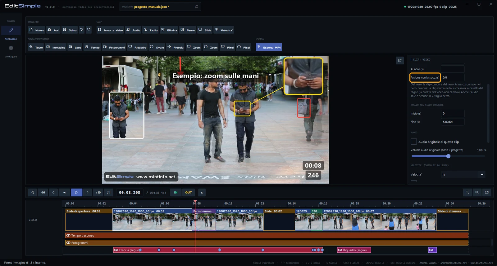

Selezionando una clip, il pannello ha la sezione **Transizioni**:

- **Dal nero**: la clip compare dal nero;
- **Al nero**: la clip sparisce nel nero;
- **Fusione con la successiva**: la clip sfuma nella successiva a cavallo del
  taglio. La clip che esce resta ferma durante la fusione; la durata del
  video non cambia.

Anche l'audio sale e scende con le transizioni. 0 vuol dire taglio netto.

## 14. Audio

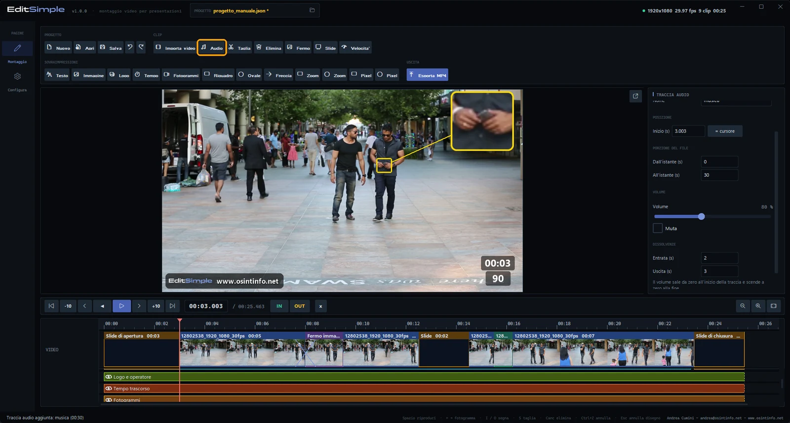

- **Audio** aggiunge una traccia (commento, musica) al cursore. Nel pannello:
  nome, posizione, porzione del file, **volume**, muto e **dissolvenze** in
  entrata e in uscita. Si sposta trascinandola; un clic sul suo nome la
  seleziona tutta, Canc la elimina.
- La **riga bianca** sopra ogni traccia mostra l'andamento del volume:
  dissolvenze e transizioni si vedono a colpo d'occhio.
- **Audio originale**: un clic sul nome della riga seleziona tutto l'audio
  del video (volume, dissolvenze all'inizio e alla fine, eliminazione); un
  clic su un pezzo seleziona solo quel pezzo (volume, dissolvenze, muto).
  Con IN e OUT segnati e l'audio originale selezionato, Canc toglie **solo
  l'audio** di quel tratto: il video resta.
- La riproduzione nell'anteprima è **con l'audio** (mescolato come
  nell'esportazione).

## 15. Esportare il video

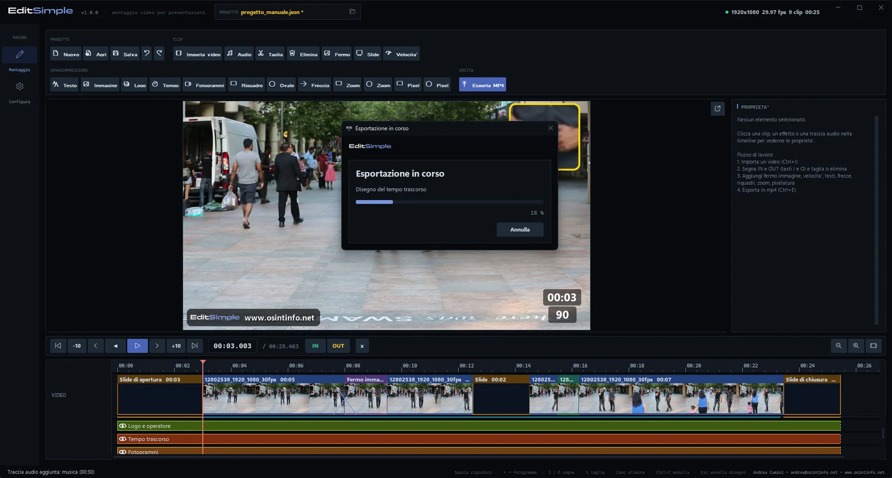

**Esporta MP4** (Ctrl+E) sceglie il file e crea il video con ffmpeg: H.264 e
AAC, qualità e velocità di codifica in Configura. Il risultato è identico
all'anteprima. L'esportazione si può annullare; alla fine il programma
propone di aprire la cartella.

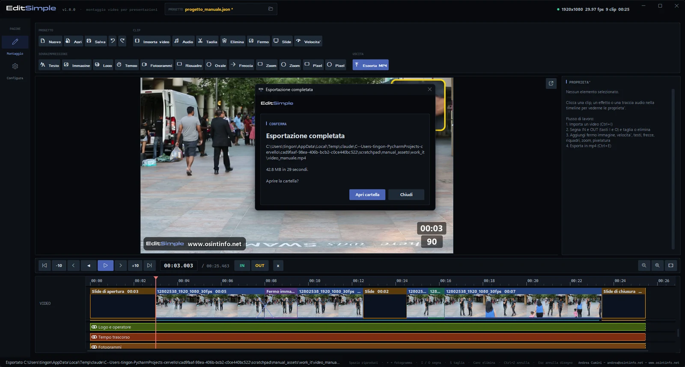

## 16. Consigli per un buon risultato

- **Il riquadro dello zoom va in un'area neutra**: il riquadro ingrandito
  copre la parte di video su cui è posato, per tutto il tempo in cui compare.
  Mettilo dove non succede nulla di interessante (cielo, muro, pavimento).
- **Disegna stretto il soggetto** per riquadri, ovali e pixelature: il
  contenuto della figura è il modello che viene cercato nei fotogrammi
  successivi.
- **Per la freccia, un rettangolo un po' più grande** (testa e spalle invece
  della sola testa) regge meglio quando altre persone passano davanti.
- **Dopo l'inseguimento, scorri il video**: dove la figura sbaglia, trascinala
  sul soggetto. Pochi keyframe bastano anche per percorsi lunghi.
- **Con molti effetti**, usa l'occhio per nascondere quelli che non ti servono
  in quel momento, e l'anteprima staccata per avere più spazio nella timeline.
- **Salva spesso** (Ctrl+S): il progetto è un piccolo file JSON che si riapre
  e si modifica quando si vuole.

## 17. Scorciatoie da tastiera e mouse

| Tasto | Azione |
| --- | --- |
| Spazio / Maiusc+Spazio | Riproduci o ferma / riproduci all'indietro |
| ← → | Un fotogramma indietro / avanti |
| Ctrl+← → | Dieci fotogrammi indietro / avanti |
| Maiusc+← → | Un secondo indietro / avanti |
| Home / Fine | Inizio / fine del video |
| I / O | Segna IN / OUT |
| S | Taglia al cursore |
| F | Fermo immagine |
| V | Velocità della porzione IN-OUT |
| T / R / E / A | Testo / riquadro / ovale / freccia |
| Z / Maiusc+Z | Zoom rettangolare / ovale |
| P / K | Pixelatura rettangolare / ovale |
| L | Logo e operatore |
| Canc | Elimina la selezione (o la porzione IN-OUT) |
| Esc | Annulla il disegno in corso |
| Ctrl+Z / Ctrl+Y | Annulla / ripeti |
| Ctrl+N / Ctrl+O / Ctrl+S / Ctrl+Maiusc+S | Nuovo / apri / salva / salva con nome |
| Ctrl+I | Importa video |
| Ctrl+E | Esporta MP4 |

| Mouse | Dove | Azione |
| --- | --- | --- |
| Rotellina | Anteprima | Un fotogramma avanti o indietro |
| Ctrl+rotellina | Anteprima | Ingrandisce la vista |
| Trascina su un punto vuoto, tasto centrale | Anteprima ingrandita | Sposta la vista |
| Doppio clic | Testo nell'anteprima | Riscrive il testo |
| Ctrl+rotellina | Timeline | Ingrandisce la timeline |
| Rotellina / Alt+trascina / tasto centrale | Timeline | Scorre in orizzontale |
| Maiusc+rotellina, rotellina sui nomi | Timeline | Scorre audio ed effetti in verticale |
| Tasto destro | Barra di un effetto | Allunga fino al cursore / interrompi al cursore |
| Tasto destro | Keyframe o punto | Cancella |

## 18. Il file di progetto

Il progetto è un file JSON con le clip, le tracce audio, gli effetti (con i
percorsi dell'inseguimento e i keyframe) e i percorsi dei file usati. I video,
gli audio e le immagini non vengono copiati nel progetto: lasciali dove sono
finché il lavoro non è finito. Il video esportato, invece, è un MP4 autonomo.

---

EditSimple è software libero, distribuito con la licenza GNU GPL versione 3
con termini aggiuntivi di attribuzione dell'autore (vedi `LICENSE` e
`NOTICE`). ffmpeg e VitTrack sono programmi separati con le proprie licenze.
