# EditSimple — Handleiding

[English](manual.en.md) · [Italiano](manual.it.md) · [Deutsch](manual.de.md) · [Français](manual.fr.md) · [Español](manual.es.md) · **Nederlands** · [Polski](manual.pl.md) · [Ελληνικά](manual.el.md) · [Shqip](manual.sq.md)

EditSimple is een videomontageprogramma voor wie in een video **een feit moet
uitleggen of een bewijs moet tonen**: een overdracht van hand tot hand in een
menigte, een voertuig dat aankomt, een persoon die je wilt volgen of
onherkenbaar wilt maken. Je importeert de beelden, je wijst aan wat telt en
het programma doet de rest: pijlen, kaders, zooms en pixeleringen **volgen
vanzelf het onderwerp** in de volgende frames, en waar het volgen fout gaat,
sleep je de figuur gewoon naar de juiste plek om het te corrigeren. In een
paar minuten heb je een MP4 die klaar is om te vertonen of mee te sturen, met
een openings- en slotdia, teksten, logo en de naam van de operator.

*Andrea Cumini — www.osintinfo.net — andrea@osintinfo.net*
*EditSimple maakt deel uit van de tools van [Seity](https://www.seity.com).*

> **Over de voorbeeldvideo.** De afbeeldingen in deze handleiding gebruiken
> een archiefvideo die op Pexels is gepubliceerd: een voetgangersstraat met
> gewone voorbijgangers. **De mensen die je ziet, doen niets verkeerds**: de
> pijlen, kaders, zooms en pixeleringen die op hen zijn gezet, dienen alleen
> om te laten zien hoe het programma werkt, en de onderwerpen zijn willekeurig
> gekozen.

## Inhoud

1. [Wat je ermee kunt doen](#1-wat-je-ermee-kunt-doen)
2. [Installatie en eerste start](#2-installatie-en-eerste-start)
3. [Het venster](#3-het-venster)
4. [Pagina Configuratie](#4-pagina-configuratie)
5. [Een volledig voorbeeld, stap voor stap](#5-een-volledig-voorbeeld-stap-voor-stap)
6. [Het volgen corrigeren met keyframes](#6-het-volgen-corrigeren-met-keyframes)
7. [De tijdlijn](#7-de-tijdlijn)
8. [De voorvertoning: vergroten en losmaken](#8-de-voorvertoning-vergroten-en-losmaken)
9. [Dia's aan het begin, aan het einde en tussendoor](#9-dias-aan-het-begin-aan-het-einde-en-tussendoor)
10. [Teksten, afbeeldingen, verstreken tijd en framenummer](#10-teksten-afbeeldingen-verstreken-tijd-en-framenummer)
11. [Versnellen en vertragen](#11-versnellen-en-vertragen)
12. [Knippen, verwijderen, stilstaand beeld](#12-knippen-verwijderen-stilstaand-beeld)
13. [Overgangen](#13-overgangen)
14. [Audio](#14-audio)
15. [De video exporteren](#15-de-video-exporteren)
16. [Tips voor een goed resultaat](#16-tips-voor-een-goed-resultaat)
17. [Sneltoetsen voor toetsenbord en muis](#17-sneltoetsen-voor-toetsenbord-en-muis)
18. [Het projectbestand](#18-het-projectbestand)

## 1. Wat je ermee kunt doen

| Functie | In het kort |
| --- | --- |
| **Onderwerp volgen** | Kaders, ovalen, pijlen, zooms en pixeleringen volgen een persoon, een gezicht, een object of een voertuig; ze worden groter en kleiner als het onderwerp dichter bij de camera komt of verder weg gaat; ze stoppen vanzelf als het onderwerp uit beeld gaat. |
| **Correctiekeyframes** | Waar het volgen fout gaat (een paal, iemand die ervoor langs loopt), sleep je de figuur op het onderwerp: het programma corrigeert het pad voor en na dat punt. |
| **Zoom** | Een klein detail (de handen, een kenteken) 2x tot 16x vergroot in een kader, met een omtrek en een lijn die het met het object verbinden. Rechthoekig of ovaal. |
| **Pixelering** | Rechthoekig of ovaal, voor gezichten en kentekens; volgt het onderwerp en groeit mee. |
| **Teksten en afbeeldingen** | Teksten op meerdere regels met achtergrond en afgeronde hoeken; afbeeldingen erbovenop (een frame, een kaart, een document). |
| **Logo en naam** | Logo en tekst van de operator vast in een hoek, één keer voorbereid in Configuratie. |
| **Tijd en frames** | De verstreken tijd en het framenummer in de video geschreven, waar je maar wilt. |
| **Dia's** | Aan het begin, aan het einde of tussendoor; effen kleur of achtergrondafbeelding; erop schrijf je teksten en zet je afbeeldingen. |
| **Snelheid** | Van 0,25x (slow motion) tot 32x (versneld afspelen), met een klokpictogram dat de snelheid aangeeft. |
| **Knippen** | Knippen op de cursor, een deel verwijderen, stilstaand beeld, clips herschikken. |
| **Overgangen** | Verschijnen uit zwart, verdwijnen in zwart, overvloeien in de volgende clip. |
| **Audio** | Toegevoegde sporen (commentaar, muziek) met volume en faden; originele audio met volume, faden en het verwijderen van losse stukken. |
| **Voorvertoning** | Afspelen met geluid, achteruit, frame voor frame; voorvertoning die je kunt vergroten en **losmaken** in een apart venster. |
| **Export** | MP4 (H.264 + AAC), identiek aan de voorvertoning. |
| **Talen** | Interface in 9 talen, te wisselen zonder herstart. |

## 2. Installatie en eerste start

**Uitvoerbaar bestand (Windows 10/11, 64 bit).** Pak het zip-bestand uit waar
je wilt en start `EditSimple.exe`. Python is niet nodig.

**Vanuit de broncode.** Met Python 3.11:

```bash
python -m venv .venv
.venv\Scripts\python.exe -m pip install -r requirements.txt
.venv\Scripts\python.exe EditSimple.py
```

**FFmpeg.** EditSimple gebruikt ffmpeg om bestanden te lezen en te exporteren.
Het is niet meegeleverd: als het programma ffmpeg bij de eerste start niet
vindt, opent de pagina **Configuratie** en de knop **Downloaden / Bijwerken**
downloadt het (officiële build voor Windows) naar de map `tools\ffmpeg\` naast
het programma. Geen installatie nodig.

**VitTrack (optioneel).** Op dezelfde pagina haalt **Downloaden** VitTrack op,
een klein model (0,7 MB) dat het volgen helpt het onderwerp terug te vinden na
een obstakel. Zonder VitTrack werkt het volgen ook.

## 3. Het venster

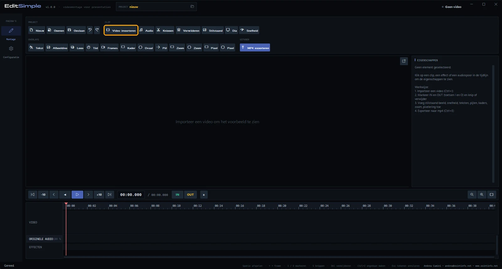

- **Werkbalk**, in vier groepen: *Project* (nieuw, openen, opslaan, ongedaan
  maken, opnieuw), *Clip* (video importeren, audio, knippen, verwijderen,
  stilstaand beeld, dia, snelheid), *Overlays* (tekst, afbeelding, logo, tijd,
  frames, kader, ovaal, pijl, rechthoekige en ovale zoom, rechthoekige en
  ovale pixel) en *Uitvoer* (MP4 exporteren). Elke knop heeft een tooltip met
  zijn sneltoets.
- **Voorvertoning**, in het midden: toont het frame op de cursor met alle
  effecten, precies zoals in de geëxporteerde video. Hierop teken en
  verplaats je de effecten.
- **Eigenschappen**, rechts: de waarden van het geselecteerde element (een
  clip, een effect, een audiospoor).
- **Transport**: begin, -10 frames, vorig frame, achteruit afspelen,
  afspelen, volgend frame, +10 frames, einde; de tijd van de cursor (je kunt
  hem intypen); IN, OUT en het wissen van de markeringen; rechts de zoom van
  de tijdlijn.
- **Tijdlijn**, onderaan: liniaal, spoor **Video** als filmstrook, **Originele
  audio**, toegevoegde audiosporen en **Effecten**.

## 4. Pagina Configuratie

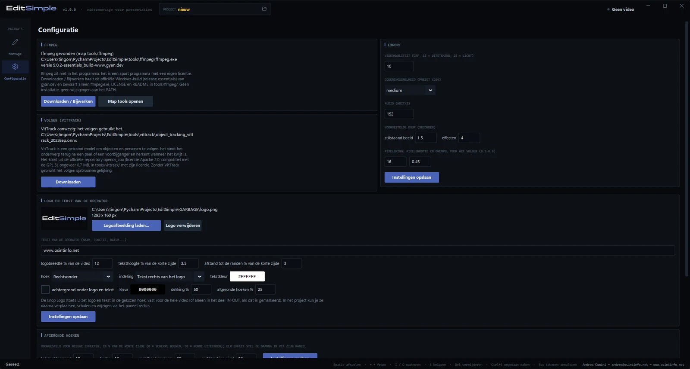

Je opent deze pagina via de balk links. Ze bevat:

- **FFmpeg** en **Volgen (VitTrack)**: status, downloaden en bijwerken.
- **Export**: videokwaliteit (CRF: 15 uitstekend, 28 licht),
  coderingssnelheid, audiokwaliteit, voorgestelde duur voor stilstaand beeld
  en effecten, standaard pixelgrootte en drempel voor het volgen (hoger =
  strenger bij het herkennen van het onderwerp).
- **Logo en tekst van de operator**: de logoafbeelding (PNG met transparantie
  of JPG), de tekst (naam, organisatie, website), de logobreedte, de
  teksthoogte, de afstand tot de randen, de hoek, de indeling, de kleuren en
  een achtergrond met dekking en afgeronde hoeken. Je stelt ze één keer in;
  daarna zet de knop **Logo** ze in de video.

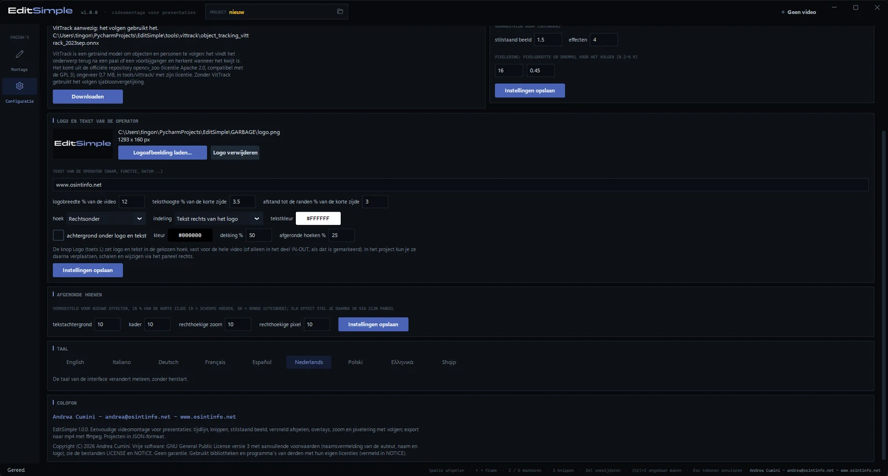

- **Afgeronde hoeken** van de tekstachtergrond, de kaders, de rechthoekige
  zoom en de rechthoekige pixelering.
- **Taal** van de interface: English, Italiano, Deutsch, Français, Español,
  Nederlands, Polski, Ελληνικά, Shqip. De wijziging gaat meteen in.

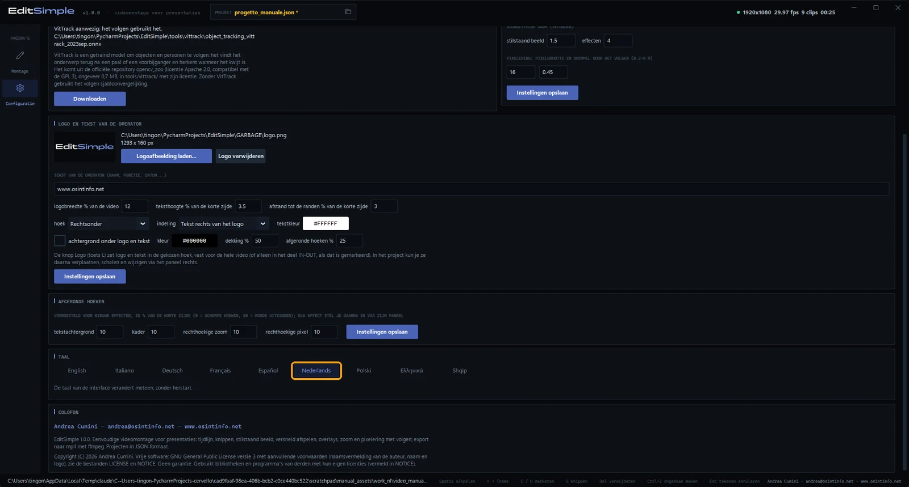

## 5. Een volledig voorbeeld, stap voor stap

Het voorbeeld in dit hoofdstuk is een video van 19 seconden, opgenomen in een
drukke voetgangersstraat (zie de inleiding: de voorbijgangers doen niets
verkeerds). In een paar stappen verrijken we hem: het logo en de website van
de operator onderaan, een zoom op de handen van een man die zijn bewegingen
volgt, een pijl die 12 seconden lang een persoon aanwijst, twee kaders op
andere personen en de pixelering van een gezicht aan het einde.

### 5.1 De video importeren

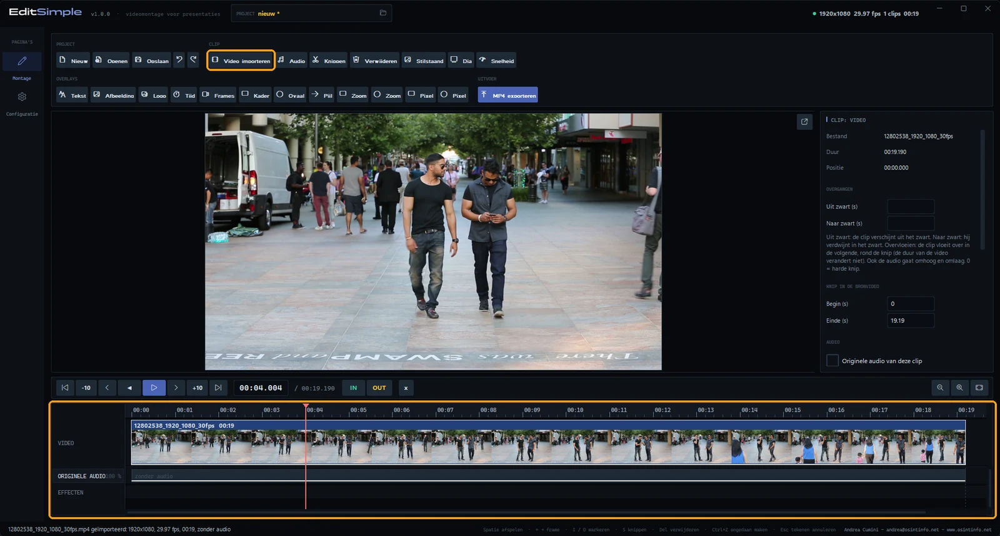

**Video importeren** (Ctrl+I) opent de beelden. De eerste video bepaalt de
afmetingen en de framerate van het project (hier 1920×1080, 29,97 frames per
seconde). De clip verschijnt in het spoor Video als een filmstrook van frames;
de audio ervan in het spoor Originele audio (deze video heeft geen audio).
Andere video's voeg je toe aan het einde of op de cursor.

Je verplaatst de cursor met een klik op de liniaal, met de pijltoetsen ← →
(één frame), Ctrl+← → (tien frames), Shift+← → (één seconde), Home en End,
of door de tijd in het vak te typen. **Spatie** speelt af met geluid,
**Shift+Spatie** speelt achteruit af.

### 5.2 Logo en naam van de operator

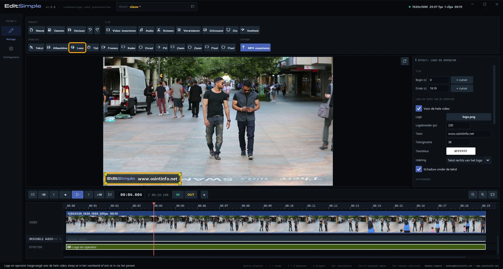

**Logo** (L) zet het logo en de tekst die je in Configuratie hebt voorbereid
in de hele video (of alleen tussen IN en OUT, als die gemarkeerd zijn). In de
voorvertoning verplaats je ze door te slepen en vergroot je ze via de hoeken;
in het paneel wijzig je tekst, kleuren, achtergrond, hoek en dekking.

### 5.3 Een zoom die de handen volgt

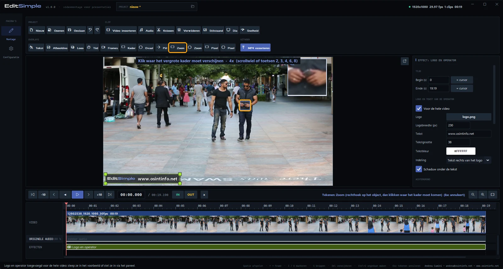

**Zoom** (Z) gebruik je in twee stappen:

1. sleep een rechthoek rond het detail (hier de handen van de man);
2. onder de muis verschijnt het vergrote kader met de echte inhoud: met een
   klik zet je het neer. De vergroting kies je op dat moment met het
   scrollwiel of met de toetsen 2, 3, 4, 6, 8 (tot 16x via het paneel).

De zoom **begint meteen het object te volgen**: een venster toont de voortgang
van het volgen.

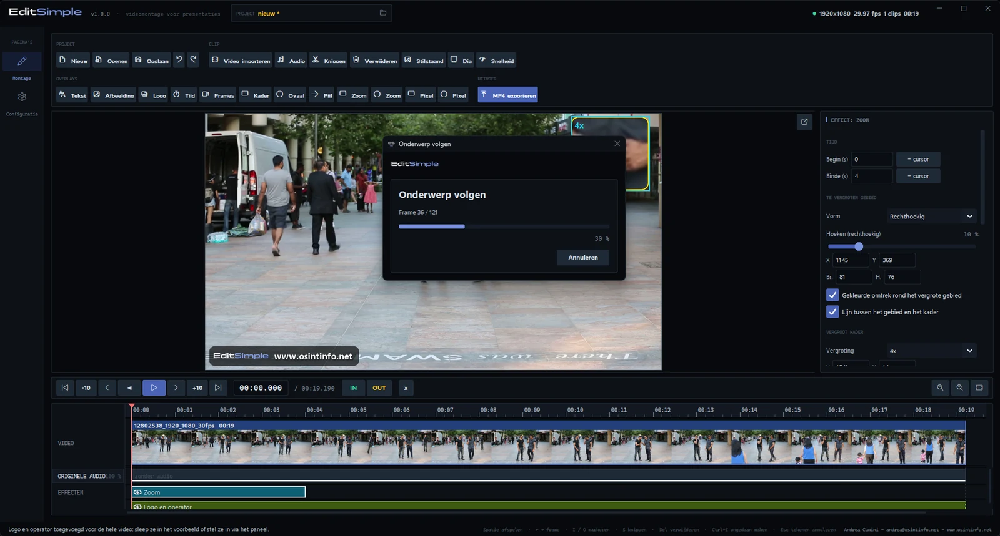

Het vergrote gebied volgt de handen en wordt groter of kleiner als de man
dichterbij komt of verder weg gaat; het vergrote kader blijft waar we het
hebben neergezet. Een gekleurde omtrek markeert het object en een lijn
verbindt het met het kader. Shift+Z maakt een ovale zoom.

### 5.4 Een pijl die een persoon volgt

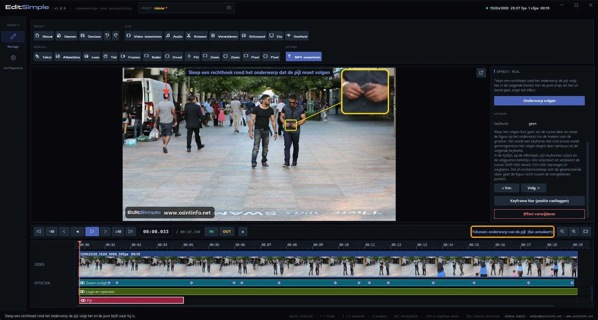

**Pijl** (A): sleep van de staart naar de punt. Om de pijl een persoon te laten
volgen, druk je in het paneel op **Onderwerp volgen** (of *Volgen opnieuw
vanaf de cursor*) en teken je een **rechthoek rond het onderwerp**: de pijl
volgt het en houdt de punt erop.

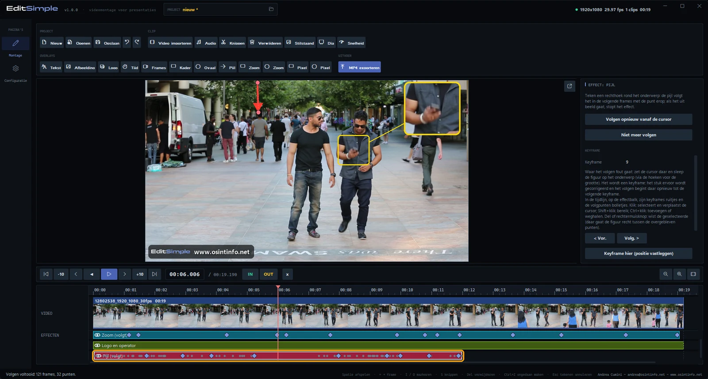

In de tijdlijn toont de balk van de pijl *(volgt)* en de ruitjes van de
keyframes waarmee we het pad hebben gecorrigeerd (zie hoofdstuk 6).

### 5.5 Kaders op de personen

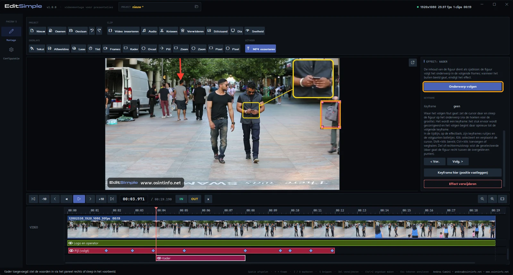

**Kader** (R) en **Ovaal** (E): sleep ze in de voorvertoning. In het paneel
kies je kleur, dikte, vulling, afgeronde hoeken en dekking; **Onderwerp
volgen** laat ze volgen wat erin staat. Als de persoon uit beeld gaat,
begeleidt de figuur hem naar buiten en eindigt het effect.

### 5.6 De pixelering van een gezicht

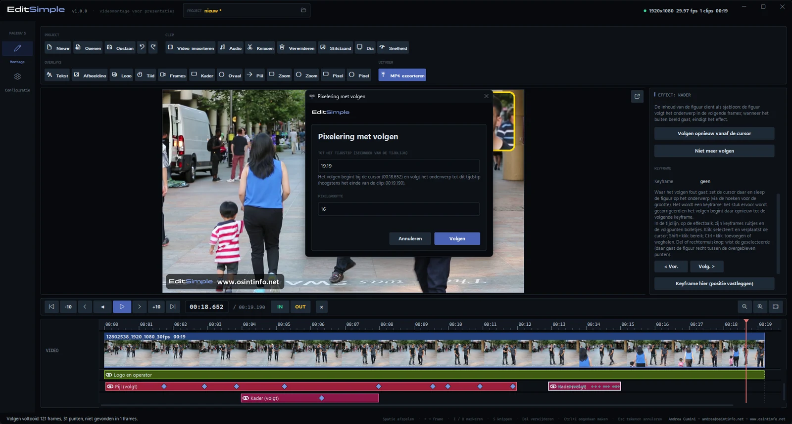

**Pixel** (P rechthoekig, K ovaal): sleep een kader over het gezicht; een
venster vraagt tot wanneer het gevolgd moet worden en hoe groot de pixels
zijn.

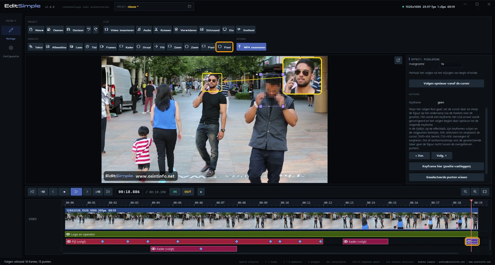

De pixelering volgt het gezicht en **groeit als het dichter bij** de camera
komt, zodat het altijd bedekt blijft. Als het onderwerp uit beeld gaat,
begeleidt de pixelering het tot het helemaal weg is: geen enkel frame blijft
onbedekt.

## 6. Het volgen corrigeren met keyframes

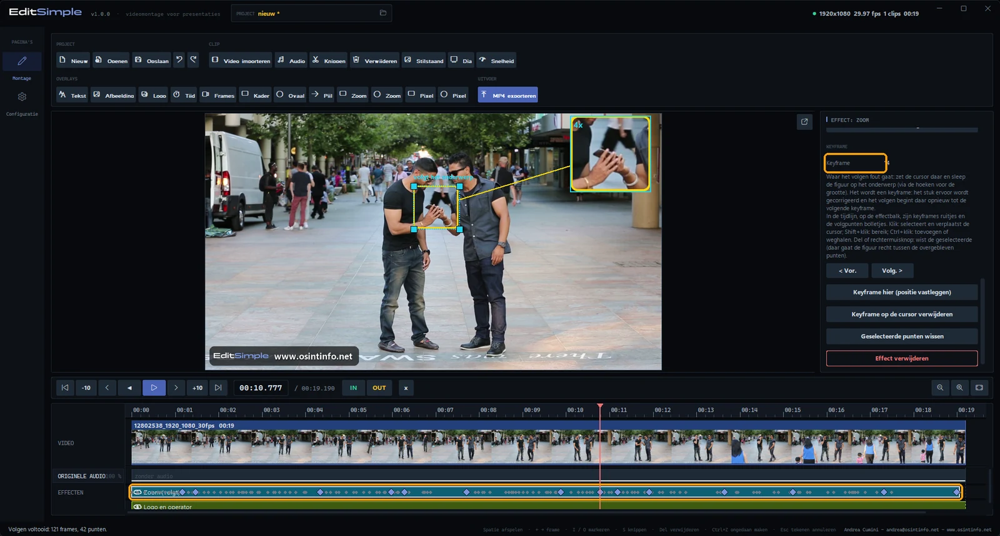

Het volgen gaat automatisch, maar een echte video heeft obstakels: een paal,
iemand die ervoor langs loopt, een onderwerp dat zich omdraait. Waar de figuur
fout gaat:

1. zet de cursor op dat frame;
2. **sleep de figuur op het onderwerp** in de voorvertoning (of pas de grootte
   aan via de hoeken).

Er ontstaat een **keyframe** (een ruitje op de balk van het effect). Het
programma corrigeert het pad vóór de keyframe geleidelijk en **begint daar
opnieuw met volgen** tot de volgende keyframe. Je kunt zoveel keyframes zetten
als nodig: de zoom uit het voorbeeld heeft er 14, de pijl 9.

Op de balk van het geselecteerde effect zie je ook de punten die het volgen
heeft gevonden (bolletjes). Een klik selecteert een punt en zet de cursor
daar, Shift+klik selecteert een bereik, Ctrl+klik voegt toe of haalt weg;
**Del** of de rechtermuisknop wist de geselecteerde punten. In het paneel
heeft het onderdeel **Keyframe** de knoppen *< Vor.* en *Volg. >*, *Keyframe
hier* (legt de huidige positie vast) en *Keyframe op de cursor verwijderen*.

## 7. De tijdlijn

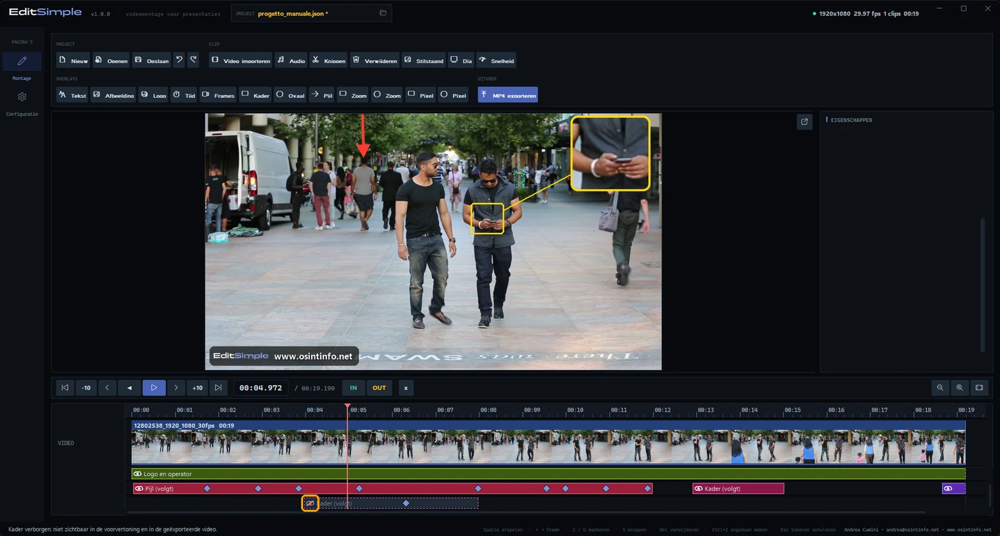

- **Effectbalken**: verplaats ze door te slepen; de rechterrand wijzigt de
  duur. De effecten worden over meerdere banen verdeeld; met veel effecten
  **schuift** het deel met audio en effecten **verticaal** (balk rechts,
  scrollwiel op de rijnamen of Shift+scrollwiel), terwijl liniaal en video
  bovenaan blijven staan.
- **Oog**: het pictogram links van elke balk **verbergt of toont** het effect,
  in de voorvertoning en in de geëxporteerde video. Handig als veel effecten
  elkaar overlappen terwijl je werkt.
- **Rechtermuisknop op een balk**: *Verlengen tot de cursor* (als de cursor
  voorbij het einde staat; als het effect een onderwerp volgt, gaat het volgen
  verder) en *Stoppen bij de cursor* (als de cursor binnen het effect staat).
- **Zoom van de tijdlijn**: Ctrl+scrollwiel, of de knoppen − + en *Tijdlijn
  passend maken*. Van dichtbij toont de filmstrook elk afzonderlijk frame.
- **Schuiven**: scrollwiel, Alt+slepen of slepen met de middelste muisknop.
- **Scheiding**: de smalle strook boven de afspeelknoppen sleep je omhoog of
  omlaag om meer ruimte te geven aan de tijdlijn of aan de voorvertoning.

## 8. De voorvertoning: vergroten en losmaken

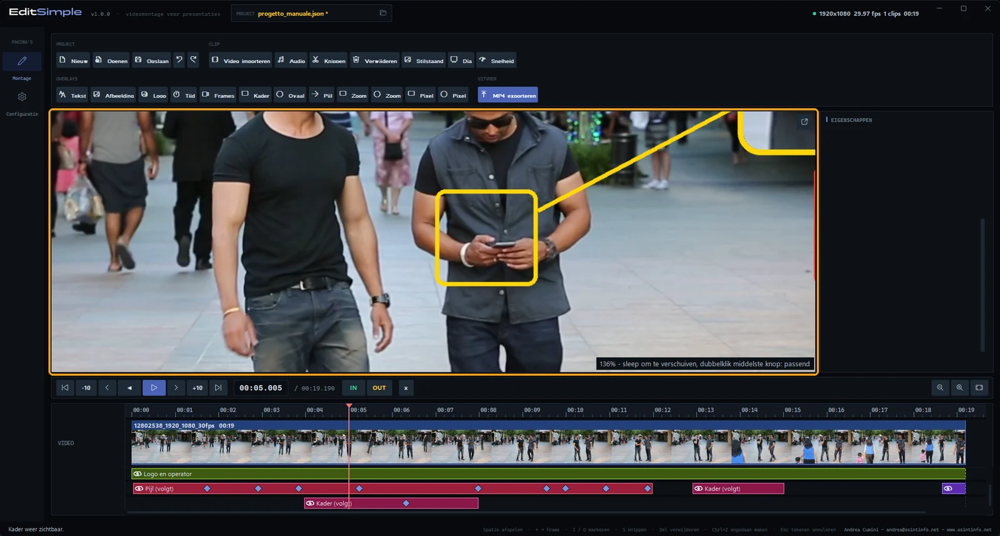

- **Ctrl+scrollwiel** op de voorvertoning vergroot die rond de muis, tot 16
  keer: om een zoom precies op een klein detail te zetten of om een
  pixelering te controleren. Je verschuift het beeld door op een lege plek te
  slepen (of met de middelste muisknop); dubbelklikken met de middelste
  muisknop brengt je terug naar het volledige beeld.
- **De voorvertoning losmaken**: de knop rechtsboven in de voorvertoning
  opent die in een **apart venster**, dat je op een tweede monitor of waar je
  maar wilt kunt zetten; de tijdlijn krijgt alle ruimte. Dezelfde knop (of
  het sluiten van het venster) **zet hem terug**. De sneltoetsen werken ook in
  het losgemaakte venster.

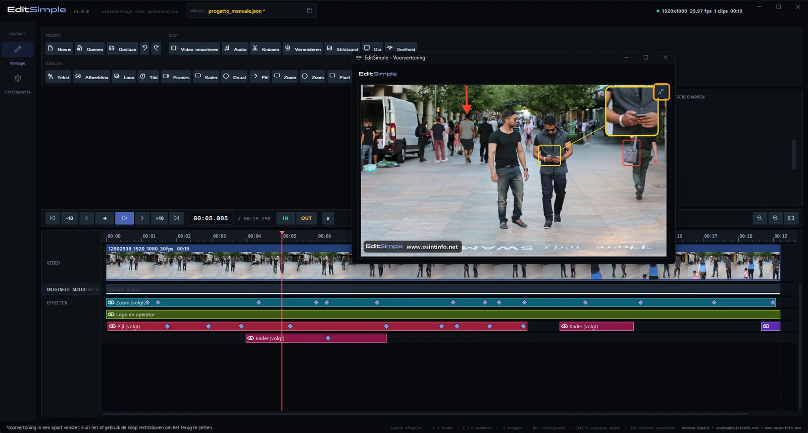

## 9. Dia's aan het begin, aan het einde en tussendoor

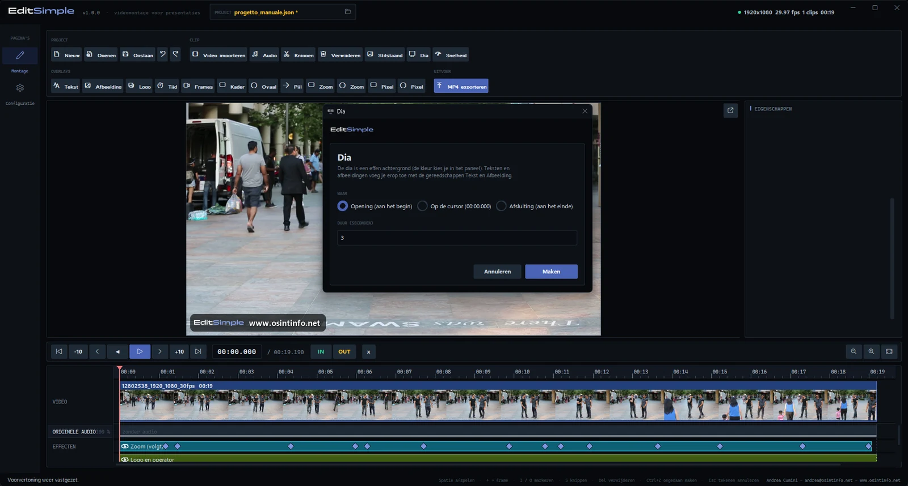

**Dia** voegt een dia in **aan het begin** (opening), **op de cursor** (midden
in de video) of **aan het einde** (afsluiting), met de gekozen duur. De dia is
een effen achtergrond of een **achtergrondafbeelding** die aan de afmetingen
van de video wordt aangepast (vullen, volledig of uitrekken); kleur en
afbeelding kies je in het paneel. De effecten erna schuiven samen met de video
naar achteren.

Op de dia schrijf je teksten en zet je afbeeldingen met de gereedschappen
**Tekst** en **Afbeelding**: met de cursor op de dia duren ze even lang als de
dia.

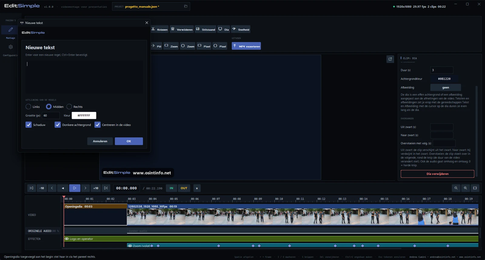

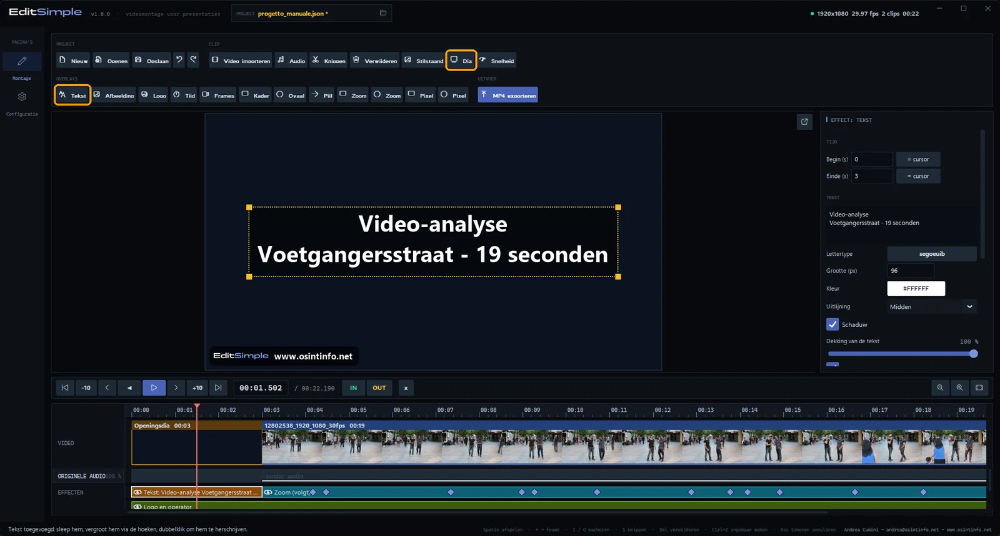

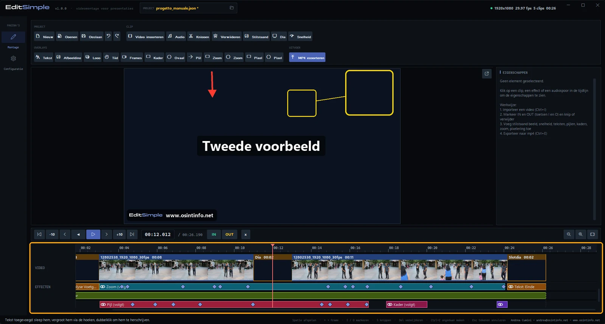

## 10. Teksten, afbeeldingen, verstreken tijd en framenummer

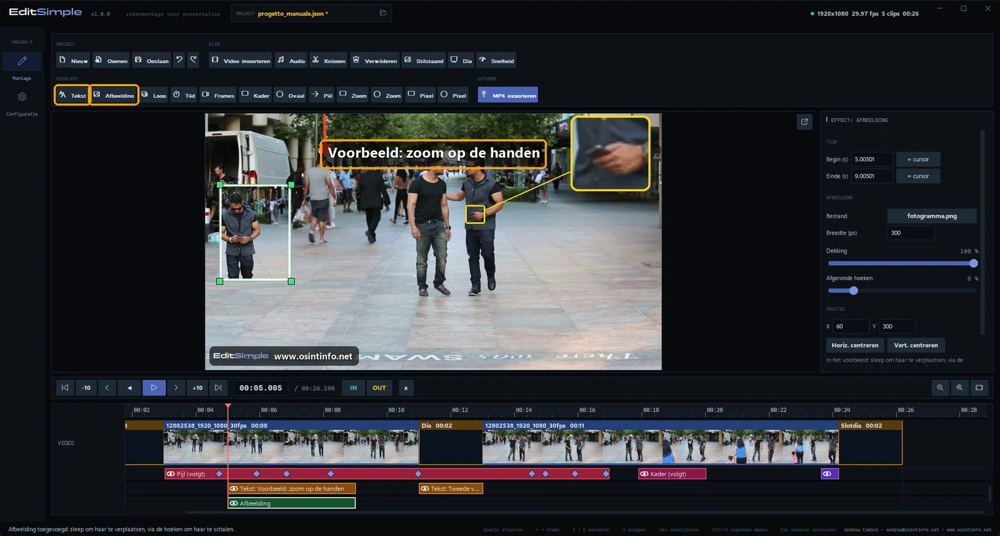

- **Tekst** (T): een klik in de voorvertoning opent het tekstvenster: meerdere
  regels, uitlijning, grootte, kleur, schaduw, achtergrond (met dekking en
  afgeronde hoeken), centreren. Dubbelklik op een tekst om hem te
  herschrijven. In het paneel ook het lettertype, gekozen uit een lijst die
  elk lettertype toont.
- **Afbeelding**: kiest een bestand (PNG, JPG...) en zet het in het midden; je
  verplaatst en schaalt het in de voorvertoning; in het paneel dekking en
  afgeronde hoeken. Hier is het een vergroot frame van het onderwerp, maar het
  kan ook een kaart, een document of een foto zijn.

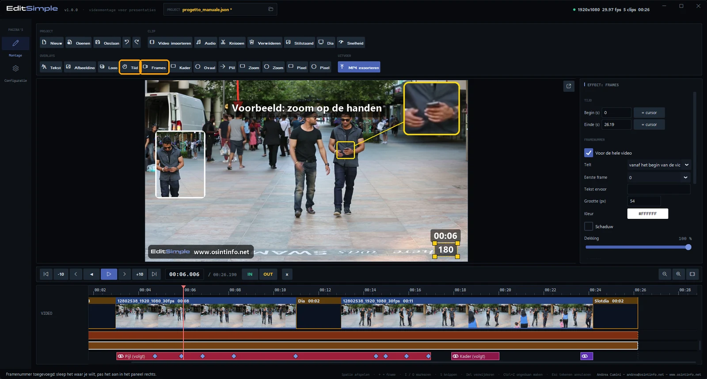

- **Tijd**: de verstreken tijd (01:23, 00:01:23 of met tienden), vanaf het
  begin van de video of vanaf het begin van het effect, met een tekst ervoor
  naar keuze. Boven het uur verschijnen de uren.
- **Frames**: het framenummer, vanaf 0 of vanaf 1, vanaf het begin van de
  video of van het effect. Handig om een moment precies aan te halen.

Allebei hebben ze achtergrond, dekking en afgeronde hoeken, en je zet ze met
een klik waar je maar wilt.

## 11. Versnellen en vertragen

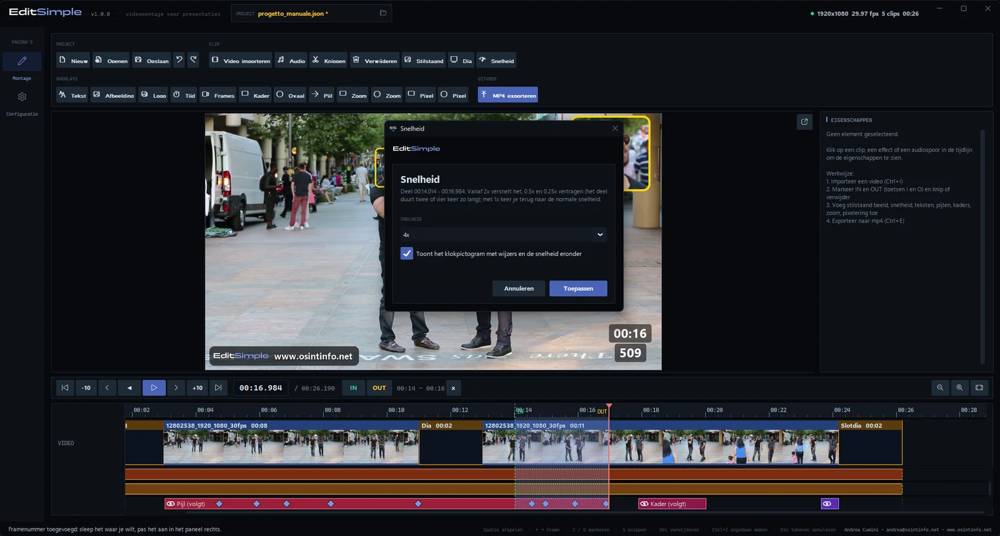

Markeer een deel met **IN** en **OUT** (toetsen I en O) en druk op
**Snelheid** (V). Van **2x tot 32x** versnelt de video; **0,5x en 0,25x**
vertragen. De optie **klok** toont een pictogram met draaiende wijzers en de
snelheid eronder geschreven, zodat de kijker weet dat de tijd sneller
verstrijkt. De tijdlijn wordt korter of langer; met 1x keer je terug naar de
normale snelheid. Positie, grootte en kleur van de klok stel je in via het
paneel van de clip.

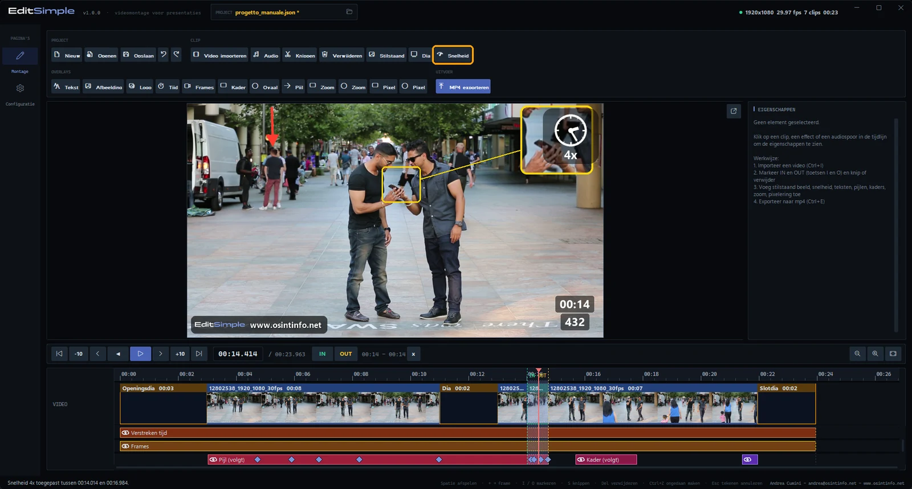

## 12. Knippen, verwijderen, stilstaand beeld

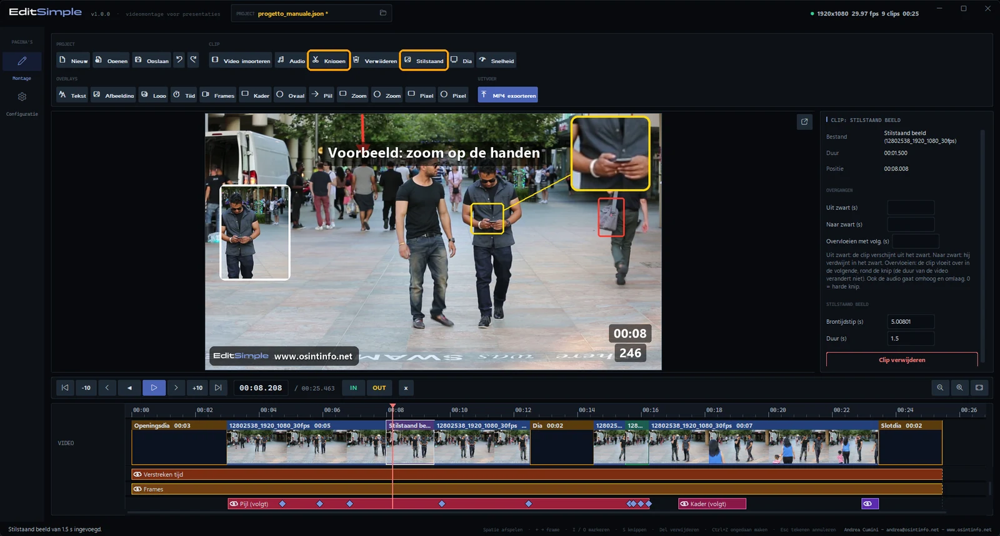

- **Knippen** (S) splitst de clip op de cursor. Je **herschikt** de clips **door
  ze te slepen** in de tijdlijn.
- **Verwijderen** (Del) haalt het deel tussen IN en OUT weg, of het
  geselecteerde element: wat volgt schuift naar voren, samen met de effecten.
- **Stilstaand** (F): het frame op de cursor blijft stilstaan gedurende het
  gekozen aantal seconden; wat volgt schuift naar achteren.

Alles maak je ongedaan met Ctrl+Z en herhaal je met Ctrl+Y.

## 13. Overgangen

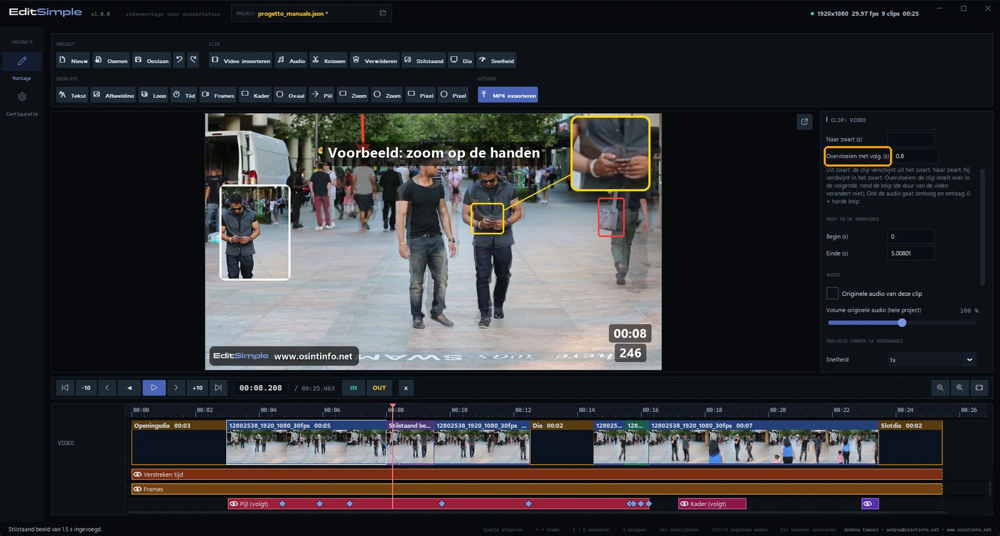

Als je een clip selecteert, heeft het paneel het onderdeel **Overgangen**:

- **Uit zwart**: de clip verschijnt uit het zwart;
- **Naar zwart**: de clip verdwijnt in het zwart;
- **Overvloeien met volg.**: de clip vloeit over in de volgende, rond de knip.
  De uitgaande clip blijft stilstaan tijdens het overvloeien; de duur van de
  video verandert niet.

Ook de audio gaat omhoog en omlaag met de overgangen. 0 betekent een harde
knip.

## 14. Audio

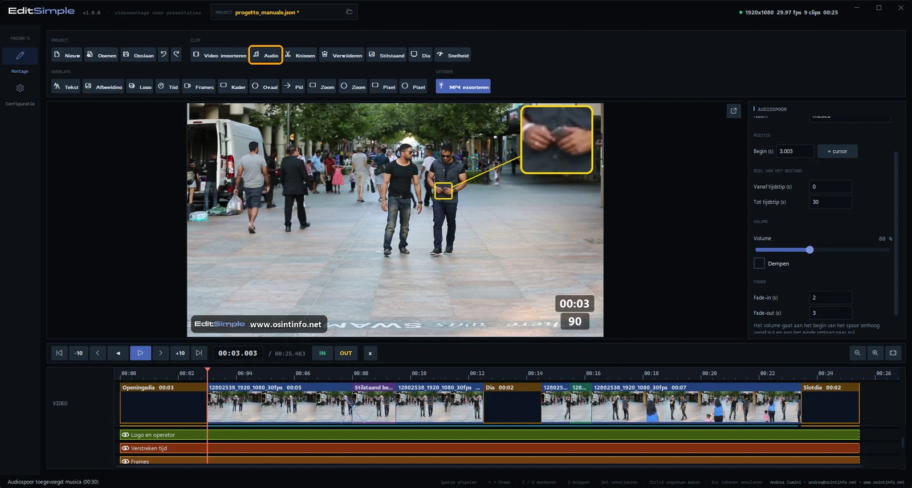

- **Audio** voegt een spoor (commentaar, muziek) toe op de cursor. In het
  paneel: naam, positie, deel van het bestand, **volume**, dempen en
  **faden** in en uit. Je verplaatst het door te slepen; een klik op de naam
  selecteert het hele spoor, Del verwijdert het.
- De **witte lijn** boven elk spoor toont het verloop van het volume: faden en
  overgangen zie je in één oogopslag.
- **Originele audio**: een klik op de naam van de rij selecteert alle audio
  van de video (volume, faden aan het begin en aan het einde, verwijderen);
  een klik op een stuk selecteert alleen dat stuk (volume, faden, dempen).
  Met IN en OUT gemarkeerd en de originele audio geselecteerd, haalt Del
  **alleen de audio** van dat stuk weg: de video blijft.
- Het afspelen in de voorvertoning gebeurt **met geluid** (gemengd zoals bij
  de export).

## 15. De video exporteren

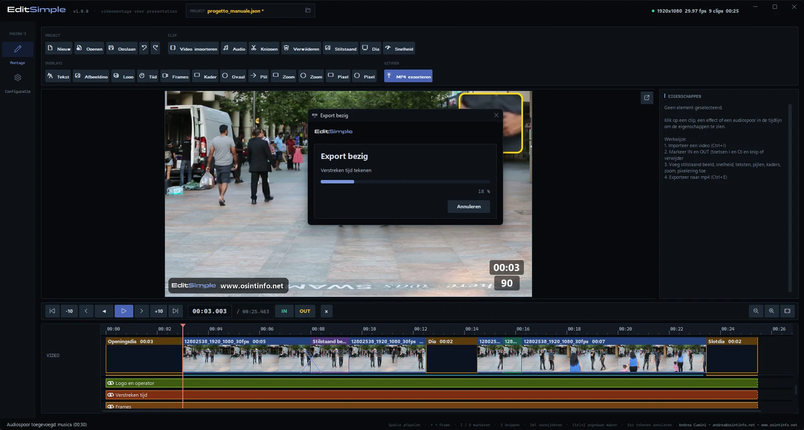

**MP4 exporteren** (Ctrl+E) kiest het bestand en maakt de video met ffmpeg:
H.264 en AAC, kwaliteit en coderingssnelheid in Configuratie. Het resultaat is
identiek aan de voorvertoning. De export kun je annuleren; aan het einde
biedt het programma aan de map te openen.

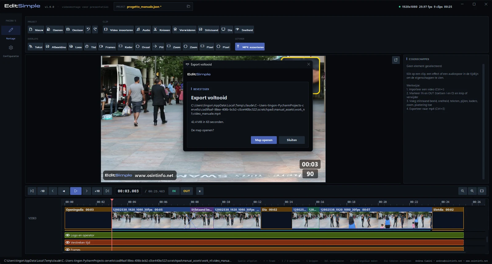

## 16. Tips voor een goed resultaat

- **Zet het kader van de zoom op een neutrale plek**: het vergrote kader
  bedekt het deel van de video waarop het staat, zolang het in beeld is. Zet
  het waar niets interessants gebeurt (lucht, muur, vloer).
- **Teken nauw rond het onderwerp** bij kaders, ovalen en pixeleringen: de
  inhoud van de figuur is het sjabloon dat in de volgende frames wordt
  gezocht.
- **Voor de pijl houdt een iets grotere rechthoek** (hoofd en schouders in
  plaats van alleen het hoofd) beter stand als er andere mensen voor langs
  lopen.
- **Loop na het volgen de video door**: waar de figuur fout gaat, sleep je
  haar op het onderwerp. Een paar keyframes volstaan, ook voor lange paden.
- **Met veel effecten** gebruik je het oog om de effecten te verbergen die je
  op dat moment niet nodig hebt, en de losgemaakte voorvertoning voor meer
  ruimte in de tijdlijn.
- **Sla vaak op** (Ctrl+S): het project is een klein JSON-bestand dat je
  opnieuw kunt openen en bewerken wanneer je wilt.

## 17. Sneltoetsen voor toetsenbord en muis

| Toets | Actie |
| --- | --- |
| Spatie / Shift+Spatie | Afspelen of stoppen / achteruit afspelen |
| ← → | Eén frame terug / vooruit |
| Ctrl+← → | Tien frames terug / vooruit |
| Shift+← → | Eén seconde terug / vooruit |
| Home / End | Begin / einde van de video |
| I / O | IN / OUT markeren |
| S | Knippen op de cursor |
| F | Stilstaand beeld |
| V | Snelheid van het deel IN-OUT |
| T / R / E / A | Tekst / kader / ovaal / pijl |
| Z / Shift+Z | Rechthoekige / ovale zoom |
| P / K | Rechthoekige / ovale pixelering |
| L | Logo en operator |
| Del | Selectie verwijderen (of het deel IN-OUT) |
| Esc | Het tekenen annuleren |
| Ctrl+Z / Ctrl+Y | Ongedaan maken / opnieuw |
| Ctrl+N / Ctrl+O / Ctrl+S / Ctrl+Shift+S | Nieuw / openen / opslaan / opslaan als |
| Ctrl+I | Video importeren |
| Ctrl+E | MP4 exporteren |

| Muis | Waar | Actie |
| --- | --- | --- |
| Scrollwiel | Voorvertoning | Eén frame vooruit of terug |
| Ctrl+scrollwiel | Voorvertoning | Vergroot het beeld |
| Slepen op een lege plek, middelste knop | Vergrote voorvertoning | Verschuift het beeld |
| Dubbelklik | Tekst in de voorvertoning | Herschrijft de tekst |
| Ctrl+scrollwiel | Tijdlijn | Zoomt in op de tijdlijn |
| Scrollwiel / Alt+slepen / middelste knop | Tijdlijn | Schuift horizontaal |
| Shift+scrollwiel, scrollwiel op de namen | Tijdlijn | Schuift audio en effecten verticaal |
| Rechtermuisknop | Balk van een effect | Verlengen tot de cursor / stoppen bij de cursor |
| Rechtermuisknop | Keyframe of punt | Wissen |

## 18. Het projectbestand

Het project is een JSON-bestand met de clips, de audiosporen, de effecten (met
de paden van het volgen en de keyframes) en de paden van de gebruikte
bestanden. De video's, audiobestanden en afbeeldingen worden niet naar het
project gekopieerd: laat ze staan waar ze zijn tot het werk klaar is. De
geëxporteerde video daarentegen is een zelfstandige MP4.

---

EditSimple is vrije software, verspreid onder de licentie GNU GPL versie 3 met
aanvullende voorwaarden voor naamsvermelding van de auteur (zie `LICENSE` en
`NOTICE`). ffmpeg en VitTrack zijn aparte programma's met hun eigen licenties.
