# EditSimple — Instrukcja obsługi

[English](manual.en.md) · [Italiano](manual.it.md) · [Deutsch](manual.de.md) · [Français](manual.fr.md) · [Español](manual.es.md) · [Nederlands](manual.nl.md) · **Polski** · [Ελληνικά](manual.el.md) · [Shqip](manual.sq.md)

EditSimple to program do montażu wideo dla osób, które muszą **wyjaśnić
zdarzenie lub pokazać dowód** na nagraniu: przekazanie czegoś z ręki do ręki
w tłumie, nadjeżdżający pojazd, osobę, którą trzeba śledzić lub uczynić
nierozpoznawalną. Importujesz nagranie, wskazujesz to, co ważne, a program
robi resztę: strzałki, ramki, zoomy i pikselizacje **same śledzą obiekt**
w kolejnych klatkach, a tam, gdzie śledzenie się pomyli, wystarczy przeciągnąć
figurę we właściwe miejsce, aby to poprawić. W kilka minut powstaje plik MP4
gotowy do wyświetlenia lub załączenia, ze slajdem otwierającym i zamykającym,
tekstami, logo i podpisem operatora.

*Andrea Cumini — www.osintinfo.net — andrea@osintinfo.net*
*EditSimple należy do narzędzi [Seity](https://www.seity.com).*

> **Uwaga o przykładowym wideo.** Ilustracje w tej instrukcji wykorzystują
> archiwalne wideo opublikowane w serwisie Pexels: deptak ze zwykłymi
> przechodniami. **Widoczne osoby nie robią niczego złego**: strzałki, ramki,
> zoomy i pikselizacje nałożone na nie służą wyłącznie pokazaniu, jak działa
> program, a obiekty zostały wybrane przypadkowo.

## Spis treści

1. [Co można zrobić](#1-co-można-zrobić)
2. [Instalacja i pierwsze uruchomienie](#2-instalacja-i-pierwsze-uruchomienie)
3. [Okno programu](#3-okno-programu)
4. [Strona Konfiguruj](#4-strona-konfiguruj)
5. [Pełny przykład, krok po kroku](#5-pełny-przykład-krok-po-kroku)
6. [Poprawianie śledzenia klatkami kluczowymi](#6-poprawianie-śledzenia-klatkami-kluczowymi)
7. [Oś czasu](#7-oś-czasu)
8. [Podgląd: powiększanie i odłączanie](#8-podgląd-powiększanie-i-odłączanie)
9. [Slajdy otwierające, zamykające i pośrodku](#9-slajdy-otwierające-zamykające-i-pośrodku)
10. [Teksty, obrazy, upływ czasu i numer klatki](#10-teksty-obrazy-upływ-czasu-i-numer-klatki)
11. [Przyspieszanie i zwalnianie](#11-przyspieszanie-i-zwalnianie)
12. [Cięcie, usuwanie, stopklatka](#12-cięcie-usuwanie-stopklatka)
13. [Przejścia](#13-przejścia)
14. [Audio](#14-audio)
15. [Eksport wideo](#15-eksport-wideo)
16. [Wskazówki dla dobrego rezultatu](#16-wskazówki-dla-dobrego-rezultatu)
17. [Skróty klawiatury i myszy](#17-skróty-klawiatury-i-myszy)
18. [Plik projektu](#18-plik-projektu)

## 1. Co można zrobić

| Funkcja | W skrócie |
| --- | --- |
| **Śledzenie obiektu** | Ramki, owale, strzałki, zoomy i pikselizacje podążają za osobą, twarzą, przedmiotem lub pojazdem; rosną i maleją razem z nim, gdy zbliża się do kamery lub od niej oddala; same się kończą, gdy obiekt wychodzi z kadru. |
| **Korygujące klatki kluczowe** | Tam, gdzie śledzenie się myli (słup, osoba przechodząca przed obiektem), przeciągasz figurę na obiekt: program poprawia ścieżkę przed tym punktem i po nim. |
| **Zoom** | Mały szczegół (dłonie, tablica rejestracyjna) powiększony od 2x do 16x w ramce, z konturem i linią łączącą go z przedmiotem. Prostokątny lub owalny. |
| **Pikselizacja** | Prostokątna lub owalna, do twarzy i tablic rejestracyjnych; śledzi obiekt i rośnie razem z nim. |
| **Teksty i obrazy** | Teksty wielowierszowe z tłem i zaokrąglonymi rogami; nałożone obrazy (klatka, mapa, dokument). |
| **Logo i podpis** | Logo i tekst operatora nieruchome w rogu, przygotowane raz w Konfiguruj. |
| **Czas i klatki** | Upływ czasu i numer klatki wpisane w wideo, w dowolnym miejscu. |
| **Slajdy** | Na początku, na końcu lub pośrodku; jednolity kolor lub obraz tła; na nich wpisuje się teksty i umieszcza obrazy. |
| **Prędkość** | Od 0,25x (zwolnione tempo) do 32x (przyspieszenie), z ikoną zegara pokazującą prędkość. |
| **Cięcia** | Cięcie na kursorze, usuwanie fragmentu, stopklatka, zmiana kolejności klipów. |
| **Przejścia** | Wyłanianie z czerni, znikanie w czerni, przenikanie z następnym klipem. |
| **Audio** | Dodane ścieżki (komentarz, muzyka) z głośnością i wyciszeniami; oryginalne audio z głośnością, wyciszeniami i usuwaniem pojedynczych odcinków. |
| **Podgląd** | Odtwarzanie z dźwiękiem, wstecz, klatka po klatce; podgląd z możliwością powiększenia i **odłączenia** do osobnego okna. |
| **Eksport** | MP4 (H.264 + AAC) identyczny z podglądem. |
| **Języki** | Interfejs w 9 językach, zmiana bez ponownego uruchamiania. |

## 2. Instalacja i pierwsze uruchomienie

**Plik wykonywalny (Windows 10/11, 64 bity).** Rozpakuj zip w dowolnym miejscu
i uruchom `EditSimple.exe`. Python nie jest potrzebny.

**Ze źródeł.** Z Pythonem 3.11:

```bash
python -m venv .venv
.venv\Scripts\python.exe -m pip install -r requirements.txt
.venv\Scripts\python.exe EditSimple.py
```

**FFmpeg.** EditSimple używa ffmpeg do odczytu plików i do eksportu. Nie jest
on dołączony: przy pierwszym uruchomieniu, jeśli program go nie znajdzie,
otwiera się strona **Konfiguruj**, a przycisk **Pobierz / Aktualizuj** pobiera
go (oficjalna kompilacja dla Windows) do folderu `tools\ffmpeg\` obok
programu. Bez instalacji.

**VitTrack (opcjonalnie).** Na tej samej stronie przycisk **Pobierz** pobiera
VitTrack, mały model (0,7 MB), który pomaga śledzeniu odnaleźć obiekt po
przeszkodzie. Bez niego śledzenie też działa.

## 3. Okno programu

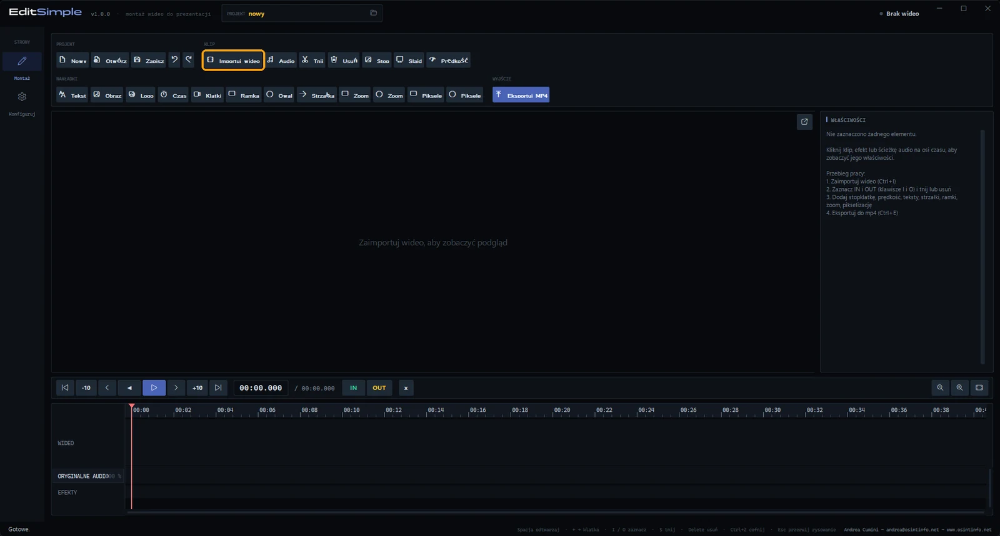

- **Pasek narzędzi**, w czterech grupach: *Projekt* (nowy, otwórz, zapisz,
  cofnij, ponów), *Klip* (importuj wideo, audio, tnij, usuń, stopklatka,
  slajd, prędkość), *Nakładki* (tekst, obraz, logo, czas, klatki, ramka, owal,
  strzałka, zoom prostokątny i owalny, piksele prostokątne i owalne) oraz
  *Wyjście* (eksportuj MP4). Każdy przycisk ma podpowiedź ze swoim skrótem.
- **Podgląd**, pośrodku: pokazuje klatkę na kursorze ze wszystkimi efektami,
  dokładnie tak jak w wyeksportowanym wideo. Na nim rysuje się i przesuwa
  efekty.
- **Właściwości**, po prawej: wartości zaznaczonego elementu (klipu, efektu,
  ścieżki audio).
- **Odtwarzanie**: początek, -10 klatek, poprzednia klatka, odtwarzanie
  wstecz, odtwarzanie, następna klatka, +10 klatek, koniec; czas kursora
  (można go wpisać); IN, OUT i kasowanie znaczników; po prawej zoom osi czasu.
- **Oś czasu**, na dole: linijka, ścieżka **Wideo** w postaci taśmy filmowej,
  **Oryginalne audio**, dodane ścieżki audio i **Efekty**.

## 4. Strona Konfiguruj

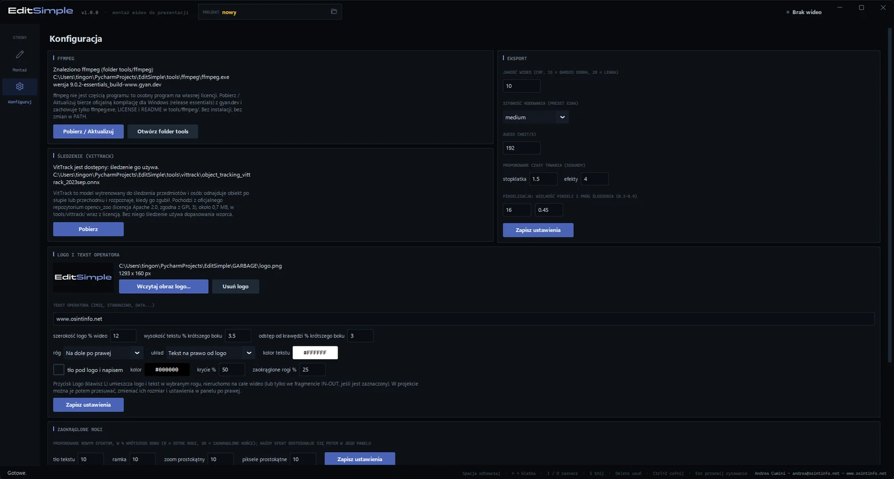

Otwiera się ją z paska po lewej. Zawiera:

- **FFmpeg** i **Śledzenie (VitTrack)**: stan, pobieranie i aktualizacja.
- **Eksport**: jakość wideo (CRF: 15 bardzo dobra, 28 lekka), szybkość
  kodowania, jakość audio, proponowane czasy trwania stopklatki i efektów,
  domyślna wielkość pikseli i próg śledzenia (wyższy = surowsze
  rozpoznawanie obiektu).
- **Logo i tekst operatora**: obraz logo (PNG z przezroczystością lub JPG),
  tekst (imię i nazwisko, instytucja, strona www), szerokość logo, wysokość
  tekstu, odstęp od krawędzi, róg, układ, kolory oraz tło z kryciem
  i zaokrąglonymi rogami. Przygotowujesz je raz; potem przycisk **Logo**
  umieszcza je w wideo.

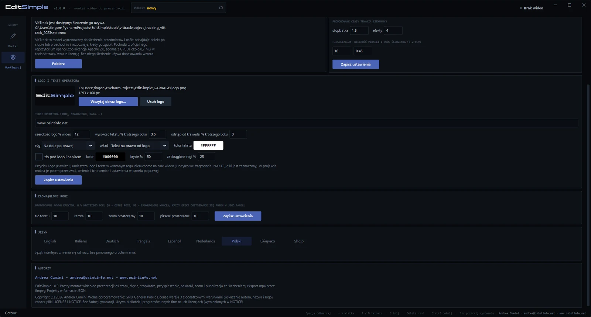

- **Zaokrąglone rogi** tła tekstów, ramek, zoomu prostokątnego i prostokątnej
  pikselizacji.
- **Język** interfejsu: English, Italiano, Deutsch, Français, Español,
  Nederlands, Polski, Ελληνικά, Shqip. Zmiana następuje od razu.

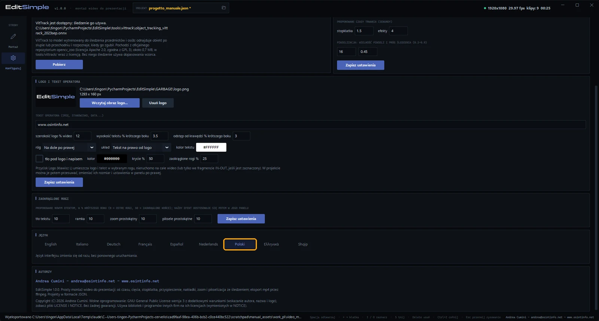

## 5. Pełny przykład, krok po kroku

Przykład w tym rozdziale to 19-sekundowe wideo nagrane na zatłoczonym
deptaku (zob. uwagę na początku: przechodnie nie robią niczego złego).
W kilku krokach je wzbogacamy: logo i strona www operatora na dole, zoom na
dłonie mężczyzny, który śledzi ich ruchy, strzałka wskazująca osobę przez
12 sekund, dwie ramki na innych osobach i pikselizacja twarzy na końcu.

### 5.1 Import wideo

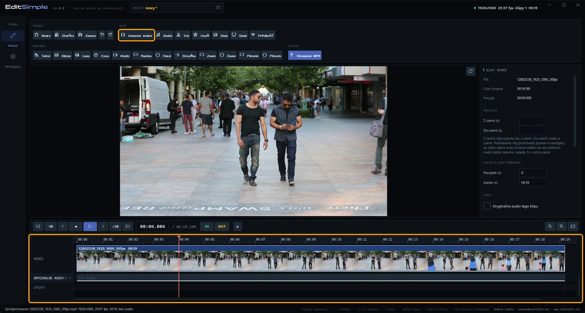

**Importuj wideo** (Ctrl+I) otwiera nagranie. Pierwsze wideo ustala rozmiar
i liczbę klatek na sekundę projektu (tutaj 1920×1080, 29,97 klatki na
sekundę). Klip pojawia się na ścieżce Wideo jako taśma klatek, a jego audio na
ścieżce Oryginalne audio (to wideo go nie ma). Kolejne wideo dodaje się na
końcu lub na kursorze.

Kursor przesuwa się kliknięciem na linijce, strzałkami ← → (jedna klatka),
Ctrl+← → (dziesięć klatek), Shift+← → (jedna sekunda), Home i End albo
wpisując czas w polu. **Spacja** odtwarza z dźwiękiem, **Shift+Spacja**
odtwarza wstecz.

### 5.2 Logo i podpis operatora

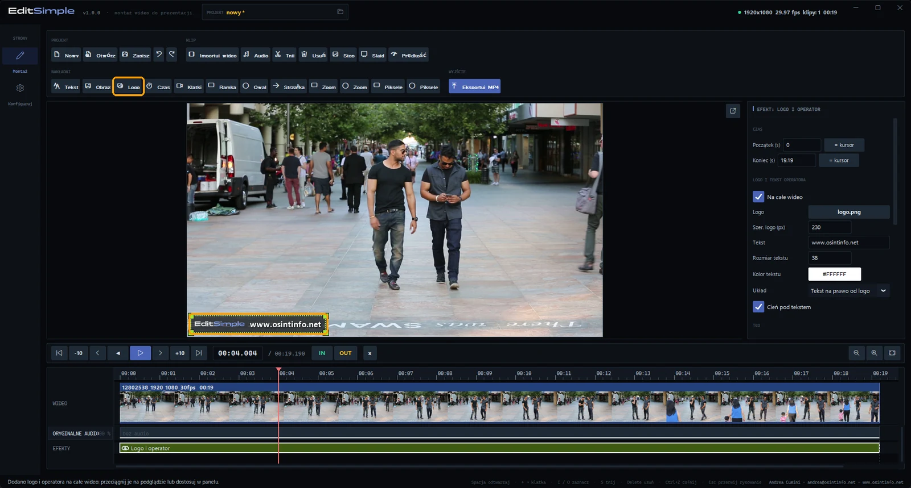

**Logo** (L) umieszcza logo i tekst przygotowane w Konfiguruj na całe wideo
(lub tylko między IN a OUT, jeśli są zaznaczone). Na podglądzie przesuwa się
je przeciąganiem i powiększa za rogi; w panelu zmienia się tekst, kolory, tło,
róg i krycie.

### 5.3 Zoom śledzący dłonie

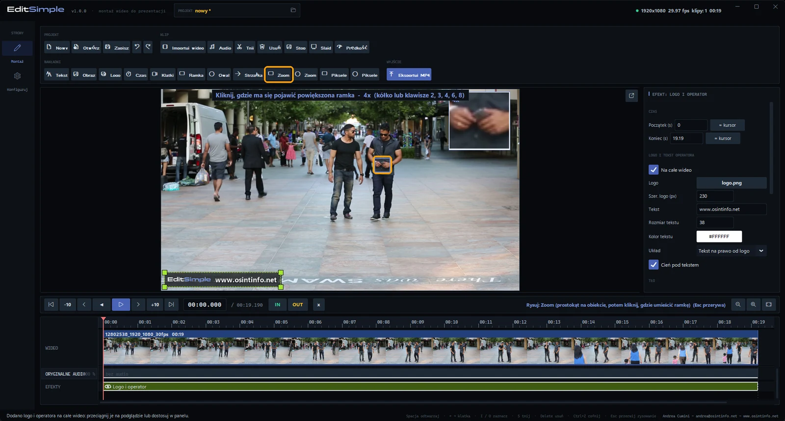

**Zoom** (Z) używa się w dwóch krokach:

1. przeciągasz prostokąt wokół szczegółu (tutaj dłonie mężczyzny);
2. pod myszą pojawia się powiększona ramka z rzeczywistą zawartością:
   kliknięcie ją umieszcza. Powiększenie wybierasz w tym momencie kółkiem
   myszy lub klawiszami 2, 3, 4, 6, 8 (do 16x w panelu).

Zoom **od razu zaczyna śledzić przedmiot**: okno pokazuje postęp śledzenia.

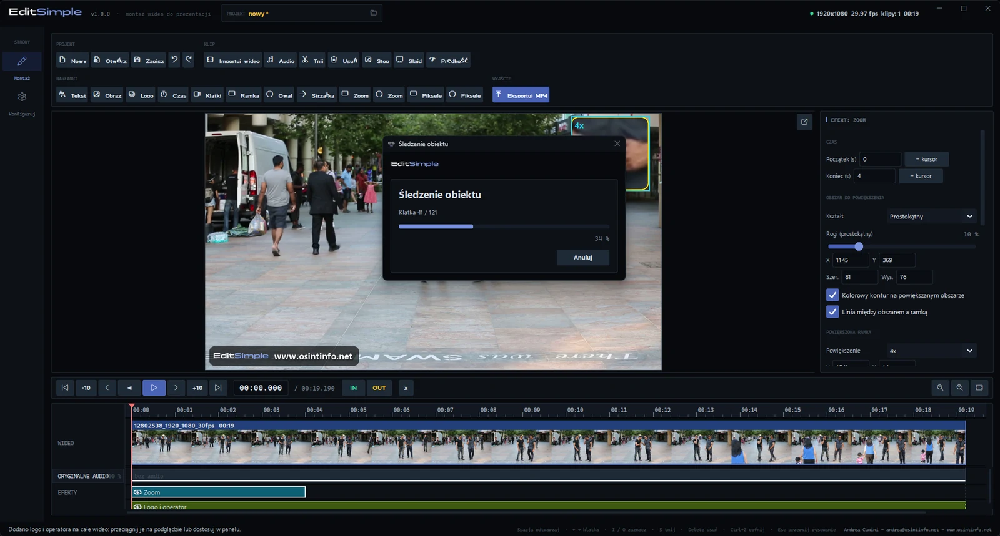

Powiększany obszar podąża za dłońmi i rośnie lub maleje, gdy mężczyzna się
zbliża lub oddala; powiększona ramka zostaje tam, gdzie ją umieściliśmy.
Kolorowy kontur oznacza przedmiot, a linia łączy go z ramką. Shift+Z tworzy
zoom owalny.

### 5.4 Strzałka śledząca osobę

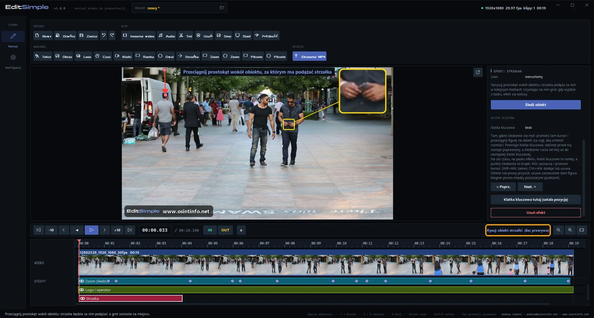

**Strzałka** (A): przeciągasz od ogona do grotu. Aby śledziła osobę,
naciśnij w panelu **Śledź obiekt** (lub *Powtórz śledzenie od kursora*)
i narysuj **prostokąt wokół obiektu**: strzałka podąża za nim, trzymając na
nim grot.

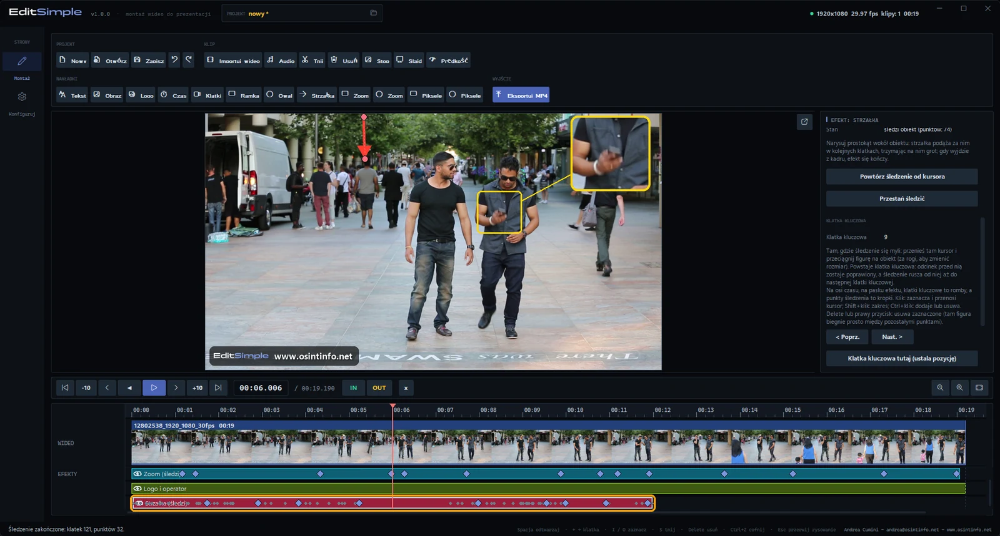

Na osi czasu pasek strzałki pokazuje *(śledzi)* oraz romby klatek kluczowych,
którymi poprawiliśmy ścieżkę (zob. rozdział 6).

### 5.5 Ramki na osobach

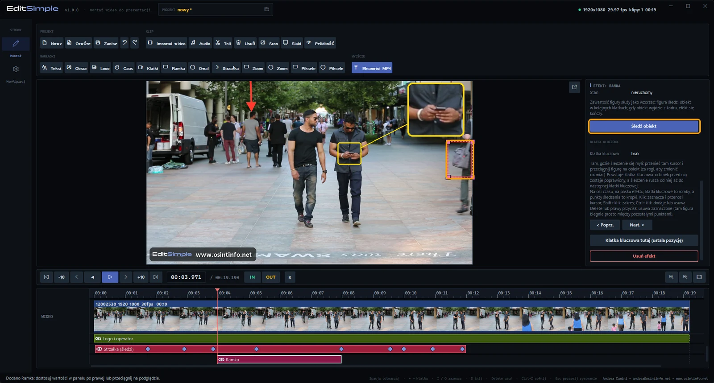

**Ramka** (R) i **Owal** (E): przeciąga się je na podglądzie. W panelu wybiera
się kolor, grubość, wypełnienie, zaokrąglone rogi i krycie; **Śledź obiekt**
sprawia, że podążają za tym, co zawierają. Gdy osoba wychodzi z kadru, figura
odprowadza ją na zewnątrz i efekt się kończy.

### 5.6 Pikselizacja twarzy

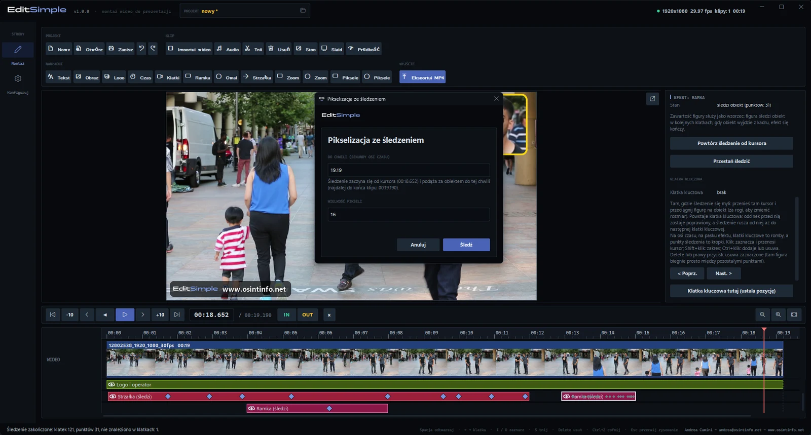

**Piksele** (P prostokątne, K owalne): przeciągasz ramkę na twarz; okno pyta,
do kiedy ją śledzić i jaka ma być wielkość pikseli.

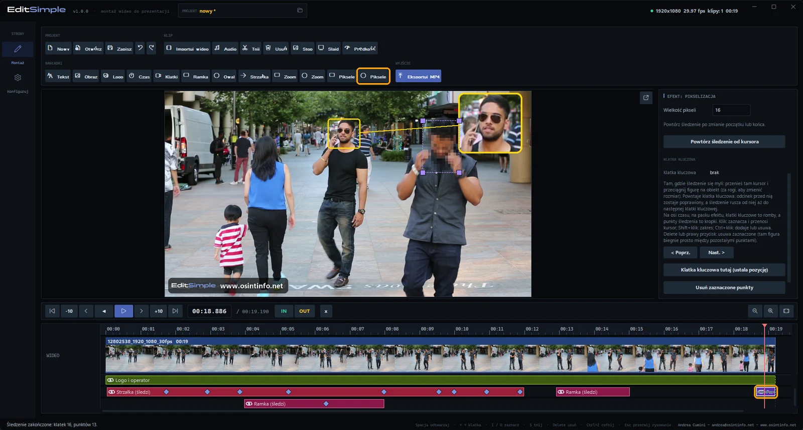

Pikselizacja śledzi twarz i **rośnie, gdy ta zbliża się** do kamery, więc
zawsze ją zakrywa. Jeśli obiekt wychodzi z kadru, pikselizacja towarzyszy mu,
aż całkowicie wyjdzie: żadna klatka nie zostaje odsłonięta.

## 6. Poprawianie śledzenia klatkami kluczowymi

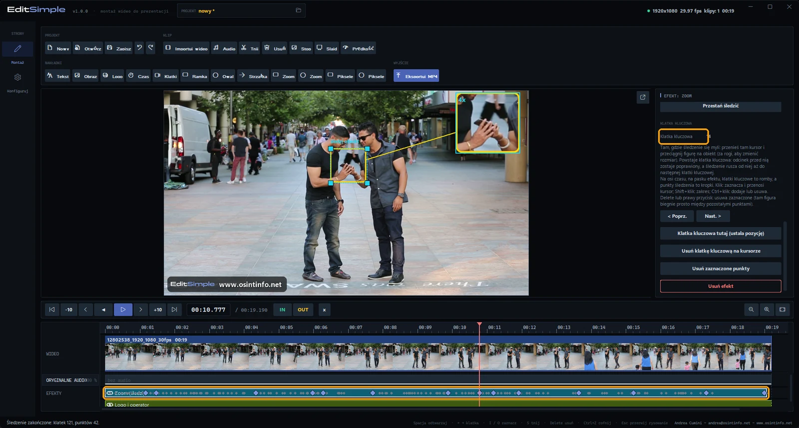

Śledzenie jest automatyczne, ale prawdziwe wideo ma przeszkody: słup, osobę
przechodzącą przed obiektem, obiekt, który się odwraca. Tam, gdzie figura się
myli:

1. przenieś kursor na tę klatkę;
2. **przeciągnij figurę na obiekt** na podglądzie (lub zmień jej rozmiar za
   rogi).

Powstaje **klatka kluczowa** (romb na pasku efektu). Program stopniowo
poprawia ścieżkę przed klatką kluczową i **wznawia od niej śledzenie** aż do
następnej klatki kluczowej. Możesz dodać tyle klatek kluczowych, ile
potrzeba: zoom z przykładu ma ich 14, strzałka 9.

Na pasku zaznaczonego efektu widać też punkty znalezione przez śledzenie
(kropki). Kliknięcie zaznacza punkt i przenosi tam kursor, Shift+klik
zaznacza zakres, Ctrl+klik dodaje lub usuwa; **Delete** lub prawy przycisk
myszy usuwa zaznaczone punkty. W panelu sekcja **Klatka kluczowa** ma
przyciski *< Poprz.* i *Nast. >*, *Klatka kluczowa tutaj* (ustala bieżącą
pozycję) oraz *Usuń klatkę kluczową na kursorze*.

## 7. Oś czasu

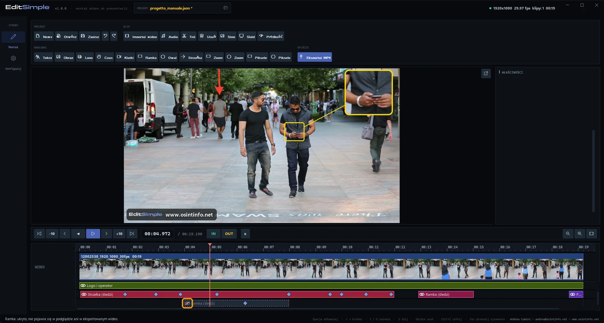

- **Paski efektów**: przesuwa się je przeciąganiem; prawa krawędź zmienia
  czas trwania. Efekty układają się na kilku torach; przy wielu efektach
  część z audio i efektami **przewija się w pionie** (pasek po prawej, kółko
  na nazwach wierszy lub Shift+kółko), a linijka i wideo pozostają nieruchomo
  u góry.
- **Oko**: ikona po lewej stronie każdego paska **ukrywa lub pokazuje** efekt,
  na podglądzie i w wyeksportowanym wideo. Przydatne, gdy podczas pracy wiele
  efektów na siebie nachodzi.
- **Prawy przycisk na pasku**: *Wydłuż do kursora* (jeśli kursor jest za
  końcem; jeśli efekt śledzi obiekt, śledzenie jest kontynuowane) oraz
  *Zakończ na kursorze* (jeśli kursor jest wewnątrz efektu).
- **Zoom osi czasu**: Ctrl+kółko albo przyciski − + i *Dopasuj*. Z bliska
  taśma pokazuje każdą pojedynczą klatkę.
- **Przewijanie**: kółko, Alt+przeciąganie lub przeciąganie środkowym
  przyciskiem.
- **Rozdzielacz**: cienki pas nad przyciskami odtwarzania przeciąga się
  w górę lub w dół, aby dać więcej miejsca osi czasu lub podglądowi.

## 8. Podgląd: powiększanie i odłączanie

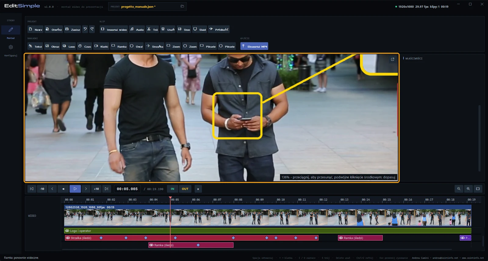

- **Ctrl+kółko** na podglądzie powiększa go wokół myszy, nawet 16 razy: aby
  precyzyjnie umieścić zoom na małym szczególe lub sprawdzić pikselizację.
  Widok przesuwa się przeciąganiem w pustym miejscu (lub środkowym
  przyciskiem); dwuklik środkowym przyciskiem przywraca pełny widok.
- **Odłączanie podglądu**: przycisk w prawym górnym rogu podglądu otwiera go
  w **osobnym oknie**, które można umieścić na drugim monitorze lub
  w dowolnym miejscu; oś czasu zajmuje wtedy całą przestrzeń. Ten sam przycisk
  (lub zamknięcie okna) **przypina go z powrotem**. Skróty działają także
  w odłączonym oknie.

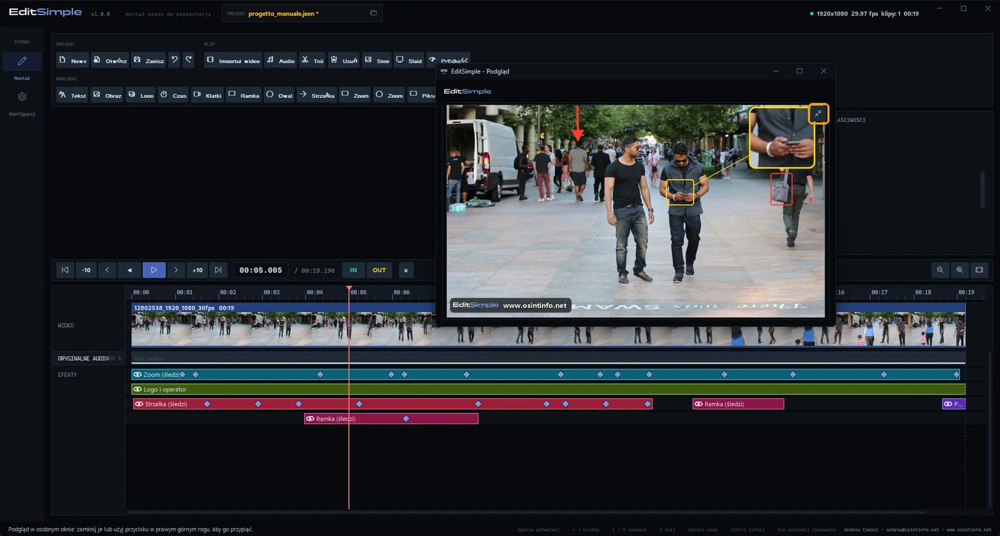

## 9. Slajdy otwierające, zamykające i pośrodku

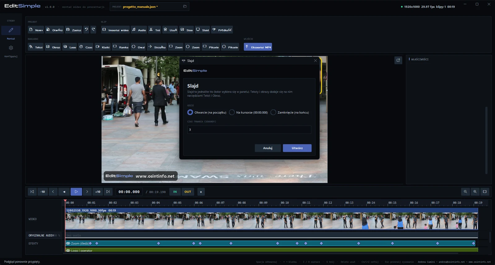

**Slajd** wstawia slajd **na początku** (otwarcie), **na kursorze** (w środku
wideo) lub **na końcu** (zamknięcie), o wybranym czasie trwania. Slajd to
jednolite tło lub **obraz tła** dopasowany do rozmiaru wideo (wypełnij, całość
lub rozciągnij); kolor i obraz wybiera się w panelu. Następujące po nim efekty
przesuwają się do przodu razem z wideo.

Na slajdzie wpisuje się teksty i umieszcza obrazy narzędziami **Tekst**
i **Obraz**: z kursorem na slajdzie trwają tyle co on.

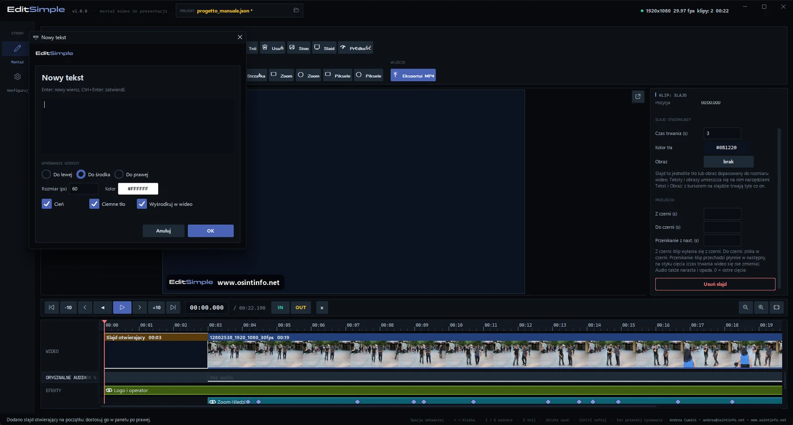

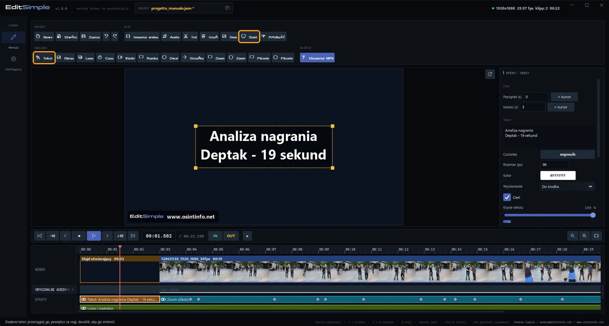

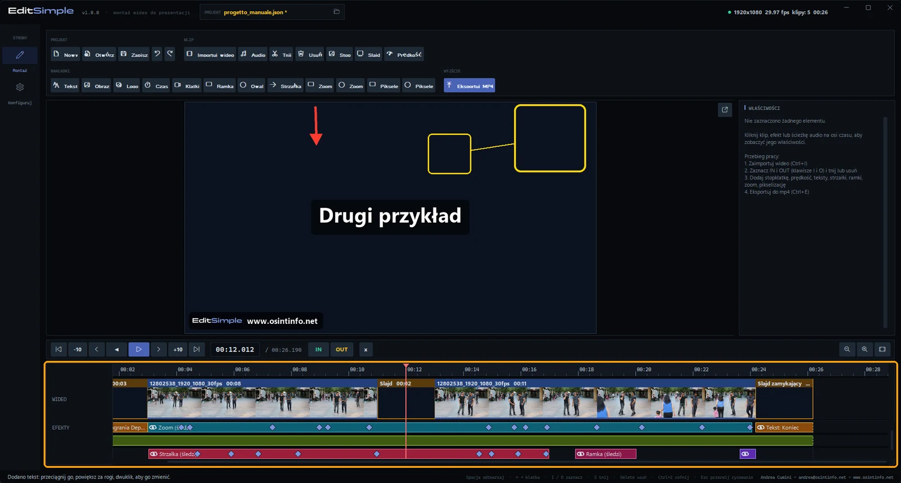

## 10. Teksty, obrazy, upływ czasu i numer klatki

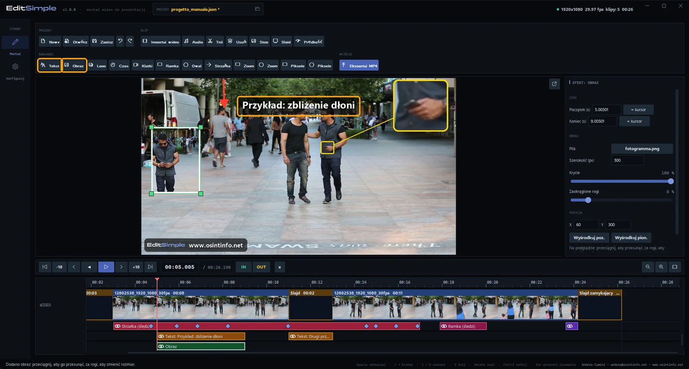

- **Tekst** (T): kliknięcie na podglądzie otwiera okno tekstu: wiele wierszy,
  wyrównanie, rozmiar, kolor, cień, tło (z kryciem i zaokrąglonymi rogami),
  wyśrodkowanie. Dwuklik na tekście pozwala go zmienić. W panelu także
  czcionka, wybierana z listy, która pokazuje każdą czcionkę.
- **Obraz**: wybiera plik (PNG, JPG...) i umieszcza go na środku; przesuwa
  się go i zmienia jego rozmiar na podglądzie; w panelu krycie i zaokrąglone
  rogi. Tutaj to powiększona klatka z obiektem, ale może to być mapa,
  dokument, zdjęcie.

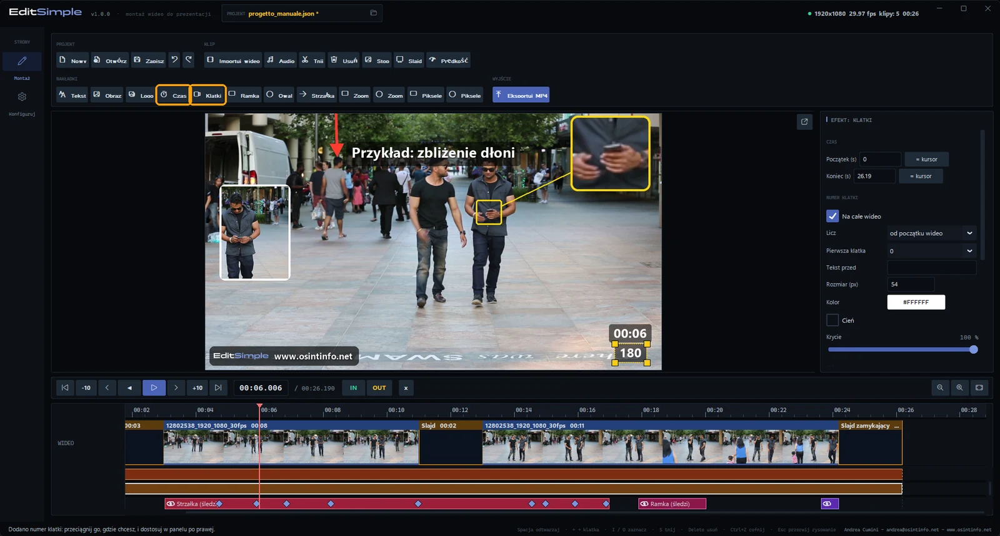

- **Czas**: upływ czasu (01:23, 00:01:23 lub z dziesiątymi), od początku
  wideo lub od początku efektu, z dowolnym tekstem przed nim. Po przekroczeniu
  godziny pojawiają się godziny.
- **Klatki**: numer klatki, od 0 lub od 1, od początku wideo lub efektu.
  Przydatne do precyzyjnego wskazania chwili.

Oba mają tło, krycie i zaokrąglone rogi, a umieszcza się je kliknięciem
w dowolnym miejscu.

## 11. Przyspieszanie i zwalnianie

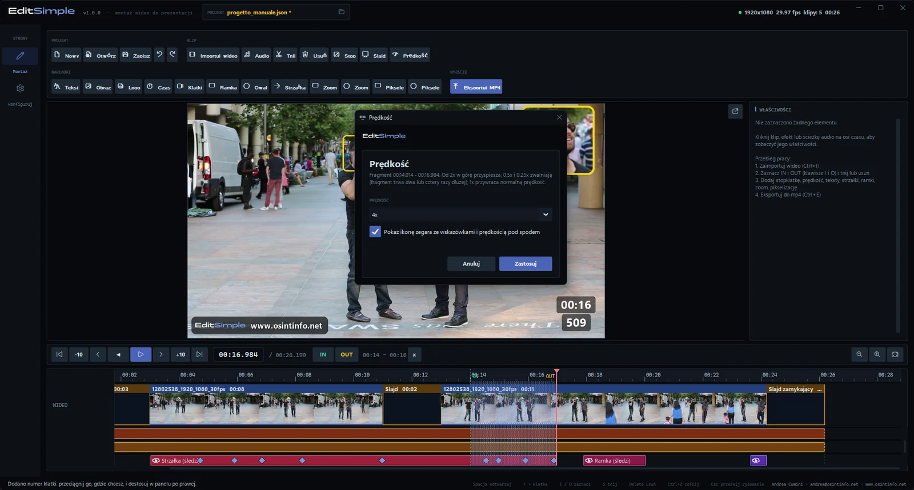

Zaznacz fragment przez **IN** i **OUT** (klawisze I i O) i naciśnij
**Prędkość** (V). Od **2x do 32x** wideo przyspiesza; **0,5x i 0,25x**
zwalniają. Opcja **zegara** pokazuje ikonę z obracającymi się wskazówkami
i prędkością wpisaną pod spodem, aby widz wiedział, że czas płynie szybciej.
Oś czasu się skraca lub wydłuża; 1x przywraca normalną prędkość. Pozycję,
rozmiar i kolor zegara ustawia się w panelu klipu.

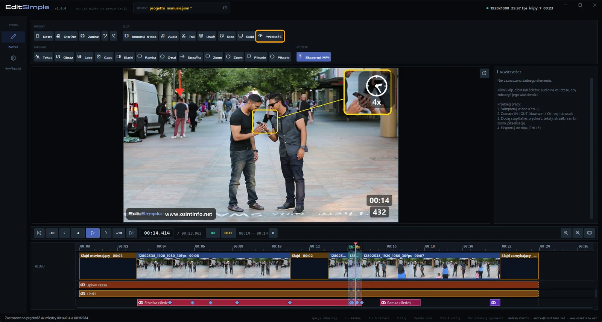

## 12. Cięcie, usuwanie, stopklatka

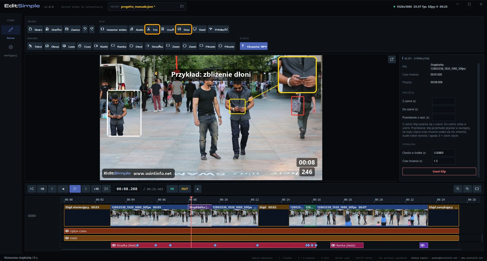

- **Tnij** (S) dzieli klip na kursorze. Kolejność klipów **zmienia się
  przeciąganiem** na osi czasu.
- **Usuń** (Delete) usuwa fragment między IN a OUT lub zaznaczony element:
  to, co następuje, przesuwa się do tyłu razem z efektami.
- **Stop** (F): klatka na kursorze pozostaje nieruchoma przez wybraną liczbę
  sekund; to, co następuje, przesuwa się do przodu.

Wszystko cofa się przez Ctrl+Z i ponawia przez Ctrl+Y.

## 13. Przejścia

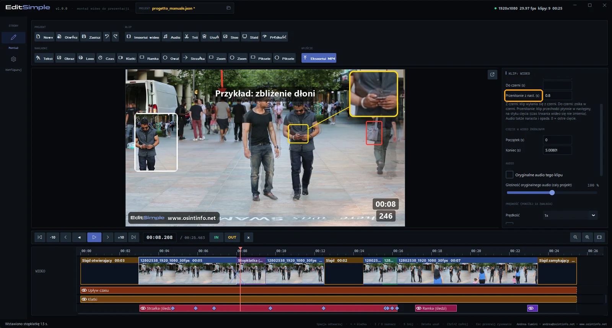

Po zaznaczeniu klipu panel ma sekcję **Przejścia**:

- **Z czerni**: klip wyłania się z czerni;
- **Do czerni**: klip znika w czerni;
- **Przenikanie z następnym**: klip przechodzi płynnie w następny na styku
  cięcia. Wychodzący klip pozostaje nieruchomy podczas przenikania; czas
  trwania wideo się nie zmienia.

Audio także narasta i opada wraz z przejściami. 0 oznacza ostre cięcie.

## 14. Audio

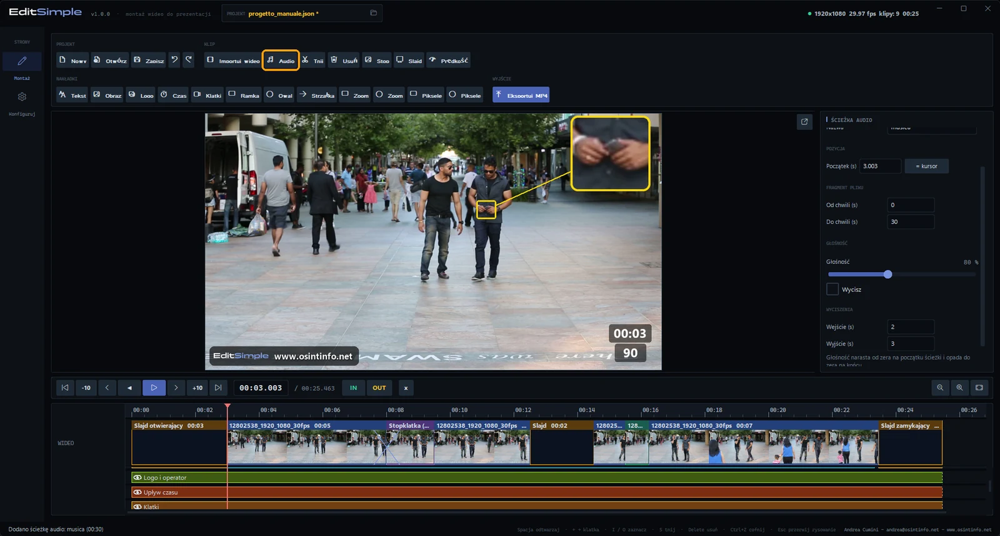

- **Audio** dodaje ścieżkę (komentarz, muzyka) na kursorze. W panelu: nazwa,
  pozycja, fragment pliku, **głośność**, wyciszenie oraz **wyciszenia** na
  wejściu i na wyjściu. Przesuwa się ją przeciąganiem; kliknięcie jej nazwy
  zaznacza całą ścieżkę, Delete ją usuwa.
- **Biała linia** nad każdą ścieżką pokazuje przebieg głośności: wyciszenia
  i przejścia widać na pierwszy rzut oka.
- **Oryginalne audio**: kliknięcie nazwy wiersza zaznacza całe audio wideo
  (głośność, wyciszenia na początku i na końcu, usuwanie); kliknięcie
  fragmentu zaznacza tylko ten fragment (głośność, wyciszenia, wyciszenie
  dźwięku). Przy zaznaczonych IN i OUT oraz zaznaczonym oryginalnym audio
  Delete usuwa **tylko audio** tego odcinka: wideo zostaje.
- Odtwarzanie na podglądzie odbywa się **z dźwiękiem** (zmiksowanym tak jak
  w eksporcie).

## 15. Eksport wideo

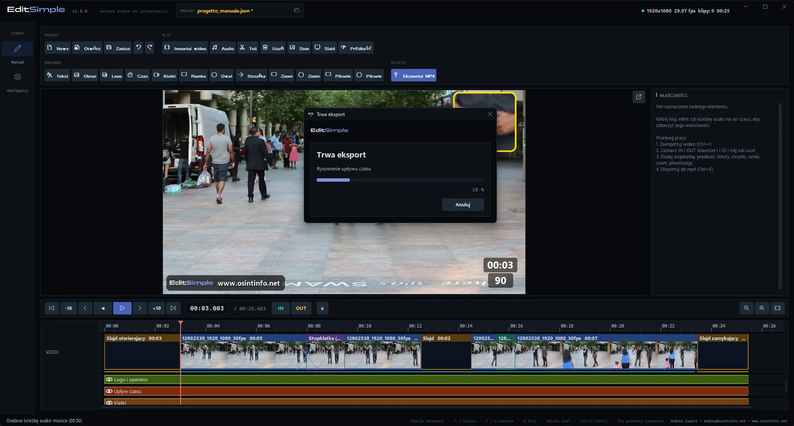

**Eksportuj MP4** (Ctrl+E) wybiera plik i tworzy wideo za pomocą ffmpeg:
H.264 i AAC, jakość i szybkość kodowania w Konfiguruj. Wynik jest identyczny
z podglądem. Eksport można anulować; na końcu program proponuje otwarcie
folderu.

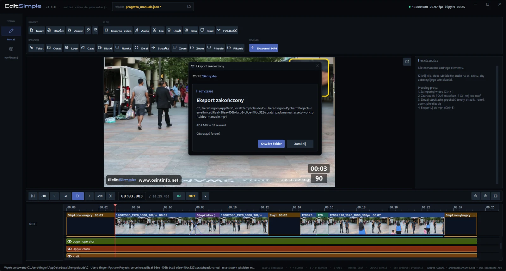

## 16. Wskazówki dla dobrego rezultatu

- **Ramkę zoomu umieść w neutralnym obszarze**: powiększona ramka zakrywa
  część wideo, na której leży, przez cały czas, gdy jest widoczna. Umieść ją
  tam, gdzie nie dzieje się nic ciekawego (niebo, ściana, podłoże).
- **Rysuj ciasno wokół obiektu** w przypadku ramek, owali i pikselizacji:
  zawartość figury jest wzorcem wyszukiwanym w kolejnych klatkach.
- **Dla strzałki nieco większy prostokąt** (głowa i ramiona zamiast samej
  głowy) lepiej się sprawdza, gdy przed obiektem przechodzą inne osoby.
- **Po śledzeniu przewiń wideo**: tam, gdzie figura się myli, przeciągnij ją
  na obiekt. Kilka klatek kluczowych wystarcza nawet przy długich ścieżkach.
- **Przy wielu efektach** użyj oka, aby ukryć te, których w danej chwili nie
  potrzebujesz, oraz odłączonego podglądu, aby mieć więcej miejsca na osi
  czasu.
- **Zapisuj często** (Ctrl+S): projekt to mały plik JSON, który można
  ponownie otworzyć i edytować w dowolnym momencie.

## 17. Skróty klawiatury i myszy

| Klawisz | Działanie |
| --- | --- |
| Spacja / Shift+Spacja | Odtwórz lub zatrzymaj / odtwarzaj wstecz |
| ← → | Jedna klatka wstecz / do przodu |
| Ctrl+← → | Dziesięć klatek wstecz / do przodu |
| Shift+← → | Jedna sekunda wstecz / do przodu |
| Home / End | Początek / koniec wideo |
| I / O | Zaznacz IN / OUT |
| S | Tnij na kursorze |
| F | Stopklatka |
| V | Prędkość fragmentu IN-OUT |
| T / R / E / A | Tekst / ramka / owal / strzałka |
| Z / Shift+Z | Zoom prostokątny / owalny |
| P / K | Pikselizacja prostokątna / owalna |
| L | Logo i operator |
| Delete | Usuń zaznaczenie (lub fragment IN-OUT) |
| Esc | Przerwij bieżące rysowanie |
| Ctrl+Z / Ctrl+Y | Cofnij / ponów |
| Ctrl+N / Ctrl+O / Ctrl+S / Ctrl+Shift+S | Nowy / otwórz / zapisz / zapisz jako |
| Ctrl+I | Importuj wideo |
| Ctrl+E | Eksportuj MP4 |

| Mysz | Gdzie | Działanie |
| --- | --- | --- |
| Kółko | Podgląd | Jedna klatka do przodu lub wstecz |
| Ctrl+kółko | Podgląd | Powiększa widok |
| Przeciąganie w pustym miejscu, środkowy przycisk | Powiększony podgląd | Przesuwa widok |
| Dwuklik | Tekst na podglądzie | Zmienia tekst |
| Ctrl+kółko | Oś czasu | Powiększa oś czasu |
| Kółko / Alt+przeciąganie / środkowy przycisk | Oś czasu | Przewija w poziomie |
| Shift+kółko, kółko na nazwach | Oś czasu | Przewija audio i efekty w pionie |
| Prawy przycisk | Pasek efektu | Wydłuż do kursora / zakończ na kursorze |
| Prawy przycisk | Klatka kluczowa lub punkt | Usuwa |

## 18. Plik projektu

Projekt to plik JSON z klipami, ścieżkami audio, efektami (ze ścieżkami
śledzenia i klatkami kluczowymi) oraz ścieżkami do użytych plików. Wideo,
audio i obrazy nie są kopiowane do projektu: zostaw je tam, gdzie są, aż
praca zostanie zakończona. Wyeksportowane wideo jest natomiast samodzielnym
plikiem MP4.

---

EditSimple to wolne oprogramowanie, rozpowszechniane na licencji GNU GPL
w wersji 3 z dodatkowymi warunkami dotyczącymi wskazania autora (zob. `LICENSE`
i `NOTICE`). ffmpeg i VitTrack to osobne programy na własnych licencjach.
