# EditSimple — Manuali i përdorimit

[English](manual.en.md) · [Italiano](manual.it.md) · [Deutsch](manual.de.md) · [Français](manual.fr.md) · [Español](manual.es.md) · [Nederlands](manual.nl.md) · [Polski](manual.pl.md) · [Ελληνικά](manual.el.md) · **Shqip**

EditSimple është një program montazhi video i menduar për ata që duhet të
**shpjegojnë një fakt ose të tregojnë një provë** në një video: një dorëzim
diçkaje në mes të turmës, një automjet që mbërrin, një person që duhet ndjekur
ose bërë i panjohshëm. Importoni filmimin, tregoni atë që ka rëndësi dhe
programi bën pjesën tjetër: shigjetat, kornizat, zmadhimet dhe pikselimet
**e ndjekin vetë subjektin** në kuadrot pasardhëse, dhe aty ku ndjekja gabon
mjafton ta zvarritni figurën në vendin e duhur për ta korrigjuar. Në pak
minuta merrni një MP4 gati për t'u shfaqur ose për t'u bashkëngjitur, me
slajde hapjeje dhe mbylljeje, tekste, logo dhe firmën e operatorit.

*Andrea Cumini — www.osintinfo.net — andrea@osintinfo.net*
*EditSimple është pjesë e mjeteve të [Seity](https://www.seity.com).*

> **Shënim për videon shembull.** Imazhet e këtij manuali përdorin një video
> arkivi të publikuar në Pexels: një rrugë këmbësorësh me kalimtarë të
> zakonshëm. **Personat që shfaqen nuk po bëjnë asgjë të keqe**: shigjetat,
> kornizat, zmadhimet dhe pikselimet e vendosura mbi ta shërbejnë vetëm për të
> treguar si funksionon programi, dhe subjektet janë zgjedhur rastësisht.

## Përmbajtja

1. [Çfarë mund të bëhet](#1-çfarë-mund-të-bëhet)
2. [Instalimi dhe nisja e parë](#2-instalimi-dhe-nisja-e-parë)
3. [Dritarja](#3-dritarja)
4. [Faqja Konfiguro](#4-faqja-konfiguro)
5. [Një shembull i plotë, hap pas hapi](#5-një-shembull-i-plotë-hap-pas-hapi)
6. [Korrigjimi i ndjekjes me kuadrot kyçe](#6-korrigjimi-i-ndjekjes-me-kuadrot-kyçe)
7. [Vija kohore](#7-vija-kohore)
8. [Parapamja: zmadhimi dhe shkëputja](#8-parapamja-zmadhimi-dhe-shkëputja)
9. [Slajdet e hapjes, të mbylljes dhe në mes](#9-slajdet-e-hapjes-të-mbylljes-dhe-në-mes)
10. [Tekste, imazhe, koha e kaluar dhe numri i kuadrit](#10-tekste-imazhe-koha-e-kaluar-dhe-numri-i-kuadrit)
11. [Përshpejtimi dhe ngadalësimi](#11-përshpejtimi-dhe-ngadalësimi)
12. [Prerja, fshirja, kuadri i ngrirë](#12-prerja-fshirja-kuadri-i-ngrirë)
13. [Kalimet](#13-kalimet)
14. [Audio](#14-audio)
15. [Eksportimi i videos](#15-eksportimi-i-videos)
16. [Këshilla për një rezultat të mirë](#16-këshilla-për-një-rezultat-të-mirë)
17. [Shkurtoret e tastierës dhe të miut](#17-shkurtoret-e-tastierës-dhe-të-miut)
18. [Skedari i projektit](#18-skedari-i-projektit)

## 1. Çfarë mund të bëhet

| Funksioni | Shkurt |
| --- | --- |
| **Ndjekja e subjektit** | Kornizat, ovalet, shigjetat, zmadhimet dhe pikselimet ndjekin një person, një fytyrë, një objekt ose një automjet; rriten dhe zvogëlohen bashkë me të kur afrohet ose largohet nga kamera; mbarojnë vetë kur ai del nga kuadri. |
| **Kuadrot kyçe të korrigjimit** | Aty ku ndjekja gabon (një shtyllë, një person që kalon përpara) e zvarritni figurën mbi subjektin: programi korrigjon shtegun para dhe pas asaj pike. |
| **Zmadhim** | Një detaj i vogël (duart, një targë) i zmadhuar nga 2x deri në 16x në një kornizë, me kontur dhe vijë që e lidhin me objektin. Drejtkëndor ose oval. |
| **Pikselimi** | Drejtkëndor ose oval, për fytyra dhe targa; ndjek subjektin dhe rritet bashkë me të. |
| **Tekste dhe imazhe** | Tekste në disa rreshta me sfond dhe qoshe të rrumbullakosura; imazhe të mbivendosura (një kuadër, një hartë, një dokument). |
| **Logo dhe firma** | Logoja dhe teksti i operatorit të palëvizshëm në një qoshe, të përgatitur një herë te Konfiguro. |
| **Koha dhe kuadrot** | Koha e kaluar dhe numri i kuadrit të shkruara në video, ku të doni. |
| **Slajde** | Në fillim, në fund ose në mes; ngjyrë e njëtrajtshme ose imazh sfondi; sipër shkruhen tekste dhe vendosen imazhe. |
| **Shpejtësia** | Nga 0,25x (lëvizje e ngadaltë) deri në 32x (përshpejtim), me ikonën e një ore që tregon shpejtësinë. |
| **Prerje** | Prerje te kursori, fshirje e një pjese, kuadër i ngrirë, rirenditje e klipeve. |
| **Kalimet** | Shfaqje nga e zeza, zhdukje në të zezë, shkrirje me klipin tjetër. |
| **Audio** | Gjurmë të shtuara (koment, muzikë) me volum dhe shuarje; audio origjinale me volum, shuarje dhe fshirje të pjesëve të veçanta. |
| **Parapamja** | Luajtje me zë, mbrapsht, kuadër pas kuadri; parapamje që zmadhohet dhe **shkëputet** në një dritare më vete. |
| **Eksportimi** | MP4 (H.264 + AAC) identik me parapamjen. |
| **Gjuhët** | Ndërfaqe në 9 gjuhë, që ndryshon pa rinisje. |

## 2. Instalimi dhe nisja e parë

**Skedari i ekzekutueshëm (Windows 10/11, 64 bit).** Nxirreni zip-in ku të
doni dhe nisni `EditSimple.exe`. Python nuk nevojitet.

**Nga kodi burim.** Me Python 3.11:

```bash
python -m venv .venv
.venv\Scripts\python.exe -m pip install -r requirements.txt
.venv\Scripts\python.exe EditSimple.py
```

**FFmpeg.** EditSimple përdor ffmpeg për të lexuar skedarët dhe për të
eksportuar. Nuk përfshihet: në nisjen e parë, nëse nuk e gjen, hapet faqja
**Konfiguro** dhe butoni **Shkarko / Përditëso** e shkarkon (versioni zyrtar
për Windows) në dosjen `tools\ffmpeg\` pranë programit. Pa asnjë instalim.

**VitTrack (opsional).** Në të njëjtën faqe, **Shkarko** merr VitTrack, një
model i vogël (0,7 MB) që e ndihmon ndjekjen ta rigjejë subjektin pas një
pengese. Pa të, ndjekja funksionon njësoj.

## 3. Dritarja

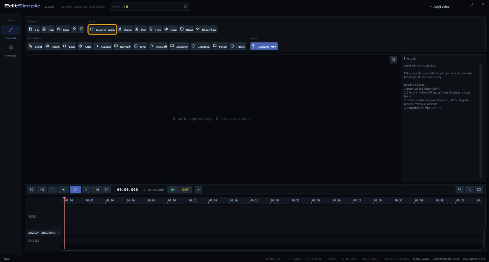

- **Shiriti i mjeteve**, në katër grupe: *Projekti* (i ri, hap, ruaj, zhbëj,
  ribëj), *Klipi* (importo video, audio, prit, fshi, kuadër i ngrirë, slajd,
  shpejtësi), *Mbivendosje* (tekst, imazh, logo, koha, kuadrot, kornizë, oval,
  shigjetë, zmadhim drejtkëndor dhe oval, piksel drejtkëndor dhe oval) dhe
  *Dalja* (eksporto MP4). Çdo buton ka një këshillë me shkurtoren e vet.
- **Parapamja**, në qendër: tregon kuadrin te kursori me të gjitha
  efektet, saktësisht si në videon e eksportuar. Mbi të vizatohen dhe
  lëvizen efektet.
- **Vetitë**, djathtas: vlerat e elementit të zgjedhur (një klip, një efekt,
  një gjurmë audio).
- **Luajtja**: fillimi, -10 kuadro, kuadri i mëparshëm, luajtje mbrapsht,
  luajtje, kuadri tjetër, +10 kuadro, fundi; koha e kursorit (mund të
  shkruhet); IN, OUT dhe fshirja e shenjave; djathtas zmadhimi i vijës
  kohore.
- **Vija kohore**, poshtë: vizorja, gjurma **Video** si shirit filmi,
  **Audioja origjinale**, gjurmët audio të shtuara dhe **Efektet**.

## 4. Faqja Konfiguro

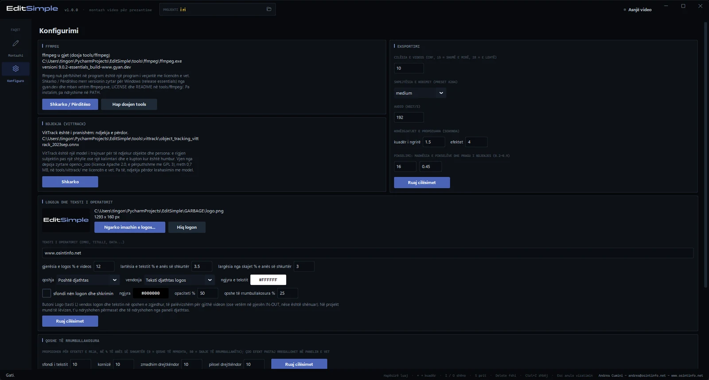

Hapet nga shiriti në të majtë. Përmban:

- **FFmpeg** dhe **Ndjekja (VitTrack)**: gjendja, shkarkimi dhe përditësimi.
- **Eksportimi**: cilësia e videos (CRF: 15 shumë e mirë, 28 e lehtë),
  shpejtësia e kodimit, cilësia e audios, kohëzgjatjet e propozuara për
  kuadrin e ngrirë dhe efektet, madhësia e paracaktuar e pikselëve dhe pragu
  i ndjekjes (më i lartë = më i rreptë në njohjen e subjektit).
- **Logoja dhe teksti i operatorit**: imazhi i logos (PNG me tejdukshmëri ose
  JPG), teksti (emri, institucioni, faqja e internetit), gjerësia e logos,
  lartësia e tekstit, largësia nga skajet, qoshja, vendosja, ngjyrat dhe një
  sfond me opacitet dhe qoshe të rrumbullakosura. Përgatiten një herë; pastaj
  butoni **Logo** i vendos në video.

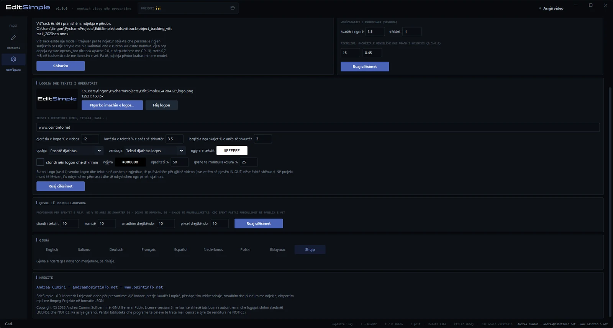

- **Qoshe të rrumbullakosura** për sfondin e teksteve, kornizat, zmadhimin
  drejtkëndor dhe pikselimin drejtkëndor.
- **Gjuha** e ndërfaqes: English, Italiano, Deutsch, Français, Español,
  Nederlands, Polski, Ελληνικά, Shqip. Ndryshimi është i menjëhershëm.

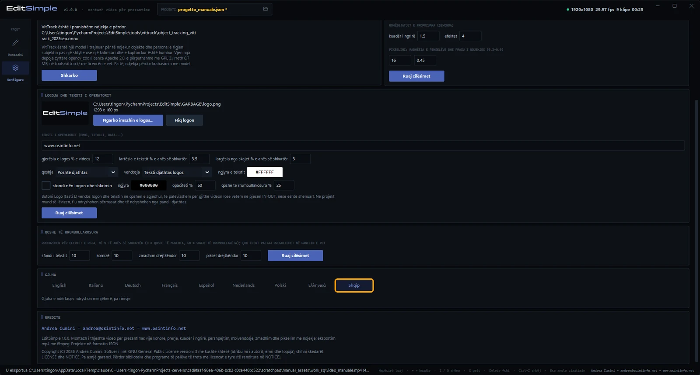

## 5. Një shembull i plotë, hap pas hapi

Shembulli i këtij kapitulli është një video 19 sekondash e xhiruar në një
rrugë këmbësorësh plot njerëz (shihni shënimin në fillim: kalimtarët nuk po
bëjnë asgjë të keqe). Me pak hapa e pasurojmë: logoja dhe faqja e operatorit
poshtë, një zmadhim mbi duart e një burri që ndjek lëvizjet e tij, një
shigjetë që tregon një person për 12 sekonda, dy korniza mbi persona të tjerë
dhe pikselimi i një fytyre në fund.

### 5.1 Importimi i videos

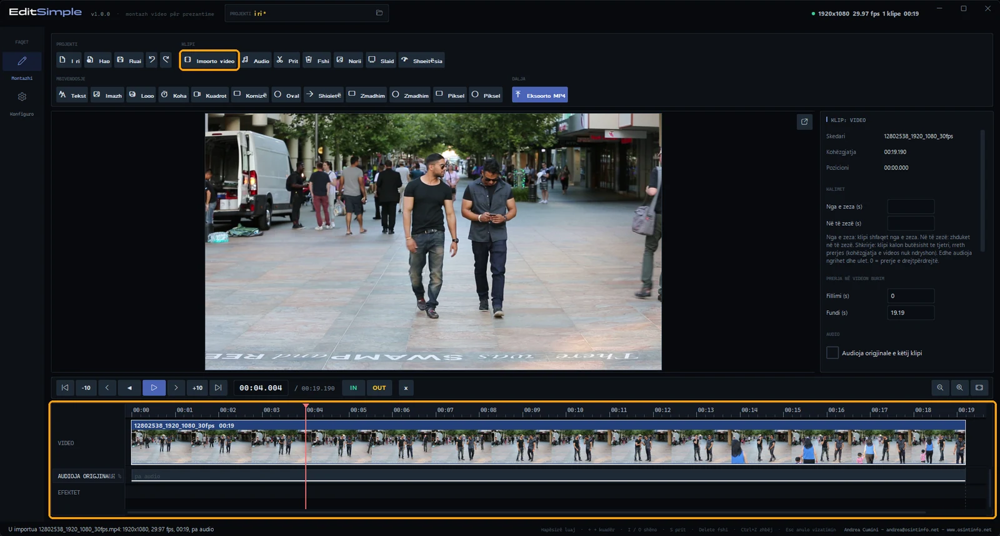

**Importo video** (Ctrl+I) hap filmimin. Videoja e parë përcakton përmasat dhe
shpeshtësinë e projektit (këtu 1920×1080, 29,97 kuadro në sekondë). Klipi
shfaqet në gjurmën Video si një shirit filmi me kuadro; audioja e tij në
gjurmën Audioja origjinale (kjo video nuk ka audio). Video të tjera shtohen
në fund ose te kursori.

Kursori lëviz me një klik mbi vizore, me shigjetat ← → (një kuadër), Ctrl+← →
(dhjetë kuadro), Shift+← → (një sekondë), Home dhe End, ose duke shkruar
kohën në kutinë përkatëse. **Hapësirë** luan me zë, **Shift+Hapësirë** luan
mbrapsht.

### 5.2 Logoja dhe firma e operatorit

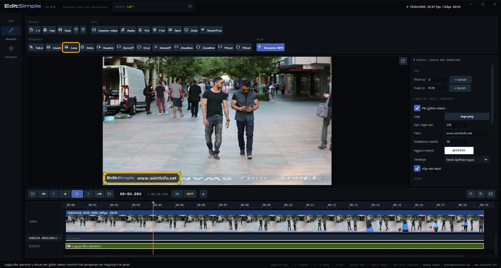

**Logo** (L) vendos logon dhe tekstin e përgatitur te Konfiguro për gjithë
videon (ose vetëm midis IN dhe OUT, nëse janë shënuar). Në parapamjen
lëvizen duke i zvarritur dhe zmadhohen nga qoshet; në panel ndryshohen
teksti, ngjyrat, sfondi, qoshja dhe opaciteti.

### 5.3 Një zmadhim që ndjek duart

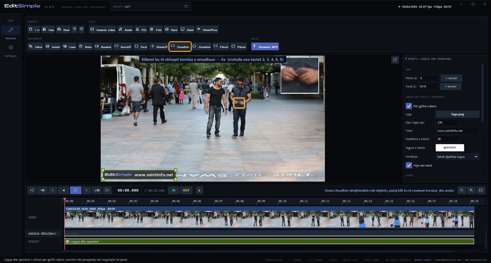

**Zmadhim** (Z) përdoret në dy hapa:

1. zvarritni një drejtkëndësh rreth detajit (këtu duart e burrit);
2. nën miun shfaqet korniza e zmadhuar me përmbajtjen e vërtetë: një klik e
   vendos. Zmadhimi zgjidhet në atë moment me rrotullën ose me tastet 2, 3, 4,
   6, 8 (deri në 16x nga paneli).

Zmadhimi **fillon menjëherë të ndjekë objektin**: një dritare tregon
ecurinë e ndjekjes.

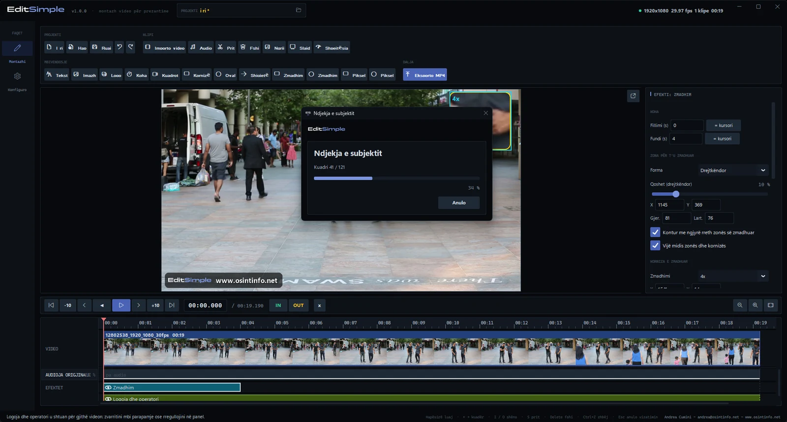

Zona e zmadhuar ndjek duart dhe rritet ose zvogëlohet kur burri afrohet ose
largohet; korniza e zmadhuar mbetet aty ku e vendosëm. Një kontur me ngjyrë
shënon objektin dhe një vijë e lidh me kornizën. Shift+Z krijon një zmadhim
oval.

### 5.4 Një shigjetë që ndjek një person

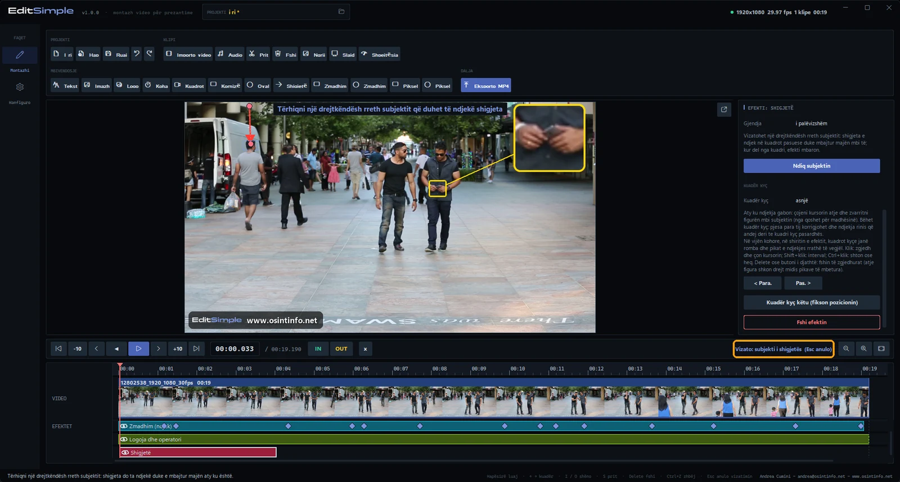

**Shigjetë** (A): zvarritni nga bishti te maja. Që të ndjekë një person,
shtypni **Ndiq subjektin** në panel (ose *Përsërit ndjekjen nga kursori*)
dhe vizatoni një **drejtkëndësh rreth subjektit**: shigjeta e ndjek duke
mbajtur majën mbi të.

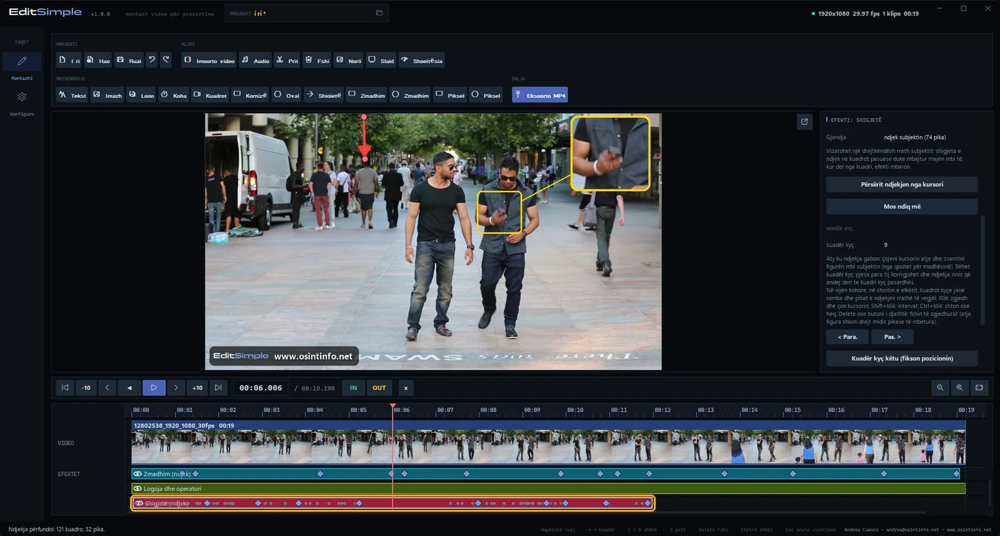

Në vijën kohore shiriti i shigjetës tregon *(ndjek)* dhe rombet e kuadrove
kyçe me të cilat kemi korrigjuar shtegun (shihni kapitullin 6).

### 5.5 Korniza mbi personat

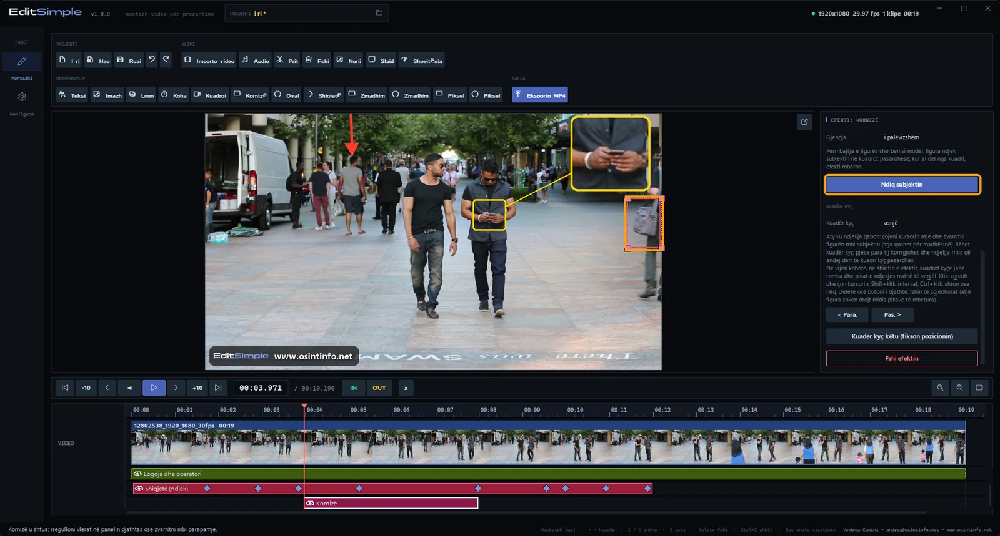

**Kornizë** (R) dhe **Oval** (E): zvarriten mbi parapamjen. Në panel
zgjidhen ngjyra, trashësia, mbushja, qoshet e rrumbullakosura dhe opaciteti;
**Ndiq subjektin** i bën të ndjekin atë që përmbajnë. Kur personi del nga
kuadri, figura e shoqëron jashtë dhe efekti mbaron.

### 5.6 Pikselimi i një fytyre

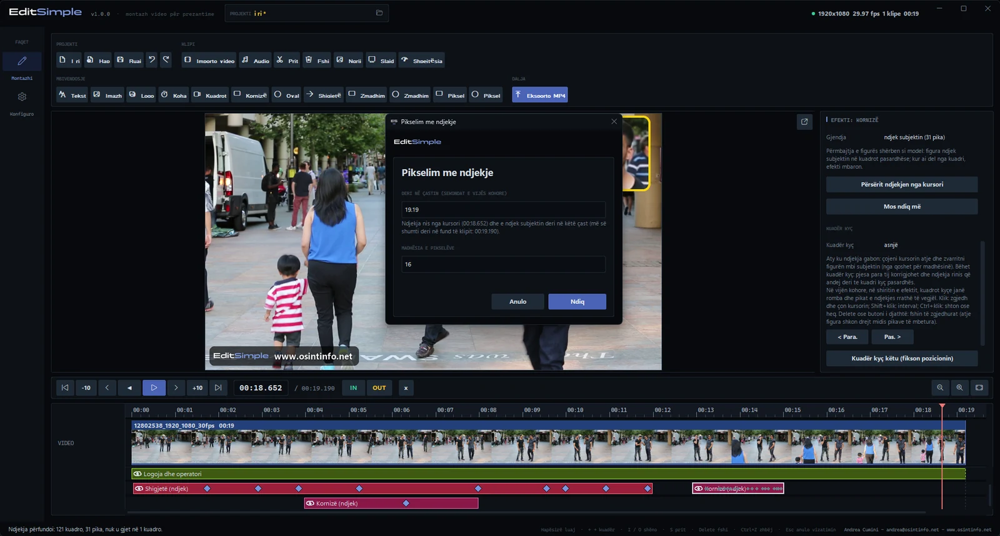

**Piksel** (P drejtkëndor, K oval): zvarritni një kornizë mbi fytyrë; një
dritare pyet deri kur të ndiqet dhe për madhësinë e pikselëve.

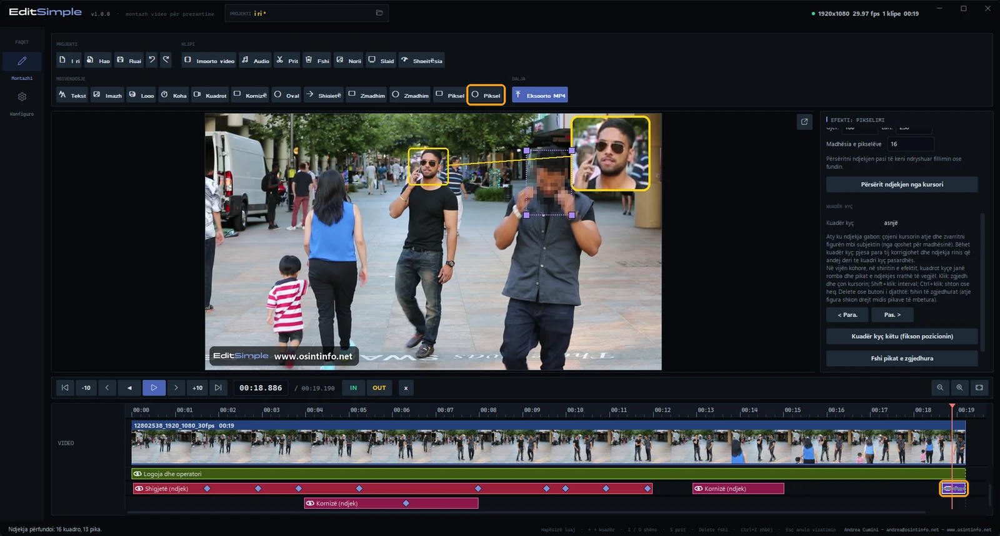

Pikselimi ndjek fytyrën dhe **rritet kur ajo afrohet** te kamera, kështu që e
mbulon gjithmonë. Nëse subjekti del nga kuadri, pikselimi e shoqëron derisa
të ketë dalë plotësisht: asnjë kuadër nuk mbetet i pambuluar.

## 6. Korrigjimi i ndjekjes me kuadrot kyçe

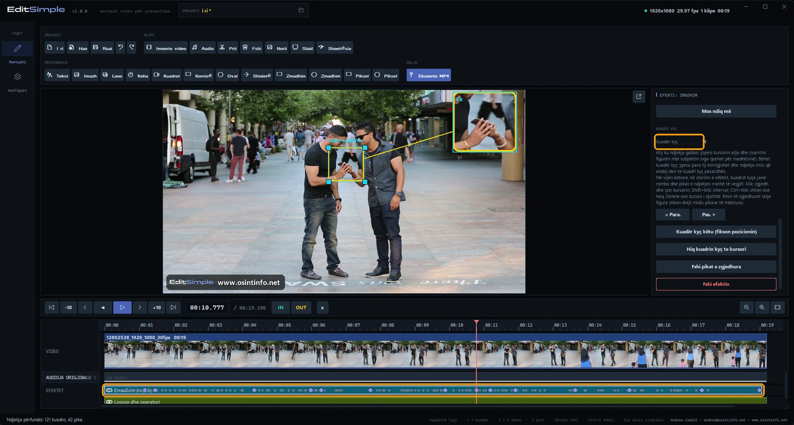

Ndjekja është automatike, por një video e vërtetë ka pengesa: një shtyllë, një
person që kalon përpara, një subjekt që kthehet. Aty ku figura gabon:

1. çojeni kursorin në atë kuadër;
2. **zvarritni figurën mbi subjektin** në parapamjen (ose ndryshojini
   përmasat nga qoshet).

Krijohet një **kuadër kyç** (një romb në shiritin e efektit). Programi
korrigjon shtegun para kuadrit kyç, në mënyrë graduale, dhe **e rinis
ndjekjen që andej** deri te kuadri kyç pasardhës. Mund të vendosni sa kuadro
kyçe të nevojiten: zmadhimi i shembullit ka 14, shigjeta 9.

Në shiritin e efektit të zgjedhur shihen edhe pikat e gjetura nga ndjekja
(rrathë të vegjël). Një klik zgjedh një pikë dhe çon kursorin atje,
Shift+klik zgjedh një interval, Ctrl+klik shton ose heq; **Delete** ose
butoni i djathtë fshijnë pikat e zgjedhura. Në panel, seksioni **Kuadër kyç**
ka butonat *< Para.* dhe *Pas. >*, *Kuadër kyç këtu* (fikson pozicionin
aktual) dhe *Hiq kuadrin kyç te kursori*.

## 7. Vija kohore

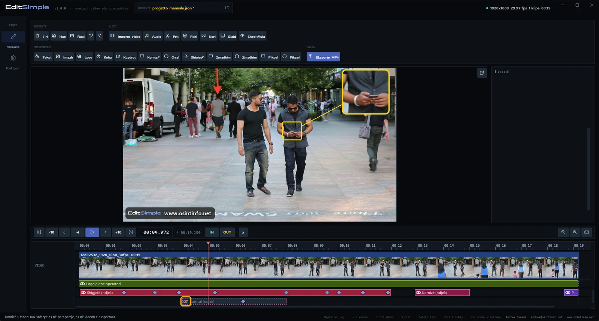

- **Shiritat e efekteve**: lëvizen duke i zvarritur; skaji i djathtë
  ndryshon kohëzgjatjen. Efektet vendosen në disa korsi; me shumë efekte
  pjesa e audios dhe e efekteve **rrëshqet vertikalisht** (shiriti djathtas,
  rrotulla mbi emrat e rreshtave ose Shift+rrotull), ndërsa vizorja dhe
  videoja mbeten të palëvizshme lart.
- **Syri**: ikona në të majtë të çdo shiriti **fsheh ose shfaq** efektin, në
  parapamjen dhe në videon e eksportuar. E dobishme kur shumë efekte
  mbivendosen gjatë punës.
- **Butoni i djathtë mbi një shirit**: *Zgjat deri te kursori* (nëse kursori
  është përtej fundit; nëse efekti ndjek një subjekt, ndjekja vazhdon) dhe
  *Ndalo te kursori* (nëse kursori është brenda efektit).
- **Zmadhimi i vijës kohore**: Ctrl+rrotull, ose butonat − + dhe *Përshtat*.
  Nga afër shiriti i filmit tregon çdo kuadër të veçantë.
- **Rrëshqitja**: rrotulla, Alt+zvarritje ose zvarritje me butonin e mesit.
- **Ndarësi**: rripi i hollë mbi komandat e luajtjes zvarritet lart ose poshtë
  për t'i dhënë më shumë hapësirë vijës kohore ose parapamjes.

## 8. Parapamja: zmadhimi dhe shkëputja

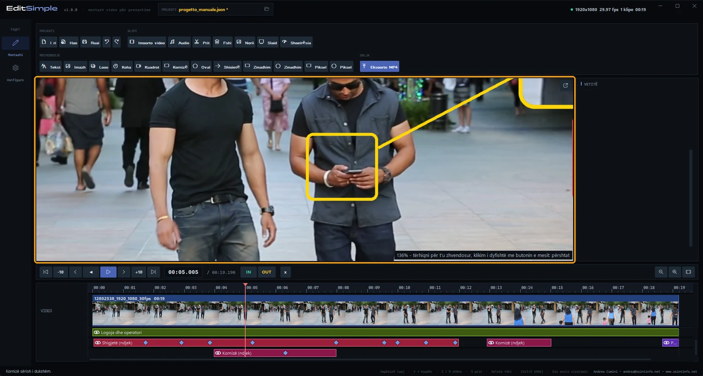

- **Ctrl+rrotull** mbi parapamjen e zmadhon rreth miut, deri në 16
  herë: për të vendosur me saktësi një zmadhim mbi një detaj të vogël ose për
  të kontrolluar një pikselim. Lëvizet duke zvarritur mbi një pikë bosh (ose
  me butonin e mesit); klik i dyfishtë me butonin e mesit kthen pamjen e
  plotë.
- **Shkëputja e parapamjes**: butoni lart djathtas i parapamjes e
  hap atë në një **dritare më vete**, për ta vendosur në një monitor të dytë
  ose ku të doni; vija kohore merr gjithë hapësirën. I njëjti buton (ose
  mbyllja e dritares) e **ribashkon**. Shkurtoret funksionojnë edhe në
  dritaren e shkëputur.

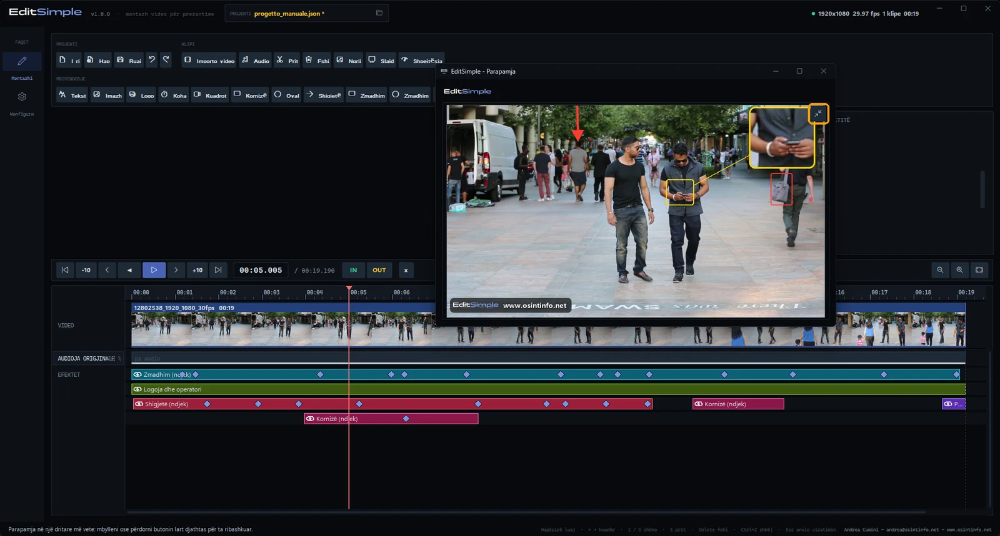

## 9. Slajdet e hapjes, të mbylljes dhe në mes

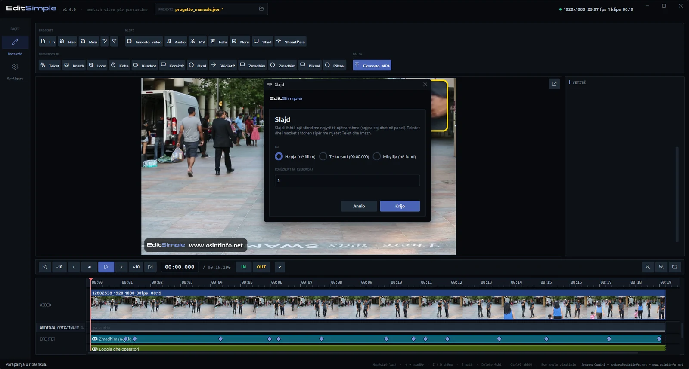

**Slajd** fut një slajd **në fillim** (hapja), **te kursori** (në mes të
videos) ose **në fund** (mbyllja), me kohëzgjatjen e zgjedhur. Slajdi është
një sfond me ngjyrë të njëtrajtshme ose një **imazh sfondi** i përshtatur me
përmasat e videos (mbush, e plotë ose shtrij); ngjyra dhe imazhi zgjidhen në
panel. Efektet që vijojnë zhvendosen përpara bashkë me videon.

Mbi slajd shkruhen tekste dhe vendosen imazhe me mjetet **Tekst** dhe
**Imazh**: me kursorin mbi slajd zgjasin sa ai.

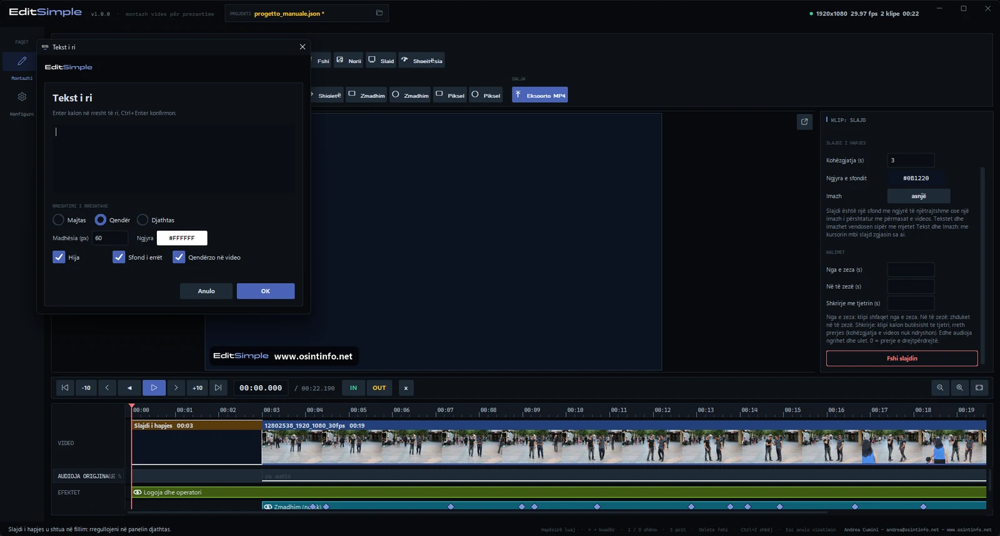

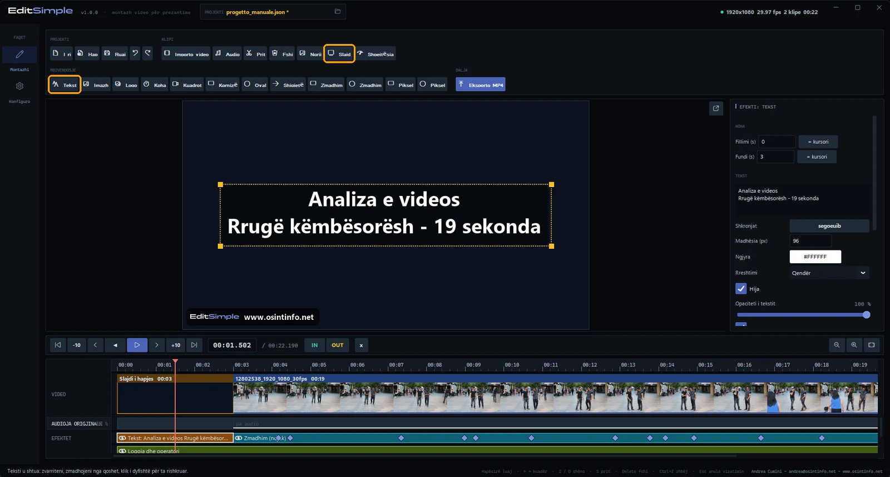

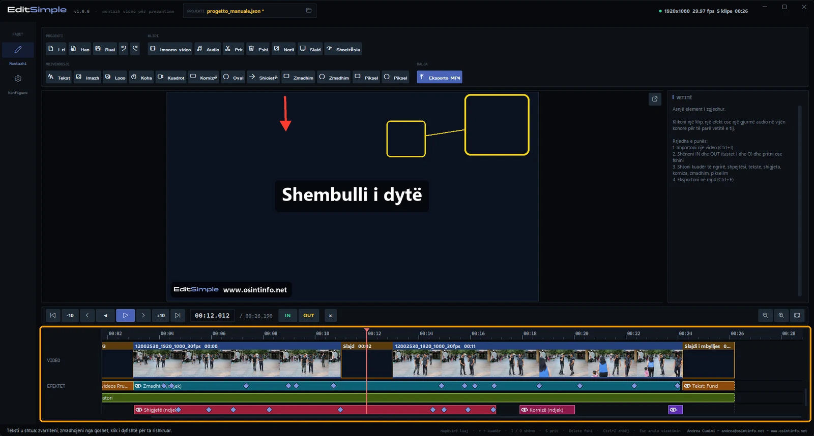

## 10. Tekste, imazhe, koha e kaluar dhe numri i kuadrit

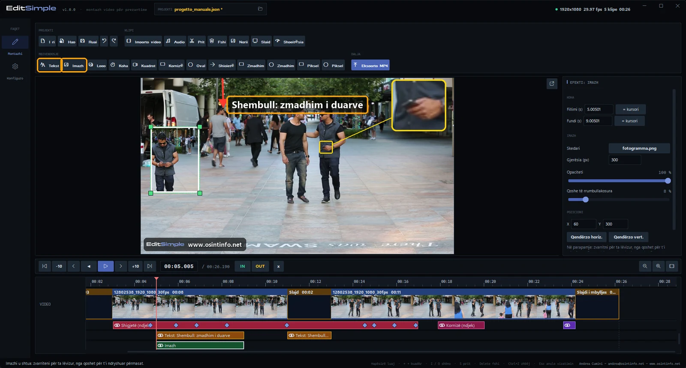

- **Tekst** (T): një klik mbi parapamjen hap dritaren e tekstit: disa
  rreshta, rreshtim, madhësi, ngjyrë, hije, sfond (me opacitet dhe qoshe të
  rrumbullakosura), qendërzim. Klik i dyfishtë mbi një tekst për ta
  rishkruar. Në panel edhe shkronjat, të zgjedhura nga një listë që tregon
  secilin lloj shkronjash.
- **Imazh**: zgjedh një skedar (PNG, JPG...) dhe e vendos në qendër; lëvizet
  dhe i ndryshohen përmasat mbi parapamjen; në panel opaciteti dhe
  qoshet e rrumbullakosura. Këtu është një kuadër i zmadhuar i subjektit, por
  mund të jetë një hartë, një dokument, një fotografi.

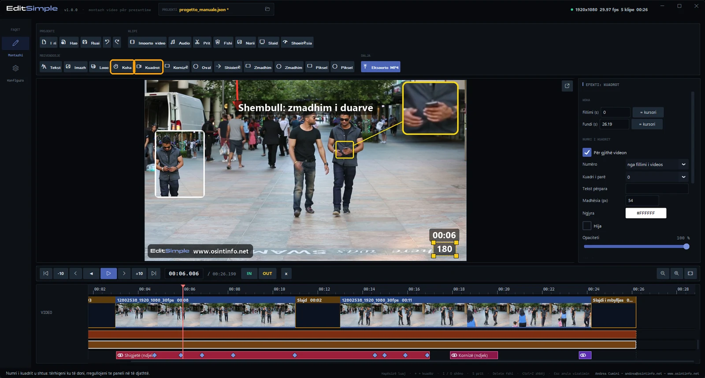

- **Koha**: koha e kaluar (01:23, 00:01:23 ose me të dhjetat), nga fillimi i
  videos ose nga fillimi i efektit, me një tekst përpara sipas dëshirës. Pas
  një ore shfaqen edhe orët.
- **Kuadrot**: numri i kuadrit, nga 0 ose nga 1, nga fillimi i videos ose i
  efektit. I dobishëm për të cituar me saktësi një çast.

Të dyja kanë sfond, opacitet dhe qoshe të rrumbullakosura, dhe vendosen ku të
doni me një klik.

## 11. Përshpejtimi dhe ngadalësimi

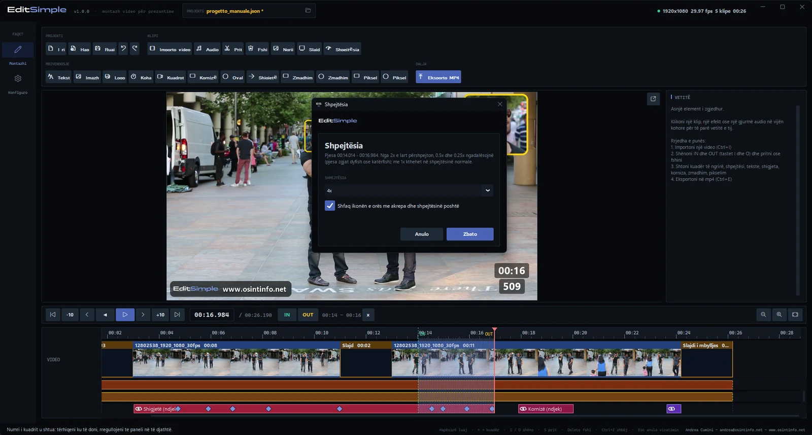

Shënoni një pjesë me **IN** dhe **OUT** (tastet I dhe O) dhe shtypni
**Shpejtësia** (V). Nga **2x deri në 32x** videoja përshpejtohet; **0,5x dhe
0,25x** e ngadalësojnë. Opsioni i **orës** shfaq një ikonë me akrepa që
rrotullohen dhe shpejtësinë të shkruar poshtë, kështu që ai që shikon e di se
koha rrjedh më shpejt. Vija kohore shkurtohet ose zgjatet; me 1x kthehet
shpejtësia normale. Pozicioni, madhësia dhe ngjyra e orës rregullohen në
panelin e klipit.

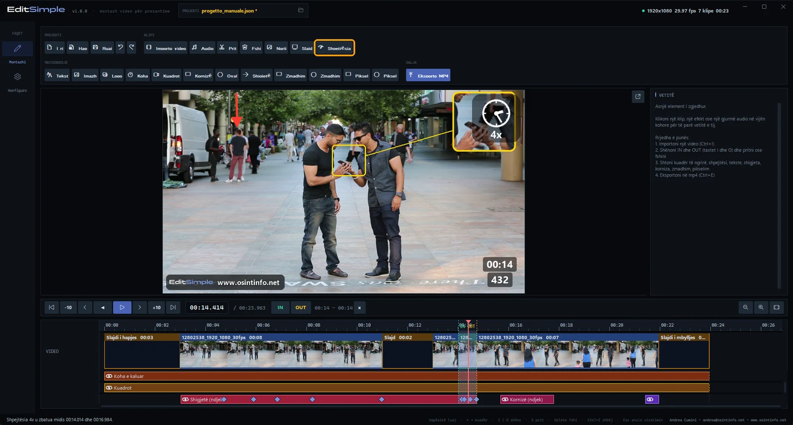

## 12. Prerja, fshirja, kuadri i ngrirë

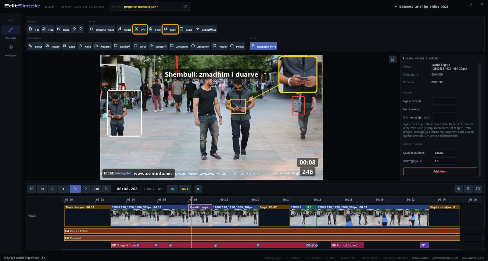

- **Prit** (S) e ndan klipin te kursori. Klipet **rirenditen duke i
  zvarritur** në vijën kohore.
- **Fshi** (Delete) heq pjesën midis IN dhe OUT, ose elementin e zgjedhur: ajo
  që vijon zhvendoset prapa, bashkë me efektet.
- **Ngrij** (F): kuadri te kursori mbetet i ngrirë për sekondat e zgjedhura;
  ajo që vijon zhvendoset përpara.

Gjithçka zhbëhet me Ctrl+Z dhe ribëhet me Ctrl+Y.

## 13. Kalimet

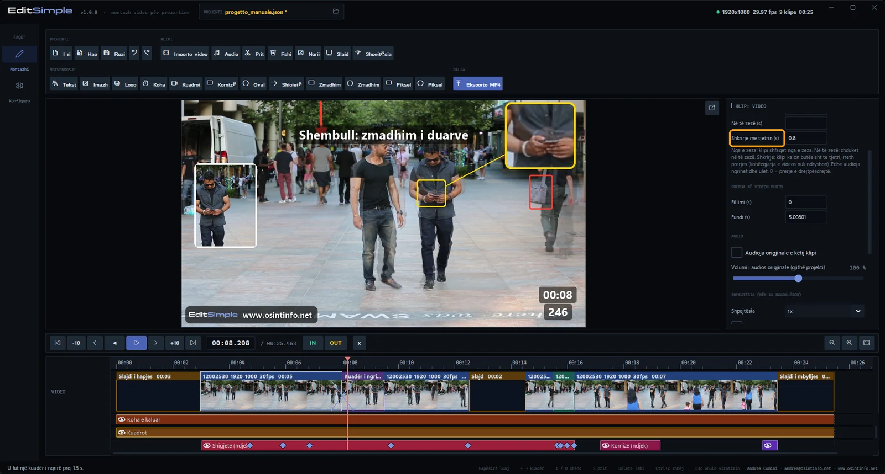

Kur zgjidhni një klip, paneli ka seksionin **Kalimet**:

- **Nga e zeza**: klipi shfaqet nga e zeza;
- **Në të zezë**: klipi zhduket në të zezë;
- **Shkrirje me tjetrin**: klipi kalon butësisht te klipi tjetër, rreth
  prerjes. Klipi që del mbetet i ngrirë gjatë shkrirjes; kohëzgjatja e
  videos nuk ndryshon.

Edhe audioja ngrihet dhe ulet me kalimet. 0 do të thotë prerje e
drejtpërdrejtë.

## 14. Audio

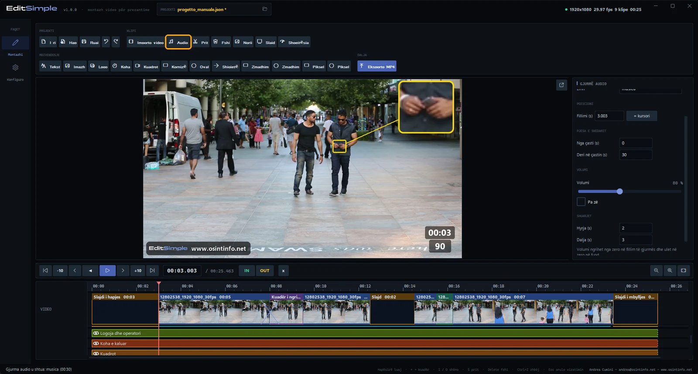

- **Audio** shton një gjurmë (koment, muzikë) te kursori. Në panel: emri,
  pozicioni, pjesa e skedarit, **volumi**, pa zë dhe **shuarjet** në hyrje
  dhe në dalje. Lëvizet duke e zvarritur; një klik mbi emrin e saj e zgjedh
  të tërën, Delete e fshin.
- **Vija e bardhë** mbi çdo gjurmë tregon ecurinë e volumit: shuarjet dhe
  kalimet shihen me një shikim.
- **Audioja origjinale**: një klik mbi emrin e rreshtit zgjedh gjithë audion
  e videos (volum, shuarje në fillim dhe në fund, fshirje); një klik mbi një
  pjesë zgjedh vetëm atë pjesë (volum, shuarje, pa zë). Me IN dhe OUT të
  shënuar dhe audion origjinale të zgjedhur, Delete heq **vetëm audion** e
  asaj pjese: videoja mbetet.
- Luajtja në parapamjen është **me zë** (i përzier si në eksportim).

## 15. Eksportimi i videos

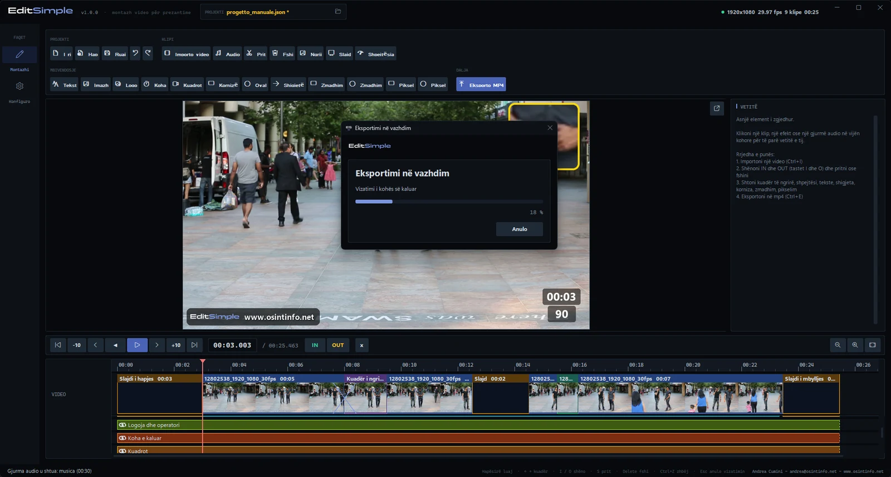

**Eksporto MP4** (Ctrl+E) zgjedh skedarin dhe krijon videon me ffmpeg: H.264
dhe AAC, cilësia dhe shpejtësia e kodimit te Konfiguro. Rezultati është
identik me parapamjen. Eksportimi mund të anulohet; në fund programi
propozon të hapet dosja.

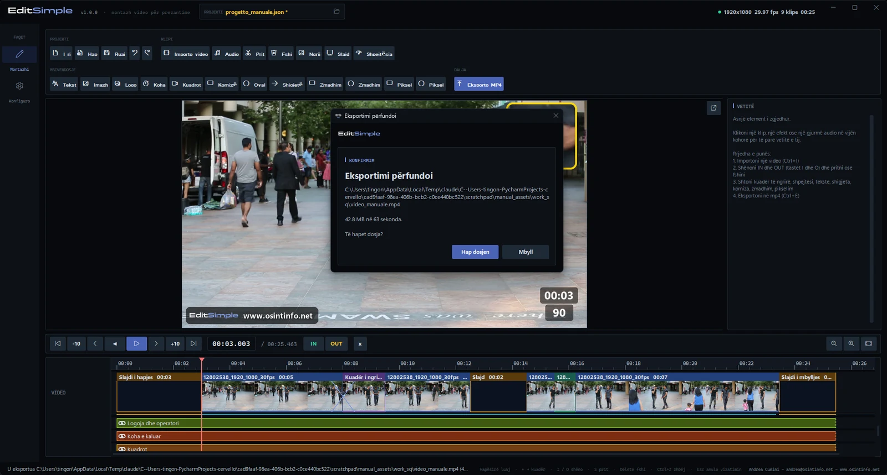

## 16. Këshilla për një rezultat të mirë

- **Korniza e zmadhimit shkon në një zonë neutrale**: korniza e zmadhuar
  mbulon pjesën e videos mbi të cilën është vendosur, gjatë gjithë kohës që
  shfaqet. Vendoseni aty ku nuk ndodh asgjë interesante (qiell, mur, dysheme).
- **Vizatojeni ngushtë subjektin** për korniza, ovale dhe pikselime:
  përmbajtja e figurës është modeli që kërkohet në kuadrot pasardhëse.
- **Për shigjetën, një drejtkëndësh pak më i madh** (koka dhe supet në vend
  të vetëm kokës) qëndron më mirë kur persona të tjerë kalojnë përpara.
- **Pas ndjekjes, shfletoni videon**: aty ku figura gabon, zvarriteni mbi
  subjekt. Pak kuadro kyçe mjaftojnë edhe për shtigje të gjata.
- **Me shumë efekte**, përdorni syrin për të fshehur ato që nuk ju duhen në
  atë moment, dhe parapamjen të shkëputur për të pasur më shumë
  hapësirë në vijën kohore.
- **Ruani shpesh** (Ctrl+S): projekti është një skedar i vogël JSON që
  rihapet dhe ndryshohet kur të doni.

## 17. Shkurtoret e tastierës dhe të miut

| Tasti | Veprimi |
| --- | --- |
| Hapësirë / Shift+Hapësirë | Luaj ose ndalo / luaj mbrapsht |
| ← → | Një kuadër prapa / përpara |
| Ctrl+← → | Dhjetë kuadro prapa / përpara |
| Shift+← → | Një sekondë prapa / përpara |
| Home / End | Fillimi / fundi i videos |
| I / O | Shëno IN / OUT |
| S | Prit te kursori |
| F | Kuadër i ngrirë |
| V | Shpejtësia e pjesës IN-OUT |
| T / R / E / A | Tekst / kornizë / oval / shigjetë |
| Z / Shift+Z | Zmadhim drejtkëndor / oval |
| P / K | Pikselim drejtkëndor / oval |
| L | Logoja dhe operatori |
| Delete | Fshi përzgjedhjen (ose pjesën IN-OUT) |
| Esc | Anulo vizatimin në vazhdim |
| Ctrl+Z / Ctrl+Y | Zhbëj / ribëj |
| Ctrl+N / Ctrl+O / Ctrl+S / Ctrl+Shift+S | I ri / hap / ruaj / ruaj si |
| Ctrl+I | Importo video |
| Ctrl+E | Eksporto MP4 |

| Miu | Ku | Veprimi |
| --- | --- | --- |
| Rrotulla | Parapamja | Një kuadër përpara ose prapa |
| Ctrl+rrotull | Parapamja | Zmadhon pamjen |
| Zvarritje mbi një pikë bosh, butoni i mesit | Parapamja e zmadhuar | Lëviz pamjen |
| Klik i dyfishtë | Tekst në parapamjen | Rishkruan tekstin |
| Ctrl+rrotull | Vija kohore | Zmadhon vijën kohore |
| Rrotulla / Alt+zvarritje / butoni i mesit | Vija kohore | Rrëshqet horizontalisht |
| Shift+rrotull, rrotulla mbi emrat | Vija kohore | Rrëshqet audion dhe efektet vertikalisht |
| Butoni i djathtë | Shiriti i një efekti | Zgjat deri te kursori / ndalo te kursori |
| Butoni i djathtë | Kuadër kyç ose pikë | Fshin |

## 18. Skedari i projektit

Projekti është një skedar JSON me klipet, gjurmët audio, efektet (me shtigjet
e ndjekjes dhe kuadrot kyçe) dhe shtigjet e skedarëve të përdorur. Videot,
audiot dhe imazhet nuk kopjohen në projekt: lërini aty ku janë derisa puna të
ketë mbaruar. Videoja e eksportuar, përkundrazi, është një MP4 i pavarur.

---

EditSimple është softuer i lirë, i shpërndarë me licencën GNU GPL versioni 3
me kushte shtesë për atribuimin e autorit (shihni `LICENSE` dhe `NOTICE`).
ffmpeg dhe VitTrack janë programe të veçanta me licencat e tyre.
